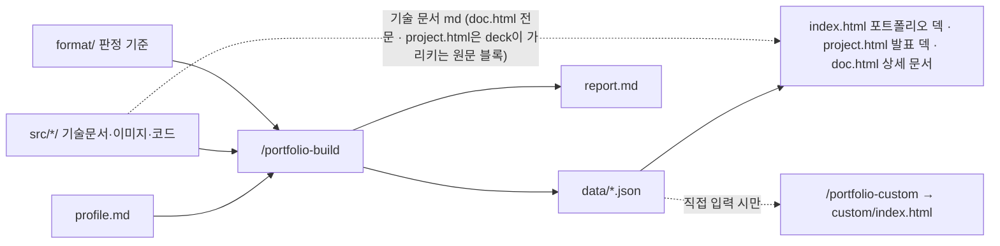

# CLAUDE.md — 포트폴리오 자동 작성 템플릿

이 레포는 **수강생의 원천 소스(기술 문서·스크린샷·소스코드)를 조합해 포트폴리오 웹페이지를 만드는 템플릿**입니다.
기준은 「유니티 개발자 취업·기술 문서 작성 가이드 v2」(https://koohoo-dev.github.io/portfolio-guide/)이며,
그 판정 기준 압축본이 `format/`에 있습니다.

사용자는 **유니티(C#) 개발 지망 수강생**입니다. 정돈된 **경어체**로, 쉬운 말로 설명합니다.

---

## 폴더 규약

```
├── profile.md               # ✍ 수강생이 직접 씀 — 이름·연락처·자기소개·페이지 설정
├── src/<NN-프로젝트>/        # ✍ 수강생의 원천 소스 (입력)
│   ├── 기술문서.md           #    기술 문서 (폴더 안의 .md 하나. README.md여도 됨)
│   ├── images/              #    스크린샷·GIF
│   ├── code/                #    (선택) 핵심 소스코드 .cs
│   └── _intake/             #    (/portfolio-intake) 재료집·촬영목록 — 기술 문서가 아님, git 제외, build·check가 읽지 않음
├── format/                  # 📏 가이드 판정 기준 (읽기 전용)
├── data/                    # 🤖 /portfolio-build가 생성 (portfolio.json, projects/*.json)
├── index.html               # 🖥 고정 렌더러 — 포트폴리오 덱 (16:9 슬라이드, 제출 PDF)
├── project.html             # 🖥 고정 렌더러 — 발표 덱 (?p=<폴더 이름>, data/의 deck이 가리키는 기술 문서 원문 블록을 그대로 그림)
├── doc.html                 # 🖥 고정 렌더러 — 상세 기술문서 (?p=<폴더 이름>, src/의 기술 문서 md를 직접 읽음)
├── assets/                  # 🖥 렌더러 CSS·JS (덱 키트·장면 키트·상세 문서·md-blocks.js = 기술 문서 md 해석과 원문 블록 찾기, 발표 덱·상세 문서 공용)
├── custom/                  # 🎨 /portfolio-custom 결과 (직접 생성 모드)
├── report.md                # 📋 점검 리포트 (git 제외, 로컬 전용)
└── report-intake.md         # 📋 /portfolio-intake 리포트 (git 제외 — 비밀값 위치·작성자 정보)
```

- `src/` 아래에서 이름이 `_`로 시작하는 폴더는 무시합니다(초안·보관용).
- 템플릿에는 샘플 프로젝트 4개(`00-example-crafting`, `0-Tidy-Mommy`, `1-action-platformer`, `2-Yggdrasil`)가 들어 있고,
  `data/`에는 그중 `00-example-crafting`을 뺀 3개의 빌드 결과가 들어 있습니다. 수강생 프로젝트가 생기면 샘플 폴더를 지우고 다시 빌드하라고 안내합니다
  (지운 프로젝트의 `data/projects/*.json`도 함께 정리). 샘플은 동의를 받은 선배 작품이므로 내용을 수강생 문서에 옮기지 않습니다.

## 데이터 흐름



## 명령 (스킬)

| 명령 | 하는 일 |
|---|---|
| `/portfolio-build [폴더]` | 소스를 읽어 `data/` 생성 + 점검 리포트 + 미리보기. 폴더를 주면 그 프로젝트만 |
| `/portfolio-check [폴더]` | 기술 문서를 가이드 기준으로 점검만 (데이터는 안 건드림) |
| `/portfolio-custom [디자인 요청]` | 직접 생성 모드. **사용자가 직접 입력했을 때만** 실행 |
| `/portfolio-intake <레포 주소\|폴더>` | GitHub 레포에서 핵심 `.cs`·재료집(사실 + 질문)·촬영 목록을 `src/<NN>/`에 만듦. 기술 문서는 만들지 않음. **사용자가 직접 입력했을 때만** 실행 |

---

## 반드시 지킬 원칙

1. **지어내지 않는다.** `data/`의 모든 값은 `profile.md`·기술 문서·코드에서 **찾을 수 있는 사실**이어야 합니다.
   요약·압축은 되지만 새로운 사실·수치·기술명·성과를 만들지 않습니다. 없으면 비워 두고 리포트에 적습니다.
2. **수강생 문서를 대신 고쳐 쓰지 않는다.** `src/`와 `profile.md`는 수강생의 것입니다. 점검 결과는 리포트로
   **문제와 방향**만 알려 주고, 수강생이 명시적으로 "고쳐 줘"라고 요청한 부분만 수정합니다.
   (가이드 원칙: *"이해 없이 복붙 금지"* — 기술 문서의 목적은 "내 코드를 설명할 줄 안다"를 보여주는 것)
3. **Claude가 요약한 문장은 표시한다.** 원문을 그대로 옮기지 않고 Claude가 압축한 문장(한 줄 소개, 기술 스택 근거 등)은
   리포트의 "확인해 주세요" 목록에 넣어 수강생이 직접 검토하게 합니다.
4. **고칠 곳은 소스다.** 페이지 내용이 틀리면 `data/`를 손으로 고치기보다 `src/`·`profile.md`를 고치고 다시 빌드하도록 안내합니다.
5. **렌더러는 건드리지 않는다.** `index.html`, `project.html`, `doc.html`, `assets/`는 사용자가 요청할 때만 수정합니다.
   디자인 변경 요청은 ① `profile.md`의 강조색 ② `/portfolio-custom` 순으로 안내합니다.
6. **경로는 상대경로, 대소문자 정확히.** GitHub Pages(리눅스)는 대소문자를 구분합니다.

## 판단 기준 (format/)

| 파일 | 언제 읽나 |
|---|---|
| `format/01-portfolio.md` | 요약·상세 페이지에 무엇이 들어가야 하는지, 체크리스트 |
| `format/02-tech-document.md` | 기술 문서 5단 구조 점검 |
| `format/03-diagrams.md` | 다이어그램 점검·제안 |
| `format/04-layout-patterns.md` | 렌더러 구성 / 직접 생성 모드의 레이아웃 |
| `format/05-custom-page-prompts.md` | 직접 생성 모드 규칙 |
| `format/06-deploy.md` | 배포 안내·문제 해결 |

## 미리보기

`fetch()`로 데이터를 읽으므로 파일 더블클릭(`file://`)으로는 열리지 않습니다. 로컬 서버로 엽니다.

- `python -m http.server 4600` (Windows에서 `python`이 없으면 `py -m http.server 4600`) → http://localhost:4600
- JetBrains IDE(Rider·WebStorm): `index.html` 우클릭 → **Open in → Browser** (내장 서버)
- Claude 데스크톱 앱: `.claude/launch.json`의 `portfolio` 구성으로 미리보기
- 덱 아래 띠의 빨간 숫자(미리보기 배치 점검)를 물으면 데이터를 다시 만들지 않고, 그 페이지(`index.html`·`project.html?p=<id>`)에서
  `await PFScene.whenReady()` 뒤 `PFScene.report().audit`을 읽어 `.claude/skills/portfolio-build/SKILL.md` §7-1처럼 장면마다 1건으로
  묶어 알려 줍니다. 브라우저 도구가 없으면 headless Chrome으로
  `chrome --headless=new --virtual-time-budget=30000 --dump-dom "http://localhost:4600/index.html?pf-audit=1"`
  (발표 덱은 `project.html?p=<id>&pf-audit=1`)을 실행해 `#pf-audit`의 base64 JSON(= `report()`)을 읽고, `ready`가 `yes`인지 확인합니다.
  발표 덱의 빨간 띠(원문 블록을 찾지 못함·여러 곳·바뀜)도 `audit`에 함께 나오고, `info.mode`가 `auto`면 예전 데이터로 자동 구성된 덱이므로 `/portfolio-build`를 다시 실행하도록 안내합니다.
