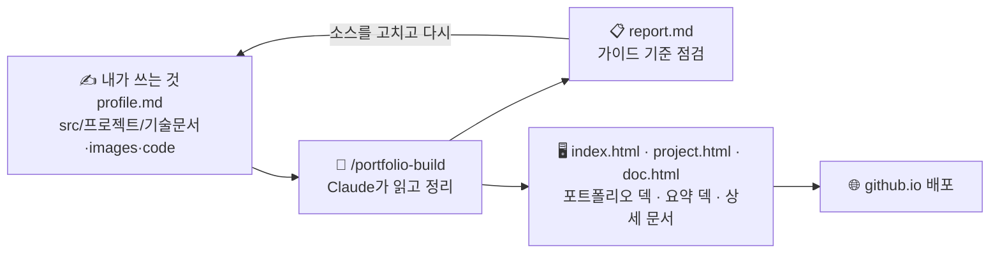

# 포트폴리오 자동 작성 템플릿 (Claude Code)

내 레포에 있는 **기술 문서 · 스크린샷 · 소스코드**를 Claude가 읽고 조합해서,
「[유니티 개발자 취업·기술 문서 작성 가이드 v2](https://koohoo-dev.github.io/portfolio-guide/)」 기준을 만족하는
**포트폴리오 웹페이지**(포트폴리오 덱 + 프로젝트 요약 덱 + 상세 기술문서)를 만들어 줍니다. 결과물은 GitHub Pages로 바로 배포됩니다.



> **이 템플릿이 대신 해 주지 않는 것**: 기술 문서를 *써 주는 것*. Claude는 여러분이 쓴 내용을 **정리·점검**할 뿐,
> 없는 사실을 지어내거나 문서를 고쳐 쓰지 않습니다. 기술 문서의 목적은 *"내 코드를 설명할 줄 안다"* 를 보여주는 것이니까요.

---

## 준비물

| 준비물 | 비고 |
|---|---|
| GitHub 계정 | 무료 플랜은 **공개 레포**에서만 Pages가 동작합니다 |
| [Claude Code](https://claude.com/claude-code) | 터미널(CLI) · 데스크톱 앱 · IDE 확장 어느 것이든 |
| Python 3 (선택) | 로컬 미리보기용. JetBrains IDE의 내장 서버로 대신해도 됩니다 |

## 사용법 (5단계)

### 1. 내 레포 만들기

아래 두 방법 중 하나를 고르세요. 어느 쪽이든 내 레포는 **공개(Public)여야** 무료 플랜에서 Pages가 동작합니다.

**방법 A. Fork (추천)**

1. 이 레포 오른쪽 위 **Fork → Create fork**를 누릅니다. "Copy the `main` branch only"는 체크된 그대로 둡니다.
2. 레포 이름은 바꿔도 됩니다(예: `portfolio`). 영문 소문자·숫자·하이픈을 권합니다.
3. 내 레포 화면의 **Code → HTTPS 주소**로 내 PC에 clone합니다.

나중에 템플릿이 업데이트되면, 내 레포 화면의 **Sync fork** 버튼으로 받아올 수 있습니다.
내가 고친 파일과 겹치면 충돌이 날 수 있으니, 받기 전에 커밋해 두세요.

**방법 B. 새 레포를 만들고 파일 복사**

1. GitHub에서 **New repository**로 빈 공개 레포를 만들고 내 PC에 clone합니다.
2. 이 레포에서 **Code → Download ZIP**으로 받아 압축을 풉니다.
3. 압축을 푼 폴더 안의 내용(숨김 파일 `.claude/`, `.gitignore`, `.nojekyll` 포함)을 **모두** 내 레포 폴더로 복사한 뒤 commit · push합니다.
   - 숨김 파일이 빠지면 Claude 명령(`/portfolio-build` 등)과 Pages 동작이 깨집니다. 탐색기에서 **보기 → 숨긴 항목**을 켜고 복사하세요.

> 유지관리자가 이 레포를 Template repository로 설정해 두었다면 **Use this template → Create a new repository**도 쓸 수 있습니다(방법 A와 비슷하지만 Sync fork는 없습니다).

### 2. 소스 넣기

```
src/
└── 1-my-game/              ← 프로젝트 하나 = 폴더 하나 (앞 번호로 순서 정렬)
    ├── 기술문서.md          ← 기술 문서 (5단 구조 권장 → format/02)
    ├── images/             ← 스크린샷·GIF (4~6장 권장)
    └── code/               ← (선택) 핵심 소스코드 .cs — 문서 코드와 실제 코드가 맞는지 점검에 씀
```

- 기술 문서 속 이미지는 ``처럼 **상대경로**로 쓰세요.
- `src/`에 들어 있는 **샘플 프로젝트 4개는 참고용**입니다. 내 프로젝트를 넣었다면 **모두 지우세요.**

  | 샘플 | 참고할 점 |
  |---|---|
  | `00-example-crafting/` | 가이드 관통 예제. 가장 짧은 **A형(단일 기능)** + `code/` 폴더 예시 |
  | `0-Tidy-Mommy/` | 선배 수강생 작품 — **B형(다기능)**, 고민과 선택 비교 표 |
  | `1-action-platformer/` | 선배 수강생 작품 — **B형**, 트러블슈팅·스크린샷 구성 |
  | `2-Yggdrasil/` | 선배 수강생 작품 — **C형(팀 프로젝트)**, 내 역할 분리 |

  > 선배 수강생 작품은 **작성자의 동의를 받아** 싣습니다. 구조와 서술 방식을 참고하되, 내용을 베끼지 마세요.
- 이름이 `_`로 시작하는 폴더(예: `src/_draft/`)는 무시됩니다.

### 3. `profile.md` 채우기

이름·연락처·자기소개·강조색·구성 방식(프로젝트 중심 / 기술 스택 중심)을 **직접** 씁니다. 구성 방식은 지금의 덱에는 아직 반영되지 않습니다(아래 「디자인 바꾸기」).

- 들어 있는 값(홍길동, `you@example.com` 등)은 **예시**입니다. 모두 내 정보로 바꾸세요.
- **프로젝트 순서**는 비워 두면 `src/` 폴더 이름 순서로 실립니다. 순서를 정하거나 일부만 싣고 싶을 때만 폴더 이름을 쉼표로 적으세요(예: `2-my-rpg, 1-my-game`).
- 이 레포는 공개라서 `profile.md`의 내용은 누구나 볼 수 있습니다. 전화번호·주소 같은 개인정보는 넣지 마세요.

### 4. Claude로 만들기

레포 폴더에서 Claude Code를 열고:

```text
/portfolio-build
```

Claude가 하는 일:

1. `src/`의 기술 문서를 끝까지 읽고 → 요약·핵심 구현·이슈 해결·스크린샷을 골라 `data/`에 정리
2. 가이드 기준으로 점검해 **`report.md`** 작성 (필수 / 권장 / 참고)
3. 미리보기를 띄워 깨진 이미지·링크 확인

그다음 **`report.md`를 꼭 읽으세요.** 특히 **"확인해 주세요"** 목록은 Claude가 요약한 문장이라, 내 의도와 맞는지 직접 확인해야 합니다.
틀린 곳은 `data/`가 아니라 **원본(`src/`, `profile.md`)을 고친 뒤** 다시 `/portfolio-build` 하세요.

| 명령 | 언제 |
|---|---|
| `/portfolio-build` | 처음 만들 때, 소스를 고친 뒤 |
| `/portfolio-build 1-my-game` | 프로젝트 하나만 다시 만들 때 |
| `/portfolio-check` | 기술 문서를 **쓰는 중에** 가이드 기준 피드백만 받고 싶을 때 |
| `/portfolio-custom 다크 톤으로…` | 고정 디자인 대신 **나만의 디자인**을 원할 때 (아래 참고) |

### 5. 배포

변경 사항을 commit · push → 레포 **Settings → Pages → Build and deployment → Source: Deploy from a branch → Branch: `main` / `(root)` → Save**.
1~2분 뒤 `https://<아이디>.github.io/<레포>/` 에서 열립니다. 자세한 내용과 문제 해결은 [format/06-deploy.md](format/06-deploy.md).

**5분이 지나도 404라면**

1. 레포의 **Actions** 탭에 "pages build and deployment"가 있는지 봅니다.
2. 없다면 설정만 저장되고 배포가 시작되지 않은 것입니다. 아무 파일이나 조금 고쳐 다시 commit · push하거나, 터미널에서 아래 두 줄을 실행하면 배포가 시작됩니다.

   ```bash
   git commit --allow-empty -m "Pages 배포 시작"
   ```

   ```bash
   git push
   ```

3. 그래도 안 되면 Source가 `GitHub Actions`나 다른 브랜치로 되어 있지 않은지, 레포가 공개(Public)인지 확인하세요.

배포 직후에는 브라우저가 예전 화면을 보여 줄 수 있습니다. 최대 10분 기다리거나 **Ctrl+F5**로 새로 고치세요.

> 기업 보안 정책상 외부 링크가 막힌 곳도 있습니다. 배포된 주소에서 덱의 **[PDF로 저장] 버튼**으로 PDF 사본도 준비하세요.
> 방법은 아래 [덱을 PDF로 저장하기](#덱을-pdf로-저장하기)를 보세요.

---

## 만들어지는 페이지

| 페이지 | 주소 | 무엇인가요 |
|---|---|---|
| 포트폴리오 덱 | `index.html` | 16:9 슬라이드. 표지 → 자기소개 → 기술 스택 → 프로젝트마다 2장(소개 · 핵심 요약) → 한눈에 보기 → 연락처. **제출용 PDF**가 되는 페이지입니다 |
| 프로젝트 요약 덱 | `project.html?p=폴더 이름` | 16:9 슬라이드. 표지 → 목차 → 스크린샷 → 핵심 구현 → 이슈 해결 → 회고 → 상세 문서로 |
| 상세 기술문서 | `doc.html?p=폴더 이름` | `src/`의 기술 문서 전문을 읽기 좋게 보여 주는 긴 문서. 넓은 화면에서는 목차가 옆에 붙고, 휴대폰에서는 한 단으로 보입니다 |

- 포트폴리오 덱 → 요약 덱 → 상세 문서 순서로 타고 들어갑니다. 요약 덱의 핵심 구현·이슈 해결 장면마다 **상세 문서에서 보기 ↗** 링크가 있어 그 절로 바로 갑니다.
- 다른 페이지나 외부 사이트로 가는 링크(↗ 표시)는 **새 탭**에서 열립니다. 같은 페이지 안의 이동(목차, 슬라이드 넘기기)은 지금 탭에서 움직입니다.

> **이력서·자기소개서 장면은 아직 없습니다.** 여러분이 직접 쓴 원천이 생기면 나중에 덱에 추가됩니다(작성 방법은 추후 안내).
> 그전까지 Claude가 대신 써 넣거나 빈 자리를 만들지 않습니다.

### 덱 넘기기

| 기기 | 방법 |
|---|---|
| 키보드 | `→` · `↓` · `Space` · `PageDown` 다음 / `←` · `↑` · `Shift+Space` · `PageUp` 이전 / `Home` · `End` 처음 · 끝 / `O` 개요 / `F` 전체 화면 |
| 마우스 · 트랙패드 | 휠을 한 번 굴리면(트랙패드를 한 번 밀면) 한 장 넘어갑니다. 아래 띠의 `‹` `›`나 슬라이드 바깥 여백을 눌러도 됩니다. 슬라이드 위를 누르는 것으로는 넘어가지 않습니다(글자를 고를 수 있게) |
| 휴대폰 · 태블릿 | 좌우로 밀기. 세로 화면에서는 위아래로 밀어도 됩니다(위로 밀면 다음). 슬라이드 왼쪽 30%를 탭하면 이전, 나머지를 탭하면 다음. 가로로 돌리면 더 크게 보입니다 |

아래 띠에는 지금 장 번호(`03 / 12`)·섹션 이름·진행 막대가 보이고, 이런 버튼이 있습니다.

- **개요**: 모든 슬라이드를 격자로 보고 골라서 이동합니다.
- **한 번에 보기**: 모든 슬라이드를 세로로 이어서 봅니다. `Ctrl+F` 찾기가 모든 장에 닿습니다. 고른 보기는 다음에 열 때도 유지됩니다.
- **PDF로 저장**: 아래 방법을 보세요.
- 주소창의 `#s=…`까지 복사하면 그 장면으로 바로 가는 링크가 됩니다.

휴대폰처럼 좁은 화면(폭 760px 이하)에서는 섹션 이름이 숨고(더 좁으면 진행 막대, `?`(PDF 저장 안내) 단추, PDF 버튼의 쪽 수도), 버튼이 ▦(개요) · 전체(한 번에 보기, 한 번에 보기 중에는 슬라이드) · PDF(PDF로 저장)로 짧게 보입니다. 화면 폭이 761px 이상이면(큰 휴대폰을 가로로 돌렸을 때 등) 원래 이름이 보입니다.

### 덱을 PDF로 저장하기

**Windows PC의 Chrome 또는 Edge**에서 저장하세요. Mac, 휴대폰·태블릿, Safari·Firefox는 지원 범위 밖입니다.

1. **배포된 주소**(`https://<아이디>.github.io/<레포>/`)에서 덱을 열고, 화면이 다 나타날 때까지 기다립니다.
2. 아래 띠의 **[PDF로 저장] 버튼**을 누릅니다(`Ctrl+P`도 됩니다).
3. **대상**을 **PDF로 저장**으로 고릅니다. "Microsoft Print to PDF"나 프린터가 골라져 있으면 A4로 바뀌고 날짜·주소가 찍힙니다.
4. **여백은 "기본" 그대로** 둡니다. Edge는 **시트당 페이지 수**도 1 그대로 둡니다. 용지 크기·배율 항목이 보이지 않는 것이 정상입니다.
5. 미리보기의 쪽 수가 버튼에 적힌 쪽 수와 같으면 저장합니다. 슬라이드 1장이 PDF 1쪽(16:9)이 됩니다.

- 포트폴리오 덱(`index.html`)과 프로젝트 요약 덱(`project.html`) 모두 같은 방법으로 저장합니다.
- 상세 기술문서(`doc.html`)도 `Ctrl+P`로 A4 문서처럼 인쇄할 수 있지만, 코드·그림이 쪽 사이에서 잘리지 않게 맞추는 정도입니다. PDF 모양을 보장하는 것은 덱뿐입니다.
- 미리보기(로컬 서버)에서 저장한 PDF는 링크가 내 컴퓨터 주소를 가리킵니다. 제출용은 꼭 배포된 주소에서 저장하세요.

---

## 미리보기

`data/`와 기술 문서를 불러와 그리는 방식이라 **파일 더블클릭으로는 열리지 않습니다.** 아래 중 하나로 여세요.

```bash
python -m http.server 4600
```

→ http://localhost:4600 (Windows에서 `python`이 없으면 `py -m http.server 4600`)

- JetBrains IDE(Rider·WebStorm): `index.html` 우클릭 → **Open in → Browser**
- 또는 Claude에게 "미리보기 띄워줘"

처음 열리는 것은 포트폴리오 덱(`index.html`)이고, 요약 덱·상세 문서는 덱 안의 링크로 열립니다.
미리보기에서 저장한 PDF는 링크가 내 컴퓨터 주소를 가리키므로 **제출용 PDF는 배포된 주소에서** 저장하세요.

- 슬라이드 아래쪽에 빨간 **내용이 잘렸습니다** 띠가 보이면 그 장면에 들어갈 글이 너무 긴 것입니다. 이 띠는 배포된 페이지와 PDF에도 그대로 나오니, 그 장면의 글이 나온 파일(표지·자기소개는 `profile.md`, 연락처 장면은 왼쪽 내 연락처가 `profile.md`·오른쪽 프로젝트 링크가 `src/`의 기술 문서, 그 밖의 장면은 `src/`의 기술 문서)에서 그 부분을 줄이고 `/portfolio-build`를 다시 실행하세요. 띠에 적힌 `원문:` 뒤 주소는 잘린 장면의 페이지 주소입니다.
- 미리보기에서만 아래 띠 오른쪽에 빨간 숫자가 뜰 수 있습니다. 장면 배치 점검에서 찾은 항목 수이고, 배포된 페이지와 PDF에는 나오지 않습니다. 숫자가 보이면 Claude에게 "미리보기 배치 점검 결과 알려 줘"라고 물어보세요.

## 디자인 바꾸기

| 원하는 것 | 방법 |
|---|---|
| 색만 바꾸기 | `profile.md`의 **강조색** → `/portfolio-build` (세 페이지 모두에 적용) |
| 구성 바꾸기 | `profile.md`의 **구성 방식**: `project`(프로젝트 중심) / `stack`(기술 스택 중심). **지금의 덱에는 아직 반영되지 않습니다.** 덱의 장면 순서는 위 「만들어지는 페이지」대로 고정입니다 |
| 완전히 새 디자인 | `/portfolio-custom [디자인 요청]` → `custom/index.html` 생성. 같은 데이터를 쓰므로 내용은 그대로, 겉모습만 달라집니다. 실행마다 결과가 달라지니 **직접 확인**하세요. ([format/05](format/05-custom-page-prompts.md)) |

---

## 폴더 구조

```
├── profile.md            ✍ 내 정보 (직접 작성)
├── src/                  ✍ 프로젝트 소스 (직접 작성)
├── format/               📏 가이드 판정 기준 — Claude가 점검할 때 읽는 기준표 (사람이 읽어도 좋습니다)
├── data/                 🤖 /portfolio-build가 생성 (직접 고치지 않기)
├── index.html            🖥 포트폴리오 덱 (16:9 슬라이드, 제출용 PDF)
├── project.html          🖥 프로젝트 요약 덱 (?p=폴더 이름)
├── doc.html              🖥 상세 기술문서 (?p=폴더 이름)
├── assets/               🖥 세 페이지의 스타일·스크립트
├── custom/               🎨 /portfolio-custom 결과 (선택)
├── .claude/skills/       ⚙ Claude 명령 정의 (portfolio-build · check · custom)
├── CLAUDE.md             ⚙ Claude가 지키는 규칙
└── report.md             📋 점검 리포트 (git에 올라가지 않음)
```

## 원칙

- **이해 없이 복붙 금지.** Claude가 정리한 문장도 내가 이해·검증한 뒤에 씁니다.
- **고칠 곳은 소스.** 페이지가 마음에 안 들면 `src/`·`profile.md`를 고치고 다시 빌드합니다.
- **법칙이 아닙니다.** `format/`의 기준은 목적(잘 읽히는 문서로 역량 증명)을 위한 수단입니다.

---

기준 가이드: 「유니티 개발자 취업·기술 문서 작성 가이드 v2」 — 김재훈 (Jay / KooHoo) · https://koohoo-dev.github.io/portfolio-guide/
