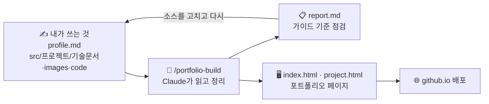

# 포트폴리오 자동 작성 템플릿 (Claude Code)

내 레포에 있는 **기술 문서 · 스크린샷 · 소스코드**를 Claude가 읽고 조합해서,
「[유니티 개발자 취업·기술 문서 작성 가이드 v2](https://koohoo-dev.github.io/portfolio-guide/)」 기준을 만족하는
**포트폴리오 웹페이지**(요약 랜딩 + 프로젝트 상세)를 만들어 줍니다. 결과물은 GitHub Pages로 바로 배포됩니다.



> **이 템플릿이 대신 해 주지 않는 것**: 기술 문서를 *써 주는 것*. Claude는 여러분이 쓴 내용을 **정리·점검**할 뿐,
> 없는 사실을 지어내거나 문서를 고쳐 쓰지 않습니다. 기술 문서의 목적은 *"내 코드를 설명할 줄 안다"* 를 보여주는 것이니까요.

---

## 준비물

| 준비물 | 비고 |
|---|---|
| GitHub 계정 | 무료 플랜은 **공개 레포**에서만 Pages가 동작합니다 |
| [Claude Code](https://claude.com/claude-code) | 터미널(CLI) · 데스크톱 앱 · IDE 확장 어느 것이든 |
| Python 3 (선택) | 로컬 미리보기용. JetBrains IDE의 내장 서버로 대신해도 됩니다 |

## 사용법 (5단계)

### 1. 템플릿으로 내 레포 만들기

이 레포 오른쪽 위 **Use this template → Create a new repository** → 공개(Public)로 생성 → 내 PC로 clone.

### 2. 소스 넣기

```
src/
└── 1-my-game/              ← 프로젝트 하나 = 폴더 하나 (앞 번호로 순서 정렬)
    ├── 기술문서.md          ← 기술 문서 (5단 구조 권장 → format/02)
    ├── images/             ← 스크린샷·GIF (4~6장 권장)
    └── code/               ← (선택) 핵심 소스코드 .cs — 문서 코드와 실제 코드가 맞는지 점검에 씀
```

- 기술 문서 속 이미지는 ``처럼 **상대경로**로 쓰세요.
- `src/`에 들어 있는 **샘플 프로젝트 4개는 참고용**입니다. 내 프로젝트를 넣었다면 **모두 지우세요.**

  | 샘플 | 참고할 점 |
  |---|---|
  | `00-example-crafting/` | 가이드 관통 예제. 가장 짧은 **A형(단일 기능)** + `code/` 폴더 예시 |
  | `0-Tidy-Mommy/` | 선배 수강생 작품 — **B형(다기능)**, 고민과 선택 비교 표 |
  | `1-action-platformer/` | 선배 수강생 작품 — **B형**, 트러블슈팅·스크린샷 구성 |
  | `2-Yggdrasil/` | 선배 수강생 작품 — **C형(팀 프로젝트)**, 내 역할 분리 |

  > 선배 수강생 작품은 **작성자의 동의를 받아** 싣습니다. 구조와 서술 방식을 참고하되, 내용을 베끼지 마세요.
- 이름이 `_`로 시작하는 폴더(예: `src/_draft/`)는 무시됩니다.

### 3. `profile.md` 채우기

이름·연락처·자기소개·강조색·구성 방식(프로젝트 중심 / 기술 스택 중심)을 **직접** 씁니다.

### 4. Claude로 만들기

레포 폴더에서 Claude Code를 열고:

```text
/portfolio-build
```

Claude가 하는 일:

1. `src/`의 기술 문서를 끝까지 읽고 → 요약·핵심 구현·이슈 해결·스크린샷을 골라 `data/`에 정리
2. 가이드 기준으로 점검해 **`report.md`** 작성 (필수 / 권장 / 참고)
3. 미리보기를 띄워 깨진 이미지·링크 확인

그다음 **`report.md`를 꼭 읽으세요.** 특히 **"확인해 주세요"** 목록은 Claude가 요약한 문장이라, 내 의도와 맞는지 직접 확인해야 합니다.
틀린 곳은 `data/`가 아니라 **원본(`src/`, `profile.md`)을 고친 뒤** 다시 `/portfolio-build` 하세요.

| 명령 | 언제 |
|---|---|
| `/portfolio-build` | 처음 만들 때, 소스를 고친 뒤 |
| `/portfolio-build 1-my-game` | 프로젝트 하나만 다시 만들 때 |
| `/portfolio-check` | 기술 문서를 **쓰는 중에** 가이드 기준 피드백만 받고 싶을 때 |
| `/portfolio-custom 다크 톤으로…` | 고정 디자인 대신 **나만의 디자인**을 원할 때 (아래 참고) |

### 5. 배포

변경 사항을 commit · push → 레포 **Settings → Pages → Deploy from a branch → `main` / `(root)` → Save**.
1~2분 뒤 `https://<아이디>.github.io/<레포>/` 에서 열립니다. 자세한 내용과 문제 해결은 [format/06-deploy.md](format/06-deploy.md).

> 기업 보안 정책상 외부 링크가 막힌 곳도 있습니다. 각 페이지에서 **Ctrl+P → PDF로 저장**해 PDF 사본도 준비하세요.

---

## 미리보기

`data/`를 불러와 그리는 방식이라 **파일 더블클릭으로는 열리지 않습니다.** 아래 중 하나로 여세요.

```bash
python -m http.server 4600
```

→ http://localhost:4600 (Windows에서 `python`이 없으면 `py -m http.server 4600`)

- JetBrains IDE(Rider·WebStorm): `index.html` 우클릭 → **Open in → Browser**
- 또는 Claude에게 "미리보기 띄워줘"

## 디자인 바꾸기

| 원하는 것 | 방법 |
|---|---|
| 색만 바꾸기 | `profile.md`의 **강조색** → `/portfolio-build` |
| 구성 바꾸기 | `profile.md`의 **구성 방식**: `project`(프로젝트 중심) / `stack`(기술 스택 중심) |
| 완전히 새 디자인 | `/portfolio-custom [디자인 요청]` → `custom/index.html` 생성. 같은 데이터를 쓰므로 내용은 그대로, 겉모습만 달라집니다. 실행마다 결과가 달라지니 **직접 확인**하세요. ([format/05](format/05-custom-page-prompts.md)) |

---

## 폴더 구조

```
├── profile.md            ✍ 내 정보 (직접 작성)
├── src/                  ✍ 프로젝트 소스 (직접 작성)
├── format/               📏 가이드 판정 기준 — Claude가 점검할 때 읽는 기준표 (사람이 읽어도 좋습니다)
├── data/                 🤖 /portfolio-build가 생성 (직접 고치지 않기)
├── index.html            🖥 포트폴리오 요약(랜딩)
├── project.html          🖥 프로젝트 상세 (?p=폴더 이름)
├── assets/               🖥 페이지 스타일·스크립트
├── custom/               🎨 /portfolio-custom 결과 (선택)
├── .claude/skills/       ⚙ Claude 명령 정의 (portfolio-build · check · custom)
├── CLAUDE.md             ⚙ Claude가 지키는 규칙
└── report.md             📋 점검 리포트 (git에 올라가지 않음)
```

## 원칙

- **이해 없이 복붙 금지.** Claude가 정리한 문장도 내가 이해·검증한 뒤에 씁니다.
- **고칠 곳은 소스.** 페이지가 마음에 안 들면 `src/`·`profile.md`를 고치고 다시 빌드합니다.
- **법칙이 아닙니다.** `format/`의 기준은 목적(잘 읽히는 문서로 역량 증명)을 위한 수단입니다.

---

기준 가이드: 「유니티 개발자 취업·기술 문서 작성 가이드 v2」 — 김재훈 (Jay / KooHoo) · https://koohoo-dev.github.io/portfolio-guide/
