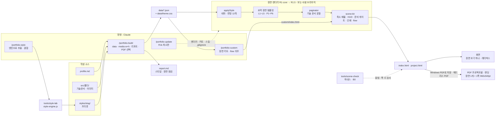

# 16:9 장면 포트폴리오 + 스타일 프리셋 — 통합 설계 요약

이 묶음은 포트폴리오 템플릿에 두 가지를 함께 넣는 최종 설계입니다. 하나는 기존에 설계한 **스타일 추출·프리셋 기능**이고, 다른 하나는 유지관리자의 새 요구 **R-A(모든 페이지를 16:9 장면으로)·R-B(브라우저 인쇄로 깨짐·빈칸 없는 PDF)**입니다. 이 파일은 한 장 요약이자 **결정 기록과 남은 질문의 마스터 목록**입니다.

- 근거 표기: [print-engine]·[paginator]·[scene-design]·[screen-ux]·[spec-impact]·[critic-final] = 이번 16:9 실험 묶음의 이름, [01 §]·[02 §] = 이 묶음의 상세 문서입니다. 실험 보고서 원문은 `scratchpad\scene\_reports\<이름>.md`(스타일 쪽은 `scratchpad\research\*.md`)에 있고, 실험 스크립트·출력 파일은 §9 근거 지도의 폴더에 있습니다. 이 근거 파일들은 **레포 밖 임시 폴더**에 있어 커밋되지 않습니다(§9 경로 참고).
- 근거 종류: **프로토타입 실측**(분할기·키트 프로토타입), **데모 미리보기**(실제 인쇄 대화상자의 미리보기 쪽 수·스크린샷, 저장된 PDF 아님), **계산값**, **설계값**, **미확인**.
- 모든 실측은 **Windows 11**, Chrome 155·Edge 155에서 했고 레포 파일은 바꾸지 않았습니다. Linux는 미확인(Q1-b에 따라 보장 범위 밖)이고, macOS는 R0 결정(Q1-b)으로 보장 범위에서 빠졌으므로 앞으로도 확인하지 않습니다.
- 이 묶음의 **통합 설계 자체는 아직 시험하지 않았습니다.** 실측은 프로토타입(감싸개 구조 분할기, zoom 기반 키트, 별도 준비 신호)의 결과이고, 통합 설계에서 새로 정한 부분은 R0·R1 하네스로 확인합니다[01 머리말].

## 결정 현황 (2026-10-22)

R0 질문 10개(§7-1)는 **2026-10-22에 유지관리자가 직접 정했습니다.** Q1은 판정 기준(Q1-a)과 보장 범위(Q1-b)로 나눠 적습니다. 추천과 다르게 정한 세 곳(Q1-b·Q2·Q3)은 본문에 **【R0 결정】**으로 표시하고, 무엇을 골랐고 무엇을 감수하는지(수용한 리스크)를 함께 적었습니다.

| 질문 | 결정 | 추천과 |
|---|---|---|
| Q1-a R-B 판정 기준 | 추천안 4조건 그대로: ① 장면 안 잘림 0(이어짐 → 축소 → 보이는 잘림 띠) ② 쪽 수 = 장면 수, 모든 쪽 960×540pt, 빈 쪽 0, 머리글·바닥글 0 ③ 장면 안 여백은 레이아웃 규칙이 정하고 채움률은 리포트 지표 ④ 그림은 쪼개지 않고 축소, 실효 10px 미만 권장·10~12px 참고 | 같음 |
| Q1-b 보장 범위 | **Windows만.** Windows PC의 Chrome·Edge "PDF로 저장", 여백 기본. macOS는 확인하지 않고 보장하지 않음. Firefox·Safari·휴대폰은 안내만(보장 밖) | **다름** |
| Q2 좁은 화면 | **어디서나 장면 그대로 축소.** 모든 화면에서 `k = min(vw/1280, vh/720)` 장면 보기 하나(레터박스). 문서 보기·폭 맞춤은 삭제. 손가락 확대는 허용, WCAG 1.4.10 미충족은 수용한 리스크 | **다름** |
| Q3 PDF 범위 | **프로젝트별 PDF만.** project.html을 프로젝트마다 인쇄(HUD "요약만" 가능), 랜딩 index.html은 따로 인쇄. `deck.html` 합본은 만들지 않음(R1f 삭제). 헤드리스 PDF는 R0 스파이크 그대로 | **다름** |
| Q4 가이드·format 갱신 | 가이드 원문을 먼저 고치고, 그다음 `format/` 7곳 이상(`format/README:22` 포함)과 CLAUDE.md를 [01 §13] 문구로 동기화. R1 착수 전에 함 | 같음 |
| Q6 `/portfolio-update` | 최소판 R1k(R1-core와 함께), 완성판 P1. 템플릿 원본 주소 `https://github.com/krKooHoo/portfolio-test`로 고정 | 같음(주소 확정) |
| Q7 상세 장면 순서 | 표지 → 목차 → 스크린샷 → 핵심 구현 → 이슈 해결 → 회고 → 기술 문서 부록 | 같음 |
| Q8 코드 길이 | 한 장면에 들어가는 20줄 안팎 권장, 넘으면 장면 분할("계속" 표시), 전체는 GitHub 링크, 코드 위·'왜' 아래 세로 배치 | 같음 |
| Q10 PDF 색 | PDF = 화면(다크 프리셋은 다크로 인쇄). R1에는 밝은 인쇄 예약 훅만 넣고, 밝은 인쇄는 필요하면 P3 | 같음 |
| Q12 이미지 크기 | `/portfolio-build`가 이미지 헤더의 w×h를 `data/projects/*.json`의 `media`에 기록(schema.md 필드 추가) | 같음 |
| Q16 R1 범위 | **R1-core → R1.5.** R1-full·R1-min은 검토했으나 채택하지 않음 | 같음 |

**형식 결정 (2026-10-22, 덱·스크롤 비교 뒤, 유지관리자 직접 선택)** — 근거는 [deck-vs-scroll.md](deck-vs-scroll.md). 아래 결정은 위 Q2·Q3·Q7·Q8의 적용 범위를 바꾸며, 01·02 문서 반영은 아직 하지 않았습니다(구조 설계 확정 뒤 일괄 반영).

| 번호 | 결정 | 영향 |
|---|---|---|
| F1 | **결과물을 둘로 나눔: 요약 기술문서 = 16:9 슬라이드 덱(기본), 상세 기술문서 = 스크롤 읽기 문서(별도 페이지)** | 덱·스크롤 비교의 (나)·(다-2)를 넘어서는 새 구조. 요약 덱에서 상세 문서로 타고 들어감 |
| F2 | 상세 기술문서는 **읽기용 흐르는 문서**(화면 폭에 맞춰 흐름, 휴대폰·Ctrl+F·스크린리더·확대 지원). R-A(16:9)는 덱에만 적용 | Q2(어디서나 장면 축소)는 덱에만 적용. Q8(코드 20줄)도 덱에만 적용, 상세 문서는 전체 코드 |
| F3 | **PDF는 덱만 보장.** 상세 문서는 웹 링크로 보고, 인쇄하면 A4 문서형(코드·그림이 쪽 사이에서 잘리지 않게 하는 정도, 빈칸 0은 보장 안 함) | R-B 적용 범위가 덱으로 좁아짐. Q3의 "project.html 인쇄 = 요약 + 부록"은 "요약 덱 PDF"로 바뀜 |
| F4 | **포트폴리오 문서(최상위)**: 이력서 1, 기술 스택 1, 자기소개서(에세이), 프로젝트별 소개 2~3장(영상, 요약 덱 링크, GitHub 링크 등). 아래로 프로젝트 요약 덱 → 상세 문서로 이어짐 | 이력서·자기소개서는 지금 템플릿 범위 밖이었음(format/README). 학생이 직접 쓰는 원천 파일과 스키마가 새로 필요(구조 설계에서 정함) |
| F5 | **모든 링크는 기본으로 새 창(새 탭)에서 열기** | 예외는 F10 |

**구조 결정 (2026-10-22, [portfolio-structure.md](portfolio-structure.md) §10 질문에 대한 답)**

| 번호 | 결정 | 영향 |
|---|---|---|
| F6 (구조 Q1) | 빨간 선 해석("넓은 화면의 좌우 빈 여백을 줄인다")이 맞음. 시안 3개 캡처(`spikes/doc-layout/`)를 보고 **① 가운데 정렬로 결정**(2026-10-22): 최대 폭 1840, 목차 260 · 본문 칸 · 레일 300(1800px 이상), 본문 글줄 40rem을 본문 칸 가운데, 코드·표·도식·그림은 넓힘 | 추천(②)과 다름. 수용한 점: 2560 모니터에서 한쪽 빈 여백 401px이 남음, 블록 왼쪽 정렬선이 여러 개(도식·그림 가운데 / 코드·표는 글줄 왼쪽에서 오른쪽으로). 개선 후보는 [portfolio-structure.md](portfolio-structure.md) §4-3 결정 메모 |
| F7 (구조 Q2) | **이력서·자기소개서의 공개 범위는 수강생이 직접 정함.** `profile.md` 설정으로 선택지를 주고(개인정보 칸 공개 여부, 자기소개서 웹 공개/PDF 전용, 검색 노출 허용/차단), 학생이 정하지 않은 동안은 안전한 쪽(개인정보는 로컬 PDF에만, 자기소개서 PDF 전용, 검색 차단)으로 두고 리포트에서 선택을 요청 | 개인정보 칸은 구조로 분리(`private/`, git 제외)하는 설계는 유지하되, 공개 여부 스위치를 학생에게 줌 |
| F8 (구조 Q3) | "핵심을 요약한 2~3페이지"는 **프로젝트당** 2~3장(소개 + 핵심 요약 …) | 포트폴리오 덱 장 수 = 고정 장 + 프로젝트 수 × 2~3 |
| F9 (구조 Q4) | **제출은 포트폴리오 덱 PDF 한 파일.** 가이드 Part 1·발표 덱의 "세 문서의 역할을 섞지 마세요"는 "한 파일로 묶더라도 장을 나눠 역할을 섞지 마세요"로 고쳐 R1-core 착수 전에 반영(Q4 순서: 가이드 → format/) | 가이드 수정 범위에 Part 1 문구 추가 |
| F10 (구조 Q5) | 링크 규칙은 추천안: 문서 사이·외부 링크는 새 탭, **같은 문서 안 이동(목차·앵커·건너뛰기·같은 덱 장면)·덱 조작 버튼·`mailto:`·라이트박스는 예외**, 새 탭 링크에 ↗ + 숨김 설명, 이름 있는 탭 재사용은 파일럿 뒤 선택 기능. PDF 안 링크는 뷰어가 정함 | F5의 구체 규칙 |
| F11 (구조 Q6, 유지관리자가 Claude에게 위임) | **출시 순서: R0.5 상세 문서를 먼저 냄 → 남은 R0 → 가이드 선행 수정 → R1-core(포트폴리오 덱·이력서·자기소개서 포함, 요약 덱, 링크 체계, 휴대폰 읽기 보기 최소판) → R1.5.** R1k 최소 `/portfolio-update`의 일부를 R0.5에 당겨 기존 학생 레포에도 상세 문서를 전함 | 16:9 덱 도달은 약 9~13.5주(추정, portfolio-structure §8-3). 상세 문서는 약 1.5~2주 안에 도달 |

**아직 열린 질문** (§7-2·§7-3)

| 질문 | 마감 |
|---|---|
| Q5 계약 동결 전 파일럿 | R1 도중, R1-core 릴리스 전 |
| Q11 `/portfolio-custom` 장면 규칙 | R1i 착수 전 |
| Q13 장면 배경 scheme·프로젝트별 테마 | R1g 착수 전 |
| Q9 큰 다이어그램 세부 | P2 전 |
| Q14 남의 사이트·자료를 스타일 출처로 쓰는 범위 | P2 전 |
| Q15 템플릿 LICENSE | P2 전 |

**채택 경로와 일정**(추정, 검증 버퍼 30% 포함, 주 5일): R0 → R1-core → 파일럿 → R1.5 + P1 → P2 → P3 → P4. MVP(R0 + R1-core + R1.5 + P1 + P2)는 약 57~75일 ≈ 11.5~15주(파일럿 1주 별도)이고, 학생에게 16:9 장면·PDF가 처음 닿는 시점은 R0 + R1-core ≈ 25~33일 ≈ 5~6.5주입니다(§5).

## 용어 (처음 읽는 분을 위해)

| 용어 | 뜻 |
|---|---|
| 장면, 캔버스 | 16:9 한 화면(= PDF 한 쪽). 논리 크기 1280×720 CSS px로 고정 |
| k | 화면 배율. 장면을 화면에 맞추려고 통째로 키우거나 줄이는 비율. 모든 화면에서 `k = min(vw/1280, vh/720)`(k=1이면 1280×720 그대로) |
| transform / zoom | 배율을 거는 두 CSS 방식. transform은 배치를 그대로 두고 그림만 키움(화면 = 인쇄 보장), zoom은 줄바꿈을 다시 계산함 |
| 장면 보기, 레터박스 | 모든 화면에서 쓰는 단 하나의 보기. 장면을 통째로 맞춰 줄이고, 화면 비율이 16:9와 달라 남는 위아래·좌우 빈 띠가 레터박스. 옛 설계의 "폭 맞춤"(데스크톱 폭에 맞추고 세로 스크롤)·"문서 보기"(장면 높이를 풀어 한 문서처럼 보기)는 Q2 결정으로 **삭제** |
| 분할기(paginator) | 기술 문서를 재 보고 장면에 나눠 담는 런타임 코드 |
| 준비 게이트 | 그리기가 끝나기 전에 인쇄하면 장면 대신 안내 한 쪽만 나오게 하는 장치(`data-pf-ready`) |
| HUD | 화면 구석의 조작 막대(이전·다음, PDF로 저장, 인쇄 범위 "요약만"). 옛 "보기 전환"은 Q2 결정으로 없어짐. 확대 버튼은 제안 단계(§7-1 Q2) |
| WCAG 1.4.10 / 1.4.4 | 웹 접근성 기준. 1.4.10(리플로) = 폭 320 CSS px 화면에서 한 방향 스크롤만으로 읽힘, 1.4.4(글자 크기 조정) = 보조 기술 없이 200%까지 키워도 내용·기능이 유지됨 |
| `.pf-skip` | "요약만" 인쇄 때 기술 문서 장면에 붙여 인쇄에서 빼는 표시 |
| 잘림 띠 | 어떤 방법으로도 장면에 안 들어간 내용이 있을 때 붙는 빨간 "내용이 잘렸습니다 → 원문" 표시(조용한 잘림 방지) |
| CDP | Chrome DevTools Protocol. 프로그램으로 브라우저를 조종해 PDF를 뽑는 통로(Node 22 이상 필요) |
| B0 | 렌더러 기본형의 기준선(장면 나눔 서명 JSON + PDF 단언 + 장면 PNG). 이후 회귀 비교의 기준. R1-core에서는 서명 JSON + PDF 단언만 만들고, 장면 PNG와 동결은 R1.5 |
| R0, R1(R1a~R1k), R1-core·R1.5, P1~P4 | 로드맵 단계(§5). 채택 경로는 R1-core(첫 렌더러 릴리스) → R1.5(두 번째, P1과 함께)이고, "R1"은 둘을 합친 렌더러 작업 전체를 가리킵니다. R1a~R1k는 그 하위 산출물(R1f는 Q3 결정으로 삭제) |
| scrim α | 그림 위 흰 글자를 읽히게 까는 반투명 검정의 진하기. α 0.54면 어떤 그림에서도 4.61:1(계산값) |
| on-accent | 강조색 채움 위에 올라가는 글자색(흰색·검정 중 대비가 맞는 쪽) |
| feature-dark | 표지·장 첫 머리만 다크, 본문은 라이트인 장면 배경 방식 |
| V8, Chromium 메이저 | Chrome·Edge·Node의 JS 엔진 / Chrome·Edge의 큰 버전 번호(약 4주마다 바뀜). 결정성의 조건 |

---

## 1. 결론

**요구 여섯 가지 모두 구현할 수 있습니다.** 다만 R-B는 **Windows PC의 Chrome·Edge "PDF로 저장", 여백 기본**에서만 보장하고 macOS는 확인하지 않습니다(Q1-b). "빈칸 0"은 **쪽 나눔 때문에 생기는 빈칸(빈 쪽) 0**으로 좁혀 정의했습니다(Q1-a). 렌더러는 **16:9 장면 렌더러로 교체**하고 스타일 계약을 처음부터 그 안에 넣으며, 릴리스는 **R1-core → R1.5** 두 번으로 나눕니다(Q16). 화면은 휴대폰까지 모든 기기에서 장면을 통째로 줄여 보여 주는 보기 하나이고(Q2), PDF는 프로젝트마다 따로 만듭니다(Q3). Q1-b·Q2·Q3는 추천과 다르게 정했으며 대가는 §2·§4·§7-1에 적었습니다. 일정은 MVP(R0 + R1-core + R1.5 + P1 + P2) 약 57~75일 ≈ 11.5~15주(추정)로 옛 계획(4~5주)보다 길고, 학생에게 16:9 장면·PDF가 처음 닿는 것은 R0 + R1-core ≈ 5~6.5주 뒤입니다.

## 2. 요구별 판정

| # | 요구 | 판정 | 정밀도·조건 | 완성 단계 |
|---|---|---|---|---|
| 1 | 이미지·PDF·웹 → **형태 추출** | 가능 | 웹은 토큰·컴포넌트 차원을 측정(computed 스타일 + hover 스캔 → 엔진 매핑). 단 **새 장면 축 4개(cover·footer·scheme·title-place)는 웹에서 rubric 판단(신뢰도 하)**이고, 측정은 16:9 슬라이드 PDF에서만 합니다. 이미지는 Claude 판단(신뢰도 상·중·하, 정확도 미측정). PDF는 그림으로 렌더한 뒤 판단. **16:9 슬라이드 PDF는 여백·제목 위치·크기 비율을 측정**(PyMuPDF 대리 실험만, pdf.js 경로 미확인). 고정 렌더러 반영 범위는 토큰·컴포넌트·**장면 변형 12축**, 자유 배치는 `/portfolio-custom` | P2 |
| 2 | **색 추출** | 가능 | 이미지는 측정·결정적(헤드리스 Edge 약 0.7초). GIF 다중 프레임은 데스크톱 앱·Lab, PDF 렌더값 P2·선언색 P3, 웹은 데스크톱 앱 브라우저 창만. 도구가 없으면 vision 근사(ΔE 중앙값 2.6~4.9, 면적 비율 신뢰 불가 → 항상 "확인해 주세요") | P2 |
| 3 | 형태+색 **결합** | 가능·결정적 | 같은 입력 → 같은 JSON. **장면 안 모든 글자 4.5:1**(장면이 줄어들 수 있어 큰 글자 예외 없음). 엔진 실행 호스트가 없으면 멈춤 | P1(유지보수자), P2(학생) |
| 4 | **프리셋 저장·재생성** | 가능 | 다시 적용 = 복사(항상 같음), 다시 파생 = 엔진 버전·V8 같으면 같음, 다시 추출 = Chromium 메이저 같으면 같음. **장면 나눔은 저장하지 않고 열 때마다 계산**(분할 결정적: Chrome = Edge, 재실행 동일, 프로토타입 실측) | P1~P3 |
| 5 | **16:9 장면 페이지** (R-A) | 가능 | 1280×720 논리 캔버스. **【R0 결정】 Q2: 모든 화면에서 장면 보기 하나** — `k = min(vw/1280, vh/720)`로 통째로 맞춰 줄이고 남는 곳은 레터박스. 그래서 화면과 PDF가 어디서나 같습니다. 1366 노트북 본문 13.4px, 14·13인치 FHD @150% 노트북 약 12.3px(즐겨찾기 막대를 켜면 조금 더 작음, 계산값). 휴대폰 세로는 본문 약 4.5px라 손가락 확대에 맡깁니다(막지 않음). 대가(수용한 리스크): WCAG 1.4.10 미충족, 데스크톱 브라우저 확대(Ctrl +)가 k 재계산으로 상쇄될 수 있음(1.4.4, 보완안은 R0 스파이크에서 결정, §7-1 Q2). 세로로 긴 Mermaid는 6px대까지 작아짐(문서당 2~5개 10px 미만, Q9) | R1-core |
| 6 | **PDF 인쇄** (R-B) | 가능(범위 한정) | **【R0 결정】 Q3: 프로젝트별 PDF** — project.html을 프로젝트마다 인쇄(HUD에서 "요약만" 가능), 랜딩 index.html은 따로 인쇄, 합본 `deck.html`은 없음. 장면 1개 = PDF 1쪽, 모든 쪽 960×540pt. 근거: CDP PDF 61개+(**프로토타입 실측**, 쪽 수 = 장면 수)와 실제 대화상자(**데모 미리보기**: 데모 7장면, 여백 4종·배경 켬·끔의 미리보기 쪽 수 = 7. 저장 PDF 파일 미확인, 최소·맞춤 여백은 머리글이 나타나 보장 밖). 통합 설계는 미시험. **【R0 결정】 Q1-b: 보장은 Windows PC의 Chrome·Edge "PDF로 저장", 여백 기본뿐**이고 macOS는 확인하지 않고 보장하지 않습니다. **"Microsoft Print to PDF"·프린터는 A4 + 날짜·URL**, Safari 18.2 미만은 쪽 크기 무시, Firefox 미확인, 휴대폰 → 안내만(보장 밖). 넘침은 조용히 잘리지 않고 "이어짐 → 축소 → 보이는 잘림 띠" 순서[01 §4-3]. 채움률 평균 0.72~0.83(장면 안 여백은 남음, Q1-a에 따라 리포트 지표). 대화상자를 건너뛰는 **헤드리스 PDF**를 R0에서 시험하고, 통과하면 프로젝트별·랜딩 PDF를 만드는 빌드 선택 단계로 R1-core에 넣음(§6) | R1-core |

## 3. 전체 아키텍처

## 4. 핵심 결정

| # | 결정 | 이유 |
|---|---|---|
| 1 | **캔버스 1280×720 CSS px 고정**(PDF 960×540pt = PowerPoint 와이드). 본문 16px(12pt), 코드 14px, 최소 13px | 가이드 발표 덱의 선례, 지금 CSS 수치 재사용, 8의 배수가 아니면 PDF 가장자리 흰 띠. 큰 캔버스는 얻는 것이 없음[01 §2] |
| 2 | **렌더러를 장면 렌더러로 교체하고 스타일 계약을 처음부터 내장.** 옛 P0(지금 CSS 토큰화)·P0.5 폐기. 릴리스는 **R1-core → R1.5 두 번**(Q16 결정) | 곧 버릴 CSS를 토큰화하는 낭비를 피함. R1-core CSS도 처음부터 토큰으로 쓰므로 "나중에 다시 토큰화"할 일이 없음. **렌더러 릴리스는 2회(R1-core, R1.5)이고, 학생 레포 동기화(`/portfolio-update`)는 단계 릴리스마다(R1-core, R1.5 + P1, P2) 필요**합니다(스킬·도구·내장 프리셋이 단계마다 늘어남)[02 T8] |
| 3 | **측정한 뒤 나누는 런타임 분할기**, 결과는 data에 저장하지 않음 | CSS만으로는 긴 문서를 고정 상자에 넣을 수 없음. 분할은 글꼴에 따라 달라짐(원칙 1)[01 §6] |
| 4 | **H2마다 새 장면(아주 짧은 장은 앞 장면에 이어 붙임), 그림은 쪼개지 않고 축소, 실효 10px 미만은 리포트. 어떤 넘침도 조용히 자르지 않음**(이어짐 → 축소 → 보이는 잘림 띠) | "한 화면 = 한 메시지". 비용은 장면 +3~7%·채움 −6~11%p(프로토타입 실측). 짧은 H2가 많은 문서의 거의 빈 장면 연속을 막음[01 §6-3] |
| 5 | **화면 배율은 `transform` 기본**, 선명한 `zoom`은 k≥1.1 혼합을 R0에서 검증 | transform은 화면 = 인쇄를 구조로 보장. zoom은 k<1에서 문서당 7~21장면이 넘침[01 §7-1] |
| 6 | **【R0 결정】 모든 화면에서 장면 보기 하나: `k = min(vw/1280, vh/720)`로 장면을 통째로 맞춰 줄이고 남는 곳은 레터박스. 문서 보기·폭 맞춤은 없음. 손가락 확대(pinch zoom)는 막지 않음**(viewport meta에 `user-scalable=no`·`maximum-scale` 금지). 인쇄는 항상 16:9. 인쇄용 이미지 미리 받기(eager)는 기기(데스크톱, 데이터 절약 아님)로 정함 | Q2 결정(추천은 "좁은 화면은 문서 보기, 마우스 데스크톱은 폭 맞춤"). 얻는 것: 화면 = PDF가 어디서나 같고, 모드 전환 로직·문서 보기 CSS(`pf-mode-reflow`)·폭 맞춤 계산이 빠져 R1e가 원시 1.5~2.5일 → 0.5~1일로 줄며, 흔한 노트북 설정(14·13인치 FHD @150%)이 경계 0.75 근처에서 보기가 바뀌던 문제 자체가 사라짐. **대가(수용한 리스크)**: 휴대폰 세로 본문 약 4.5px(손가락 확대 시 두 방향 스크롤)로 WCAG 1.4.10 미충족. 데스크톱 브라우저 확대(Ctrl +)도 k가 다시 계산되어 장면 실제 크기가 그대로일 수 있음(1.4.4. 옛 모드 규칙 실측에서 FHD 110~150% 확대 시 실제 글자 ×0.99~1.00[screen-ux §5]) → 보완안은 R0 스파이크에서 결정(§7-1 Q2)[01 §7-2, §7-6] |
| 7 | **PDF = 화면**(`print-color-adjust: exact`, 다크 프리셋은 다크로 인쇄). 인쇄용 밝은 팔레트·Mermaid 이중 렌더는 v1에서 삭제하되, 나중에 되살릴 훅은 R1-core(R1g)에 예약(Q10 결정). 밝은 인쇄는 필요하면 P3 | 배경 그래픽을 꺼도 화면 그대로 인쇄됨. 다크 코드 대비 문제 자동 해소, 스타일 설계 단순화[02 §6-6] |
| 8 | **검증된 인쇄 레시피 + 준비 게이트(timeout 회복) + 페이지 안 인쇄 안내** | 함정 21종 실측, 레시피는 최악 순서 56/56 통과(프로토타입). 준비 전 인쇄·lazy 이미지·대화상자 기본 대상이 실제 실패 원인. 원본 게이트의 timeout 고착 버그를 고침[01 §8-2] |
| 9 | **고정 렌더러와 custom이 공용 장면 키트를 쓰고, custom은 반복 데이터를 `PFScene.flow`로만 나누며 `audit()`·`selfTest()` 통과(실행 못 하면 "검증 못 함" 보고)가 완료 조건**(`selfTest()`는 R1.5부터, 세부는 Q11) | 키트 없는 custom은 Letter 7쪽, 키트만 싣고 대충 짜면 카드 3장이 PDF에서 사라짐(zoom 기반 프로토타입). custom은 data를 실행 중에 받으므로 장면당 개수를 박으면 다시 빌드한 뒤 넘침[01 §9] |
| 10 | **【R0 결정】 제출용 PDF = 프로젝트별 PDF.** project.html을 프로젝트마다 인쇄(화면 그대로 = 요약 + 기술 문서 부록), HUD로 "요약만" 선택(쪽 번호·교차 참조는 인쇄 집합 기준으로 다시 계산). 랜딩 index.html도 장면 페이지라 따로 인쇄. **합본 `deck.html`은 만들지 않음** | Q3 결정(추천은 `deck.html` 요약 합본, 샘플 약 29쪽). 얻는 것: R1f(원시 1~1.5일)와 deck 템플릿·하네스(T8의 deck 부분)가 빠짐. **대가**: 제출용 "한 파일"이 없음. 여러 프로젝트를 한 PDF로 내려면 학생이 직접 합쳐야 하고(템플릿은 합본을 만들지 않음), 프로젝트 사이 쪽 번호·목차는 이어지지 않음. 기술 문서 전문까지 넣으면 샘플 4편 합계 약 200~220쪽(추정)이라 HUD "요약만" 선택이 중요해짐[01 §5] |

## 5. 로드맵 (1인, 검증 버퍼 30% 포함, 추정)

**채택 경로(Q16 결정): R0 → R1-core → 파일럿 → R1.5 + P1 → P2 → P3 → P4.** 규모와 누적은 모두 추정이고 주 5일로 셉니다.

| 단계 | 핵심 산출물 | 규모 | 누적 | 완료 기준 요지 |
|---|---|---|---|---|
| **R0** 결정·스파이크 | R0 질문(§7-1) 답은 **2026-10-22 확정**. 스파이크: transform 배치·zoom 혼합, 레시피 재시험(바꾼 줄 + 기본 숨김 애니메이션·CSS 배경 그림 함정), `beforeprint` 게이트, Pretendard·D2Coding 로드, 실제 대화상자 기본값(Windows Chrome·Edge), **헤드리스 PDF(실제 페이지)**, **실제 기기 뷰포트 표**(Windows), **확대(67~200%) 후 인쇄**, **브라우저 확대 보완안**(Q2: HUD 확대 버튼 또는 확대율 감지 시 k 하한 유지), 학생 PC 헤드리스 장면 점검(`?pf-audit=1`), custom 통합 게이트·Tailwind 타이밍. (선택) Firefox, Paged.js 등. macOS 항목은 Q1-b 결정으로 삭제 | **6~8일**(선택 항목 +1~2일) | 6~8일(1.2~1.6주) | 스파이크별 채택/기각, 대화상자 기본값 표, 뷰포트 표, 브라우저 확대 보완안 결정, 헤드리스 PDF 채택 여부 |
| **R1-core** 첫 렌더러 릴리스 + 스타일 계약 v1 | 토큰(처음부터 전부)·캔버스·장면 CSS, 템플릿 L1~L5·P1·P3~P6, 요약 장면 빌더(이어짐·잘림 띠 포함), 문서 분할기, 장면 키트(게이트·HUD 기본·`flow`·`fetchData`·`?pf-audit=1`·번호 다시 계산), **R1e 축소 배율 경계 사례·접근성 기본**(핀치 확대 허용, 375px 확인, 브라우저 확대 보완안 스파이크 결과 반영), 변형 축 4~6개(예: sechead·hero-scale·surface·cover(split·center)·footer·scheme), 계약 훅(밝은 인쇄 예약 훅·기본 경로 on-accent 자동 선택 포함), 하네스(T1~T3·T7·T8·T11·T16, B0는 서명 JSON + PDF 단언만), 스킬·format(`media` w×h 기록, 헤드리스 PDF 단계는 R0 통과 시), R1j 환경 리허설, **R1k 최소 `/portfolio-update`**(부트스트랩, 렌더러·키트·스킬 교체, `.gitignore` 병합, 되돌리기). 문서 보기·폭 맞춤은 빠짐(Q2), R1f deck은 삭제(Q3) | **약 19~25일**(핵심 16.5~22 + R1k 2~3) | 25~33일(5~6.5주) | 잘림 0·잘림 띠 0, 쪽 수 = 장면 수·960×540pt·빈 쪽 0, Windows Chrome·Edge 실제 대화상자 수동 기록, Chrome = Edge 분할 동일, timeout 회복, "요약만" 인쇄 번호 = PDF 쪽, 375px에서 장면 통째 축소·가로 넘침 0·같은 쪽 수, 손가락 확대가 막히지 않음, 옛 템플릿 복사본에 R1k update 성공 |
| **파일럿** | R1-core를 v1-rc로 한 반 1주 운영(Q5, 미결) | 달력 1주(별도) | — | 피드백을 R1.5에 반영 |
| **R1.5** 두 번째 렌더러 릴리스(P1과 함께) | 발표 모드, `selfTest()`, P2 목차, 나머지 변형 축(hero-align·media·divider·accentbar·bg·title-place·`cover: art`), 문단 줄 분할, B0 PNG, T13 전체 행렬. `deck.html`은 Q3 결정으로 빠짐 | **약 13~20일** | 38~53일(7.6~10.6주) | 변형 12축 반복, `selfTest()` 통과, B0 동결, 계약 동결 |
| **P1** 내장 프리셋 | 엔진(결합·검증), 내장 3~4종, `/portfolio-style` 목록·미리보기·적용·확인, `/portfolio-update` 완성(tools·내장 프리셋·launch.json 병합) | 약 6.5일 | 44.5~59.5일(8.9~11.9주) | checks ok, 컴파일러 회귀 = B0, update 병합·되돌리기 |
| **P2** 추출·결합·저장 | 이미지·웹·PDF·**슬라이드 격자** 추출, 초안 2안, 저장·다시만들기, Style Lab, `cover: art` 후보 기록 | 12~15일 | 약 57~75일(11.5~15주) | 호스트 간 바이트 동일, 키아트 10장, 웹 5곳, 슬라이드 3종 |
| **P3** 정밀 입력·PDF 도구 | PDF 선언색·글꼴, 다시추출, PDF 책갈피(CDP), 프로젝트별 테마, (선택) 밝은 인쇄 | 6~9일 | 약 63~84일(12.5~16.7주) | 선언색 ±1, 책갈피 = 장 제목 |
| **P4** 공유 | 내보내기·가져오기 | 2.5~4일 | 약 65~88일(13~17.5주) | 가져오기 검증, CSS 주입 불가 |

- **MVP(채택 경로: R0 + R1-core + R1.5 + P1 + P2) = 약 57~75일 ≈ 11.5~15주**이고, 파일럿 1주는 별도입니다.
- **학생에게 16:9 장면·PDF가 처음 닿는 시점 = R0 + R1-core ≈ 25~33일 ≈ 5~6.5주**입니다. R1-core에는 문서 보기·폭 맞춤이 없고(Q2), 장면 축소 보기와 프로젝트별 PDF로 R-A·R-B가 동작합니다.
- **R0 결정이 일정에 준 영향**: Q2로 R1e가 "문서 보기·폭 맞춤·접근성"(원시 1.5~2.5일)에서 "축소 배율 경계 사례·접근성 기본"(원시 0.5~1일)으로 줄었고, Q3로 R1f `deck.html`(원시 1~1.5일)이 빠졌습니다. 뒤 산출물 이름(R1g~R1k)은 바꾸지 않고 R1f는 "(삭제됨, Q3)"으로 남깁니다. R0의 선택 항목은 macOS가 빠져 +1~2일입니다.
- **Q4 문서 작업**: 가이드 원문 → `format/`·CLAUDE.md 동기화(§7-1 Q4)는 R1 착수 전에 합니다. `format/`·CLAUDE.md 동기화 공수는 원래 R1i(원시 3.5~4.5일)에 들어 있던 것이라 위 일수에 이미 포함되어 있고 시점만 앞당겨집니다. 가이드 원문을 먼저 고치는 공수는 아직 추정하지 않았고 위 일수에 넣지 않았습니다([02 §11]과 같은 계산).
- **검토했으나 채택하지 않은 대안**: R1-full(렌더러를 한 번에 릴리스, 원시 24.5~34.5일 → 약 32~45일), R1-min(R1-full에서 문단 줄 분할·발표 모드를 뺀 것, 원시 23.5~33일 → 약 31~43일). 둘 다 학생에게 처음 닿는 시점이 늦고 한 릴리스의 검증 행렬이 큽니다(§7-1 Q16).
- **옛 계획과의 차이**: 옛 P0~P2는 약 22.5~25.5일(P0 약 6 + P0.5 약 1 + P1 약 6.5 + P2 9~12)이었습니다. 늘어난 양은 약 34~49일이고, 내역은 R0 + R1-core + R1.5(38~53일)에서 흡수된 옛 P0·P0.5(약 7일)를 뺀 약 31~46일과 P2 증가분(9~12 → 12~15, 약 3일)입니다. 늘어난 이유는 그대로, 렌더러 전체를 새로 만들기 때문입니다(이전 판의 "순수 증가분 24~36일"은 계산 오류였습니다).
- 각 단계에서 멈춰도 앞 단계는 완결됩니다. 새로 만든 레포에서는 R1-core만으로 R-A·R-B가 동작하고, **기존 학생 레포에는 R1k의 최소 `/portfolio-update`로 전달**합니다. 렌더러를 두 번(R1-core, R1.5) 받는 비용은 R1k가 있어 작습니다.
- R1-core·R1.5 상세 대응표와 완료 기준은 [02 §11], 하네스 검사 항목은 [01 §11]에 있습니다.

## 6. 역제안 상위 목록

| 기능 | 가치 | 단계 |
|---|---|---|
| **대화상자 없는 PDF**(헤드리스 Edge `--print-to-pdf` + `--virtual-time-budget`, 빌드의 선택 단계 "PDF 만들기"로 프로젝트별·랜딩 PDF를 만듦) | 학생 제출 PDF 실패 원인 상위 3개(기본 대상, 기억된 여백, 머리글)가 모두 대화상자에서 생김. Edge는 모든 Windows PC에 있어 보장 범위(Windows만, Q1-b)와 맞음. 장난감 페이지에서 8쪽·960×540pt·비동기 장면 포함·날짜·URL 없음 확인(`spec-impact\cli-budget.pdf`, 플래그 미확인) | R0 스파이크 → 통과하면 R1-core |
| `/portfolio-update` 템플릿 동기화(보호 규칙·되돌리기 포함) | 렌더러 교체를 기존 학생 레포에 전할 유일한 길. 원본 주소 `https://github.com/krKooHoo/portfolio-test` 고정(Q6) | **R1k 최소판**(R1-core와 함께), P1 완성 |
| 발표·면접 모드(전체 화면, ←/→, 목차 쪽 번호로 이동) | 화면 공유 기술 면접에 바로 씀 | R1.5 |
| 장면 점검 리포트(작은 도식·긴 코드·잘림을 숫자로, custom 포함) | "다이어그램을 나누세요"가 "6px로 보입니다"가 됨 | R1-core |
| 16:9 슬라이드 PDF를 스타일 출처로(격자 측정) | 판단이 아니라 측정. 수업 발표 자료·가이드 덱은 권리가 분명 | P2 |
| 게임 화면 표지(`cover: art` + scrim 상수 α 0.54) | 이미지마다 재지 않고 흰 글자 대비 4.5 보장(계산값 4.61) | 렌더러 규칙 R1.5, 키아트 후보 추출 P2 |
| 기본 경로 on-accent 자동 선택 + profile 예시 색 AA 교체 | 스타일을 안 쓰는 학생의 버튼 대비(3.44:1, 1.43:1) 해결 | R1-core(R1g) |
| 프로젝트별 테마(그 게임 키아트로 상세 페이지만) | 프로젝트마다 분위기 | P3 |
| Unity `.uss`·`.asset` 가져오기/내보내기 | 측정 오차·권리 문제 없음, 유니티 수강생 특화 | P3 |
| GIF 포스터 프레임 교체 | PDF에 찍히는 GIF 프레임을 결정적으로(미확인) | P3 |
| OG 이미지(표지 장면 캡처) | 메신저 링크 미리보기 | 자리 R1, 생성 P3 |

전체 목록: [02 §13], 장면 쪽 기능: [01 §7-5, §11-1].

## 7. 결정 기록과 남은 질문 (마스터 목록)

다른 두 문서는 이 번호로 가리킵니다. 옛 스타일 설계의 Q1·Q2는 소멸했고, 옛 Q3~Q7은 아래 Q4·Q6·Q14·Q15·Q5로 옮겼습니다([02 §14]). 마감별로 묶었습니다. §7-1의 10개는 **2026-10-22에 유지관리자가 직접 정했고**, §7-2·§7-3은 아직 열려 있습니다. 추천과 다르게 정한 곳(Q1-b·Q2·Q3)에는 【R0 결정】과 그 대가를 적었습니다.

### 7-1. R0 결정 (2026-10-22 확정)

1. **Q1 R-B 운영 정의와 보장 범위.**
   - **결정(Q1-a 판정 기준, 추천과 같음):** ① 장면 안 내용 잘림 0(넘치면 이어짐 → 축소 → 보이는 잘림 띠, 조용한 잘림 금지) ② PDF 쪽 수 = 장면 수, 모든 쪽 960×540pt, 빈 쪽 0, 머리글·바닥글 0 ③ 장면 안 여백은 레이아웃 규칙이 정하고 채움률은 리포트 지표 ④ 그림은 쪼개지 않고 축소, 실효 10px 미만은 리포트 "권장", 10~12px는 "참고". 이 정책(H2 엄격 나눔, 그림 비분할, 순서 고정) 아래에서는 엄격한 "빈칸 0"을 샘플로 달성할 수 없으므로(하위 10% 장면 채움 0.30~0.54, 프로토타입 실측) "빈칸 0"은 쪽 나눔 때문에 생기는 빈 쪽 0으로 정의합니다. 연속 흐름이나 그림 남은 칸 맞춤을 쓰면 수치가 달라집니다(미측정).
   - **결정(Q1-b 보장 범위, 추천과 다름):** **Windows PC의 Chrome·Edge "PDF로 저장", 여백 기본**만 보장합니다. 학생 안내 문구는 "Windows PC의 Chrome·Edge에서 저장하세요"입니다. Firefox·Safari·휴대폰은 안내만 하고 보장하지 않습니다. 대상·브라우저에 따라 A4로 바뀌는 문제("Microsoft Print to PDF"·프린터)는 페이지 안 인쇄 안내로 줄입니다[01 §1].
   - **【R0 결정】** 추천은 "macOS는 R0 확인 후 추가"였지만 **macOS는 확인하지 않고 보장하지 않습니다.** R0의 macOS 확인 항목은 삭제했습니다(선택 항목에서도 제외). 대가: Mac만 쓰는 학생은 보장 밖이고, macOS 대화상자 기본값·글꼴 차이는 미확인으로 남습니다.
2. **Q2 휴대폰·세로·좁은 화면.**
   - **결정(추천과 다름): "어디서나 장면 그대로 축소".** 모든 화면에서 장면 보기 하나만 씁니다. `k = min(vw/1280, vh/720)`로 장면을 통째로 맞춰 줄이고 남는 곳은 레터박스로 둡니다(세부 여백·상한은 [01 §7-2]). 그래서 화면 = PDF가 어디서나 같습니다. 문서 보기(reflow) 모드와 데스크톱 폭 맞춤 보기는 **모두 삭제**했습니다. 인쇄는 항상 16:9입니다. 인쇄용 이미지 미리 받기(eager)는 그대로 기기(데스크톱) 기준입니다.
   - 휴대폰 세로에서는 장면 배율 0.28~0.29, 본문 약 4.5px입니다[screen-ux §3]. **손가락 확대(pinch zoom)는 막지 않습니다**(viewport meta에 `user-scalable=no`·`maximum-scale` 금지).
   - **【R0 결정】 수용한 리스크:** 확대하면 가로·세로 두 방향 스크롤이 생겨 **WCAG 1.4.10(리플로)을 충족하지 못합니다.** 추천안이 이 대체 버전으로 두었던 문서 보기가 없어졌기 때문입니다. 얻는 것은 화면 = PDF의 일관성과 R1e 축소(원시 1.5~2.5일 → 0.5~1일), 그리고 흔한 노트북 설정(14·13인치 FHD @150%)이 경계 0.75 근처에서 보기가 바뀌던 문제가 사라지는 것입니다(계산값)[01 §7-2, §7-6].
   - **새로 생기는 문제(WCAG 1.4.4):** 데스크톱에서 브라우저 확대(Ctrl +)를 해도 k가 다시 계산되어 장면의 실제 크기가 그대로일 수 있습니다(옛 모드 규칙 실측에서 FHD 110~150% 확대 시 실제 글자 ×0.99~1.00[screen-ux §5]). 보완안은 **제안**이며 확정이 아닙니다. R0 스파이크에서 둘 중 하나를 고르거나 둘 다 기각합니다: (가) HUD 확대 버튼(k에 1.0~2.0 배수를 곱하고 장면 안을 스크롤) (나) 브라우저 확대율을 감지하면 k 하한을 유지.
3. **Q3 PDF 범위와 제출용 산출물.**
   - **결정(추천과 다름): 프로젝트별 PDF만.** 학생은 project.html을 프로젝트마다 인쇄합니다(화면 그대로 = 요약 + 기술 문서 부록). HUD에서 "요약만"을 고를 수 있고, 쪽 번호·교차 참조는 인쇄 집합 기준으로 다시 계산합니다. 랜딩 index.html도 장면 페이지라 따로 인쇄할 수 있습니다. 대화상자 없는 헤드리스 PDF는 R0 스파이크로 그대로 두고, 통과하면 R1에서 프로젝트별·랜딩 PDF를 만드는 빌드 선택 단계가 됩니다. PDF 책갈피는 P3입니다. `exports/`는 gitignore, PDF를 Pages에 올릴지는 학생 선택입니다[01 §5, §8-4, §11-1].
   - **【R0 결정】** 추천은 `deck.html` 요약 합본(샘플 약 29쪽)이었지만 **`deck.html`은 만들지 않습니다.** R1f와 deck 관련 템플릿·하네스(T8의 deck 부분)·와이어프레임·장면 수 표의 deck 행이 빠집니다. 대가: 제출용 "한 파일"이 없습니다. 여러 프로젝트를 한 PDF로 내려면 학생이 직접 합쳐야 하고, 프로젝트 사이 쪽 번호·목차는 이어지지 않습니다.
4. **Q4 가이드 원문·`format/` 갱신 범위와 순서.** **결정(추천과 같음):** ① 가이드 원문을 **먼저** 고칩니다 — Part 1 §3.2 상세 구성, Part 2 코드 길이, Part 3 슬라이드 레이아웃(장면 틀로 재도입하되 **⑤ "좌 코드 50줄 이하 / 우 '왜'"는 "코드 위 · '왜' 아래 · 약 20줄"로 변경**), Part 4 도식 가독성, Part 6 트랙 B, Part 7 PDF(Q1-b의 Windows 보장 범위·Q3의 프로젝트별 PDF·Q10의 PDF 색을 반영). ② 그다음 `format/` 7곳 이상과 CLAUDE.md를 [01 §13] 문구로 동기화합니다. `format/README:22`("슬라이드 레이아웃은 가져오지 않음")는 R-A와 정면으로 충돌하므로 반드시 포함합니다. ③ 옛 네 문구(04:30·04:31·05:16·03:47)도 함께 고칩니다. 이 작업은 **R1 착수 전**에 합니다.
5. **Q6 `/portfolio-update`와 템플릿 주소.** **결정(추천과 같음):** 최소판은 **R1k**(R1-core 릴리스와 함께), 완성판은 P1. **템플릿 원본 주소 = `https://github.com/krKooHoo/portfolio-test`**이며, 스킬 상수와 README 부트스트랩 명령에 고정합니다. 렌더러 교체라 이 기능 없이는 기존 학생에게 R-A·R-B가 닿지 않습니다[02 §8-8]. **주의:** 주소를 나중에 옮기면 이미 학생 레포에 배포된 스킬은 옛 주소를 가리킵니다. 옮길 일이 생기면 옛 주소에서 새 주소로 안내하는 방법을 함께 마련해야 합니다(방법 미정).
6. **Q7 상세 장면 순서.** **결정(추천과 같음):** 가이드 Part 1 §3.2 순서 — 표지 → 목차 → 스크린샷 → 핵심 구현 → 이슈 해결 → 회고 → 기술 문서 부록. 지금 렌더러는 스크린샷이 핵심 구현 뒤에 있어 새 장면 렌더러에서 이 순서로 바꿉니다(목차 장면 템플릿 P2는 R1.5)[01 §5-2].
7. **Q8 코드 블록 길이 기준.** **결정(추천과 같음):** 한 장면에 들어가는 20줄 안팎을 권장하고, 넘으면 장면 분할("계속" 표시)을 허용하며, 전체 코드는 GitHub 링크로 보냅니다. 코드 장면은 **코드 위 · '왜' 아래** 세로 배치입니다. `format/02:51`("대략 50줄")과 가이드 ⑤(좌 코드 50줄 이하 2단, 사본 `03-presentation-layouts.md:142`)는 Q4 순서대로(가이드 원문 → `format/`) 고칩니다. 샘플 코드 48개 중 19개가 18줄을 넘습니다(최대 38줄)[01 §4-1, §6-4].
8. **Q10 PDF 색(인쇄 테마).** **결정(추천과 같음):** PDF = 화면(`print-color-adjust: exact`, 배경 포함, 다크 프리셋은 다크로 인쇄). R1-core(R1g)에는 밝은 인쇄 **예약 훅**만 넣습니다 — 변형 화이트리스트 `print: screen|light` 자리, Mermaid 인쇄용 두 번째 렌더 자리, validate의 "카탈로그 플래그가 켜졌을 때만 허용하는" 인쇄 구간(약 0.5일, 추정). 밝은 인쇄는 필요하면 P3에서 엔진·프리셋 쪽만으로 켭니다(렌더러 재릴리스 없음). 훅을 미리 넣는 이유: R1에서 theme.css의 인쇄 블록을 validate가 거부하도록 동결하고 인쇄 규칙은 키트 소유라, 훅 없이 나중에 밝은 인쇄를 되살리면 렌더러를 다시 릴리스해야 합니다[02 §6-6]. 남은 긴장: 가이드 원문은 "다크 코드 테마는 … 제출용은 밝은 테마 권장"(사본 `03-presentation-layouts.md:234`), "기업 제출용 PDF = 밝은 배경"(같은 파일 :246)이라, Q4에서 가이드 Part 7을 고칠 때 이 두 문구를 이 결정에 맞춰야 합니다. 채용 담당자가 PDF를 주로 화면에서 본다는 가정은 그대로입니다(가정, 미확인).
9. **Q12 이미지 크기 기록(`media`).** **결정(추천과 같음):** `/portfolio-build`가 이미지 파일 헤더에서 w×h를 읽어 `data/projects/*.json`의 `media`에 기록하고, schema.md에 필드를 추가합니다. 헤더는 설치 없이 PowerShell로 읽을 수 있습니다(설계값, 미검증). 사실이므로 원칙 1과 맞습니다. 이 값이 없으면 분할 전에 이미지를 받아야 해서, 10Mbps에서 1-action-platformer(GIF 50MB)는 장면 완성까지 45초 걸렸습니다[01 §6-7].
10. **Q16 R1 범위.** **결정(추천과 같음): R1-core → R1.5.** 문서 전체의 기본 경로는 **R0 → R1-core → (파일럿) → R1.5 + P1 → P2 → P3 → P4**입니다(§5). R1-core는 약 19~25일, R1.5는 약 13~20일입니다(추정). 이유: 1인 유지관리자에게 한 릴리스로 검증하기에 R1-full(하위 산출물 10개, 템플릿 15종, 변형 12축 × T13 행렬, HUD·발표 모드·selfTest, B0 PNG)은 큽니다. R1-core CSS를 처음부터 토큰으로 쓰면 "나중에 다시 토큰화"할 일이 없고, R1k가 있으면 두 번째 렌더러 릴리스 비용도 작으므로, 이전 판이 "장면 먼저, 토큰 나중"을 기각한 이유는 R1-core에는 해당하지 않습니다. 대가: 학생 레포가 렌더러를 두 번 받고, B0·계약 동결이 R1.5로 늦어집니다[02 T8, §11]. 검토했으나 채택하지 않은 대안: R1-full(약 32~45일), R1-min(약 31~43일).

### 7-2. R1 도중 (해당 하위 산출물 착수 전)

11. **Q5 계약 동결 전 파일럿**(R1-core를 v1-rc로 낼지, 그러므로 R1-core 릴리스 전). **추천:** R1-core를 v1-rc로 한 반에서 1주 운영한 뒤, R1.5에서 토큰·변형·장면 규칙을 동결. 동결 뒤 이름 변경은 모든 학생 레포의 업데이트 비용이 됩니다. 확인할 것: 분할 결과에 대한 인상, 휴대폰에서 장면 축소 + 손가락 확대 사용감, 브라우저 확대 보완안(R0에서 채택했다면) 사용감, Windows PC에서 인쇄 안내만으로 맞는 PDF를 만드는 비율, Mac만 쓰는 학생 비율(Q1-b 보장 밖 규모), Python·Node 없는 PC 비율[02 §11].
12. **Q11 `/portfolio-custom` 장면 규칙**(R1i 착수 전). **추천:** 공용 장면 키트 링크 의무, 장면 안 금지 목록, 반복 데이터는 `PFScene.flow`로만, 버전 고정 Tailwind URL, `audit()` `[]`·`selfTest()` 0(R1.5부터. R1-core에서는 좁은 뷰포트(375px)와 1280px에서 `audit()` 결과·장면 수가 같은지로 vw·vh 의존을 대신 잡음)·`?pf-stress=1`에서도 `[]`를 완료 조건으로, 헤드리스가 있으면 쪽 수도 검사. 실행 수단이 없는 환경(E3·E4, 검증 전 E2)에서는 "검증 못 함"을 명시적 상태로 보고하고 완료라고 하지 않음. 빌드 장면 점검이 custom도 감시. 옛 custom 페이지는 재생성 권고[01 §9-5].
13. **Q13 장면 배경 scheme·프로젝트별 테마**(R1g 착수 전: scheme 축이 변형 화이트리스트에 들어가기 때문). **추천:** 기본 uniform, `feature-dark`(다크 표지 + 라이트 본문) 허용과 내장 `docs-feature` 추가. 랜딩 index.html은 전역 테마만, 프로젝트별 테마는 project.html에서만(P3)[02 §4-4, §6-6].

### 7-3. P2 전

14. **Q9 큰 다이어그램(세부).** 쪼개지 않고 축소하며 실효 10px 미만은 "권장"·10~12px는 "참고"로 리포트한다는 원칙은 Q1-a ④로 **이미 정해졌습니다.** 여기서 정할 것은 세부입니다. **추천:** 장면용 촘촘한 Mermaid 간격(26개 중 11px 미만 14 → 9개)을 렌더러 기본으로(이 값은 렌더러 상수라 바꾸면 B0가 바뀌므로, 바꾸려면 R1.5의 B0 동결 전에 정하는 편이 쌉니다). 90도 회전 장면은 두지 않음. 고칠 곳은 소스(나누기·LR 방향)이며 Claude가 Mermaid를 대신 쓰지 않습니다[01 §6-5].
15. **Q14 남의 공개 사이트·자료를 스타일 출처로 쓰는 범위**(옛 Q5). **추천:** 경고 후 허용. 기본 출처는 내 게임 화면, 제3자 출처는 해시로만 커밋, 단일 출처 복제는 권장 경고, 고지문 매번. 법률 판단은 미확인[02 §10-2].
16. **Q15 템플릿 LICENSE**(옛 Q6). **추천:** 지정. 코드(렌더러·장면 키트·tools·스킬)는 허용형, `src/` 샘플은 "동의 범위 안에서만, 재배포 금지"로 따로. 학생의 `src/`·`profile.md`·프리셋은 학생 소유라고 README에 명시. 법률 자문 아님[02 §10-2].

(목록 번호 1~16은 읽는 순서이고, 문서 사이 참조는 Q번호로 합니다.)

## 8. 문서 안내

| 문서 | 내용 |
|---|---|
| [01-scene-layout-print.md](01-scene-layout-print.md) | **16:9 장면과 PDF 인쇄 설계(신규).** 요구 해석과 이의, 캔버스·타입 스케일, 장면 격자, 템플릿 15종·용량 규칙·와이어프레임, 페이지 구성과 장면 수, 분할기 알고리즘과 샘플 4편 실측, 화면 배율(장면 축소 단일 보기, Q2)·HUD·내비·접근성·성능, 인쇄 레시피 전문(CSS/JS)·함정 21종·대화상자 실측·지원 매트릭스·학생 인쇄 안내, 공용 장면 키트(`flow`·`?pf-audit=1`)와 custom 규칙, 렌더러 변경 목록, 하네스(T1~T16), 리스크, format/·CLAUDE.md 문구 변경안 |
| [02-style-presets.md](02-style-presets.md) | **스타일 추출·프리셋 설계(16:9 반영본).** 원래 설계(§0~§14)를 유지하고 바뀐 곳을 【16:9 반영】으로 표시. 토큰 계약(장면·글자 크기 토큰, 변형 12축), 추출(슬라이드 격자), 결합(장면 안 모든 글자 4.5, PDF = 화면), 스키마, 빌드·custom·update 연동, 명령·메시지, 가드레일, 로드맵 상세 완료 기준(R1-core 대응표 포함), 역제안, 옛 질문의 행방 |

## 9. 근거 지도

경로는 모두 `scratchpad\` 아래이며, 이 세션의 scratchpad는 `C:\Users\user\AppData\Local\Temp\claude\C--Users-user-portfolio-test\9be3bc40-e32f-472a-8ce3-612dae8387a1\scratchpad\`입니다(임시 폴더라 정리될 수 있습니다. 필요하면 따로 보관해 주세요). 16:9 실험 보고서 원문은 `scene\_reports\`(print-engine·paginator·scene-design·screen-ux·spec-impact)에 있습니다.

**재확인 메모 (2026-10-22, PyMuPDF):** `scene\paginator\out\FINAL\A-*.pdf` 4개(1280×720, 본문 16px)는 각각 46·17·75·71쪽이고, 모든 쪽이 960×540pt, 빈 쪽 0, 쪽 밖으로 나간 글자 블록 0입니다. 헤드리스 CLI 실험 `scene\spec-impact\cli-budget.pdf`도 8쪽 모두 960×540pt입니다. 이것은 프로토타입 결과이며, 통합 설계 자체는 R0·R1 하네스로 다시 확인해야 합니다.

| 표기 | 실험 폴더 | 확인할 파일 |
|---|---|---|
| [print-engine] | `scene\print-recipe\` | 레시피 `recipe\pf-print.css`·`recipe\pf-ready.js`, 함정 매트릭스 `exp*.js`·`out\*.pdf`, 실제 대화상자 `dialog-*.js`(여백 4종 `dialog-margins.js`, lazy `dialog-lazy.js`), 하네스 `harness\scene-print-check.js`·`harness\pdf-deep.py`, 실패 데모 `demo\broken.html` |
| [paginator] | `scene\paginator\` | 분할기 `site\paginator.js`(force·zoomFit 포함)·`site\scene-project.js`, 최종 결과 `out\FINAL\*.json`(params: `bodyH 606`, `slack 1`)·`*.pdf`, 검증 `verify_pdf.py`, 요약 `out\FM\_summary.md` |
| [scene-design] | `scene\info-design\` | 템플릿 프로토타입 `proto\scenes.js`·`scenes.css`, Mermaid 측정 `mermaid-measure*.json`·`mm-*.txt`, 가이드 사본 `guide\*.md`(`03-presentation-layouts.md:142, 234, 246`)·`guide\deck.html`(가이드 발표 덱 사본, 이 템플릿의 산출물 아님), 현재 A4 인쇄 `current\*-A4.pdf` |
| [screen-ux] | `scene\screen-ux\` | zoom 기반 키트 `kit\scene-kit.css`·`kit\scene-kit.js`, custom 실험 `custom\naive-nokit.html`·`naive-kit.html`·`kit.html`(`chunk(a, n)`, `CUSTOM_READY`), 배율·내비·접근성·성능 `exp1~exp6*.js` |
| [spec-impact] | `scene\spec-impact\` | 덱 실험 `deck*.html`·`deck*.pdf`, 비동기 덱 `deck-async.html`(Q3 결정으로 `deck.html`은 만들지 않지만, 인쇄·비동기 장면의 실험 근거로 남김), 헤드리스 CLI PDF `cli-budget.pdf`(8쪽)·`cli-nobudget.pdf`(5쪽), 문단 폭 측정 `res-*.json` |
| [final-arch] | `scene\final-arch\` | 기본값 대비 `contrast-defaults.js`, Mermaid 점검 `mmd-*.js` |
| [critic-final] | `scene\critic-final\` | 준비 게이트 timeout 고착 시뮬레이션 `gate-sim.js`, 대비 재계산 `contrast-check.js` |
| 스타일 연구 | `research\*.md` | 02의 [렌더러]·[색추출]·[형태]·[결합]·[프리셋]·[통합] |
| 옛 설계 | `design\revised-spec.md` | 02의 출발점, 옛 로드맵 수치(§11) |

**원자료**
- 옛 설계: `scratchpad\design\revised-spec.md` (02의 출발점)
- 스타일 연구 보고서: `scratchpad\research\*.md`
- 16:9 실험물: 위 근거 지도
