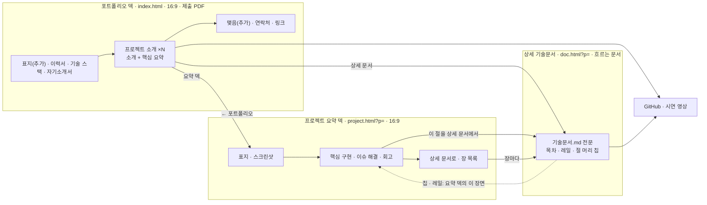

# 포트폴리오 구조 설계 — 포트폴리오 덱 · 요약 덱 · 상세 문서

> 상태: **제안** (2026-10-22). 형식 결정 F1~F5를 하나의 구조로 묶고, 적대적 검토 27건을 확인한 뒤 반영한 최종안입니다.
> 이 문서 말고는 레포 파일을 바꾸지 않았습니다. 정해 주실 것은 §10의 질문 6개입니다.

**근거 표기**
- [README] `docs/design/README.md` · [01 §n] `01-scene-layout-print.md` · [02 §n] `02-style-presets.md` · [R0] `R0-results.md` · [DvS §n] `deck-vs-scroll.md` · [B] `spikes/deck/README.md`
- [가이드조사 §n]·[외부조사 §n]: 이번 설계 묶음의 조사 보고서입니다(레포에는 없음). [검토 #n]: 이번 적대적 검토의 지적 번호입니다(반영 기록은 부록 A).

**수치 종류**
- **실측(인용)**: 위 문서들이 잰 값을 옮겼습니다. 이번에 브라우저로 새로 잰 값은 없습니다.
- **계산값**: 실측값이나 레포 CSS 값으로 계산했습니다.
- **설계값**: 제안하는 수치입니다. **추정**: 근거가 약한 어림값입니다. **미확인**: 확인하지 못했습니다.
- 일수는 따로 적지 않으면 **버퍼 30%를 더한 값**입니다(README·02 §11과 같은 기준). 원시 일수는 "원시"라고 적습니다.

---

## 0. 요약

1. **세 문서로 나눕니다.** 포트폴리오 덱(`index.html`, 16:9) → 프로젝트 요약 덱(`project.html?p=`, 16:9, 부록 없음) → 상세 기술문서(`doc.html?p=`, 흐르는 읽기 문서)입니다. 위로 갈수록 짧고, 아래로 갈수록 학생 원문에 가깝습니다.
2. **제출물은 포트폴리오 덱 PDF 한 파일**입니다. 요청하신 순서(이력서 → 기술 스택 → 자기소개서 → 프로젝트 소개)에 표지·맺음을 더해 샘플 기준 10~11장입니다. 상세 문서의 PDF는 보장하지 않습니다(F3).
3. **요약 → 상세는 절 단위 양방향 링크**입니다. 요약 덱의 장면마다 상세 문서의 그 절로 가는 링크를, 상세 문서의 그 절에는 요약 덱으로 돌아오는 칩을 둡니다. 문서 사이 링크는 모두 새 탭이고, 같은 문서 안 이동만 예외로 제안합니다(F5).
4. **추천 ① 상세 문서 페이지를 먼저(R0.5) 냅니다.** 장면 키트와 무관해 약 1.5~2주 안에 학생에게 닿습니다. 넓은 화면 레이아웃은 시안 세 개를 1920·2560 캡처로 보고 정합니다(Q1, 임시 추천은 "본문 왼쪽 정렬 + 코드·도식을 오른쪽 끝까지").
5. **추천 ② 개인정보는 경고가 아니라 구조로 막습니다.** 사진·전화·생년월일·주소·병역은 웹 데이터에 넣지 않고, git에 올라가지 않는 `private/` 폴더에서 로컬 PDF에만 넣습니다. 자기소개서도 기본은 PDF 전용입니다(Q2).
6. **추천 ③ 부록이 빠지므로 문서 분할기(R1c)를 없앱니다.** 그래도 새 페이지·원천·링크 일이 더 커서 R1-core가 약 +8.5~19.5일 늘고, **16:9 덱이 학생에게 닿는 시점은 약 5~6.5주에서 약 9~13.5주로 늦어집니다**(추정, §8-3).

---

## 1. 결과물 지도



- 실선은 아래로 내려가는 링크, 점선은 위로 되돌아가는 링크입니다. **문서 사이 화살표는 모두 새 탭**입니다(§5).
- 같은 덱 안 이동(표지 썸네일 → 그 프로젝트 소개 장면, 목차 → 장면)은 같은 탭입니다(F5 예외 제안).

| 문서 | 형식 | 주소 | 담는 것 | PDF |
|---|---|---|---|---|
| **포트폴리오 덱** | 16:9 덱 (R-A·R-B) | `index.html` (`#s=resume`, `#s=stack`, `#s=essay`, `#s=p-<폴더>`, `#s=contact`) | 표지(추가), 이력서, 기술 스택, 자기소개서, 프로젝트 소개(프로젝트마다 소개 + 핵심 요약), 맺음(추가) | **제출 기본.** 960×540pt, 샘플 10~11쪽, 범위 인쇄 가능 |
| **프로젝트 요약 덱** (요약 기술문서) | 16:9 덱 | `project.html?p=<폴더>` (`#s=cover`, `#s=shots`, `#s=hl-<n>`, `#s=ts-<n>`, `#s=retro`, `#s=more`) | 표지, 스크린샷, 핵심 구현, 이슈 해결, 회고, 상세 문서로(P8) | 선택. 960×540pt, 11~13쪽 |
| **상세 기술문서** | 흐르는 문서 (F2) | `doc.html?p=<폴더>#<제목 앵커>` (`#sec=<제목>`도 받음) | 머리(제목·한 줄 소개·메타·링크), `기술문서.md` 전문, 목차, 오른쪽 레일 | **보장 안 함**(F3). A4 인쇄는 잘림 방지만 |
| (휴대폰 읽기 보기) | 흐르는 목록 | `index.html?view=read` | 기본 정보·연락처·프로젝트 목록과 링크, (공개했으면) 자기소개서 | 없음. §4-6, Q6 |

### 1-1. 주소 규칙

- 파일 이름은 소문자 영문입니다: `index.html`, `project.html`, `doc.html`, `assets/doc.js`, `assets/doc.css`. `docs.html`은 레포의 `docs/` 폴더와 헷갈려 쓰지 않습니다.
- 페이지 사이 링크는 상대경로(`doc.html?p=…`)이고 앞에 `/`를 붙이지 않습니다. 프로젝트 Pages는 `/portfolio-test/` 아래에 있기 때문입니다(CLAUDE.md 원칙 6).
- 절대주소는 PDF로 나가는 링크·보이는 주소·QR에만 쓰고, 빌드가 기록한 `site.baseUrl`에서 만듭니다(§5-4).
- `?p=` 값은 폴더 이름 그대로(대소문자 포함)입니다. 폴더 이름에 한글이 있으면 주소가 `%EB%…`로 길어져 보이는 주소·QR이 망가지므로, 빌드가 리포트 **권장**으로 ASCII 이름을 권합니다. 이름은 학생이 바꿉니다[검토 #7].
- 프로젝트마다 HTML을 생성하는 방식(`p/<폴더>/index.html`)은 쓰지 않습니다. 고정 렌더러 원칙(원칙 5)에 맞지 않습니다.

### 1-2. 옛 주소 넘기기 (`project.html?p=X`의 해시)

`project.html?p=X`는 이미 이력서·메신저로 공유된 주소라 그대로 층 2를 가리킵니다. 해시는 **아래 순서대로** 판별합니다[검토 #22].

| 순서 | 해시 | 처리 |
|---|---|---|
| 1 | `#s=…` | 덱 장면 공유 링크. 그대로 그 장면으로 |
| 2 | `#<숫자>` | 덱이 주소창에 보이는 장 번호(B의 `#6` 형식). 그 장으로 |
| 3 | `#pf-doc` | `doc.html?p=X` |
| 3 | `#pf-highlights` · `#pf-troubleshooting` · `#pf-screenshots` · `#pf-retro` | `#s=hl-1` · `#s=ts-1` · `#s=shots` · `#s=retro` |
| 4 | 그 밖의 해시(옛 기술 문서 제목 앵커 등) | `location.replace('doc.html?p=X#<같은 해시>')` |

### 1-3. 층마다 답하는 질문 (내용이 겹치지 않게)

| 질문 | 답하는 곳 |
|---|---|
| 이 사람은 누구이고 무엇을 할 줄 아는가 (첫 훑어보기) | 포트폴리오 덱 표지·이력서·기술 스택 |
| 어떤 게임을 만들었고, 영상은 어디 있고, 무엇을 맡았나 | 포트폴리오 덱 프로젝트 소개 |
| 무엇을 왜 그렇게 만들었고, 어떤 문제를 어떻게 풀었나 | 프로젝트 요약 덱 |
| 코드·다이어그램·설계 과정 전문 (면접 질의응답) | 상세 기술문서 |

- 근거(실측 인용): 첫 훑어보기 평균 7.4초(Ladders), 신입 이력서 검토 약 6분, 자기소개서까지 약 13분(사람인)[외부조사 §1-2].
- 포트폴리오 덱 PDF는 링크를 누르지 않아도 혼자 읽혀야 합니다. 보안 정책상 외부 링크가 막힌 회사가 있다는 가이드 Part 2 근거입니다[가이드조사 §6].

---

## 2. 포트폴리오 덱 (`index.html`)

### 2-1. 장면 구성 (기본 순서 = 요청하신 순서)

| # | 장면 | 요청 | 템플릿 | 데이터 원천 | 장 수 | 단계 |
|---|---|---|---|---|---|---|
| 1 | 표지 = 한 장 요약 | **추가** | L1 개정 | `profile.*`(이름·영문명·한 줄 정체성·자기소개 그대로·연락처), `resume.role`, 프로젝트 줄(커버·제목·한 줄·구분·기간) | 1 | R1-core |
| 2 | 이력서 | 요청 | **R1 신규** | `resume.*`(학생 원문) + `profile` 연락처 + 기술 스택 줄(`skills[].name`) + 프로젝트 표(`title`·`team`·`meta` 기간·`team.role`·`tags`) | 1 (넘치면 2, Q3) | R1-core |
| 3 | 기술 스택 | 요청 | L2 그대로 (`stack` 구성이면 L2 stack 변형) | `skills[]` | **1 고정**[검토 #11] | R1-core |
| 4 | 자기소개서 | 요청 | **E1 신규** (흐름형) | `essay.sections[]` 원문 | 분량대로 (1장 ≈ 1,000~1,500자, 계산값) | R1-core |
| 5~ | 프로젝트 소개 | 요청 | **F1 신규** (= 요약 덱 표지 P1과 같은 템플릿) | `title`·`tagline`·`cover`(포스터)·`team`·`meta`·`tags`·`links` | 프로젝트마다 1 | R1-core |
| | 프로젝트 핵심 요약 | 요청("2~3페이지"의 해석, Q3) | **F2 신규** | `highlights[].title`, `troubleshooting[].title`, `resume.projectResults`(있으면) | 프로젝트마다 1 (설정으로 끔) | R1-core (최소안에서는 뺌) |
| 끝 | 맺음 | **추가** | L5 개정 | `profile` 연락처, 프로젝트별 링크, 웹 포트폴리오 주소 | 1 | R1-core (QR은 R1.5) |

- **순서**: 기본은 요청하신 순서입니다[검토 #11]. "프로젝트를 자기소개서보다 먼저"(첫 몇 초에 결과물을 보이고, 에세이가 말하는 프로젝트를 먼저 보여 주는 순서)는 `profile.md` 설정으로 고를 수 있게 하고 Q3에서 여쭙니다.
- **표지·맺음은 요청 목록에 없는 추가 장면**입니다. 표지는 첫 7초 훑어보기용, 맺음은 링크·연락처를 한곳에 모으는 용도입니다. 필요 없으면 빼도 구조는 그대로입니다.
- **기술 스택 1장 고정**: `skills`는 3~8개입니다(schema.md). 넘치면 글자를 15px까지 줄이고, 그래도 넘치면 기술마다 근거를 2개까지 보이고 "외 n건"을 눈에 보이게 적습니다(조용히 자르지 않음[01 §4-3 원칙 5]).
- **대표 프로젝트**: `profile.md`의 `대표 프로젝트` 칸(새 칸)에 2~3개를 적으면 그 프로젝트만 F1·F2를 싣고, 나머지는 이력서 프로젝트 표에만 싣습니다. 비우면 모든 프로젝트를 싣습니다. 프로젝트가 4개 이상인데 비어 있으면 리포트 **권장**입니다[검토 #12].
- **빠지는 옛 랜딩 장면**: L3 카드는 표지 프로젝트 줄과 F1로, L4 한눈에 보기 표는 이력서 프로젝트 표로 대신합니다.
- **원천이 없을 때**: `resume.md`가 없으면 이력서 장면은 "이력 요약"(기본 정보·기술 스택 줄·프로젝트 표만)이 됩니다. 공개 자기소개서가 없으면 웹에는 자기소개서 장면을 만들지 않습니다(로컬 PDF에는 `private/essay.md`가 있으면 실림, §7-2). 둘 다 리포트 **권장**입니다.

### 2-2. 와이어프레임 (1280×720 논리 px, 본문 상자 1152×590[01 §3])

```
① 표지 = 한 장 요약 (추가 장면)
┌──────────────────────────────────────────────────────────────────┐
│PORTFOLIO                                 희망 직무: 유니티 클라이언트 │
│홍길동  Gildong Hong                                                │
│구조를 설명할 줄 아는 유니티 클라이언트 개발자                        │
│자기소개 2~3문장 — profile.md 그대로                                 │
│✉ you@example.com   GitHub github.com/your-id                       │
│┌ 대표 프로젝트 ─────────────────────────────────────────────────┐ │
││[커버] 엄마의 삼단정리 │[커버] Switch Strike   │[커버] 이그드라실    │ │
││개인 프로젝트          │1인 개발               │3인                 │ │
││2026.05.25 ~ 05.28(4일)│2주 (2026.06.24 ~ …)  │2026.08.20 ~ …     │ │  ← 장면에서는 meta 값 그대로, 줄바꿈
││한 줄 소개(≤2줄)        │한 줄 소개             │한 줄 소개           │ │
│└ 썸네일을 누르면 같은 덱의 그 프로젝트 소개 장면(같은 탭) ─────────┘ │
│웹 포트폴리오  krkoohoo.github.io/portfolio-test/            1 / 10 │
└──────────────────────────────────────────────────────────────────┘

② 이력서 (국문 양식 항목을 16:9 "자유 양식"으로)
┌──────────────────────────────────────────────────────────────────┐
│이력서                                                              │
│┌──────┐ 홍길동  Gildong Hong  ·  유니티 클라이언트(희망 직무)          │
││ 사진  │ ✉ you@example.com · github.com/your-id · 블로그 주소          │
││로컬   │ ☎ 전화 — 로컬 PDF에만(private/)                               │
││PDF만  │                                                             │
│└──────┘                                                             │
│학력 · 교육                          │경력 · 인턴 · 실습 (없으면 칸 생략)│
│구분│기관/과정      │기간      │상태  │소속 │기간 │역할 │핵심 성과       │
│ …(≤4행, 원문 그대로)                │ …(≤3행, 원문 그대로)             │
│프로젝트                                                             │
│이름        │구분·인원 │기간(meta 그대로)│역할(팀이면 필수)│주요 기술≤4│성과│
│ …(≤4행, profile 순서. 성과 열은 resume.md에 쓴 것만)                 │
│기술 스택  Unity · C# · 디자인 패턴 (근거는 다음 장)  │자격·수상·활동 ≤5│
│홍길동 · 포트폴리오                                           2 / 10 │
└──────────────────────────────────────────────────────────────────┘
  ※ 별점·상중하 없음. 사진·전화·병역은 웹에서는 칸 자체가 없습니다(§7-2).

③ 기술 스택 = L2 그대로 ([01 §4-2] 와이어프레임), 1장 고정

④ 자기소개서 (E1: 원문 그대로, 장 안에서는 CSS 2단으로 흐름)
┌──────────────────────────────────────────────────────────────────┐
│자기소개서                                                    1 / 2 │
│## 학생이 쓴 소제목 1               │ 문단 계속 …                   │
│문단 (17px / 1.75, 단 폭 552)       │ ## 소제목 2                   │
│…                                   │ 문단 …                        │
│                                    │           다음 장에 이어짐 ↓  │
└──────────────────────────────────────────────────────────────────┘

⑤ 프로젝트 소개 (F1 = 요약 덱 P1)
┌──────────────────────────────────────────────────────────────────┐
│PROJECT · 개인 프로젝트                               홍길동 포트폴리오│
│┌──────────────────────────────┐  Switch Strike                (40) │
││                              │  한 줄 소개 (19, ≤2줄)              │
││   포스터 (cover / poster)     │  [Unity 6.3][C#][Kinematic 이동] ≤7 │
││   세로 영상이면 portrait 변형  │  기간  2주 (2026.06.24 ~ 2026.07.07) │
││           ▶ 시연 영상          │  인원  1인 개발 (개인 평가 프로젝트) │
│└──────────────────────────────┘  내 역할 (팀: 필수, ≤3줄)            │
│ 영상     youtube.com/watch?v=qtJYxDbJ-fQ ↗                          │
│ 요약 덱  krkoohoo.github.io/portfolio-test/project.html?p=1-action-platformer ↗ │
│ 상세 문서 krkoohoo.github.io/portfolio-test/doc.html?p=1-action-platformer ↗    │
│ GitHub   (links.github 주소 그대로) ↗                     (R1.5) [QR 영상] │
│홍길동 · 포트폴리오                                           5 / 10 │
└──────────────────────────────────────────────────────────────────┘
  ※ 보이는 주소는 말줄임 없이 "사이트 주소 + ?p=폴더"까지만, 조각(#…)은 넣지 않습니다[검토 #7].
    길면 / 와 ? 뒤에서 줄을 바꿉니다.

⑥ 프로젝트 핵심 요약 (F2) — "이 프로젝트에서 볼 것"
┌──────────────────────────────────────────────────────────────────┐
│Switch Strike · 핵심 요약                                           │
│핵심 구현                               │이슈 해결                   │
│· Kinematic 이동 컨트롤러      요약 덱 ↗│· 점프 이동 중 타일 모서리에  │
│· Animator 기반 FSM            요약 덱 ↗│  끼는 문제          요약 덱 ↗│
│· 캐릭터 교대 & QTE            요약 덱 ↗│· 소비되지 않은 Trigger가     │
│· 중재자 기반 전투 처리        요약 덱 ↗│  남아 생긴 문제 2건  요약 덱 ↗│
│                                        │· 공중 공격·스킬 모션이 …    │
│성과  resume.md "프로젝트 성과"에 학생이 쓴 한 줄 (있을 때만)          │
│[요약 덱 전체 ↗]  [상세 문서 ↗]                                       │
└──────────────────────────────────────────────────────────────────┘
  ※ 링크 이름은 장 번호가 아니라 항목 제목입니다. 요약 덱이 다시 빌드되어 장 수가 바뀌어도 PDF 안 글자가
    틀리지 않습니다[검토 #19]. 각 링크는 project.html?p=…#s=hl-<n>으로 갑니다.
  ※ 기본은 제목만입니다. 항목마다 what·result 한 줄을 더하는 것은 설정(`핵심 요약 설명줄: 켜기`)으로 켭니다.
    이 줄은 Claude 압축일 수 있어 제출 PDF에 기본으로 넣지 않습니다[검토 #8].

⑦ 맺음 (추가 장면)
┌──────────────────────────────────────────────────────────────────┐
│연락처와 링크                                                        │
│✉ you@example.com   GitHub github.com/your-id   블로그 주소           │
│엄마의 삼단정리  요약 덱 ↗ · 상세 문서 ↗ · GitHub ↗ · 영상 ↗            │
│Switch Strike    …                                                  │
│이그드라실       … · 서버 GitHub ↗ · 풀 플레이 영상 ↗                    │
│웹 포트폴리오  krkoohoo.github.io/portfolio-test/        (R1.5) [QR] │
└──────────────────────────────────────────────────────────────────┘
  ※ "링크는 새 탭에서 열립니다" 안내는 장면 안이 아니라 HUD에만 둡니다(인쇄에서 사라져 줄바꿈이 바뀌는 것을 막음)[검토 #15].
```

### 2-3. 샘플 데이터 기준 장 수

| 문서 | 구성 | 장 수 | 근거 |
|---|---|---|---|
| 포트폴리오 덱 (데모 웹) | 표지 1 + 이력서 1 + 기술 스택 1 + 자기소개서 자리 표시 1("예시", §7-1) + 프로젝트 3 × 2 + 맺음 1 | **11** | 계산값 |
| 포트폴리오 덱 (자기소개서를 공개하지 않은 학생 웹) | 위에서 자기소개서 0 | **10** | 계산값. 프로젝트당 1장 설정이면 7 |
| 포트폴리오 덱 PDF (로컬, 에세이 1,000자) | 웹 10 + 자기소개서 1 | **11** | 계산값. 1,500자를 넘으면 12 |
| 요약 덱 엄마의 삼단정리 | B "요약만" 실측 11 + P8 1 | **12** (R1.5에 목차 P2를 더하면 13) | [DvS §4] 요약만 11 + 계산 |
| 요약 덱 Switch Strike | 10 + 1 | **11** (12) | 같음 |
| 요약 덱 이그드라실 | 10 + 1 | **11** (12) | 같음 |
| 상세 기술문서 | A4 인쇄 쪽 수 가변 | 미측정 | 참고: 지금 A0 A4 인쇄는 39/55/54쪽[01 §5-5] |

### 2-4. 용량과 넘침

[01 §4-3] 원칙 5를 그대로 따릅니다. 넘치면 이어짐 → 축소(글자 15px까지) → 눈에 보이는 잘림 띠 순서이고, 조용히 자르지 않습니다.

| 장면 | 장면당 상한 (설계값) | 넘칠 때 |
|---|---|---|
| 표지 | 자기소개 ≤200자, 프로젝트 줄 ≤4개 | 5개 이상이면 줄을 빼고 대표 프로젝트만. 자기소개는 다음 장으로 |
| 이력서 | 학력 ≤4행, 경력 ≤3행, 프로젝트 ≤4행, 자격·활동 ≤5개 | 2장으로 나눔(1장 = 기본 정보·학력·경력, 2장 = 프로젝트·활동). 가이드가 1~2쪽을 허용하므로[가이드조사 §1] 리포트 **참고** |
| 기술 스택 | 기술 ≤8 (schema 상한) | 축소 → 근거 2개 + "외 n건" |
| F1 | 메타 ≤5행, 역할 ≤3줄, 태그 ≤7, 링크 ≤4 | 링크 5개째부터 맺음 장면으로 |
| F2 | 핵심 구현 ≤4, 이슈 ≤3 | 성과 줄을 빼고 "회고는 요약 덱에" 링크로 |
| 자기소개서 | 1장 ≈ 1단 1,000자 / 2단 1,400~1,500자 (계산값\*) | 아래 |

**자기소개서 흐름** [검토 #17]
- 장 **안**에서는 CSS 다단(`column-count: 2; column-fill: auto`)으로 흘립니다. 그래서 한 문단이 두 단에 걸쳐도 됩니다.
- 장 **사이**는 문단 경계에서만 나눕니다. 이것도 작은 분할기라 R0 변경 #21(늦은 글꼴 재분할, 필수)이 그대로 적용됩니다. 이 공수는 §8-3 층 1 템플릿 항목에 넣었습니다.
- **장 수 상한은 없습니다**(학생이 정한 분량을 존중). 3장 이상이면 리포트 **권장** "덱 2장 이내(약 2,000~3,000자)를 권합니다".
- 한 문단이 한 장(두 단)보다 길면 R1-core에서는 축소 → 잘림 띠가 됩니다. 이것이 제출 PDF에 찍히지 않도록 리포트 **필수**로 알리고 **헤드리스 PDF 단계를 멈춥니다.** 줄 단위 분할은 R1.5(문단 줄 분할)입니다.

\* 계산 근거: 지금 문단은 646px에 한 줄 54~58자입니다[외부조사 §3-1]. 1단(폭 760, 17px, 줄 높이 1.75): 약 16줄 × 약 62자 − 문단 간격 ≈ 1,000자. 2단(552px × 2): 약 46자 × 16줄 × 2 − 간격 ≈ 1,400~1,500자. 미측정이라 R0 신규 N6에서 잽니다.

**자기소개서를 요약하지 않는 이유**: 에세이는 문장 자체가 평가 대상입니다. Claude가 줄이면 원칙 2 위반이고 "이해 없이 복붙 금지"에도 어긋납니다. 렌더러는 **옮기고 나누기만** 합니다. 짧은 판이 필요하면 학생이 직접 씁니다.

### 2-5. 영상 표시

| 매체 | 표시 | 이유 |
|---|---|---|
| 웹 (R1-core) | **포스터 파사드**: 포스터 + ▶ 배지 + "시연 영상" 글자. 누르면 영상 주소를 새 탭으로 엽니다 | iframe을 미리 싣지 않아 준비 게이트·인쇄·성능에 영향이 없습니다. 지금 "시연 영상" 버튼과 같은 동작입니다 |
| 웹 (R1.5, 선택) | [여기서 재생]을 누르면 `youtube-nocookie.com/embed/<id>` iframe으로 바꾸고, `beforeprint`에서 포스터로 되돌립니다 | 면접 화면 공유용. 축소된 장면 안 iframe의 클릭·전체 화면은 **미확인**(R0 신규 N8) |
| PDF | 포스터 + 보이는 주소 + (R1.5) QR | PDF에서는 재생되지 않습니다. 주소를 글자로 보이라는 권고를 따릅니다[외부조사 §1-5] |

- **포스터 고르는 순서**: `src/<폴더>/images/poster.*`(있으면) → `cover` → 첫 스크린샷 → 글자 카드. YouTube 썸네일은 기본으로 쓰지 않습니다(인쇄 때 외부 이미지 의존, 학생이 고른 장면이 아님).
- GIF 커버는 PDF에 첫 프레임만 찍히므로[01 §4-3] PNG 포스터를 권한다고 리포트 **참고**에 적습니다.
- 샘플 엄마의 삼단정리의 영상은 YouTube Shorts(세로)입니다. 세로 포스터면 F1의 portrait 변형을 씁니다.
- **영상 공개 범위**(리포트 **참고**): YouTube는 "일부 공개"를 권합니다. Google Drive는 "링크가 있는 모든 사용자"여야 열리고, 휴대폰에서는 로그인을 요구할 수 있습니다[외부조사 §1-5]. 실제로 열리는지 확인하는 것은 §9 제안 B6입니다.

### 2-6. QR (R1.5, 선택 기능) [검토 #18]

- **대상은 짧은 ASCII 주소만** 씁니다. 프로젝트 소개 장면은 시연 영상(`youtu.be/<id>`로 바꿈, 예: `youtu.be/qtJYxDbJ-fQ`), 표지·맺음은 웹 포트폴리오 주소입니다. 한글이 섞인 딥링크는 QR로 만들지 않습니다.
  - 영상으로 보내는 이유: 휴대폰에서 덱은 본문이 물리 9.4px라 읽기 어렵고[DvS §4-3], 영상은 잘 보입니다.
- **크기는 128 논리 px 이상**(설계값). 계산값: 128px = PDF 96pt ≈ 3.4cm. 16:9 PDF를 A4 세로에 맞춰 인쇄하면(여백 0) 약 0.62배라 약 2.1cm로, 최소 기준 2cm를 겨우 넘습니다[외부조사 §1-6]. 96px였다면 약 1.6cm로 기준 미달입니다. 주변 여백은 4모듈입니다.
- **SVG로 그리고, 생성 완료를 준비 게이트(`data-pf-ready`)에 넣습니다.** 라이브러리(MIT)는 `assets/vendor/`에 버전을 고정해 넣습니다. 라이브러리 이름·버전은 **미확인**입니다.
- 실제 인식은 R0 신규 N5에서 PDF 화면·A4 인쇄로 확인합니다.

### 2-7. 인쇄 범위 (HUD)

- **전체 / 이력서만 / 자기소개서만 / 이력서 + 자기소개서 / 프로젝트만**입니다. 이미 있는 `.pf-skip`과 번호 다시 계산[01 §8-4]을 `data-pf-part="cover|resume|stack|essay|project|contact"`로 재사용합니다.
- 회사가 이력서·자기소개서를 따로 받을 때 씁니다. 가이드의 "세 문서의 역할을 섞지 마세요"와의 관계는 §6-2와 Q4입니다.
- (R1.5 후보) **블라인드**: 사진·학교 이름·생년월일을 뺀 범위입니다. 게임사 블라인드 채용 적용 범위는 **미확인**입니다[검토 #27].
- 회사 지정 양식이나 A4 세로 이력서를 대신하지는 못합니다(§9 제안 B4).

---

## 3. 프로젝트 요약 덱 (`project.html?p=`, 요약 기술문서)

### 3-1. B(덱 시안)에서 가져오는 것과 빼는 것

| 항목 | 처리 |
|---|---|
| 장면 템플릿 P1 표지, P5 스크린샷, P3 핵심 구현(한 장에 한 항목), P4 이슈 해결, P6 회고, 인디고 모티프 | 가져옵니다. P1은 포트폴리오 덱의 F1과 같은 템플릿으로 합칩니다(유지비가 한 벌). 테마 색은 [DvS §7 Q2] 추천대로 강조색에서 파생하며, 이 결정은 아직 열려 있습니다 |
| 부록 디바이더 + 기술 문서 부록(68장), `paginator.js`, Mermaid·hljs·marked 로드 | **뺍니다.** 요약 덱은 md를 불러오지 않습니다. 장 목록은 빌드가 `chapters[]`로 기록합니다. 첫 화면이 분할을 기다리던 약 1.15초[DvS §4-4]보다 빨라질 것으로 보지만 **미측정**입니다 |
| HUD "요약만" | 뺍니다(부록이 없음) |
| 덱 탐색부(`spikes/deck/kit/deck-kit.js` 블록 B) | 가져오되 §3-4 조건을 채웁니다 |
| 한 번에 보기(`?view=scroll`, 같은 DOM) | 키트 기능이라 두 덱 모두에 있습니다. **우선은 포트폴리오 덱**입니다(글이 가장 많은 이력서·자기소개서가 있음)[검토 #16]. 시험 행렬이 크면 요약 덱 쪽을 먼저 뺍니다(기술 내용은 상세 문서가 대신함) |

### 3-2. 장면 순서 (Q7 개정)

표지(P1 = F1) → (목차 P2, R1.5) → 스크린샷 P5 → 핵심 구현 P3 × n → 이슈 해결 P4 × n → 회고 P6 → **상세 문서로 P8(신규)**

- P2 목차(R1.5): 왼쪽은 요약 구간(같은 덱 안 이동, 같은 탭), 오른쪽은 한 줄 "상세 기술문서 → P8"입니다. 장 목록은 P8에만 둡니다.

```
P3 핵심 구현 (B 템플릿 + 딥링크 줄)
┌──────────────────────────────────────────────────────────────────┐
│Switch Strike · 핵심 구현 1/4                                       │
│Kinematic 이동 컨트롤러                                             │
│[기능] → what        [구현 방법] → how                              │
│┌ 선택 이유 ─────────────────────────────────────────────────┐   │
││ why                                                           │   │
│└────────────────────────────────────────────────────────────┘   │
│상세 문서에서 보기 ↗  "3.4 핵심 동작: 축 분리 충돌 해결" (section 원문 제목)│
│  (PDF) 보이는 주소: krkoohoo.github.io/portfolio-test/doc.html?p=1-action-platformer │
│        링크 자체는 #sec=… 조각까지 포함 (보이는 글자에는 넣지 않음)        │
└──────────────────────────────────────────────────────────────────┘

P8 상세 문서로 (부록 대신)
┌──────────────────────────────────────────────────────────────────┐
│상세 기술문서                                                       │
│코드 · 다이어그램 · 설계 과정 전문은 상세 문서에 있습니다. (UI 문구)   │
│[상세 문서 열기 ↗]  krkoohoo.github.io/portfolio-test/doc.html?p=…폴더 그대로 │
│장 목록 (H2, 2단, ≤14개 — chapters[] 원문 제목)                       │
│ 0. 한 장 요약 ↗           │ 4. … ↗                                  │
│ 1. 프로젝트 개요 ↗         │ 5. … ↗                                  │
│GitHub ↗   영상 ↗   ← 포트폴리오 덱 ↗                                   │
└──────────────────────────────────────────────────────────────────┘
```

### 3-3. 장면별 "상세 문서에서 보기" 딥링크

| 장면 | 가리키는 곳 | 데이터 |
|---|---|---|
| P1 표지 | 상세 문서 맨 위 | — |
| P3 핵심 구현 n | `highlights[n].section` 절 | 이미 있음 |
| P4 이슈 해결 n | `troubleshooting[n].section` 절 | 이미 있음 |
| P6 회고 | `retro.section` 절 | **신규**(결과·회고 절 제목 그대로) |
| P5 스크린샷 | 링크 없음 | 스크린샷과 절의 대응 데이터가 없음 |
| P8 장 목록 | 각 H2 | **신규** `chapters[]` |

**주소 형식**
- 요약 덱은 md를 불러오지 않아 앵커를 계산할 수 없습니다. 그래서 `doc.html?p=<폴더>#sec=<URL 인코딩한 절 제목>`으로 보냅니다.
- `doc.html`이 문서를 불러온 뒤 제목을 찾아 그 위치로 옮기고, 주소를 정규 앵커 `#<GitHub식 slug>`로 바꿉니다(`history.replaceState`). 도착한 제목은 2초 강조합니다(§9 제안 A1).
- **slug는 렌더러 코드(`PF.slugger`)만 만듭니다.** Claude가 빌드하면서 slug를 손으로 계산하지 않게 하려는 설계입니다.

**제목 찾기 규칙 (렌더러와 빌드가 한 규칙)** [검토 #21]
- 규칙: 정규화(`PF.normTitle`) → 정확히 일치 → 앞부분 양방향 일치. 여러 곳이 맞으면 `sectionParent`(바로 위 제목)로 가리고, 그래도 여럿이면 **문서 순서상 첫 번째**를 씁니다.
  - 지금 `assets/project.js` 183행의 `new Map(...)`은 같은 제목이 여럿이면 **마지막 것**을 고릅니다. `doc.html`을 새로 쓰면서 첫 번째로 맞춥니다.
- 같은 제목은 실제로 많습니다. 이그드라실에는 H4 "개요"가 7곳 있습니다(`src/2-Yggdrasil/기술문서.md`). 지금 `section` 값은 겹치지 않지만, 문서를 고치면 깨지기 쉽습니다.
- **일치 개수는 Claude가 세지 않습니다.** `doc.html?p=<폴더>&pf-audit=1`이 런타임 규칙 그대로 계산해 결과를 DOM에 JSON으로 남기고, 빌드는 헤드리스 Edge `--dump-dom`으로 그 결과를 읽어 리포트에 옮깁니다. 0곳이면 **필수**, 2곳 이상이면 `sectionParent`를 기록하고 다시 검사한 뒤 **참고**입니다. 헤드리스를 쓸 수 없으면 "검사하지 못함"(참고)으로 적습니다.

**옛 데이터일 때의 대체 동작** (다시 빌드하기 전 학생 레포)[검토 #6]

| 없는 필드 | 동작 |
|---|---|
| `chapters` | P8에 장 목록 없이 [상세 문서 열기]와 주소만 |
| `retro.section` | P6에 딥링크 없음 |
| `sectionParent` | 위 규칙의 첫 번째 일치 |
| `site` | 인쇄할 때 지금 출처가 localhost가 아니면 그 출처를 씀. localhost면 HUD 경고 + 헤드리스 PDF 멈춤 |
| `resume`·`essay` | 이력서 → "이력 요약" 장면, 자기소개서 장면 없음 |
| 딥링크 대상을 못 찾음 | 상세 문서 맨 위로 보내고 콘솔 경고 1건 |

**되돌아가기**
- 상세 문서는 같은 `data/projects/<폴더>.json`을 읽어, 어떤 제목이 어떤 장면의 대상인지 런타임에 계산하고 `project.html?p=<폴더>#s=hl-2` 같은 링크를 만듭니다(§4-5).
- 장면 id는 데이터 순서(`hl-1`…)를 따릅니다. ASCII라 PDF·QR에서 안전하지만, 다시 빌드해 순서가 바뀌면 예전 PDF의 링크가 다른 항목을 가리킬 수 있습니다. 이 점은 감수할 만하다고 봅니다.

### 3-4. 덱 조작: [DvS §6 (나)] 조건 중 남는 것

| 원래 조건 | 3층 구조에서 |
|---|---|
| 1 덱 보기에서 Ctrl+F | **약해짐.** 요약 덱은 11~13장이고 전문 검색은 상세 문서가 맡습니다. 포트폴리오 덱의 이력서·자기소개서 검색은 "한 번에 보기"가 맡습니다 |
| 2 휠·트랙패드 넘기기 기본 켬(몸짓 하나 = 한 장) | **필요.** 실기기 확인은 R0 신규 N4 |
| 3 데스크톱 장면 클릭 넘기기 제거(터치에만 탭 구역) | **필요** |
| 4 폰 세로 스와이프 + 회전 안내 | **필요** + 폰 세로 안내 띠(포트폴리오 덱 → 읽기 보기, 요약 덱 → 상세 문서, §4-6) |
| 5 PDF 안 링크를 A1 수준으로 | **필요.** 목차·썸네일은 실제 `href="#<장면 id>"` 앵커로 두고 JS가 가로채 덱 이동을 합니다. 그래야 PDF 내부 목적지가 됩니다[외부조사 §4-3] |
| 6 보기 선택 유지 | "한 번에 보기"만 해당. 저장 키에 레포 경로를 넣습니다(같은 `<id>.github.io` 출처를 여러 레포가 공유하므로)[검토 #14] |
| 7 "전체 문서로 읽기" 경로 | 한 번에 보기 + 상세 문서 |
| 8 HUD 번호를 요약/부록으로 나눔 | **없어짐**(부록 없음) |
| 9 옛 A0 주소 넘기기 | **필요**(§1-2) |

- [DvS §6]의 공통 수정도 그대로 합니다: 연락처를 링크로, 랜딩 h1 = 이름, 한 번에 보기의 클릭 삼켜짐 수정, `<noscript>`, 빈 화면 대신 뼈대 먼저, 공유 링크는 id 기준.
- 전체 화면(`F`)은 R1-core에 넣습니다. 덱이 기본이 되어 R1.5 "발표 모드"의 나머지는 거의 사라집니다(§8-1).

---

## 4. 상세 기술문서 (`doc.html?p=`)

### 4-1. 지금 상태 (실측 인용, 1920×1080)[외부조사 §3-1]

- 문서 영역은 x=437~1469(1032px)이고 좌우 여백은 437px·451px입니다. 목차 240, 문서 카드 752, 문단 646px(40.4em), 한 줄 54~58자입니다. 원인은 `assets/portfolio.css`의 `--wrap: 1080px`, `.doc-layout` 240 + 1fr, `.md` 카드 패딩 44/52입니다.
- 그 결과 코드 블록 46개 중 38개가 가로 스크롤되고, Mermaid 23개 중 19개가 축소되며(0.31~0.93배), 이그드라실 이미지 7개가 모두 원본보다 작게 보입니다.
- 평가자 화면은 1920 이상이 많습니다(한국 데스크톱 1920×1080 41.6%, 2560×1440 17.6%). 이 통계가 CSS 폭인지 물리 해상도인지는 **미확인**입니다. Windows 배율 125%면 2560 화면의 CSS 폭은 2048px입니다.

### 4-2. 스크린샷 해석

- 보내 주신 화면은 약 1880px 폭에서 "기술 문서 전문"(목차 + 문서 카드, 최대 폭 약 1080px)의 **좌우 빈 여백**에 빨간 선을 그은 것입니다.
- 이것을 **"읽기 문서가 넓은 화면의 폭을 더 써야 한다"**로 해석했습니다. 확인은 Q1에서 부탁드립니다.
- 주의할 점: 본문 글줄 폭을 그대로 두면 빈칸은 없어지지 않고 **자리만 옮깁니다**(바깥 여백 → 문단 옆). 빈칸을 실제로 채우는 수단은 ① 코드·표·도식·그림을 넓히기 ② 레일 같은 다른 내용 ③ 글줄 자체를 넓히기, 셋뿐입니다[검토 #4].

### 4-3. 세 시안 (레포 CSS 조건으로 다시 계산)

공통 조건(설계값): 목차 260 · 간격 40 · 본문 칸 · 간격 40 · 레일 300(레일은 **1800px 이상**에서만, 아래는 칩과 머리 상자로), 바깥 패딩 `clamp(16px, 2.5vw, 48px)`.

이전 초안의 수치(1920에서 본문 칸 1184·코드 912)는 레포의 전역 `* { box-sizing: border-box; }`(`assets/portfolio.css` 28행)와 클래식 스크롤바 15px(R0 변경 #2)를 빼고 계산한 값이라 틀렸습니다. 아래는 두 조건을 넣은 **계산값**입니다[검토 #4].

- **① 가운데 정렬**: 최대 폭 1840. 본문 글줄 40rem(640)을 본문 칸 가운데에 두고, 코드·표는 글줄 왼쪽에서 오른쪽으로만, 도식·그림은 가운데 최대 1200.
- **② 왼쪽 정렬**(임시 추천): 최대 폭 2240. 글줄 640을 본문 칸 왼쪽에 붙이고, 코드·표·도식·그림은 같은 왼쪽 선에서 본문 칸 오른쪽 끝까지(도식 최대 1400).
- **③ 넓은 글줄**: ①과 같되 글줄 48rem(768, 한 줄 약 64~69자, 계산값) + [좁게 읽기] 전환(40rem).

| 화면 폭 | 시안 | 바깥 빈칸(한쪽) | 본문 칸 | 문단 옆 빈칸 | 코드 영역 | 가로 스크롤 코드\* | 도식 영역 |
|---|---|---|---|---|---|---|---|
| 1920 | 지금 A0 (실측) | 437 / 451 | — | — | 약 648 | **38 / 46** | 약 648 |
| 1366 | ① | 34 | 983 | 171 × 2 | 811 | 9 / 46 | 983 |
| | ② | 34 | 983 | 343 (오른쪽) | 983 | 1 / 46 | 983 |
| | ③ | 34 | 983 | 107 × 2 | 875 | 4 / 46 | 983 |
| 1880 (스크린샷 폭) | ① | 60 | 1106 | 233 × 2 | 873 | 4 / 46 | 1106 |
| | ② | 47 | 1131 | 491 | 1131 | 0 / 46 | 1131 |
| | ③ | 60 | 1106 | 169 × 2 | 937 | 1 / 46 | 1106 |
| 1920 | ① | 80 | 1104 | 232 × 2 | 872 | 4 / 46 | 1104 |
| | ② | 48 | 1169 | 529 | 1169 | **0 / 46** | 1169 |
| | ③ | 80 | 1104 | 168 × 2 | 936 | 1 / 46 | 1104 |
| 2560 | ① | **400** | 1104 | 232 × 2 | 872 | 4 / 46 | 1104 |
| | ② | 200 | 1504 | 864 | 1504 | 0 / 46 | 1400 |
| | ③ | **400** | 1104 | 168 × 2 | 936 | 1 / 46 | 1104 |

\* 코드 폭 모델(계산값): 코드 글꼴은 지금 웹 글꼴을 싣지 않아 Windows에서 Consolas로 보인다고 보고(13.5px에서 글자 7.42px), 한글은 13.5px, 좌우 패딩 40px로 46개 블록의 가장 긴 줄을 쟀습니다. 이 모델은 지금 폭(약 648px)에서 38/46이 넘쳐 **실측과 같습니다.** D2Coding을 싣게 되면 값이 바뀝니다.

- ①·③은 2560에서 바깥 빈칸이 400px로 돌아옵니다(빨간 선 문제가 그대로). 최대 폭을 2240으로 올리면 바깥은 200이 되지만, 그만큼 문단 양옆 빈칸이 커집니다.
- ②는 바깥 빈칸이 가장 작고 코드가 모두 들어가지만, **문단만 있는 구간에서는 본문 오른쪽이 비어 보입니다**(1920에서 약 530px).
- 도식은 본문 칸이 1100~1500이면 지금보다 크게 보이지만, 몇 개가 0.8배 미만으로 줄어드는지는 **미측정**입니다(1200 상한 기준 이그드라실 10개 중 2개라는 계산[외부조사 §3-4]이 가장 가까운 값).
- 글줄을 넓히지 않는 근거로 WCAG 1.4.8을 들었던 것은 고칩니다. 1.4.8은 **AAA 권고**이고 "40자 이하로 맞출 수단이 있으면" 충족하므로, ③처럼 [좁게 읽기] 전환을 두면 지킬 수 있습니다[검토 #4]. 40rem을 고르는 이유는 "한 줄 54~58자는 이미 긴 편"이라는 읽기 편의 판단이고, 근거는 약합니다.
- **결정 방법**: Switch Strike 문서로 세 시안을 1920·2560에서 그려 캡처를 보여 드린 뒤 Q1을 정합니다(R0.5의 첫 작업, 0.5~1일, 추정).

> **결정 (2026-10-22, 유지관리자): ① 가운데 정렬.** 시안은 `spikes/doc-layout/doc.html?layout=1`, 비교 캡처는 `spikes/doc-layout/out/sheets/`입니다. 실측값은 위 계산과 같았습니다(1920 바깥 81 · 본문 칸 1104 · 코드 영역 872, 2560 바깥 401).
> - **받아들인 점:**
>   - 2560 모니터에서는 한쪽 빈 여백 401px이 남습니다.
>   - 1366에서 가로 스크롤이 생기는 코드가 9/46입니다(1880 이상에서는 4/46).
>   - 블록 왼쪽 정렬선이 여러 개입니다. 도식·그림은 가운데에 놓이고, 코드·표는 글줄 왼쪽에서 오른쪽으로 넓어지기 때문입니다.
> - **개선 후보** (R0.5 구현 때 측정해서 정합니다. 결정은 아님):
>   - (가) 코드·표도 도식처럼 본문 칸 가운데로 넓혀 정렬선을 맞춥니다.
>   - (나) 2560급 화면에서만 최대 폭을 2240으로 올려 바깥 여백을 약 200px로 줄입니다. 대신 문단 양옆 빈칸이 커집니다.
>   - (다) 1366에서 넘치는 코드 9개는 블록 안 가로 스크롤로 둡니다(지금과 같음).

### 4-4. 임시 추천 ②의 CSS 골격 (설계값, 시험 전)

```css
/* assets/doc.css — doc.html 전용. 장면 키트 CSS(인쇄 규칙 포함)는 싣지 않습니다[검토 #20] */
:root { --measure: 40rem; --toc-w: 260px; --rail-w: 300px; --gap: 40px; --fig-max: 1400px; }
/* rem인 이유: em이면 h2(24px)에서 960px처럼 요소마다 다르게 풀립니다 */

.doc-page { max-width: 2240px; margin: 0 auto; padding-inline: clamp(16px, 2.5vw, 48px);
  display: grid; gap: var(--gap); align-items: start;
  grid-template-columns: var(--toc-w) minmax(0, 1fr) var(--rail-w);
  grid-template-areas: "toc main rail"; }
@media (max-width: 1799.98px) {
  .doc-page { grid-template-columns: var(--toc-w) minmax(0, 1fr); grid-template-areas: "toc main"; }
  .rail { display: none; }                 /* 레일 내용 → 머리 "한눈에" 상자 + 절 머리 칩 */
}
@media (max-width: 1199.98px) { .doc-page { display: block; } .toc { display: none; } /* [목차] 서랍 */ }

/* 본문은 블록 흐름 그대로(여백 겹침 유지)[검토 #25]. 카드 테두리·패딩 52는 없앰 */
.md { min-width: 0; background: none; border: 0; padding: 0; }
.md > * { max-width: min(var(--measure), 100%); }
.md > :is(pre, .table-wrap) { width: max-content; min-width: min(var(--measure), 100%);
  max-width: 100%; overflow-x: auto; }
.md > :is(.mermaid, .pf-figure) { width: fit-content; max-width: min(100%, var(--fig-max)); }
.md table { display: table; }              /* 지금의 display:block 표 대신 .table-wrap이 스크롤 */
.toc, .rail { position: sticky; top: 24px; max-height: calc(100vh - 48px); overflow-y: auto; }
:target { animation: pf-arrive 2s; }        /* 딥링크 도착 강조, reduced-motion이면 끔 */
```

- 렌더러가 marked 결과를 손봅니다: `<table>`을 `.table-wrap`으로 감싸고, **그림만 있는 문단**(자식 노드가 `` 하나와 공백 글자뿐)에 `.pf-figure`를 붙입니다. `p:has(> img:only-child)`는 글자 노드를 세지 않아 "설명 + 그림" 문단까지 잡으므로 쓰지 않습니다[검토 #25].
- ①을 고르면 글줄 요소에 `margin-inline: auto`, 코드에 `margin-left: calc((100% - var(--measure)) / 2)`를 주는 방식으로 같은 블록 흐름을 유지합니다. 격자로 바꾸지 않아 문단 간격이 그대로입니다.
- 1600px 이상에서 본문 17px(40rem은 그대로 640, 한 줄 글자 수는 줄어듦)은 선택 사항입니다.

```
1920 · 시안 ② (임시 추천)
┌────────────────────────────────────────────────────────────────────────────────────┐
│← 홍길동 포트폴리오 ↗ › Switch Strike — 기술 문서  [요약 덱 ↗] [GitHub ↗] [영상 ↗]  링크는 새 탭에서 열립니다│
├──────────┬────────────────────────────────────────────────────────┬─────────────────┤
│목차(고정)  │Switch Strike — 기술 문서 (h1)                           │이 프로젝트(고정)  │
│0 한 장 요약│한 줄 소개 · 2주 (2026.06.24 ~ 2026.07.07) · 1인 개발       │기간·인원·환경     │
│1 개요      │┌ 문단 640 ──────────┐                                   │[요약 덱 ↗]       │
│2 구조 ●    ││ …                  │  (문단 구간에서는 여기가 빔)         │[GitHub ↗][영상 ↗]│
│ 2.4 ★     │└───────────────────┘                                   │                  │
│3 이동      │┌ 코드: 가장 긴 줄만큼, 본문 칸 끝(1169)까지 ─────────────┐│(R1.5) 지금 읽는 절│
│ 3.4 ★     │└───────────────────────────────────────────────────────┘│★ 요약 덱 핵심 구현│
│…          │┌ 도식·그림: 본문 칸 끝까지(최대 1400) ──────────────────┐│Animator 기반 FSM │
│           ││ mermaid                                   [크게 보기]  ││[이 장면 열기 ↗]   │
│           │└───────────────────────────────────────────────────────┘│                  │
│           │## 2.4 Animator 기반 FSM  [◧ 요약 덱 · 핵심 구현 ↗]          │                  │
└──────────┴────────────────────────────────────────────────────────┴─────────────────┘
  바깥 48 · 목차 260 · 40 · 본문 칸 1169 · 40 · 레일 300 · 48 (+ 스크롤바 15 = 1920, 계산값)
```

### 4-5. 머리·레일·칩 (요약 덱으로 되돌아가기)

| 요소 | 내용 | 단계 |
|---|---|---|
| 머리 | h1 = 프로젝트 제목, 한 줄 소개, 메타, 링크(포트폴리오·요약 덱·GitHub·영상), "링크는 새 탭에서 열립니다" | R0.5 |
| 목차 ★ | 요약 덱에 실린 절에 ★ + 숨김 문구 "요약 덱에 있음" | R0.5 |
| 절 머리 칩 | `highlights`·`troubleshooting`·`retro`가 가리키는 제목 뒤에 `◧ 요약 덱 · 핵심 구현: <항목 제목> ↗`. 모든 폭에서 보임 | R0.5(A0 요약 페이지의 `#pf-highlights` 등으로) → R1-core(`#s=hl-<n>`으로) |
| 레일 ① 프로젝트 사실 | `meta`, `team.role`, 링크 | R0.5 |
| 레일 ② 지금 읽는 절 카드 | 지금의 IntersectionObserver를 재사용. 그 절이 요약 덱에 있으면 장면 이름·항목 제목·[이 장면 열기 ↗] | R1.5[검토 #9] |
| [요약 덱으로 돌아가기] | 링크로 막 열린 탭이면 이 탭을 닫고(요약 덱 탭은 같은 장면에 그대로 있음), 아니면 그 장면을 새 탭으로 | R1-core (§9 제안 A2) |

- **새 글은 만들지 않습니다.** 레일·칩의 글은 data에 이미 있는 값입니다. 압축한 값이면 빌드 리포트 "확인해 주세요"에 이미 들어 있습니다.

### 4-6. 휴대폰 (< 720px) [검토 #5]

- 한 열, 옆 여백 16px, 본문 16px, 페이지 가로 스크롤 0(WCAG 1.4.10 충족이 목표)입니다.
- 맨 위에 제목·한 줄 소개, 그 아래 접힌 [한눈에] 상자(메타·링크)를 둡니다. 아래쪽 고정 버튼 [목차]는 `<dialog>`로 열리고, [↑]는 맨 위로 갑니다.
- 코드는 블록 안 가로 스크롤 + 오른쪽 흐림 표시, 표는 `.table-wrap` 스크롤, 도식은 폭 맞춤 + [크게 보기] 라이트박스(손가락 확대 허용)입니다.
- **휴대폰에서는 칩의 덱 링크를 낮춥니다.** 칩은 작은 아이콘으로 접고 "요약 덱은 PC에서 보기 좋습니다"라고 적습니다. 대신 목차·절 이동을 앞에 둡니다. 덱이 휴대폰에서 읽히지 않기 때문입니다(본문 물리 9.4px[DvS §4-3]).
- **포트폴리오 덱의 휴대폰 경로**: 메신저로 받은 주소가 여는 첫 페이지가 덱이 되므로, 지금 A0보다 휴대폰 경험이 나빠집니다(폰 점수 A0 8 vs 덱 2~3[DvS §5-1]). 그래서 R1-core 최소안으로 **읽기 보기**(`index.html?view=read`)를 제안합니다.
  - 폰 세로에서 덱 위에 띠 "읽기 편한 보기로 열기"를 띄웁니다. **자동으로 바꾸지는 않습니다.**
  - 읽기 보기는 기본 정보·연락처·프로젝트 목록(커버·한 줄·영상·상세 문서·GitHub 링크)과 (공개했으면) 자기소개서 문단만 흐르게 보여 주고, `doc.css`의 반응형 규칙을 재사용합니다.
  - 이것은 [DvS §7 Q3](파일럿 뒤 (다-3) 결정)를 **일부 앞당기는 결정**입니다. 자동 전환과 이력서 표·기술 스택까지 넣은 전체판은 파일럿 뒤로 둡니다(Q6).

### 4-7. Ctrl+F와 접근성

- **찾기**: 모든 내용이 DOM에 있습니다. `inert`, `content-visibility`, 지연 렌더를 쓰지 않습니다. 닫힌 `<details>` 안도 Chrome 찾기가 펼친다고 알려져 있으나 **미확인**입니다.
- **랜드마크**: `header`, `nav aria-label="문서 목차"`, `main`, `aside aria-label="요약 덱 연결"`. "본문으로 건너뛰기" 링크는 같은 탭입니다.
- **제목**: h1 = 프로젝트 제목. 문서의 첫 H1은 지금처럼 숨기고 H2 이하는 원문 그대로입니다. 지금 위치는 `aria-current="location"`입니다.
- **스크롤되는 코드·표**: `tabindex="0"`, `role="region"`, `aria-label="코드 (C#)"`로 키보드 스크롤을 지원합니다.
- **Mermaid**: SVG에 `role="img"`와 이름(원문 `accTitle`, 없으면 "다이어그램 n"), 그 아래 `<details><summary>다이어그램 원문</summary><pre>…`를 둡니다. 원문이 글자 대체물이고 찾기에도 걸립니다.
- 이미지 alt는 md 원문을 씁니다. 없으면 리포트 **권장**입니다. 대비 4.5:1, 포커스 표시, `prefers-reduced-motion`이면 부드러운 스크롤·도착 강조를 끕니다.
- 확대 200%·400%에서 흐름을 유지합니다(1.4.4·1.4.10). NVDA·내레이터 실제 동작은 **미확인**입니다.

### 4-8. A4 인쇄 (F3: 잘림 방지만, 빈칸 0은 보장 안 함)

```css
@media print {
  @page { size: A4; margin: 16mm 15mm 18mm; }
  .toc, .rail, .doc-chip, .doc-head nav, .pf-newtab-icon, dialog, .skip-link { display: none !important; }
  .doc-page { display: block; max-width: none; padding: 0; }
  .md { font-size: 10.5pt; line-height: 1.6; }
  .md > * { max-width: none; }
  pre, .table-wrap, .mermaid, .pf-figure, blockquote, tr { break-inside: avoid; }
  h2, h3, h4 { break-after: avoid; }
  pre { white-space: pre-wrap; overflow: visible; font-size: 8.5pt; }  /* 가로 스크롤 코드는 인쇄에서 잘리므로 */
  .table-wrap { overflow: visible; } thead { display: table-header-group; }
  .mermaid svg, .md img { max-width: 100% !important; height: auto; max-height: 230mm; }
  .print-only { display: block; }  /* 첫 쪽 위: 웹 주소·요약 덱 주소(배포 절대주소) */
}
```

- **링크 주소 덧붙이기는 각주식**으로 합니다. `beforeprint`에서 외부 링크에 번호 [n]을 붙이고 문서 끝에 "링크 목록"을 만듭니다. 링크마다 본문에 주소를 붙이는 `::after` 방식은 링크가 많은 문서를 크게 늘려 쓰지 않습니다[검토 #25]. 끄는 설정도 둡니다.
- 코드 색은 인쇄에서 밝은 테마입니다(hljs `github.min.css`를 `media="print"`, `github-dark`를 `media="screen"`). 가이드 Part 3 "제출 PDF는 밝은 배경"과 맞고, 상세 문서는 PDF 보장 밖이라 Q10(PDF = 화면)과 충돌하지 않습니다.
- 한 쪽보다 큰 코드·도식은 `break-inside: avoid`가 무시되어 나뉩니다. `break-after: avoid`와 `@page` 여백을 Chrome·Edge가 어떻게 처리하는지는 **미확인**입니다(R0.5 시험, 옛 N7).
- **장면 키트 CSS와 분리합니다.** 결정 #14로 키트 인쇄 CSS는 덱 밖 요소를 모두 숨기므로, `doc.html`이 토큰을 공유하려고 키트 CSS를 함께 실으면 A4 인쇄가 빈 쪽이 됩니다. 그래서 R1-core에서 토큰 CSS(`assets/tokens.css`)와 키트 CSS를 파일로 나누고, `doc.html`은 토큰 + `doc.css`만 싣습니다. `outside-deck` 감사도 `doc.html`에서는 끕니다. 하네스에 "doc.html 인쇄 빈 쪽 0"을 넣습니다[검토 #20].
- HUD [PDF로 저장]은 두지 않습니다. Ctrl+P만 인쇄 CSS로 받습니다.

---

## 5. 이동·링크 규칙 (F5)

### 5-1. 규칙 표 (원칙 "기본은 새 탭" + 예외 제안)

| 링크 | 예 | 여는 곳 | 이유 |
|---|---|---|---|
| 외부 | GitHub, YouTube, Notion, md 안 `https:` | **새 탭** `target="_blank" rel="noopener"` | F5 |
| 우리 페이지 사이 | 포트폴리오 덱 → 요약 덱·상세 문서, 요약 덱 → 상세 문서, 상세 문서 → 요약 덱 장면, "← 포트폴리오" | **새 탭** `target="_blank"` | F5 그대로. 출발점에서 갈래를 새 탭으로 여는 것은 정당한 경우로 꼽힙니다[외부조사 §2, NN/g] |
| md 안 상대 파일 | `code/CraftingSystem.cs`, `images/*.png` | **새 탭** | 문서 사이 이동 |
| 같은 문서 안 이동 | 목차 → 절, 각주, 맨 위로, 건너뛰기 링크, 표지 썸네일·목차 → 같은 덱 장면 | **같은 탭(예외 제안)** | 새 탭이면 같은 문서를 다시 불러오고 위치·포커스·덱 상태를 잃습니다. 건너뛰기 링크는 새 탭이면 동작하지 않습니다(WCAG 2.4.1) |
| 덱 조작 | HUD ‹ ›, 개요, 키보드 | 링크가 아님(버튼) | — |
| `mailto:` | 이메일 | **target 없음(예외 제안)** | 메일 앱이 열립니다. `_blank`면 빈 탭이 남는 환경이 있다는 보고가 있으나 **미확인** |
| 라이트박스 | 그림 크게 보기 | 같은 페이지 dialog | — |
| PDF 안 | 모든 링크 | **뷰어가 정함** | `target`이 PDF에 남지 않습니다(실측). Chrome 뷰어는 같은 탭, Acrobat은 외부 브라우저(제3자 자료, 미확인)[외부조사 §4-3] |

- **이름 있는 탭 재사용**(같은 문서를 다시 누르면 기존 탭을 씀)은 R1-core에서 빼고 파일럿 뒤 선택 기능으로 미룹니다[검토 #14]. 이유: F5 문자 그대로("새 창")와 다르고, 그 탭이 앞으로 나오는지 미확인이며, 같은 `<id>.github.io` 출처의 여러 레포끼리 이름이 겹칠 수 있고, R0 시험(N1) 범위가 줄어듭니다. 대가는 같은 문서를 여러 번 누르면 탭이 늘어나는 것입니다.
- Ctrl·가운데 버튼 클릭은 브라우저 기본 동작에 맡깁니다.
- 카카오톡 같은 **인앱 브라우저**에서 `target`이 어떻게 처리되는지는 **미확인**입니다. 한국 리크루터가 메신저 링크를 여는 흔한 경로라 R0 N1에 넣습니다.

### 5-2. md 안 링크 분류 [검토 #26]

| md 안 링크 | 바꾸는 곳 |
|---|---|
| `#제목`, `기술문서.md#제목`(자기 문서) | 같은 문서 안 앵커(같은 탭) |
| `../<다른 폴더>/<문서>.md#제목` | `doc.html?p=<다른 폴더>#제목` (새 탭) |
| 그 밖의 상대 파일 | `src/<폴더>/…` 원문 파일 (새 탭, 지금 규칙) |
| `http(s):` | 외부 (새 탭) |
| Mermaid `click` 링크 | Mermaid 기본 보안 수준(strict)에서는 꺼지는 것으로 알고 있으나 **미확인**. 켜져 있으면 렌더 뒤 SVG 안 `<a>`에도 같은 분류를 적용 |

### 5-3. 새 탭 표시

```html
<a href="https://github.com/…" target="_blank" rel="noopener" aria-describedby="pf-newtab">
  GitHub<svg class="pf-newtab-icon" aria-hidden="true" focusable="false">…↗…</svg></a>
<span id="pf-newtab" hidden>새 탭에서 열림</span>   <!-- 페이지에 하나 -->
```

- W3C G201 예시 2 방식(아이콘 + 숨긴 설명)입니다[외부조사 §4-1]. 숨긴 글자를 링크 안에 넣는 방식(sr-only)은 PDF 텍스트 층에 섞일 수 있고, `hidden` 요소를 `aria-describedby`로 잇는 방식은 PDF 텍스트 층에 나오지 않았습니다(실측)[외부조사 §4-3].
- 다만 `hidden` 요소를 가리키는 설명이 낭독기의 읽기 모드에서 읽히지 않을 수 있습니다(**미확인**). 그래서 `<svg role="img" aria-label="새 탭에서 열림">` 방식과 함께 R0 N1에서 PDF 텍스트 층과 NVDA로 비교하고 하나를 고릅니다[검토 #15].
- **덱에서는 아이콘을 인쇄에도 남깁니다.** 인쇄에서만 숨기면 장면 안 줄바꿈이 화면과 달라져 R-B의 "화면 = 인쇄"가 깨질 수 있기 때문입니다. PDF의 ↗는 "바깥으로 가는 링크" 표시로도 읽힙니다. 상세 문서 A4 인쇄에서는 숨깁니다(보장 밖).
- 안내 한 줄 "링크는 새 탭에서 열립니다"는 덱 HUD와 상세 문서 머리에만 둡니다. 보이는 "(새 탭)" 글자(GOV.UK식)는 덱 공간을 차지해 기본으로 두지 않습니다.

### 5-4. PDF 안 링크와 보이는 주소

- 상대 링크는 인쇄할 때 그 페이지 기준의 절대주소가 됩니다(실측). 로컬 서버에서 인쇄하면 `http://localhost…`가 박힙니다[외부조사 §4-3].
- 그래서 `beforeprint`와 헤드리스 인쇄에서는 지금 출처가 `site.baseUrl` 출처와 다르면 내부 링크를 `site.baseUrl` 기준 절대주소로 바꿉니다. `baseUrl`을 모르면 HUD에 "PDF 링크가 localhost를 가리킵니다" 경고를 띄웁니다[01 §7-3].
- **바꾼 주소가 실제로 열리는지 확인합니다**[검토 #7]. 아직 push하지 않았거나 배포가 끝나지 않은 프로젝트면 PDF의 링크가 "프로젝트를 찾을 수 없습니다"가 됩니다. 확인 방법은 §6-4입니다.
- 같은 덱 안 앵커는 PDF 내부 목적지가 됩니다(실측). 표지 썸네일 → 프로젝트 소개 장면도 PDF 안에서 동작합니다.
- **보이는 주소**는 말줄임 없이 "사이트 주소 + `?p=폴더`"까지만 씁니다. 링크가 막힌 환경이나 인쇄본에서는 이 글자가 유일한 길이라 그대로 칠 수 있어야 합니다. 조각(`#…`)은 링크 안에만 둡니다.
- 조각에 한글이 들어간 주소가 PDF URI로 어떻게 인코딩되는지는 **미확인**입니다(R0 N3).

### 5-5. 구현

- `PF.link({ href, label, kind: 'external'|'page'|'file'|'anchor'|'mail' })` 하나가 target·rel·아이콘·설명을 정합니다. md 후처리(§5-2)도 같은 분류를 씁니다.
- `/portfolio-custom`도 이 함수를 쓰게 합니다(§7-6).
- 하네스에 "링크 규칙 검사"(같은 문서 안 앵커에 `target` 없음, 문서 사이 링크에 `_blank`, `mailto:`에 target 없음)를 넣습니다.

---

## 6. PDF와 제출물

### 6-1. 산출물

| 산출물 | 페이지 | 쪽 (샘플) | 쪽 크기 | 보장 |
|---|---|---|---|---|
| **포트폴리오 덱 PDF** (제출 기본) | `index.html` | 10~11 | 960×540pt | R-B: Windows Chrome·Edge "PDF로 저장", 여백 기본(Q1-b) |
| 범위 PDF: 이력서만 / 자기소개서만 / 이력서 + 자기소개서 / 프로젝트만 | `index.html` + HUD 범위 | 1~2 / 1~2 / 2~4 / 6 | 960×540pt | 같음 |
| 프로젝트 요약 덱 PDF (선택) | `project.html?p=` | 11~13 | 960×540pt | 같음 |
| 상세 문서 인쇄 | `doc.html?p=` | 가변 | A4 | **보장 안 함**(F3). 웹 링크로 보는 것이 기본 |

- 사진·전화 등 `private/` 정보와 PDF 전용 자기소개서는 **로컬(localhost)에서 인쇄할 때만** 실립니다(§7-2). 배포 사이트에서 인쇄한 PDF에는 없습니다.

### 6-2. 리크루터가 받는 것, 그리고 가이드 문구와의 충돌

- 기본: 메일 첨부 PDF 1개(`2026-10-22_홍길동_포트폴리오_v1.pdf`, 10~12쪽) + 본문의 웹 주소 한 줄. 가이드는 이력서·자기소개서에 짧은 github.io 주소를 권합니다[가이드조사 §6].
- 요청하거나 업로드 칸이 여럿이면 요약 덱 PDF 2~3개를 더합니다. 상세 문서는 PDF 속 링크·보이는 주소·(R1.5) QR로 봅니다.
- 이력서·자기소개서를 따로 받는 회사에는 범위 PDF나 회사 양식을 씁니다.
- **충돌**: 가이드 발표 덱 Part 1에는 "이력서는 사실의 기록, 자기소개서는 서사, 포트폴리오는 증거 — 세 문서의 역할을 섞지 마세요"라는 문구가 있습니다. F4는 세 문서를 한 PDF로 묶습니다[검토 #3].
  - 이 설계는 장면을 나누고(이력서·자기소개서·프로젝트가 서로 다른 장), 범위 인쇄로 따로 낼 수 있게 해서 "역할은 섞지 않고 파일만 묶는" 쪽입니다.
  - 그래도 가이드 원문과 표현이 어긋나므로, Q4 결정("가이드 원문을 먼저 고친다")에 따라 문구를 고쳐야 합니다. 수정안 예: "한 파일로 묶더라도 장을 나눠 역할을 섞지 마세요. 따로 내라는 회사에는 범위 인쇄로 나눠 냅니다." 시점은 §10 Q4입니다.

### 6-3. 파일 이름 (가이드 Part 1 `날짜_작성자_문서종류_버전`)

- `YYYY-MM-DD_<이름>_포트폴리오_<버전>.pdf`, `…_<프로젝트 제목>_요약_<버전>.pdf`, `…_이력서_<버전>.pdf`. 날짜는 인쇄한 날, 버전은 `profile.md`의 `PDF 버전`(기본 v1)입니다. 파일 이름에 쓸 수 없는 `\/:*?"<>|`는 뺍니다.
- `beforeprint`에서 `document.title`을 이 이름으로 바꾸고 `afterprint`에서 되돌립니다. 대화상자 기본 파일 이름에 반영되는지는 **미확인**(R0 N2)입니다.
- ATS가 한글 파일 이름을 깨뜨릴 수 있어(**미확인**) 영문 이름(`nameEn`)도 고를 수 있게 둡니다.

### 6-4. 헤드리스 PDF와 배포 확인

- `/portfolio-build`의 선택 단계 "PDF 만들기"에서 Edge `--headless --print-to-pdf --virtual-time-budget`로 위 산출물을 `exports/`(gitignore)에 만듭니다. R0 스파이크 ⑦을 그대로 두고 범위만 바꿉니다. 통과하면 대화상자 실패 원인(기본 대상, 기억된 여백, 머리글)을 모두 피합니다[README §6].
- **먼저 배포를 확인합니다**[검토 #7]: 배포 주소의 `data/portfolio.json`을 받아 프로젝트 목록을 로컬과 비교하고, 프로젝트마다 `data/projects/<폴더>.json`과 기술 문서 md가 배포 주소에서 열리는지 확인합니다. 다르거나 안 열리면 "push하고 배포가 끝난 뒤 PDF를 만드세요"라고 알리고 **멈춥니다.** 날짜만 있는 `generatedAt`은 같은 날 두 번 빌드하면 구별하지 못하므로 비교 기준으로 쓰지 않습니다.
- 다음 경우에도 멈춥니다: 장면 잘림 띠가 있음(에세이 긴 문단 포함), 틀 표시("예시")가 남아 있음, `site.baseUrl`이 없음.
- 결과 PDF의 링크 주소 검사(localhost 0, 모두 `site.baseUrl` 아래)를 통과 기준에 넣습니다.

### 6-5. 남은 제출 현실 [검토 #27]

- 포트폴리오 덱 PDF 용량은 **미측정**이고, 채용 사이트 첨부 한도는 **미확인**입니다. R0 신규 N9로 크기를 재고, 크면 이미지 압축 안내를 리포트에 넣습니다.
- 16:9 가로 이력서는 A4 세로나 회사 양식을 요구하는 곳에서 그대로 쓰기 어렵습니다. 대안은 §9 제안 B4(A4 국문 이력서 페이지)입니다.

---

## 7. 원천 파일·데이터·스킬 변경

### 7-1. 학생이 쓰는 것

| 파일 | git | 내용 | 웹 | PDF(로컬) |
|---|---|---|---|---|
| `profile.md` (있음) | 올라감 | 기본 정보·자기소개·페이지 설정(새 칸 아래) | 실림 | 실림 |
| **`resume.md`** (신규, 루트) | 올라감 | 희망 직무, 학력·교육, 경력·인턴·실습, 프로젝트 성과, 자격·수상·활동 | 실림 | 실림 |
| **`private/resume.local.md`** (신규) | **gitignore** | 사진 경로, 전화, 생년월일, 주소, 병역 | **없음** | 실림 |
| **`private/essay.md`** (신규, 기본 위치) | **gitignore** | 자기소개서 | 없음 | 실림 |
| `essay.md` (루트, 공개를 고른 경우만) | 올라감 | 자기소개서 | 실림 | 실림 |

- 틀의 예시 값은 홍길동 같은 가상 값만 씁니다. 샘플 선배의 내용은 옮기지 않습니다.
- 틀 파일 맨 위에 `<!-- pf-template -->` 표시를 둡니다. 이 표시가 남아 있으면 그 장면에 "예시" 띠를 붙이고(리포트 **권장**), 헤드리스 PDF는 멈춥니다. 데모 사이트에서도 이력서·자기소개서 장면이 "예시"로 보입니다[검토 #23].
- `private/`는 템플릿에 넣을 수 없습니다(git에 안 올라가므로). 그래서 `/portfolio-build`가 **없을 때만** 내장 틀로 만듭니다. 새 파일을 만드는 것이라 학생 파일을 고치지 않습니다.

```md
# 이력서 (resume.md)
<!-- pf-template: 내 정보로 바꾼 뒤 이 줄을 지우세요 -->
> 직접 씁니다. Claude는 적힌 사실만 그대로 싣고, 고쳐 쓰거나 지어내지 않습니다. 비운 항목은 표시되지 않습니다.
> ⚠ 이 파일과 웹 사이트는 누구나 볼 수 있고, 지워도 git 기록·포크·검색 캐시에 남습니다.
>   사진·전화·생년월일·주소·병역은 여기 쓰지 말고 private/resume.local.md에 쓰세요(PDF에만 실립니다).

## 추가 정보
- 희망 직무: 유니티 클라이언트 프로그래머

## 학력 및 교육
| 구분 | 기관 / 과정 | 기간 | 상태 |
|---|---|---|---|
| 정규 | ○○대학교 게임공학과 | 2020.03 ~ 2026.02 | 졸업 예정(2026.02) |

## 경력 · 인턴 · 실습
| 소속 | 기간 | 역할 | 주요 기술 | 핵심 성과 |
|---|---|---|---|---|

## 프로젝트 성과 (선택)
| 프로젝트 폴더 | 성과 한 줄 |
|---|---|

## 자격증 · 수상 · 활동
- 2026.05 ○○ 게임잼 우수상 (팀 4인, 클라이언트 담당)
```

```md
# 자기소개서 (private/essay.md — PDF에만 실립니다. 웹에 올리려면 레포 루트로 옮기세요)
<!-- pf-template: 다 쓴 뒤 이 줄을 지우세요 -->
> 직접 씁니다. Claude는 문장을 쓰거나 고치거나 요약하지 않고 그대로 싣습니다. 점검은 문제와 방향만 알려 드립니다.
> 권장 분량: 800~1,200자(덱 1장). 길어도 잘리지 않고 다음 장으로 이어집니다.

## (소제목을 직접 쓰세요)
<!-- 생각할 질문(페이지에 나오지 않음): 어떤 상황이었나요? 내가 맡은 과제는? 무엇을 했나요? 결과와 배운 점은? -->
```

- 완성 예문은 넣지 않고 질문만 둡니다(복붙 방지[가이드조사 §9]). 소제목 하나 = 문항 하나이고, 덱에서는 소제목이 장면 안 제목이 됩니다.
- 루트 `essay.md`와 `private/essay.md`가 둘 다 있으면 빌드가 멈추고 어느 쪽인지 묻습니다.

**`profile.md`의 `## 페이지 설정`에 더하는 칸** (학생 파일이라 템플릿에서만 추가. 기존 레포는 기본값으로 동작하고 리포트로 안내)

| 칸 | 값 | 기본 |
|---|---|---|
| 배포 주소 | `https://<아이디>.github.io/<레포>/` | 비우면 빌드가 git remote에서 만들고 "확인해 주세요"에 넣음 |
| 대표 프로젝트 | 폴더 이름 2~3개 | 비우면 모두 |
| 프로젝트 소개 장 수 | 1 / 2 | 2 |
| 장면 순서 | 요청 순서 / 프로젝트 먼저 | 요청 순서(Q3) |
| 핵심 요약 설명줄 | 켜기 / 끄기 | 끄기 |
| PDF 버전 | v1 | v1 |

### 7-2. 개인정보 [검토 #1·#2·#10]

**왜 경고만으로는 안 되는지**
- `data/portfolio.json`은 커밋되므로 장면에서 숨겨도 누구나 내려받습니다. 레포 루트에 `.nojekyll`이 있어 `resume.md`·`essay.md`·`profile.md`·사진 파일도 사이트 주소에서 원문 그대로 내려받아집니다(예: `…/portfolio-test/resume.md`).
- 한 번 push하면 지워도 git 기록·포크·검색 캐시에 남고, 사진의 EXIF도 공개됩니다.
- `report.md`는 gitignore된 로컬 파일이라, 학생이 리포트를 읽기 전에 push하면 경고가 소용없습니다.
- 가이드 Part 1 이력서 구성 항목의 첫 줄이 "증명사진"이라, 가이드대로 하면 사진을 넣게 됩니다.
- `format/06-deploy.md`의 "무료 플랜은 공개 레포에서만 Pages가 동작"은 핵심이 아닙니다. 검토 보고서에 따르면 GitHub Pro(학생 팩 포함)면 비공개 레포로도 Pages를 쓸 수 있지만 **사이트는 여전히 누구나 볼 수 있습니다**(이번에 다시 확인하지 않음).

**규칙**

| 항목 | 웹 데이터 | 로컬 PDF | 쓰는 곳 |
|---|---|---|---|
| 이름·이메일·GitHub·블로그·희망 직무 | 실림 | 실림 | `profile.md`·`resume.md` |
| 학력·교육·경력·자격·수상·활동 | 실림 | 실림 | `resume.md` |
| 사진·전화·생년월일·주소·병역 | **칸 자체가 없음** | 실림 | `private/resume.local.md` |
| 자기소개서 | 기본 없음(공개를 고르면 실림) | 실림 | `private/essay.md` (공개면 루트 `essay.md`) |
| 주민등록번호 | 지원 안 함 | 지원 안 함 | — |

- 스키마(`schema.md`)와 CLAUDE.md에 "사진·전화·생년월일·주소·병역은 웹 데이터(`data/`)에 쓰지 않는다"를 적습니다.
- **로컬 데이터 경로**: 빌드가 `private/*`를 읽어 `private/data.local.json`(gitignore)을 씁니다. 렌더러는 **주소가 localhost·127.0.0.1·[::1]일 때만** 이 파일을 불러 합칩니다. 배포 사이트에서는 요청조차 하지 않으므로, 실수로 올라가도 화면에는 나오지 않습니다(파일 자체는 내려받아질 수 있어 아래 검사로 막음).
- **빌드는 쓰기 전에 멈춥니다.**
  - `git check-ignore`로 `private/`가 무시되는지 확인합니다. 아니면 `private/` 처리를 멈춥니다.
  - 공개 파일(`profile.md`, `resume.md`, 루트 `essay.md`, `src/**/*.md`)에서 전화번호(`01x-xxxx-xxxx`, `+82`), 주민등록번호 형식, "생년월일"·"주소" 항목, `○○동 ○○호` 같은 상세 주소 형식을 찾으면 **data를 쓰기 전에 멈추고 대화 출력으로** 알립니다. 파일·줄·종류만 보여 주고 값은 다시 적지 않습니다. 원문은 고치지 않습니다(원칙 2).
  - 공개 md가 사진 파일을 가리키면 같은 방식으로 멈춥니다.
- 사진의 EXIF가 PDF에 그대로 들어가는지는 **미확인**입니다. 리포트 **참고**로 "사진은 잘라 내보낸 파일을 쓰세요"를 안내합니다.
- **`.gitignore`에 더할 항목**: `private/`, `exports/`, `variants/`. 지금 `.gitignore`에는 `exports/`도 없습니다. 기존 레포에는 R1k의 `.gitignore` 병합으로 넣습니다.
- **검색 노출**: 이력서가 들어간 `index.html`이 이름·학교와 함께 검색에 잡힐 수 있습니다.
  - 프로젝트 Pages(`/<레포>/`)에서는 `robots.txt`가 듣지 않고(호스트 루트에만 적용), `X-Robots-Tag` 헤더도 붙일 수 없습니다.
  - 그래서 세 HTML에 정적 `<meta name="robots" content="noindex">`를 넣는 것을 기본으로 제안합니다(Q2). 정적 HTML은 학생마다 바꿀 수 없어 "허용"은 R1-core에서 지원하지 않습니다. JS로 noindex를 지우는 방식은 검색 엔진이 따르지 않을 수 있습니다(**미확인**).
  - 안내문에 "noindex는 개인정보 보호가 아닙니다. 원문 `.md`와 `data/*.json`은 막지 못합니다. 위 규칙이 먼저입니다"라고 적습니다.

### 7-3. Claude가 만드는 것 (스키마·빌드·리포트)

```jsonc
// data/portfolio.json (추가)
"site":     { "baseUrl": "https://krkoohoo.github.io/portfolio-test/", "source": "profile | git-remote | none" },
"deck":     { "order": "request | projects-first", "featured": [], "projectSlides": 2,
              "summaryLines": false, "pdfVersion": "v1" },
"resume":   { "role": "",
              "education":      [{ "kind": "", "org": "", "period": "", "status": "" }],
              "career":         [{ "org": "", "period": "", "role": "", "tech": "", "result": "" }],
              "projectResults": [{ "project": "<폴더 이름>", "text": "" }],
              "awards": [""] },                    // 사진·전화·생년월일·주소·병역 칸은 없음
"essay":    null,                                  // 루트 essay.md를 공개로 둔 경우만 { "sections": [{ "title": "", "paragraphs": [""] }] }
"template": { "resume": false, "essay": false },   // pf-template 표시가 남아 있으면 true → "예시" 띠

// private/data.local.json (gitignore, 로컬 PDF 전용)
{ "photo": "private/photo.jpg", "phone": "", "birth": "", "address": "", "military": "",
  "essay": { "sections": [{ "title": "", "paragraphs": [""] }] } }

// data/projects/<폴더>.json (추가)
"highlights[].sectionParent": "",          // section이 원문 2곳 이상과 맞을 때만(감사 결과로)
"troubleshooting[].sectionParent": "",
"retro.section": "",                       // 결과·회고 절 제목 그대로
"chapters": [{ "title": "" }],             // 원문 H2 제목 그대로, 순서대로 (요약 덱 P8)
"media": { "images/cover.png": [1920, 1080] },   // Q12 결정 그대로
"review": ["tagline", "highlights[1].what"]      // Claude가 압축한 필드 경로. ?pf-audit=1에서 표시
```

- `resume.*`·`essay.*`는 **그대로 옮기기 전용**입니다. 글자 수는 데이터에 저장하지 않고, 리포트 숫자는 PowerShell이나 `?pf-audit=1`이 센 값을 씁니다(Claude가 세지 않음)[검토 #21].
- `site.baseUrl`을 git remote에서 만드는 규칙: `https://<소문자 owner>.github.io/<레포 이름 그대로>/`. 레포 이름이 `<owner>.github.io`면 루트, 루트에 `CNAME`이 있으면 그 도메인입니다. 예: `krKooHoo/portfolio-test` → `https://krkoohoo.github.io/portfolio-test/`.

**`/portfolio-build` 변경 순서**
1. 개인정보 검사(§7-2). 걸리면 data를 쓰기 전에 멈춤.
2. `resume.md`·(공개) `essay.md` → `data/portfolio.json`, `private/*` → `private/data.local.json`. 없으면 빈 값 + 리포트 **권장**. `private/`가 없으면 틀을 만듦.
3. `site.baseUrl`을 정함.
4. 프로젝트마다 `retro.section`, `chapters[]`, `media`, `review`를 기록.
5. 감사: `doc.html?pf-audit=1`로 `section` 일치 수를 받아 `sectionParent`를 기록하고 다시 검사(§3-3).
6. 리포트 새 절을 씀(아래).
7. (선택, R0 통과 시) 배포 확인 → 헤드리스 PDF → 링크 주소 검사(§6-4).
8. 미리보기는 `index.html`을 엶.

**`report.md` 새 점검 항목** (피드백만, 고쳐 쓴 문장은 제시하지 않음)

| 절 | 항목 | 심각도 |
|---|---|---|
| 확인해 주세요 | 항목마다 **"제출 PDF(포트폴리오 덱)의 '<장면 이름>'에 실림"** 또는 "요약 덱에만 실림"을 붙임[검토 #8] | — |
| 이력서 | 가이드 항목이 있는지(사진은 선택). 학력 상태가 `졸업 예정(YYYY.MM)`·`재학 중`·`수료` 형식인지 | 권장 |
| 이력서 | 별점·상중하·퍼센트 표현 | 필수 |
| 이력서 | 링크가 실제 활동이 있는 주소인지(형식·빈 링크) | 권장 |
| 이력서 | 게임잼·수상이 있으면 자격·수상 칸에 있는지 | 참고 |
| 이력서 | 프로젝트 기간·인원이 기술 문서(`meta`)와 다르면 두 값을 함께 보여 줌(자동으로 고치지 않음) | 참고 |
| 자기소개서 | 소제목마다 STAR 단서(상황·과제·행동·결과)가 보이는지. 빠진 단계를 이름으로만 알림 | 참고 |
| 자기소개서 | 직무 연관성(Unity·C#·클라이언트, 내 프로젝트 언급) | 참고 |
| 자기소개서 | 단순 노력 표현("밤새", "열심히"), 과장 의심("완벽", "최고", "모든"), 막연한 목표, 팀 서술에 "제가"가 없음 | 참고 |
| 자기소개서 | 분량(공백 포함·제외 글자 수, 덱 장 수). 3장 이상이면 권장. 한 장보다 긴 문단은 필수 | 권장 / 필수 |
| 틀 | `pf-template` 표시가 남아 있음 | 권장 |
| 주소 | 폴더 이름이 ASCII가 아님 | 권장 |
| 링크·PDF | `site.baseUrl` 출처, 영상 공개 범위, Drive 공유 안내 | 참고 |
| 상세 문서 앵커 | `section` 0곳 / 2곳 이상 일치 | 필수 / 참고 |

### 7-4. Claude가 하지 않는 것 (원칙 1·2·3) [검토 #13]

| 할 수 있음 | 하지 않음 |
|---|---|
| 그대로 옮기기, 공백·굵게 기호 정리, 표 나누기, 이미지 헤더 크기 읽기, git remote에서 주소 만들기("확인해 주세요") | 자기소개서를 쓰기·고치기·요약하기·발췌하기 |
| 이력서의 **서술 항목**(학력·경력·자격·성과)은 `resume.md`에서 그대로 옮기기 | 졸업·수료 상태, 기간, 날짜를 추론하거나 계산하기(예: "4일" → "1주 미만") |
| 이력서의 **프로젝트 표·기술 스택 줄**은 기술 문서에서 이미 뽑은 사실(`title`·`meta`·`team`·`tags`·`skills`)로 채우기 | 성과 열을 다른 데이터로 채우기. **`retro.achieved`로 채우던 대체 규칙은 뺍니다**(렌더러가 원문 그대로인지 알 수 없고, 샘플 10개 중 8개가 40자를 넘음) |
| 기술 스택은 지금 규칙대로(근거 1개 이상, 압축 문장은 "확인해 주세요") | 근거 없는 기술, 별점·숙련도, 영상 길이·조회수 같은 없는 값 |
| UI 문구(장면 이름, "상세 문서에서 보기", "다음 장에 이어짐") | 이름·학교명 번역, 순서를 임의로 바꾸기(`profile.md` 순서를 따름) |
| 글자 수·일치 수는 렌더러·PowerShell이 센 값을 옮기기 | 글자 수·일치 수를 직접 세기 |

- **자기소개서 첨삭 요청 때의 동작**: 학생이 "첨삭해 줘"라고 하면 위 리포트 항목처럼 **문제와 방향만** 알립니다. 학생이 특정 부분을 지정해 고쳐 달라고 하면 **맞춤법·띄어쓰기만** 고치고 바꾼 곳을 목록으로 보여 줍니다. 문장을 다시 써 달라는 요청에는 가이드 원칙("이해 없이 복붙 금지")을 설명하고 생각할 질문을 드립니다.
- CLAUDE.md 원칙 2에 한 줄을 더합니다: "자기소개서는 문장을 대신 쓰지 않습니다. 학생이 부분을 지정해 고쳐 달라고 하면 맞춤법·띄어쓰기만 고치고 바꾼 곳을 알립니다." 한 문장 안에서 "바꾸지 않는다"와 "고친다"가 부딪히지 않게 범위를 적었습니다.

### 7-5. 기존 학생 레포 (R1k에 더할 범위) [검토 #6]

- `resume.md` 틀을 **없을 때만** 추가합니다. `private/` 틀은 빌드가 만듭니다.
- `profile.md` 새 칸은 학생 파일이라 넣지 않습니다. 기본값으로 동작하고, 리포트가 "이 칸을 추가하면 바꿀 수 있습니다"라고 안내합니다.
- CLAUDE.md 원칙 2 추가 줄, 폴더 규약의 `doc.html`·`resume.md`·`private/` 줄, `.gitignore` 새 항목(`private/`, `exports/`, `variants/`)을 병합합니다.
- 다시 빌드하기 전 옛 `data/*.json`으로도 깨지지 않게 §3-3의 대체 동작을 따릅니다.
- **R0.5를 기존 레포에 전하는 길**: R1k 최소판 중 "렌더러 파일(HTML 3개·`assets/`)·CLAUDE.md 폴더 규약 동기화 + 되돌리기"만 R0.5로 당기는 것을 추천합니다. 공수는 R1-core에서 옮겨 갈 뿐이고, 업데이트 경로를 작은 변경으로 먼저 시험하는 효과도 있습니다. 당기지 않으면 R0.5는 "새 템플릿 전용"이고 기존 학생은 R1-core 때 한 번에 받습니다(Q6). 어느 쪽이든 README §5의 "기존 학생 레포에는 R1k로 전달" 원칙과 맞습니다.

### 7-6. `/portfolio-custom` 새 규칙 (Q11에 추가) [검토 #24]

- custom은 **포트폴리오 덱만 대체**하고, 요약 덱·상세 문서는 고정 페이지로 링크합니다.
- 완료 조건에 넷을 더합니다:
  1. 자기소개서 원문 유지: custom 페이지의 에세이 글자 수(공백 포함·제외) = 원문 글자 수
  2. 개인정보 칸 없음: `private/data.local.json`을 읽지 않고, 사진·전화 등의 칸을 만들지 않음(사진 넣은 PDF는 기본 `index.html`에서)
  3. 모든 링크를 `PF.link`로
  4. 덱 밖 내용 금지(결정 #14)
- Claude가 디자인하면서 에세이를 줄이거나 다시 배치할 위험이 가장 큰 경로라 1번을 자동 검사로 둡니다.

---

## 8. 기존 결정·로드맵에 미치는 영향

### 8-1. 결정별

| 결정 | 지금 | 이 구조에서 | 고칠 문서 |
|---|---|---|---|
| R-A 16:9 | 모든 페이지 | **두 덱만**(F2) | README §2, 01 머리말 |
| R-B PDF | project + 랜딩 | **두 덱만**(F3). 상세 문서는 A4·보장 안 함 | 01 §1-4, §8 |
| Q2 어디서나 장면 축소 | 보기 하나 | 덱에만 적용. 문구를 "덱 보기 + 한 번에 보기(같은 DOM)"로 고침[DvS §6 (나)]. 상세 문서는 반응형이라 기술 내용의 WCAG 1.4.10·1.4.4 위험이 사라짐. **포트폴리오 덱은 첫 진입 페이지라 휴대폰 문제가 남음** → 읽기 보기(Q6) | README Q2, 01 §7 |
| Q3 프로젝트별 PDF만 | 랜딩·프로젝트 따로, "요약만" | **포트폴리오 덱 PDF(제출 기본) + 요약 덱 PDF(선택)**. "요약만" 삭제, 범위 인쇄 추가. `deck.html` 합본은 여전히 만들지 않음. Q3에서 감수한 "제출용 한 파일 없음"이 해소됨 | README Q3, 01 §5·§8-4·§8-8 |
| Q4 가이드 원문 먼저 | Part 1 §3.2, Part 2·3·4·6·7 | Part 1 이력서·자기소개서가 **범위 안으로**(`format/README`의 "범위 밖" 행 삭제, 새 `format/07-resume-essay.md`). **발표 덱 Part 1 "세 문서의 역할을 섞지 마세요" 문구 충돌**(§6-2, Q4). Part 2 코드 길이 수정은 필요 없어짐. Part 7은 PDF 두 종류·파일 이름·링크 주소·개인정보 | 01 §13 |
| Q5 파일럿 | 확인 항목 | "폰으로 처음 여는 비율" + 읽기 보기 사용감 + 인앱 브라우저 새 탭 동작 추가 | README |
| Q7 상세 장면 순서 | … 회고 → 기술 문서 부록 | … 회고 → **상세 문서로(P8)** | README Q7, 01 §5-2 |
| Q8 코드 20줄 | 부록 코드 장면 | 덱에 코드 장면이 없어 사실상 해당 없음. §9 제안 B1(코드 발췌)을 채택하면 그 발췌에만 적용. 상세 문서는 가이드 Part 2 "핵심 로직 50줄 정도" 그대로 | README Q8 |
| Q9 큰 다이어그램 | 장면 안 축소 세부 | 덱에서는 거의 사라짐. 상세 문서의 넓은 도식 영역 + 크게 보기로 다시 정의하거나 닫음 | README §7-3 |
| Q10 PDF 색 | PDF = 화면 | 덱은 그대로. 상세 문서 A4는 밝은 코드(보장 밖이라 충돌 없음) | — |
| Q11 custom | 장면 키트 의무 | 포트폴리오 덱만 대체 + §7-6 네 규칙 | 01 §9-5 |
| Q12 `media` | 이미지 w×h | 그대로 필요(커버·포스터·스크린샷·게이트) | — |
| Q13 장면 배경 | 랜딩 전역·상세 프로젝트별 | 두 덱에 적용. 상세 문서는 토큰(색·글꼴)만 | 02 |
| Q16 R1-core → R1.5 | — | 범위가 바뀜(§8-3·§8-4) | README §5, 02 §11 |
| DvS Q1 넘기기 방식 | 열림 | **F1로 해소**(요약 = 덱, 상세 = 스크롤, 페이지를 나눠 "한 페이지 안에서 조작 규칙이 바뀌는" 위험도 없음) | DvS §7 |
| DvS Q2 참고 덱 테마 | 열림 | 그대로 열림(Q13과 함께) | — |
| DvS Q3 폰 때문에 Q2 다시 열기 | 열지 않음 추천 | 상세 문서가 기술 내용의 폰 경로가 됨. 포트폴리오 덱 읽기 보기를 R1-core에 넣으면 **(다-3)를 일부 앞당기는 결정**(자동 전환은 파일럿 뒤)[검토 #5] | DvS §7 |
| R1.5 발표 모드 | 전체 화면 + snap | 덱이 기본이 되어 대부분 사라짐. 전체 화면 `F`는 R1-core | 01 §7-5 |
| R1c 문서 분할기 | R1-core | **삭제**(F1). "R1f (삭제됨, Q3)"처럼 이름은 남김. 에세이 장 나눔용 작은 분할 로직은 층 1 템플릿 항목으로 | 02 §11 |
| R1k 최소 update | R1-core | 범위 추가(§7-5). 일부를 R0.5로 당기는 안(Q6) | 02 §8-8 |

### 8-2. R0 항목

| 구분 | 항목 |
|---|---|
| **그대로 유효** | 실제 대화상자 기본값 표, 실제 기기 뷰포트 표(덱), 확대 후 인쇄·브라우저 확대 보완안(덱), 헤드리스 PDF(실제 페이지), 학생 PC 장면 점검, custom 통합 게이트, Pretendard·D2Coding 로드, zoom 혼합 |
| **축소** | 늦은 글꼴 재분할(R0 변경 #21): 문서 분할이 없어 에세이 장 나눔에만 적용. B0 장면 나눔 서명의 대상도 문서 장면이 빠져 작아짐 |
| **신규** | **N1** 새 탭: `_blank` 동작, 인앱 브라우저(카카오톡 등), 새 탭 표시 두 방식의 NVDA·PDF 텍스트 층 비교(이름 있는 탭은 뺌). **N2** `beforeprint` 제목 → 기본 파일 이름. **N3** 인쇄 때 배포 절대주소 바꾸기(대화상자·헤드리스, PyMuPDF로 URI 확인, 한글 조각 인코딩). **N4** 덱 휠·트랙패드 실기기(몸짓 1 = 1장). **N5** QR 인식(PDF 화면·A4 세로/가로 인쇄, 128px). **N6** 한글 에세이 장면 용량(1단·2단 CSS 다단). **N8** 영상 파사드·iframe(장면 transform 안, 인쇄할 때 포스터로, R1.5 전이면 됨). **N9** 포트폴리오 덱 PDF 크기(MB)와 채용 사이트 첨부 한도 조사. (옛 N7 상세 문서 A4 인쇄는 R0.5 시험으로 옮김) |

### 8-3. 공수 변화 (추정, 근거 약함) [검토 #9]

모든 항목을 **원시 일수**로 어림한 뒤 **× 1.3(버퍼 30%)**해 0.5일 단위로 반올림했습니다. 기준값(R0 6~8, R1-core 19~25, R1.5 13~20, P1 6.5, P2 12~15)은 버퍼 포함값입니다[02 §11].

| 묶음 | 항목 | 원시 | 버퍼 포함 |
|---|---|---|---|
| R0 | 신규 N1~N9 − 축소 항목 | +1~1.5 | **+1.5~2** (R0 7.5~10) |
| 가이드 선행 | 가이드 Part 1(이력서·자기소개서를 덱 안에) + 발표 덱 문구 + Part 1 §3.2 3층 구조 + `format/README`·`format/01` 개정 + 새 `format/07` (Q4 순서상 R1-core 앞) | 1.5~2.5 | **2~3.5** (전에는 "미추정, 일정 밖") |
| **R0.5** | 시안 캡처 3개(Q1) | 0.5~1 | |
| | `doc.html` 본체: `renderDoc` 재사용, 레이아웃, 목차, 폰 서랍, A4 인쇄, 접근성 기본, md 링크 분류, 칩(A0 요약 페이지로), 레일 ① | 2.5~3.5 | |
| | A0 페이지 수정: "기술 문서 전문" → 상세 문서 링크, 모든 문서 사이 링크 `_blank`, 옛 제목 앵커 넘기기 | 0.5 | |
| | 시험: 가로 넘침 0, 인쇄 빈 쪽 0, 찾기, 옛 N7 | 0.5 | |
| | 소계 | 4~5.5 | **5~7** |
| | (추천) R1k 일부를 당김: 렌더러 파일 동기화·되돌리기 | 1~1.5 | **+1.5~2** → R0.5 **6.5~9** |
| **R1-core** | R1c 문서 분할기 삭제(R1-core 몫 원시 3~4.5[02 §11]) | −3~4.5 | **−4~6** |
| | 덱 탐색: B 키트 제품화 + 조건 2·3·4·5·9, 한 번에 보기, `F` | +2~3.5 | +2.5~4.5 |
| | 포트폴리오 덱 템플릿: 표지·이력서·기술 스택 1장 규칙·에세이 흐름(CSS 다단 + 장 나눔 + 늦은 글꼴 재분할)·F1·F2·맺음, 요약 덱 P8, 범위 인쇄 | +2.5~4 | +3.5~5 |
| | 상세 문서 R1-core 추가분: `#sec=` 해석·정규 앵커, 덱 장면으로 되돌아가기, 칩 대상 교체, [돌아가기], 토큰 CSS 분리 | +1~1.5 | +1.5~2 |
| | 링크 체계: `PF.link`, 새 탭 표시, 인쇄 절대주소, 파일 이름, 배포 확인 | +1~1.5 | +1.5~2 |
| | 원천·스키마·빌드·리포트: `resume`·`essay`·`private/` 경로·개인정보 검사·`site`·`chapters`·`retro.section`·감사로 `sectionParent`·`review`·noindex·CLAUDE.md·schema.md | +3~4.5 | +4~6 |
| | 하네스(상세 문서 가로 넘침 0·찾기·인쇄 빈 쪽 0·링크 규칙, 분할 검사 제외), R1k 추가 범위, custom 규칙 | +1.5~2.5 | +2~3.5 |
| | 포트폴리오 덱 휴대폰 읽기 보기(최소) | +1~1.5 | +1.5~2 |
| | R1k 일부를 R0.5로 옮김 | −1~1.5 | −1.5~2 |
| | **R1-core 순증** | | **약 +8.5~19.5** → R1-core 약 **27.5~44.5일**(옛 19~25) |
| R1.5 | 문단 줄 분할 범위 축소(에세이만), 발표 모드 대부분 삭제 | −1~2 | −1.5~2.5 |
| | QR(SVG·게이트), 레일 ② 지금 읽는 절, 영상 iframe, P2 목차 개정 | +1.5~3 | +2~4 |
| | **R1.5 순증** | | **약 −0.5~+2.5** |
| | (선택) 읽기 보기 전체판(이력서 표·기술 스택까지) | 1.5~2.5 | 2~3.5 |

- 이전 초안의 "−4~6일"은 R1c 전체 원시 4~6을 뺀 것이라 단위가 섞였습니다. R1-core 몫 원시 3~4.5에 버퍼를 더하면 우연히 같은 4~6이 되어 **값은 유지하고 근거만 고쳤습니다.**
- 범위 양 끝을 모두 더해 폭이 넓습니다. 숨은 절감(분할기가 빠져 R0 미확인 항목·B0 대상이 줄어듦)은 수치로 넣지 않았습니다.

**학생에게 처음 닿는 시점** (계산값, 1인·주 5일)

| 무엇이 | 옛 계획 | 이 구조 (추천 순서) |
|---|---|---|
| 상세 문서(넓은 화면·F5) | (계획 없음) | **R0.5 = 6.5~9일 ≈ 1.5~2주** (남은 R0보다 먼저 낼 때) |
| 16:9 덱·PDF | R0 + R1-core = 25~33일 ≈ **5~6.5주** | R0.5 + R0 + 가이드 선행 + R1-core = 43.5~67일 ≈ **9~13.5주** |
| 전체 MVP(R0 ~ P2) | 57~75일 ≈ 11.5~15주 | 74.5~111일 ≈ **15~22주** |

- 16:9 덱이 약 3.5~7주 늦어지는 것이 이 구조의 가장 큰 대가입니다. 그중 2~3.5일은 전에도 필요했지만 세지 않았던 가이드 수정입니다.

### 8-4. 출시 묶음 제안

1. **R0.5 상세 문서 먼저** (6.5~9일): `doc.html`은 장면 키트와 무관하고 A0의 `renderDoc`을 그대로 씁니다. 남은 R0와 독립이라 R0보다 먼저 낼 수 있습니다. 빨간 선 문제와 F5를 가장 빨리 학생에게 전합니다.
2. **R0** (남은 항목 + N1~N9).
3. **가이드 선행 수정** (Q4).
4. **R1-core**: 포트폴리오 덱(이력서·자기소개서 포함), 요약 덱(부록 없음), 링크 체계, 새 원천·개인정보, 읽기 보기(최소).
5. **R1.5**: QR, 레일 ②, 영상 iframe, P2 목차, (선택) 읽기 보기 전체판.

**R1-core 최소안** (1인 유지관리 부담을 줄이고 싶을 때)

| 빼는 것 | 버퍼 포함 절감 | 대가 |
|---|---|---|
| F2 핵심 요약 장면 (프로젝트당 1장 고정) | −0.5~1.5 | "2~3페이지" 요구를 R1.5로 |
| `private/` 로컬 경로 | −1.5~2 | R1.5 전까지 사진·전화는 PDF에도 없음(학생이 받은 PDF에 직접 넣음), 자기소개서는 공개하거나 R1.5까지 미룸 |
| 범위 인쇄 | −0.5 | 이력서·자기소개서 따로 내기가 R1.5로 |
| **합계** | **−2.5~4** → R1-core 25~40.5일 | 16:9 덱 ≈ 8~12.5주 |

- 더 줄이려면 이력서·자기소개서 전체를 R1.5로 미룰 수 있습니다(추가 −2.5~4일). 대신 F4의 핵심 가치인 "제출용 한 파일"이 R1.5로 늦어집니다(Q6).
- 유지할 화면 수: 포트폴리오 덱, 요약 덱, 상세 문서, 한 번에 보기, 읽기 보기, custom. A4 이력서(P3)를 더하면 7개입니다. 읽기 보기를 별도 `about.html`이 아니라 `index.html?view=read`로 둔 것은 이 수를 줄이려는 것입니다.

---

## 9. 더 좋은 제안

### 9-1. 요청("요약에서 상세로 타고 가기")에 직접 답하는 것

| # | 제안 | 가치 | 비용 | 우선순위·단계 |
|---|---|---|---|---|
| A1 | **절 단위 양방향 링크 + 도착 강조**: 요약 덱 장면 → 상세 문서의 그 절(도착하면 제목 2초 강조), 상세 문서의 그 절 → 칩으로 요약 덱 장면. 목차 ★로 "요약 덱에 실린 절"을 표시 | 상: "타고 가기"의 핵심이고, 데이터 추가가 거의 없음 | §8-3에 포함 | 상 · R0.5(칩)·R1-core(딥링크) |
| A2 | **[요약 덱으로 돌아가기] = 이 탭 닫기**: 새 탭 규칙에서는 원래 덱 탭이 같은 장면에 그대로 남아 있습니다. 상세 문서가 링크로 막 열린 탭이면 이 버튼이 탭을 닫아 덱으로 돌아가고, 아니면 그 장면을 새 탭으로 엽니다. 탭이 쌓이는 F5의 부작용을 줄입니다. `window.close()`가 이 경우 허용되는지는 **미확인** | 중상 | 0.5일 | 상 · R1-core |
| A3 | **상세 문서 선출시(R0.5)** | 상: 빨간 선·F2·F5를 몇 주 먼저 해결, 위험 낮음(A0 코드 재사용) | 6.5~9일 | 상 · 가장 먼저 |
| A4 | **표지 = 리크루터용 한 장 요약**(추가 장면) | 상: 첫 7초 훑어보기에 맞춤[외부조사 §1-2] | 0.5~1일(L1 개정에 포함) | 상 · R1-core |

### 9-2. 요청 범위 밖 — 결정이 필요한 것 [검토 #9]

| # | 제안 | 가치 | 비용 | 우선순위·단계 |
|---|---|---|---|---|
| B1 | **핵심 구현 코드 발췌**: 빌드가 `highlights[].code`에 그 절의 코드 블록을 원문 그대로 최대 20줄(Q8) 기록, P3를 "코드 위 · 왜 아래"로. 발췌 범위는 Claude가 고른 것이라 "확인해 주세요" | 상: 핵심 구현 장의 빈자리(코드·그림 없음[DvS §5-2])를 메움 | 2~3.5일 | 중 · R1.5 |
| B2 | **QR(영상) + 포스터**(§2-5·§2-6) | 중: 인쇄 면접 자료·휴대폰 | 0.5~1.5일 | 중 · R1.5 |
| B3 | **읽기 보기 전체판 + 자동 전환**(폰 세로에서 자동으로) | 상: 메신저 링크를 폰으로 여는 경우 | 2~3.5일 | 중 · 파일럿 뒤(DvS Q3) |
| B4 | **A4 국문 이력서 페이지** `resume.html`(가이드 "일반 양식", 같은 `resume` 데이터) | 중상: A4·회사 양식 요구에 대응 | 2.5~4일 + 보장 범위 결정 | 중 · P3 |
| B5 | **지원 회사별 변형**: gitignore된 `variants/<회사>/`의 자기소개서·프로젝트 순서로 로컬 PDF만 만듦 | 중: 회사 이름이 공개 레포에 남지 않음. `private/` 경로를 재사용 | 2.5~4일 | 하 · P3 이후 |
| B6 | **링크 실동작 점검**: 빌드가 영상·GitHub 주소의 응답을 확인하고, Drive가 로그인 페이지를 돌려주면 리포트 **권장** | 중: 평가자가 못 여는 링크 방지[외부조사 §1-5] | 0.5~1.5일 | 중 · R1.5 |
| B7 | **PDF 책갈피**(헤드리스에서 문서 개요 생성. 옵션이 있는지 미확인) | 중: PDF 탐색 | 기존 P3 | 하 · P3 |
| B8 | **이름 있는 탭 재사용**(§5-1) | 하~중: 탭이 쌓이지 않음 | 0.5~1일 + 시험 | 하 · 파일럿 뒤 |
| B9 | **블라인드 범위 인쇄**(§2-7) | 중: 블라인드 채용 대응(적용 범위 미확인) | 0.5일 | 하 · R1.5 |
| B10 | OG 이미지 = 포트폴리오 덱 표지 캡처(기존 제안) | 중: 메신저 미리보기 | 기존 P3 | 하 · P3 |

- 이전 초안의 "PDF 전용 개인정보(`resume.local.md`)" 제안은 검토 #1에 따라 **본 설계(§7-2)로 올렸습니다.** "PDF 파일 이름 자동"도 R1-core 링크 체계에 넣었습니다.

### 9-3. 채택하지 않는 것

- 포트폴리오 덱 + 요약 덱 PDF 합본: Q3 취지를 유지합니다. 쪽 수만 늘어납니다.
- 덱 안 영상 자동 재생: 인쇄·준비 게이트 위험이 있습니다.
- Claude가 쓰는 "에세이 요약판": 원칙 2에 어긋납니다.
- 코드와 설명 나란히 보기(Docco·Stripe식): 문단과 코드를 짝짓는 규칙이 학생 문서를 고치지 않고는 예외가 많고(미확인), 1920에서는 레일과 함께 둘 수 없습니다[외부조사 §3-4]. P3 이후로 미룹니다.

---

## 10. 결정이 필요한 질문

> **결정 (2026-10-22, 유지관리자)** — 자세한 기록은 [README 결정 현황](README.md)의 F6~F11.
> 1. 해석이 맞음. 시안 캡처를 보고 **① 가운데 정렬**로 정함(§4-3 결정 메모).
> 2. 이력서·자기소개서 공개 범위는 **수강생이 직접 정함**(`profile.md` 설정, 정하기 전에는 안전한 기본값 + 리포트로 선택 요청).
> 3. **프로젝트당** 2~3장.
> 4. **한 PDF**로 감. 가이드 문구를 "한 파일로 묶더라도 장을 나눠 역할을 섞지 마세요"로 고침.
> 5. 추천안대로(같은 문서 안 이동·덱 조작·`mailto:`·라이트박스는 예외).
> 6. 유지관리자가 Claude에게 위임 → 추천안 (a) R0.5 상세 문서 먼저 (b) 이력서·자기소개서 R1-core 포함 (c) 휴대폰 읽기 보기 최소판 R1-core 포함으로 정함.
>
> 아래 질문 원문은 기록으로 남겨 둡니다.

1. **스크린샷의 빨간 선은 "넓은 화면의 좌우 빈 여백을 줄이자"는 뜻이 맞나요? 맞다면 시안 셋을 1920·2560 캡처로 보고 정하실까요?**
   - ① 본문 가운데 + 코드·도식 넓힘(최대 폭 1840) / ② 본문 왼쪽 + 코드·도식을 오른쪽 끝까지(최대 폭 2240) / ③ 글줄 48rem + [좁게 읽기]
   - **추천: 캡처를 보고 정하기(R0.5 첫 0.5~1일). 임시 추천은 ②.** 1920에서 바깥 빈칸 48px, 코드 46개 모두 스크롤 없음, 2560에서도 바깥 빈칸 200px입니다(계산값). 대가는 문단만 있는 구간의 오른쪽 빈칸(1920에서 약 530px)입니다. ①·③은 2560에서 바깥 빈칸 400px가 돌아옵니다.
2. **이력서·자기소개서를 어떻게 다룰까요?**
   - (a) 사진·전화·생년월일·주소·병역은 웹 데이터에 절대 싣지 않고 `private/`(git 제외)에서 로컬 PDF에만 싣는다
   - (b) 자기소개서 기본 위치: PDF 전용(`private/essay.md`) / 웹 공개(루트 `essay.md`)
   - (c) 검색 노출 기본: 차단(정적 noindex) / 허용
   - (d) 첨삭 요청 때는 문제와 방향만, 학생이 지정한 부분은 맞춤법·띄어쓰기만 고친다
   - (e) 데모 사이트에서 선배 작품이 가상 인물 홍길동의 이력서 표에 실리는 것이 동의 범위 안인가요?
   - **추천: (a) 동의 (b) PDF 전용** — 같은 반 복사, 회사별 지원 동기 노출, 표절 검사 대조(미확인) 위험 때문입니다. **(c) 차단 (d) 그대로 (e)** 확인 전까지 데모 이력서·자기소개서 장면에 "예시" 띠를 두고, 확인이 안 되면 데모 이력서 프로젝트 표를 "예시 프로젝트"로 표시합니다.
3. **포트폴리오 덱의 분량과 순서를 정해 주세요.**
   - (a) "핵심을 요약한 2~3페이지"는 프로젝트당 장 수인가요, 대표 프로젝트 2~3개인가요(가이드 이력서 항목 "주요 프로젝트 요약(핵심 2~3개)"과 같은 뜻), 요약 전체 쪽 수인가요?
   - (b) 순서 기본을 요청하신 순서(이력서 → 기술 스택 → 자기소개서 → 프로젝트)로 할까요?
   - (c) 이력서는 1장 고정인가요, 넘치면 2장까지 허용할까요?
   - **추천: (a) 프로젝트당 2장(소개 + 핵심 요약)을 기본으로, 설정으로 1장. 그리고 `대표 프로젝트` 칸으로 2~3개만 고를 수 있게 함**(샘플 기준 10장, 프로젝트 5개여도 대표 3개면 10~11장) **(b) 요청 순서를 기본으로, "프로젝트 먼저"는 설정 (c) 1장 기본, 넘치면 2장 + 리포트 참고**(가이드 1~2쪽 허용).
4. **가이드 문구 충돌을 언제 어떻게 고칠까요?** 발표 덱 Part 1의 "세 문서의 역할을 섞지 마세요"와 F4의 "한 PDF"가 어긋납니다.
   - **추천: 가이드 Part 1과 발표 덱 문구를 "한 파일로 묶더라도 장을 나눠 역할을 섞지 마세요. 따로 내라는 회사에는 범위 인쇄로 나눠 냅니다"로 고치고, `format/README`·`format/07`과 함께 R1-core 착수 전에 반영(2~3.5일, 추정).** 대안은 가이드를 그대로 두고 제출 기본을 "프로젝트만" PDF + 이력서·자기소개서 범위 PDF 따로로 바꾸는 것입니다.
5. **F5 링크 방식을 이렇게 할까요?**
   - 문서 사이 링크(외부·우리 페이지·md 안 파일)는 모두 `_blank` 새 탭
   - 예외: 같은 문서 안 이동(목차·앵커·건너뛰기·같은 덱 장면), 덱 조작 버튼, `mailto:`, 라이트박스
   - 표시: ↗ 아이콘(덱에서는 인쇄에도 남김) + 숨김 설명, 안내 한 줄은 HUD·상세 문서 머리에만
   - 이름 있는 탭 재사용은 파일럿 뒤 선택 기능. F5 문구에 "PDF 안에서는 뷰어가 정한다"를 덧붙임
   - **추천: 위 그대로.** 같은 문서 안 링크를 새 탭으로 열면 같은 문서를 다시 불러오고 위치를 잃으며, 건너뛰기 링크가 동작하지 않습니다.
6. **출시 순서와 R1-core 범위를 정해 주세요.**
   - (a) R0.5(상세 문서)를 남은 R0보다 먼저 내고, R1k 최소판 일부를 당겨 기존 학생 레포에도 전할까요?
   - (b) 이력서·자기소개서를 R1-core에 넣을까요(빼면 −2.5~4일, 대신 제출용 한 파일이 R1.5로)?
   - (c) 포트폴리오 덱 휴대폰 읽기 보기(띠로 안내, 자동 전환 없음)를 R1-core에 넣을까요? DvS Q3를 일부 앞당기는 결정입니다.
   - **추천: (a) 예 (b) 넣음 (c) 넣음.** 그래도 16:9 덱은 약 9~13.5주 뒤에 닿습니다(추정). 부담이 크면 §8-4 최소안(−2.5~4일)을 고르시면 됩니다.

**질문 없이 기본값으로 진행하는 것** (이견이 있으면 알려 주세요): 배포 주소 규칙(`profile.md` 칸 우선, 비면 git remote → "확인해 주세요"), 영상 포스터 파사드(R1-core)·iframe(R1.5), QR 대상(프로젝트 = 영상, 표지·맺음 = 사이트), 파일 이름 규칙, 옛 주소 판별 순서(§1-2), 제목 찾기 규칙(§3-3).

---

## 부록 A. 적대적 검토 반영 기록

모든 지적을 레포 파일로 확인했습니다. 틀린 지적은 없었고, #9는 값은 맞고 근거만 고쳤습니다.

| # | 등급 | 확인 | 반영 위치 |
|---|---|---|---|
| 1 | 치명 | 맞음 (`.nojekyll` 있음, `.gitignore`에 `exports/` 없음, schema에 개인정보 칸 계획) | §7-2 규칙·빌드 멈춤·`private/`, §7-3 스키마, §0-5, Q2 |
| 2 | 중요 | 맞음 (가이드 Part 1: 자기소개서 = 원천 소스) | §7-1 기본 위치 `private/essay.md`, Q2(b) |
| 3 | 중요 | 맞음 (발표 덱 Part 1 문구 확인) | §6-2, §8-1 Q4, §8-3 가이드 선행, Q4 |
| 4 | 중요 | 맞음 (전역 border-box 28행, 재계산 1104/872 확인) | §4-2·§4-3 재계산 표, WCAG 표현 수정, 캡처 후 결정, Q1 |
| 5 | 중요 | 맞음 | §4-6 읽기 보기·칩 우선순위, §8-1 DvS Q3, Q6(c) |
| 6 | 중요 | 맞음 | §7-5, §3-3 대체 동작, §8-3 R1k 일부 당김, Q6(a) |
| 7 | 중요 | 맞음 | §6-4 배포 확인, §5-4 보이는 주소, §1-1 ASCII 폴더 권장 |
| 8 | 중요 | 맞음 (`tagline`은 없으면 40자 압축) | F2 기본 = 제목만, `review` 필드, 리포트 "제출 PDF의 장면" 표시 |
| 9 | 중요 | 맞음. 단 R1c 차감 −4~6은 R1-core 몫 원시 3~4.5에 버퍼를 더해도 같아 값은 유지 | §8-3 단위 통일·처음 닿는 시점, §8-4 최소안, §9 분리, §0-6 |
| 10 | 중요 | 맞음 | §7-2 검색 노출, Q2(c) |
| 11 | 보통 | 맞음 | §2-1 요청 순서 기본, 기술 스택 1장 고정, "추가" 표시 |
| 12 | 보통 | 맞음 (가이드 "핵심 2~3개" 확인) | §2-1 대표 프로젝트 칸, Q3(a) |
| 13 | 보통 | 맞음 (샘플 `retro.achieved` 10개 중 8개가 40자 초과) | §7-4 fallback 삭제·문장 정정·첨삭 동작 |
| 14 | 보통 | 맞음 | §5-1 `_blank` 단순, 이름 탭은 파일럿 뒤, 저장 키에 레포 경로 |
| 15 | 보통 | 맞음 | §5-3 아이콘 인쇄 유지·N1 비교, 안내는 HUD에만 |
| 16 | 보통 | 맞음 (B 덱 낭독 392자) | §3-1 한 번에 보기 우선 = 포트폴리오 덱 |
| 17 | 보통 | 맞음 | §2-4 CSS 다단·PDF 멈춤, §8-3 공수 반영 |
| 18 | 보통 | 맞음 (A4 세로 맞춤 0.62배 계산 확인) | §2-6 128px·ASCII·SVG·게이트·Drive 경고 |
| 19 | 보통 | 맞음 | §2-2 ⑥ 제목으로 표시 |
| 20 | 보통 | 맞음 | §4-8 토큰 CSS 분리·`outside-deck` 끔·하네스 |
| 21 | 보통 | 맞음 (`project.js` 183행 Map은 마지막 선택) | §3-3 감사로 계산·첫 번째 규칙, §7-3 글자 수 |
| 22 | 보통 | 맞음 | §1-2 판별 순서 |
| 23 | 보통 | 맞음 | §7-1 `pf-template` 예시 띠, Q2(e) |
| 24 | 보통 | 맞음 | §7-6 |
| 25 | 보통 | 맞음 (그리고 `--measure: 40em`이 제목에서 다르게 풀리는 문제를 추가로 찾아 rem으로) | §4-4 블록 흐름·`.pf-figure`, §4-8 각주식 |
| 26 | 보통 | 맞음 | §5-2 |
| 27 | 보통 | 맞음 | §6-5, §2-7 블라인드, R0 N9 |

---

**근거 파일** (모두 읽기만 했습니다)
- `C:\Users\user\portfolio-test\CLAUDE.md`, `C:\Users\user\portfolio-test\profile.md`, `C:\Users\user\portfolio-test\.gitignore`, `C:\Users\user\portfolio-test\.nojekyll`
- `C:\Users\user\portfolio-test\docs\design\README.md` (F1~F5, Q2·Q3·Q4·Q16, §5), `C:\Users\user\portfolio-test\docs\design\02-style-presets.md` (§11 R1 하위 산출물 원시 일수·합계·처음 닿는 시점), `C:\Users\user\portfolio-test\docs\design\R0-results.md` (변경 #2·#14·#21), `C:\Users\user\portfolio-test\docs\design\deck-vs-scroll.md` (§4 장 수·접근성, §5-1, §6 (나)·(다-3), §7), `C:\Users\user\portfolio-test\docs\design\01-scene-layout-print.md` (§4-2·4-3·5-5·7-3·8-4·9-5·13)
- `C:\Users\user\portfolio-test\assets\portfolio.css` (25행 `--wrap`, 28행 전역 border-box, `.doc-layout`·`.md`), `C:\Users\user\portfolio-test\assets\project.js` (`#pf-*` 구역, 163~167행 링크 처리, 183~190행 제목 일치)
- `C:\Users\user\portfolio-test\.claude\skills\portfolio-build\schema.md` (`tagline` 압축 규칙, `skills` 3~8개, `generatedAt`), `C:\Users\user\portfolio-test\format\README.md`, `C:\Users\user\portfolio-test\format\06-deploy.md`
- `C:\Users\user\portfolio-test\data\portfolio.json`, `C:\Users\user\portfolio-test\data\projects\*.json` (장 수, 기간·인원, `retro.achieved` 길이), `C:\Users\user\portfolio-test\src\*\기술문서.md` (코드 블록 46개 폭 계산, 이그드라실 H4 "개요")
- 가이드 사본(스크래치패드): `guide-dl\01-job-documents.md` (이력서 구성 항목·자기소개서 원천 소스), `refdeck\deck.html` 505행 (Part 1 "세 문서의 역할을 섞지 마세요")
- 계산 스크립트(스크래치패드, 레포 밖): `C:\Users\user\AppData\Local\Temp\claude\C--Users-user-portfolio-test\9be3bc40-e32f-472a-8ce3-612dae8387a1\scratchpad\layout.py`, `C:\Users\user\AppData\Local\Temp\claude\C--Users-user-portfolio-test\9be3bc40-e32f-472a-8ce3-612dae8387a1\scratchpad\codew.py`
