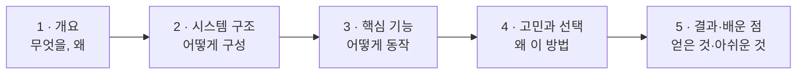

# 기준 ② 기술 문서 5단 구조

> 원본: 「유니티 개발자 취업·기술 문서 작성 가이드 v2」 **Part 2 기술 문서 작성 가이드**
> (https://koohoo-dev.github.io/portfolio-guide/guide.html#2)
> 이 파일은 Claude가 `src/*/기술문서.md`를 **읽고 점검**할 때 쓰는 판정 기준 압축본입니다.
> 비유·예시·저자 조언 전문은 원본을 읽으세요.

취업용 기술 문서는 아래 논리 흐름을 뼈대로 삼습니다.

규모에 따라 유연하게 변형합니다. **법칙이 아닙니다** — 아래 유형 중 하나에 가까우면 통과입니다.

| 유형 | 구조 |
|---|---|
| **A. 단일 기능** | 개요 → 시스템 구조 → 핵심 기능 → 고민과 선택 → 결과 |
| **B. 다기능** | 프로젝트 개요 → (기능별로 구조·기능·선택 반복) → 결과 |
| **C. 팀 프로젝트** | 개요·팀·역할 → 담당 파트 개요 → 구조 → 기능 → 고민(협업 이슈) → 결과 |

> 공통 구조 장(2장) 뒤에 기능별 장이 반복되는 형태도 **B형**입니다. 팀 프로젝트는 구조와 무관하게 **C형** 기준(역할 분리)을 함께 봅니다.
> 섹션 제목이 달라도 됩니다. "고민과 선택"이 각 기능 안에 흩어져 있어도(B형) 같은 역할을 하면 인정합니다.
> 판정은 **제목이 아니라 내용**으로 합니다.

---

## 단계별 판정 기준

### 1 · 개요 — 무엇을, 왜

- [ ] **What**(무엇을 만들었나)과 **Why**(어떤 문제·목적)가 **분리**돼 있다
- [ ] 개발 환경(엔진 버전·도구·기간)과 링크(영상·GitHub)가 있다
- [ ] 이후 섹션의 **예고편** 역할을 한다 (이 문서가 다루는 내용 안내)
- 👍 Why의 문제가 **측정 가능**하다 ("느리다" ✗ → "로딩 15초" ○)

### 2 · 시스템 구조 — 어떻게 구성

- [ ] **아키텍처 다이어그램**이 있다 (클래스·시퀀스 등 → 기준 ③)
- [ ] 핵심 클래스의 **역할 분담**(책임)이 설명돼 있다
- [ ] **왜 이렇게 나눴는지** 한두 줄이라도 있다 ("MVC 썼다" ✗ → "UI 변경이 잦아 로직과 분리" ○)
- 👎 모든 클래스를 다 그린 다이어그램 / 기술 이름만 나열한 스택

### 3 · 핵심 기능 — 어떻게 동작

- [ ] **사용법**(외부에서 무엇을 호출하면 무엇이 나오나, API 관점)이 있다
- [ ] **핵심 동작**은 핵심 로직만 선별한 코드(대략 50줄 이내 블록)로 보인다
- [ ] 코드에 **본인의 설명**이 붙어 있다 (왜 이 순서·이 구조인지)
- 👍 예외 상황(재료 부족·레시피 없음 등) 방어 코드를 보여준다
- 👎 수백 줄 코드 덤프, 설명 없는 코드

### 4 · 고민과 선택 (Trade-offs) — 왜 이 방법

- [ ] **대안 2개 이상을 비교**했다 (비교 표 권장)
- [ ] 상황(기간·규모·팀)을 근거로 **선택 이유**를 밝혔다
- [ ] "그냥", "검색에 나와서" 같은 표현이 없다
- 면접관이 가장 보고 싶어 하는 부분. **틀려도 괜찮고, 판단의 근거가 중요**합니다.

### 5 · 결과 및 배운 점

- [ ] 개요의 목표(Why)가 달성됐는지 **결과**를 밝혔다
- [ ] 가능하면 **측정값**으로 증명했다 ("렉이 없다" ✗ → "60fps 유지, 프로파일러 확인" ○)
- [ ] **문제 해결 경험**(트러블슈팅)이 있다 — 문제 → 원인 → 해결 → 결과
- [ ] **아쉬운 점(기술 부채)** 과 **개선 계획**이 있다 (약점이 아니라 성숙함의 증거)

---

## 점검 리포트에서 쓰는 심각도

| 심각도 | 의미 | 예 |
|---|---|---|
| **필수** | 없으면 포트폴리오 목적(역량 증명)을 못 이룸 | Why 없음, 고민과 선택 없음, 다이어그램 없음 |
| **권장** | 있으면 확실히 좋아짐 | 측정값 없음, 사용법(API) 없음, 예외 처리 미언급 |
| **참고** | 취향·다듬기 수준 | 표현 다듬기, 섹션 순서 |

> 리포트는 **문제를 짚고 방향을 제시**할 뿐, 학생 문서를 대신 고쳐 쓰지 않습니다.
> 목적은 *"코드를 짤 줄 안다"* 가 아니라 *"내 코드를 설명할 줄 안다"* 를 보여주는 것이기 때문입니다.
