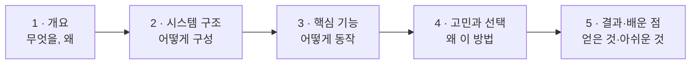

# 기준 ② 기술 문서 5단 구조

> 원본: 「유니티 개발자 취업·기술 문서 작성 가이드 v2」 **Part 2 기술 문서 작성 가이드**
> (https://koohoo-dev.github.io/portfolio-guide/guide.html#2)
> 이 파일은 Claude가 `src/*/기술문서.md`를 **읽고 점검**할 때 쓰는 판정 기준 압축본입니다.
> 비유·예시·저자 조언 전문은 원본을 읽으세요.

취업용 기술 문서는 아래 논리 흐름을 뼈대로 삼습니다.

규모에 따라 유연하게 변형합니다. **법칙이 아닙니다** — 아래 유형 중 하나에 가까우면 통과입니다.

| 유형 | 구조 |
|---|---|
| **A. 단일 기능** | 개요 → 시스템 구조 → 핵심 기능 → 고민과 선택 → 결과 |
| **B. 다기능** | 프로젝트 개요 → (기능별로 구조·기능·선택 반복) → 결과 |
| **C. 팀 프로젝트** | 개요·팀·역할 → 담당 파트 개요 → 구조 → 기능 → 고민(협업 이슈) → 결과 |

> 공통 구조 장(2장) 뒤에 기능별 장이 반복되는 형태도 **B형**입니다. 팀 프로젝트는 구조와 무관하게 **C형** 기준(역할 분리)을 함께 봅니다.
> 섹션 제목이 달라도 됩니다. "고민과 선택"이 각 기능 안에 흩어져 있어도(B형) 같은 역할을 하면 인정합니다.
> 판정은 **제목이 아니라 내용**으로 합니다.

---

## 단계별 판정 기준

### 1 · 개요 — 무엇을, 왜

- [ ] **What**(무엇을 만들었나)과 **Why**(어떤 문제·목적)가 **분리**돼 있다
- [ ] 개발 환경(엔진 버전·도구·기간)과 링크(영상·GitHub)가 있다
- [ ] 이후 섹션의 **예고편** 역할을 한다 (이 문서가 다루는 내용 안내)
- 👍 Why의 문제가 **측정 가능**하다 ("느리다" ✗ → "로딩 15초" ○)

### 2 · 시스템 구조 — 어떻게 구성

- [ ] **아키텍처 다이어그램**이 있다 (클래스·시퀀스 등 → 기준 ③)
- [ ] 핵심 클래스의 **역할 분담**(책임)이 설명돼 있다
- [ ] **왜 이렇게 나눴는지** 한두 줄이라도 있다 ("MVC 썼다" ✗ → "UI 변경이 잦아 로직과 분리" ○)
- 👎 모든 클래스를 다 그린 다이어그램 / 기술 이름만 나열한 스택

### 3 · 핵심 기능 — 어떻게 동작

- [ ] **사용법**(외부에서 무엇을 호출하면 무엇이 나오나, API 관점)이 있다
- [ ] **핵심 동작**은 핵심 로직만 선별한 코드로 보인다 — 상세 문서 한 블록 **50줄 안팎**, 발표 덱 한 장면 **20줄 안팎**
      (20줄을 넘으면 렌더러가 "계속" 장면으로 나누고 참고 지표 `long-code`를 남김. 지적이 아니라 안내)
- [ ] 코드에 **본인의 설명**이 붙어 있다 (왜 이 순서·이 구조인지)
- 👍 예외 상황(재료 부족·레시피 없음 등) 방어 코드를 보여준다
- 👎 수백 줄 코드 덤프, 설명 없는 코드

### 4 · 고민과 선택 (Trade-offs) — 왜 이 방법

- [ ] **대안 2개 이상을 비교**했다 (비교 표 권장)
- [ ] 상황(기간·규모·팀)을 근거로 **선택 이유**를 밝혔다
- [ ] "그냥", "검색에 나와서" 같은 표현이 없다
- 면접관이 가장 보고 싶어 하는 부분. **틀려도 괜찮고, 판단의 근거가 중요**합니다.

### 5 · 결과 및 배운 점

- [ ] 개요의 목표(Why)가 달성됐는지 **결과**를 밝혔다
- [ ] 가능하면 **측정값**으로 증명했다 ("렉이 없다" ✗ → "60fps 유지, 프로파일러 확인" ○)
- [ ] **문제 해결 경험**(트러블슈팅)이 있다 — 문제 → 원인 → 해결 → 결과
- [ ] **아쉬운 점(기술 부채)** 과 **개선 계획**이 있다 (약점이 아니라 성숙함의 증거)

---

## 있으면 좋은 항목 (필수는 아닙니다)

게임 프로젝트 문서에서 **있으면 읽는 사람이 더 빨리 이해하는** 항목입니다. **제목이 아니라 내용**으로 판정합니다
(예: "원작과 다른 점"이 적혀 있으면 레퍼런스가 있는 것). 없으면 리포트 **참고**로 한 줄만 적고, 필수·권장 개수에는 넣지 않습니다.

| 항목 | 어디에 | 무엇을 |
|---|---|---|
| **레퍼런스** | 1. 개요 | 참고한 게임·작품과, 내 프로젝트가 **그것과 다른 점** |
| **핵심 루프** | 1. 개요 | 플레이어가 한 판 동안 반복하는 흐름 (예: 탐색 → 수집 → 제작 → 강화) |
| **조작법** | 1. 개요 또는 3. 핵심 기능 | 키·버튼과 그 결과. 영상·스크린샷을 읽는 데 필요한 만큼만 |
| **TO-BE** | 5. 결과 (트러블슈팅 끝) | 지금 해결 방식의 한계와 **다음에 바꿀 모습** |
| **As-Is / To-Be 비교** | 4. 고민과 선택 · 5. 결과 | 바꾸기 전과 뒤를 **표로 나란히** (수치가 있으면 수치로). 발표 덱에서는 큰 표 장면(`full`)으로 |

---

## 점검 리포트에서 쓰는 심각도

| 심각도 | 의미 | 예 |
|---|---|---|
| **필수** | 없으면 포트폴리오 목적(역량 증명)을 못 이룸. 덱에서는 **빨간 띠**(배포·PDF에도 보임) | Why 없음, 고민과 선택 없음, 다이어그램 없음 / 장면 잘림 `clipped`, 원문 블록을 못 찾음 `visual-missing`·여러 곳 `visual-ambiguous`·원문이 바뀜 `visual-changed`, `key-invalid` |
| **권장** | 있으면 확실히 좋아짐 | 측정값 없음, 사용법(API) 없음, 예외 처리 미언급 |
| **참고** | 취향·다듬기 + **장면 점검 지표**(빨간 배지가 아닌 안내) | 표현 다듬기, 섹션 순서, 있으면 좋은 항목 없음 / 채움률 60% 미만 `low-fill`, 다이어그램 실효 글자 10px 미만 `tiny-diagram`, 코드 20줄 초과로 나뉨 `long-code`, 장면 30장 초과 `many-scenes`, 글자 하한(본문 14px · 코드 12px · 라벨 11px)에 걸려 더 못 줄임 `font-floor`, 예전 데이터로 자동 구성 `auto-mode` |

> 장면 점검 지표는 미리보기의 `PFScene.report()`에서 옵니다 — `audit`(필수, 빨간 띠)과 `info.notes[]`(참고, `{scene, id, type, value, detail}`).
> 참고는 쉬운 말로 한 줄씩 씁니다. 예: "[참고] 발표 덱 7장(§3.2)의 다이어그램이 작아 보입니다(약 8px). 둘로 나누거나 가로(LR)로 바꿔 보세요."
> `auto-mode`(예전 데이터) 때는 리포트에 장면 수·채움률 참고(`many-scenes`·`low-fill`)를 옮기지 않고 "다시 빌드" 권장 1건만 적습니다.

> 리포트는 **문제를 짚고 방향을 제시**할 뿐, 학생 문서를 대신 고쳐 쓰지 않습니다.
> 목적은 *"코드를 짤 줄 안다"* 가 아니라 *"내 코드를 설명할 줄 안다"* 를 보여주는 것이기 때문입니다.
