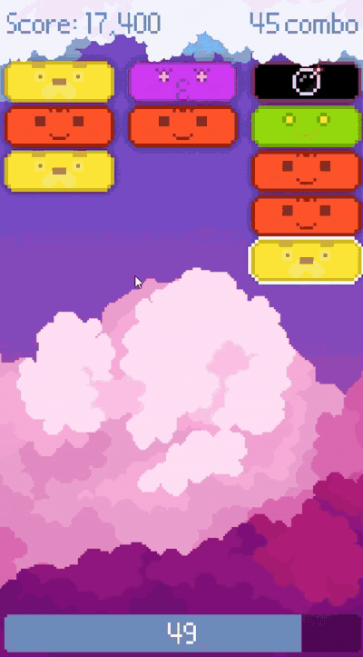
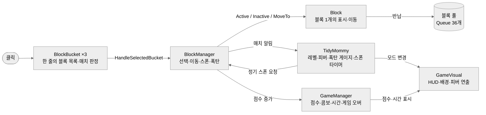
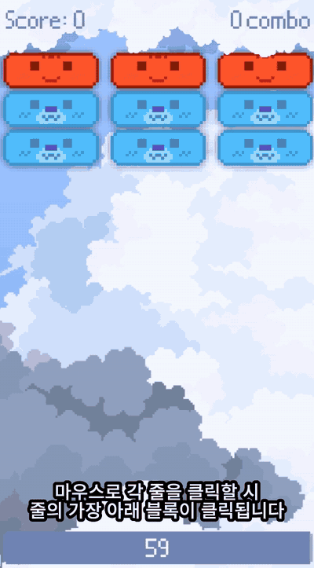
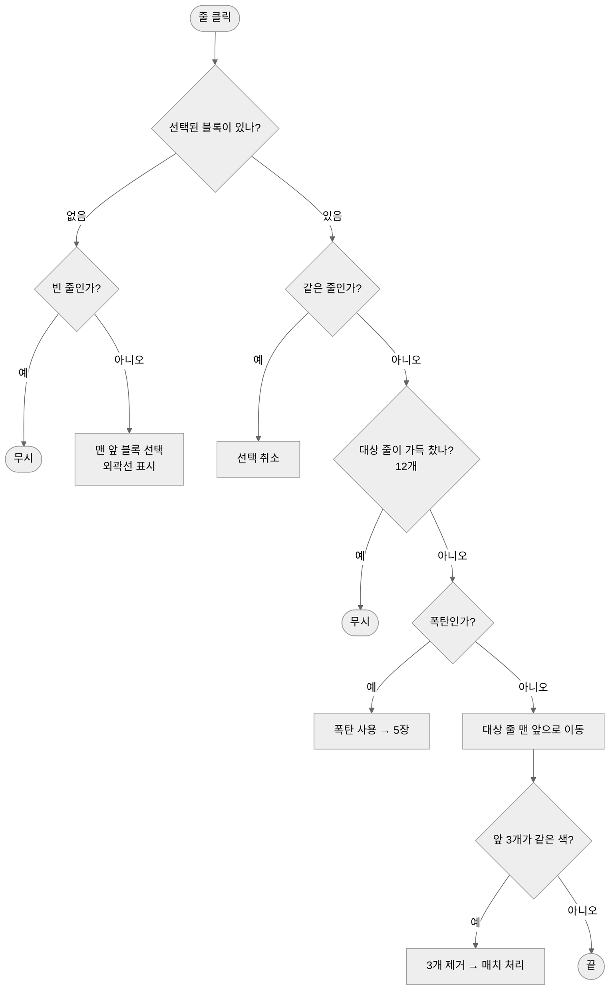
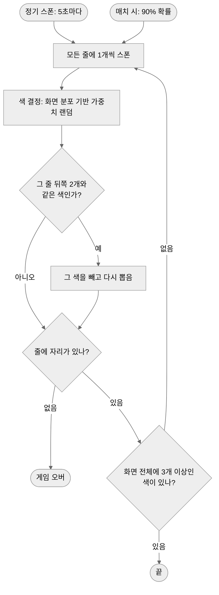
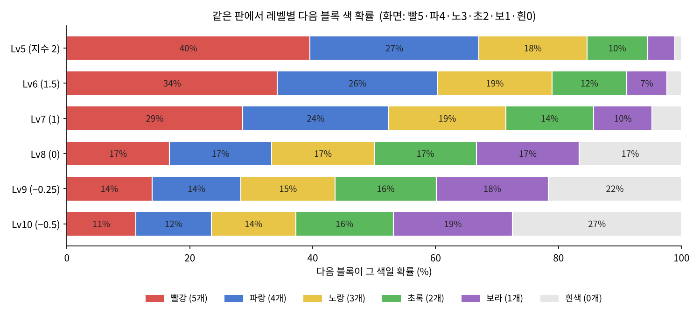
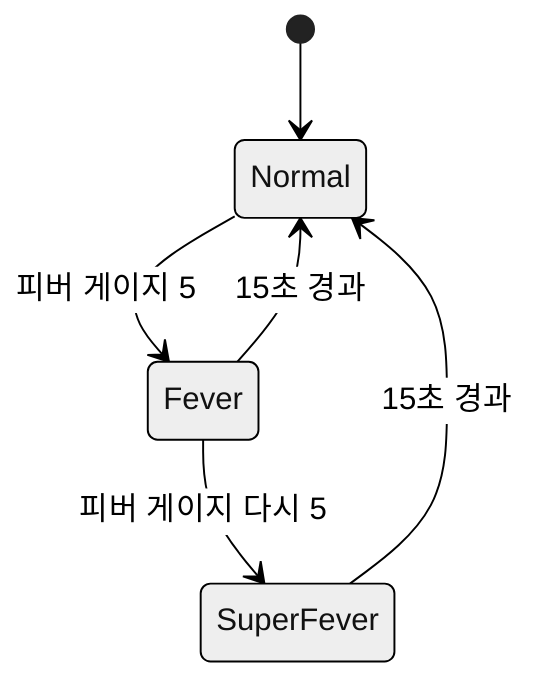
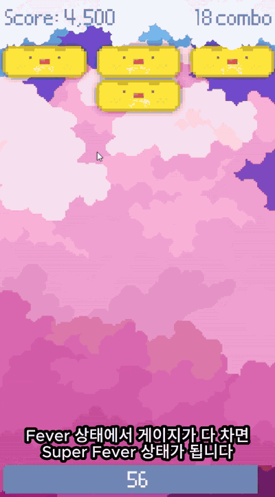
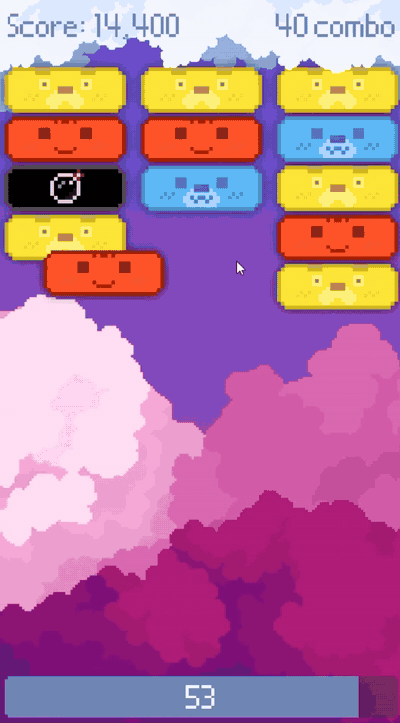
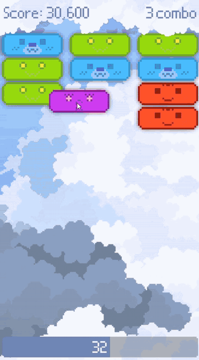

# 엄마의 삼단정리 (Tidy Mommy) 기술 문서

---

## 1. 프로젝트 개요



### 1.1 무엇을 만들었나 (What)

**「엄마의 삼단정리」**는 3줄에 계속 쌓이는 블록 중 **맨 앞 블록을 다른 줄 맨 앞으로 옮겨, 같은 색 3개를 연속으로 맞춰 제거하는** 2D 액션 퍼즐입니다. 「액션퍼즐 패밀리」의 동명 미니게임을 Unity로 재현한 개인 프로젝트입니다.

### 1.2 왜, 무엇에 집중했나 (Why)

이 프로젝트에서는 다음 세 가지에 집중했습니다.

| 집중한 것 | 내용 |
|---|---|
| **난이도 곡선** | 레벨이 오를수록 자연스럽게 어려워지도록 블록 색이 나오는 확률을 설계 |
| **코드 구조** | 블록·줄·스폰·진행 규칙·표시를 클래스별로 나누어 책임을 분리 |
| **원작 재현** | 원작의 규칙(이동·3매치·레벨·폭탄·피버)을 대부분 그대로 구현 |

처음에는 블록 색을 **순수 랜덤**으로 뽑았습니다. 그런데 등장하는 색이 조금만 늘어나도 같은 색 3개를 모으기가 급격히 어려워져, **레벨이 오르는 순간 난이도가 급증하는 문제**가 생겼습니다. 이를 해결하기 위해 화면에 있는 색의 분포를 기준으로 가중치를 주고, 레벨에 따라 그 가중치의 지수를 바꾸는 방식으로 **10단계 난이도 곡선**을 설계했습니다. 이 스폰 시스템이 이 프로젝트의 핵심입니다.

### 1.3 게임 규칙 요약

| 구분 | 규칙 |
|---|---|
| 조작 | 줄 클릭 → 맨 앞 블록 선택 → 다른 줄 클릭 → 그 줄 맨 앞으로 이동. 같은 줄 재클릭 시 취소 |
| 매치 | 블록이 들어간 줄의 **앞 3개가 같은 색**이면 제거 |
| 스폰 | 5초마다 모든 줄에 1개씩. 매치하면 90% 확률로 즉시 1개씩 |
| 레벨 | 매치 10회마다 레벨업(1~10). 등장 색 2색 → 최대 6색 |
| 점수·시간 | 매치당 200점, 콤보 10마다 배율 +0.5. 제한 60초, **매치마다 +1초** |
| 폭탄 | 매치로 게이지를 채우면 생성. 사용 시 **모든 줄 앞에서 3개씩 제거** |
| 피버 | 매치로 게이지를 채우면 Fever → 한 번 더 채우면 SuperFever (15초 지속) |
| 게임 오버 | 시간 0, 또는 가득 찬 줄(12개)에 블록이 스폰될 때 |

### 1.4 원작과 다른 점

| 항목 | 원작 | 이 프로젝트 |
|---|---|---|
| 폭탄 | 옮긴 위치 기준으로 주변이 터짐 | 어느 줄로 쓰든 모든 줄 앞에서 3개씩 제거 |
| 시간 보너스 | 피버 중 가끔 수 초씩 크게 증가 | 매치마다 +1초 |
| 슈퍼피버 | 판을 새로 깔고 처음에만 2색, 이후 다른 색이 섞임 | 지속시간 내내 **2색만** 등장 |

### 1.5 개발 환경

| 항목 | 내용 |
|---|---|
| Engine | Unity 6000.3.15f1 (URP 2D) |
| 주요 패키지 | Input System, uGUI + TextMeshPro |
| 기간 | 2026.05.25 ~ 2026.05.28 (4일) |
| 형태 | 개인 프로젝트 |
| 개발 조건 | **이벤트·LINQ 같은 고급 기능을 가능하면 쓰지 않고 기본 문법으로 구현** |

### 1.6 링크
- GitHub: [chesherneko/TidyMommy](https://github.com/chesherneko/TidyMommy)
- 시연 영상: [YouTube Shorts](https://youtube.com/shorts/EPURtuIUmQE)

### 1.7 이 문서에서 다루는 내용

전체 구조(2장)를 먼저 보여 드린 뒤, 네 가지 시스템을 차례로 설명합니다. **블록 이동·매치**(3장), 이 프로젝트의 핵심인 **스폰·난이도 곡선**(4장), **폭탄·피버**(5장), **연출·사운드 피드백**(6장)입니다. 마지막으로 결과와 기술 부채, 배운 점(7장)을 정리합니다.

---

## 2. 전체 구조

### 2.1 아키텍처



입력은 **줄(`BlockBucket`) → `BlockManager`** 한 방향으로만 들어옵니다. 블록을 실제로 움직이고 스폰하는 일은 `BlockManager`가, "언제 스폰하고 언제 피버에 들어가는가" 같은 **게임 진행 규칙**은 `TidyMommy`가 맡습니다. 점수·시간(`GameManager`)과 화면 표시(`GameVisual`)는 각각 따로 둬서, 상태를 바꾸는 쪽과 보여 주는 쪽을 나눴습니다.

### 2.2 클래스 역할

| 클래스 | 하는 일 | 하지 않는 일 |
|---|---|---|
| `BlockBucket` | 한 줄의 블록 리스트 관리, 슬롯 위치 재정렬, 앞 3개 매치 판정 | 어떤 색을 낼지 결정하지 않음 |
| `Block` | 타입·스프라이트·선택 외곽선, 이동 연출, 풀 반납 | 스스로 줄을 고르거나 매치를 판정하지 않음 |
| `BlockManager` | 클릭 처리(선택·이동·취소), 색 결정과 스폰, 폭탄 사용, 블록 풀 | 점수·시간·레벨을 계산하지 않음 |
| `TidyMommy` | 스폰 타이머, 레벨, 폭탄·피버 게이지, 모드 전환 | 블록을 직접 만들거나 옮기지 않음 (`BlockManager`에 요청) |
| `GameManager` | 점수·콤보·남은 시간, 게임 오버와 재시작 | 화면에 직접 그리지 않음 |
| `GameVisual` / `FeverFX` | 점수·콤보·타이머 HUD, 배경 교체, 피버 연출 | 게임 상태를 바꾸지 않음 |
| `SoundManager` | 효과음 재생, 이동음 겹침 제어, 모드별 BGM 피치 | — |
| `BlockSpriteLibrary` / `BlockMaterialLibrary` | 블록 타입 → 스프라이트, 선택 상태 → 머티리얼 매핑 (ScriptableObject) | — |

### 2.3 고민과 선택: 클래스끼리 어떻게 알릴 것인가

> **결정 대상**: 블록이 매치됐을 때, 진행 규칙(`TidyMommy`)·점수(`GameManager`)·사운드·카메라에 어떻게 알릴 것인가?

| | **[A] 이벤트** | **[B] 싱글톤 직접 호출** ✓ |
|---|---|---|
| 방식 | `BlockManager`가 "매치됨" 이벤트를 발행하고, 필요한 쪽이 구독 | 하나뿐인 매니저를 `Instance`로 찾아 직접 메서드 호출 |
| 장점 | 발행하는 쪽이 받는 쪽을 몰라도 됨. 반응을 추가할 때 `BlockManager` 수정 불필요 | 호출 순서가 코드에 그대로 드러나 추적이 쉬움 |
| 단점 | 호출 흐름이 코드에 바로 보이지 않음. 구독 해제 관리 필요 | 호출하는 쪽이 받는 쪽을 모두 알아야 함 |

**[최종 결정]** [B] 싱글톤 직접 호출을 선택했습니다. 이 프로젝트는 **이벤트 같은 고급 기능을 가능하면 쓰지 않는 것**이 개발 조건이었습니다. 싱글톤은 게임 안에 하나만 존재하는 매니저 5개에 적용했고, `MonoSingleton<T>` 제네릭 클래스로 중복 코드를 줄였습니다.

```csharp
// BlockManager.cs — 매치 후 필요한 곳을 차례로 직접 호출
private void OnBlockMatched()
{
    TrySpawnBlocksWhenMatched();          // 스폰 (자기 책임)

    TidyMommy.OnBlockMatched();           // 진행 규칙: 레벨·폭탄·피버 게이지
    GameManager.Instance.IncreaseScore(); // 점수·콤보·시간

    cameraShake.Shake();
    SoundManager.Instance.PlayBlockMatchSFX(isBomb: false);
}
```

**[감수한 대가]** `BlockManager`가 매치 이후에 반응하는 모든 대상을 알고 있어야 합니다. 예를 들어 "매치 시 업적 카운트"를 추가하려면 `OnBlockMatched`를 직접 고쳐야 합니다. 이 조건이 없었다면 이벤트로 바꾸고 싶은 부분으로, 7장 회고에서 다시 다룹니다.

### 2.4 고민과 선택: 줄 수를 늘릴 것인가

> **결정 대상**: 레벨이 오를 때 난이도를 무엇으로 올릴 것인가?

| | **[A] 줄 추가** | **[B] 3줄 고정** ✓ |
|---|---|---|
| 방식 | 레벨이 오르면 줄을 4줄, 5줄로 늘림 | 줄은 그대로 두고, 등장 색의 수와 확률로 조절 |
| 장점 | 난이도 상승이 눈에 바로 보임 | 블록 크기와 화면 구성이 끝까지 유지됨 |
| 단점 | 화면에 맞추려면 블록 크기를 줄여야 해 **가시성이 떨어짐** | 난이도 조절을 색 설계에 맡겨야 함 |

**[최종 결정]** [B] 3줄 고정을 선택했습니다. 이 게임의 재미는 **블록을 빠르게 파악하고 정리하는 것**인데, 줄이 늘어 블록이 작아지면 바로 그 "파악"이 어려워지기 때문입니다.

**[얻은 것]** 줄 수가 고정이므로 줄당 최대 12개 × 3줄 = **36개**로 화면에 존재할 수 있는 블록 수의 상한이 정해졌고, 블록 풀 크기도 이 값으로 고정할 수 있었습니다(3장).

**[감수한 대가]** 난이도를 올리는 수단이 "색"에 집중됐습니다. 그래서 색을 어떻게 뽑느냐가 중요해졌고, 이것이 4장 스폰·난이도 곡선 설계로 이어집니다.

---

## 3. 시스템 ① 블록 이동·매치



### 3.1 개요

플레이어의 모든 조작은 **"줄을 클릭한다"** 하나입니다. 첫 클릭으로 그 줄의 맨 앞 블록(화면에서 가장 아래 블록)을 고르고, 두 번째 클릭으로 다른 줄의 맨 앞에 넣습니다. 블록이 들어간 줄의 앞 3개가 같은 색이면 제거됩니다.

### 3.2 구조: 한 줄 = `List<Block>`

| 동작 | 리스트 처리 | 위치 |
|---|---|---|
| 맨 앞 블록 선택 | `activeBlocks[0]` | 인덱스 0이 맨 앞 |
| 다른 줄로 이동 | 대상 줄에 `Insert(0, block)` | 맨 앞에 끼워 넣음 |
| 스폰 | `Add(block)` | 맨 뒤에 붙음 |
| 매치 판정 | `activeBlocks[0..2]` 비교 | 앞 3개 |

줄마다 최대 12개의 **슬롯 위치를 `Awake`에서 미리 계산**해 두고, 리스트가 바뀔 때마다 모든 블록을 자기 순번의 슬롯으로 0.15초 동안 이동시킵니다. 이동 중에 다시 호출되면 진행 중인 이동을 멈추고 새 목적지로 바로 출발하게 해, 입력에 즉시 반응하도록 했습니다.

### 3.3 핵심 기능

**사용법 (API)** — 줄 오브젝트가 클릭되면 `BlockManager.HandleSelectedBucket(bucket)` 하나만 호출합니다. 선택·이동·취소·폭탄 사용은 모두 이 함수가 "지금 선택된 블록이 있는가"를 기준으로 나눠 처리합니다.



```csharp
// BlockManager.cs
public void HandleSelectedBucket(BlockBucket selectedBucket)
{
    if (selectedBlock != null)
    {
        // 같은 줄을 다시 누르면 선택 취소
        if (selectedBlock.CurrentBucket == selectedBucket) { DeselectSelectedBlock(); return; }

        // 가득 찬 줄에는 넣을 수 없음 (폭탄도 '옮기는' 동작이므로 같은 규칙 적용)
        if (selectedBucket.HasAvailableSpace == false) return;

        if (selectedBlock.Type == BlockType.Bomb) { UseBombBlock(selectedBlock); selectedBlock = null; return; }

        selectedBlock.TransferBucketTo(selectedBucket); // 원래 줄에서 빼고 대상 줄 맨 앞에 Insert(0)
        DeselectSelectedBlock();

        // 매치는 블록이 '들어간 줄'만 검사하면 충분
        if (selectedBucket.CheckBlockMatch())
            OnBlockMatched();
    }
    else
    {
        if (selectedBucket.IsSpaceEmpty) return;      // 빈 줄은 고를 블록이 없음

        selectedBlock = selectedBucket.ActiveBlocks[0]; // 항상 맨 앞 블록만 선택 가능
        selectedBlock.OnSelected();
    }
}
```

```csharp
// BlockBucket.cs — 앞 3개가 같은 타입이면 제거
public bool CheckBlockMatch()
{
    if (IsLastThreeConsecutiveSame() == false) return false;

    for (int i = MATCH_BLOCK_COUNT - 1; i >= 0; i--) // 뒤에서부터 제거해 인덱스가 밀리지 않게
        activeBlocks[i].Inactive();

    return true;
}
```

**예외 처리**

| 상황 | 처리 |
|---|---|
| 빈 줄을 클릭 | 아무것도 선택하지 않음 |
| 선택한 줄을 다시 클릭 | 선택 취소 (취소 효과음) |
| 가득 찬 줄(12개)로 이동 | 무시. 폭탄도 동일 |
| 게임 오버 후 클릭 | 게임 오버 UI의 Mask(Image)가 레이캐스트를 막아 줄까지 클릭이 전달되지 않음 |

### 3.4 고민과 선택: 블록을 어떻게 만들고 없앨 것인가

> **결정 대상**: 계속 생기고 사라지는 블록을 매번 생성·파괴할 것인가, 미리 만들어 재사용할 것인가?

| | **[A] Instantiate / Destroy** | **[B] 미리 배치한 풀** ✓ |
|---|---|---|
| 방식 | 스폰할 때 생성, 매치되면 파괴 | 씬에 블록 36개를 미리 두고 `Queue`에서 꺼내 쓰고 반납 |
| 장점 | 개수 제한이 없고 구현이 단순 | 플레이 중 생성·파괴 비용이 없음 |
| 단점 | 매치·스폰 때마다 생성·파괴 비용 발생 | 풀 크기를 미리 정해야 함 |

**[최종 결정]** [B] 미리 배치한 풀을 선택했습니다. 줄 3개 × 줄당 최대 12개로 **화면에 존재할 수 있는 블록 수가 36개로 정해져 있으므로**, 그만큼만 미리 만들어 두면 생성·파괴 비용 없이 모든 상황을 감당할 수 있다고 판단했습니다.

```csharp
// Block.cs — 매치된 블록은 스스로 풀에 돌아가고 줄에서 빠짐
public void Inactive()
{
    pool.EnqueueBlock(this);
    CurrentBucket.RemoveActiveBlock(this);
    gameObject.SetActive(false);
}

public void Active(BlockType type, BlockBucket bucket)
{
    ...
    bucket.AddActiveBlock(this);
#if UNITY_EDITOR
    // (Why) 에디터에서는 하이어라키가 어지러우면 확인이 어려워 줄 하위로 정리.
    //       실제 플레이에서는 부모 정리가 동작에 영향이 없어 빌드에서는 실행하지 않음
    transform.SetParent(bucket.transform);
#endif
}
```

**[감수한 대가]** 풀 크기를 최대 수용량과 정확히 같게 잡아 여유가 없습니다. 이 때문에 생기는 경계 상황은 7장 기술 부채에서 다룹니다.

---

## 4. 시스템 ② 스폰·난이도 곡선 ★

### 4.1 개요: 순수 랜덤의 문제

처음에는 등장 가능한 색 중에서 **순수 랜덤**으로 다음 블록을 뽑았습니다. 그러자 레벨이 올라 색이 조금만 늘어나도 **난이도가 급증**했습니다.

사후 분석으로 추정한 원인은 이렇습니다. 색이 n개면 블록 하나가 특정 색일 확률은 1/n입니다. 등장 색이 2색에서 6색으로 늘면 이 확률이 1/2에서 1/6로 떨어지고, 같은 색 3개가 화면에 모일 확률은 그보다 훨씬 빠르게 떨어집니다.

그래서 **화면에 이미 있는 색의 분포를 기준으로 가중치**를 주고, **레벨마다 그 가중치의 세기(지수)를 바꾸는** 방식으로 바꿨습니다. 같은 식 하나로 초반에는 "맞추기 쉽게 도와주는 스폰"을, 후반에는 "방해하는 스폰"을 만듭니다.

### 4.2 구조: 스폰 흐름



| 단계 | 하는 일 | 4장 절 |
|---|---|---|
| 트리거 | 5초마다(피버 1.5배속, 슈퍼피버 2배속) / 매치 시 90% 확률 | 4.6 |
| 색 결정 | 레벨별 지수 가중치 | 4.3 |
| 뒤쪽 3연속 방지 | 줄 뒤에 같은 색 3개가 공짜로 모이지 않게 | 4.4 |
| 매치 가능 보장 | 맞출 수 있는 색이 없으면 추가 스폰 | 4.4 |

### 4.3 핵심 기능 ①: 레벨별 지수 가중치

**규칙**: 색별 가중치 = **(화면에 있는 그 색의 개수 + 1) ^ 지수**. 누적합으로 하나를 뽑습니다.

| 레벨 | 1 | 2 | 3 | 4 | 5 | 6 | 7 | 8 | 9 | 10 |
|---|---|---|---|---|---|---|---|---|---|---|
| 등장 색 수 | 2 | 3 | 4 | 5 | 6 | 6 | 6 | 6 | 6 | 6 |
| 지수 | 2 | 2 | 2 | 2 | 2 | 1.5 | 1 | **0** | −0.25 | −0.5 |
| 성격 | 많은 색이 더 잘 나옴 | ← | ← | ← | ← | 완화 | 개수에 비례 | **균등** | 적은 색이 더 잘 나옴 | ← |

- **지수 > 0**: 화면에 많은 색이 더 잘 나옴 → 같은 색이 모이기 쉬움 (도와주는 스폰)
- **지수 = 0**: 모든 가중치가 1 → 순수 랜덤과 같음
- **지수 < 0**: 화면에 적은 색이 더 잘 나옴 → 색이 흩어짐 (방해하는 스폰)



같은 판(빨5·파4·노3·초2·보1·흰0)에서 다음 블록 색 확률을 계산한 값입니다. Lv5에서는 가장 많은 빨강이 40%, 없는 흰색은 1%입니다. Lv10에서는 반대로 흰색이 27%, 빨강이 11%가 됩니다.

```csharp
// BlockManager.cs
private Dictionary<BlockType, int> GetBlockCounts(bool useDefaultCount = true)
{
    Dictionary<BlockType, int> counts = DictionaryPool<BlockType, int>.Get();
    int maxSpawnTypeIdx = (int)GetMaxBlockType(TidyMommy.CurrentLevel, TidyMommy.CurrentMode);

    // (Why) 기본값 1: 화면에 없는 색(0개)의 가중치가 0이 되어 영영 안 나오는 것을 막음
    for (int i = 0; i <= maxSpawnTypeIdx; i++)
        counts[blockTypes[i]] = useDefaultCount ? 1 : 0;

    foreach (BlockBucket bucket in buckets)            // 화면의 모든 줄을 돌며 색별 개수 집계
        foreach (Block block in bucket.ActiveBlocks)
            if (block.Type != BlockType.Bomb) counts[block.Type]++;

    return counts;
}

private Dictionary<BlockType, float> BuildSpawnWeights(Dictionary<BlockType, int> counts, out float totalWeight)
{
    totalWeight = 0f;
    Dictionary<BlockType, float> weights = DictionaryPool<BlockType, float>.Get();
    float exponent = GetLevelExponent(TidyMommy.CurrentLevel); // Lv1~5: 2 … Lv10: -0.5

    foreach (var count in counts)
    {
        float weight = Mathf.Pow(count.Value, exponent);       // 지수 하나로 '도움'과 '방해'를 전환
        weights[count.Key] = weight;
        totalWeight += weight;
    }
    return weights;
}
```

### 4.4 핵심 기능 ②: 두 가지 보정 규칙

**① 줄 뒤쪽 3연속 방지** — 새 블록은 줄 맨 뒤에 붙습니다. 뒤쪽 두 개와 같은 색이 붙으면 같은 색 3개가 **플레이어가 아무것도 하지 않아도** 모이게 됩니다. 이 공짜 매치를 막기 위해, 이 경우에는 그 색을 뺀 나머지 색에서 다시 뽑습니다.

```csharp
private BlockType GetNextSpawnType(bool hasLastTwoTypes, BlockType t1, BlockType t2)
{
    BlockType candidate = /* 4.3의 가중치 랜덤 */;

    if (hasLastTwoTypes == false) return candidate;            // 줄에 블록이 2개 미만
    if (WouldCreateMatch(candidate, t1, t2) == false) return candidate;

    return GetBlockTypeExcluding(candidate);                   // (Why) 뒤쪽 3연속 = 공짜 매치 방지
}
```

**② 매치 가능 보장** — 스폰이 끝난 뒤, 화면 전체에서 3개 이상 있는 색이 하나도 없으면 맞출 수 있을 때까지 모든 줄에 1개씩 더 스폰합니다. 판이 막혀 아무것도 할 수 없는 상황을 막기 위해 기획 단계에서 정한 규칙입니다.

```csharp
private void SpawnRandomBlocksIfNoMatches()
{
    Dictionary<BlockType, int> counts = GetBlockCounts(useDefaultCount: false); // 실제 개수만 집계
    bool hasMatchableColor = false;

    foreach (int count in counts.Values)
        if (count >= BlockBucket.MATCH_BLOCK_COUNT) { hasMatchableColor = true; break; }

    DictionaryPool<BlockType, int>.Release(counts);
    if (hasMatchableColor) return;

    SpawnRandomBlocksToAllLines(); // 모든 줄에 1개씩 더 스폰 후 다시 검사
    SpawnRandomBlocksIfNoMatches();
}
```

### 4.5 고민과 선택: 다음 블록의 색을 어떻게 정할 것인가

> **결정 대상**: 레벨이 올라 색이 늘어날 때, 난이도가 급증하지 않고 서서히 오르게 하려면 색을 어떻게 뽑아야 하는가?

| | **[A] 순수 랜덤** | **[B] 분포 기반 지수 가중치** ✓ |
|---|---|---|
| 방식 | 등장 가능한 색 중 균등 확률 | (화면 개수 + 1)^지수, 지수는 레벨별 |
| 장점 | 구현이 가장 단순. 확률이 항상 1/n로 예측 가능 | 지수 하나로 난이도 세기를 10단계로 조절. 색이 늘어도 초반엔 맞추기 쉬움 |
| 단점 | 색 수가 늘면 난이도가 급증 | 매 스폰마다 화면 전체를 집계해야 함. 확률이 화면 상태에 따라 계속 바뀜 |

**[최종 결정]** [B]를 선택했습니다. 실제로 [A]로 플레이했을 때 색이 조금만 늘어도 난이도가 급증했고, 레벨에 따라 난이도를 서서히 올리려면 "색 수"만이 아니라 "어떤 색이 나올 확률"까지 조절할 수단이 필요했습니다. 역가중치 구현 방법을 찾아본 뒤, 지수를 양수에서 음수까지 바꾸면 같은 식으로 "도와주는 스폰"과 "방해하는 스폰"을 모두 표현할 수 있다는 점을 이용했습니다.

**[얻은 것]** 레벨 표의 지수 값만 바꾸면 난이도 곡선을 조정할 수 있습니다. Lv8(지수 0)이 순수 랜덤과 같으므로, Lv1~7은 순수 랜덤보다 쉽고 Lv9~10은 더 어려운 구간이 됩니다.

**[감수한 대가]** 스폰할 때마다 화면의 블록(최대 36개)을 모두 세야 하고, 같은 레벨에서도 판 상태에 따라 확률이 달라져 결과를 한눈에 예측하기 어렵습니다.

**[지수 값을 정한 방법]** 지수 값은 먼저 플레이로 확인했지만, 레벨 사이의 차이가 감각만으로는 잘 구분되지 않았습니다. 그래서 AI의 도움을 받아 레벨이 오를 때마다 확률이 단계적으로 바뀌도록 값을 정했습니다. 이 값이 실제 플레이 난이도와 맞는지는 데이터로 검증하지 못했고, 7장 기술 부채에서 개선 계획을 다룹니다.

### 4.6 튜닝: 스폰 타이밍

| 항목 | 변경 전 | 변경 후 | 이유 |
|---|---|---|---|
| 매치 시 스폰 | 정기 스폰만 | 매치하면 90% 확률로 즉시 모든 줄에 1개씩 | 빠른 템포를 위해 |
| 정기 스폰 타이머 | 매치와 무관하게 계속 진행 | **매치하면 0으로 리셋** | 정기 스폰과 매치 스폰이 겹쳐 블록이 한꺼번에 2개씩 쌓이는 경우가 있었음. 템포는 유지하면서 몰림을 막기 위해 |

---

## 5. 시스템 ③ 폭탄·피버

### 5.1 개요

폭탄과 피버는 **매치를 이어 가는 플레이어에게 주는 보상**입니다. 둘 다 같은 구조의 게이지를 씁니다.

| | 폭탄 | 피버 |
|---|---|---|
| 게이지 증가 | 매치마다 +1 | 매치마다 +1 |
| 게이지 감소 | 초당 0.15 | 초당 0.15 |
| 발동 기준 | 5 | 5 |
| 효과 | 빈자리 있는 줄 중 한 곳에 폭탄 블록 생성 | Normal → Fever → SuperFever로 모드 상승 |

게이지가 시간에 따라 줄어들기 때문에, **짧은 시간 안에 매치를 여러 번 해야** 보상이 발동합니다.

### 5.2 구조: 모드 전환



| | Normal | Fever | SuperFever |
|---|---|---|---|
| 스폰 속도 | 1배 | 1.5배 | 2배 |
| 등장 색 | 레벨에 따름 | 레벨에 따름 | **빨강·파랑 2색** |
| BGM 피치 | 1.0 | 1.15 | 1.3 |
| 배경 | 기본 | 피버 배경, 스크롤 4배 | 슈퍼피버 배경, 스크롤 8배 |
| 레벨·폭탄·피버 게이지 증가 | O | O | **X (정지)** |
| 진입 시 | — | 플래시·텍스트 연출 | 연출 + **판 재구성** |

### 5.3 핵심 기능

**① 게이지 공통 처리** — 폭탄과 피버 게이지는 같은 감소 규칙을 쓰므로, 게이지를 `ref`로 받는 함수 하나로 처리합니다.

```csharp
// TidyMommy.cs
private void UpdateGauge(ref float gauge, float speed)
{
    if (gauge == 0f) return;
    gauge = Mathf.Max(0, gauge - Time.deltaTime * speed); // 0 아래로 내려가지 않게
}

private void IncreaseFeverGauge()
{
    feverGauge += 1f;

    if (feverGauge >= feverUnit)
    {
        CurrentMode = (Mode)((int)CurrentMode + 1); // Normal → Fever → SuperFever
        ApplyMode();                                 // 스폰 속도·BGM·배경·연출 반영

        feverGauge = 0f;
        feverTimer = 0f;                             // 상승할 때마다 지속시간 15초를 새로 셈
    }
}
```

**② 슈퍼피버 판 재구성** — 슈퍼피버에 들어가면 모든 줄을 비우고, 줄마다 앞에서부터 **빨2·파2·빨2**로 다시 채웁니다. 이후 스폰도 빨강·파랑 2색만 나옵니다.

원작도 슈퍼피버에서 판을 새로 깔지만, 처음 잠깐만 2색이고 곧 다른 색이 섞입니다. 이 프로젝트는 **15초 내내 2색만** 나오게 바꿨습니다. 슈퍼피버를 **블록을 빠르게 연달아 처리하는 쾌감이 가장 큰 구간**으로 만들기 위해서입니다. 같은 목적으로 BGM 피치(1.3배)와 배경 스크롤 속도(8배)도 함께 올렸습니다.



```csharp
private void SuperFever()
{
    BlockManager.RemoveBlocksFromAllLines(BlockBucket.MAX_BLOCKS_PER_BUCKET); // 모든 줄 비우기

    BlockManager.SpawnBlocksToAllLines(BlockType.Red, 2);
    BlockManager.SpawnBlocksToAllLines(BlockType.Blue, 2);
    BlockManager.SpawnBlocksToAllLines(BlockType.Red, 2);
}
```

**③ 폭탄** — 게이지가 차면 빈자리가 있는 줄 중 하나를 무작위로 골라 폭탄을 넣습니다. 모든 줄이 가득 차 넣을 수 없으면 게이지를 비우지 않고 다음 매치 때 다시 시도합니다. 폭탄을 선택한 뒤 다른 줄을 클릭하면 발동합니다.



```csharp
// BlockManager.cs
private void UseBombBlock(Block block)
{
    block.Inactive();
    RemoveBlocksFromAllLines(BOMB_BLOCK_REMOVE_COUNT); // 모든 줄 앞에서 3개씩 (있는 만큼만)

    SpawnRandomBlocksToAllLines(Random.Range(1, 3));   // 모든 줄에 1~2개씩 새로 스폰

    cameraShake.BigShake();
    SoundManager.Instance.PlayBlockMatchSFX(isBomb: true);
}
```

| 상황 | 처리 |
|---|---|
| 폭탄 생성 시 모든 줄이 가득 참 | 생성 실패, 게이지 유지 → 다음 매치에 재시도 |
| 가득 찬 줄에 폭탄 사용 | 발동하지 않음. 폭탄도 그 줄로 "옮기는" 동작이므로 일반 블록과 같은 규칙 적용 |
| 줄에 블록이 3개 미만 | 있는 만큼만 제거 |
| 색 가중치 계산 | 폭탄은 집계에서 제외 |

---

## 6. 시스템 ④ 피드백 (연출·사운드)

### 6.1 피버 연출



피버에 들어가는 순간을 **약 0.6초짜리 짧은 연출**로 알립니다. 화면 플래시가 사라지는 동안 텍스트가 겹쳐서 튀어나오도록 두 동작을 한 루프 안에서 시간차로 처리했습니다.

| 시간 | 플래시 | 텍스트 |
|---|---|---|
| 0 ~ 0.05초 | 투명도 0 → 0.7 | — |
| 0.05 ~ 0.2초 | 0.7 → 0 | 0.025초 뒤 등장: 투명도 0 → 1 (0.1초), 크기 0.25 → 1.15 **EaseOutBack** (0.15초), 효과음 |
| 0.2 ~ 0.3초 | — | 크기 1.15 → 1.0 (EaseOutQuad) |
| 0.3 ~ 0.55초 | — | 위로 40 이동하며 0.2초 동안 사라짐 |

```csharp
// FeverFX.cs — 플래시가 사라지는 루프 안에서 텍스트를 시간차로 등장시킴
while (elapsed < flashOutDuration)
{
    elapsed += Time.deltaTime;
    SetAlpha(flashImage, Mathf.Lerp(flashMaxAlpha, 0f, elapsed / flashOutDuration));

    float textElapsed = elapsed - textDelay;                 // 0.025초 늦게 시작
    if (textElapsed >= 0f)
    {
        SetAlpha(tmp, Mathf.Lerp(0f, 1f, textElapsed / textFadeInDuration));
        float eased = EasingFunction.EaseOutBack(0, 1, textElapsed / textScaleUpDuration);
        tmp.transform.localScale = Vector3.LerpUnclamped(startScale, endScale, eased); // EaseOutBack은 1을 넘었다 돌아오므로 Unclamped
    }
    yield return null;
}
```

연출이 진행 중일 때 다시 호출되면 이전 코루틴을 멈추고 처음부터 재생합니다. 모드가 바뀌면 BGM 피치와 배경 스크롤 속도도 함께 바뀝니다(5.2 표).

### 6.2 화면 흔들림

| | 지속 | 세기 |
|---|---|---|
| 일반 매치 | 0.1초 | 0.035 |
| 폭탄 | 0.2초 | 0.1 |

흔들림 세기는 시간에 따라 `세기 × e^(−t)`로 줄어들어, 처음에 크게 흔들리고 점점 잦아듭니다.

### 6.3 트러블슈팅: 이동음 겹침

**증상** — 매치나 스폰이 일어날 때 이동 효과음이 한꺼번에 겹쳐 재생되어 귀가 아플 정도로 시끄러웠습니다.

**원인** — 줄의 블록 목록이 바뀌면 그 줄의 **모든 블록**이 새 위치로 `MoveTo`를 호출하고, `MoveTo`마다 이동음을 재생합니다. 예를 들어 모든 줄에 1개씩 스폰하면 화면의 블록 전체(최대 36개)가 같은 프레임에 이동음을 냅니다.

**해결** — 이동음을 `SoundManager` 한 곳에서 제어하도록 두 가지 규칙을 넣었습니다.

```csharp
// SoundManager.cs
public void PlayBlockMoveSFX()
{
    float now = Time.time;

    // ① 쿨다운: 0.1초 안에 들어온 이동음은 무시 → 같은 프레임의 수십 번 호출이 한 번으로
    if (now - lastMovePlayTime < moveCooldown) return;
    lastMovePlayTime = now;

    // ② 매치 직후 0.15초 안의 이동음은 볼륨 0.25배 → 매치음과 겹치는 구간을 작게
    bool isDuringMatch = now - lastMatchPlayTime < blockMoveAfterMatchDuration;
    float volumeScale = isDuringMatch ? moveVolumeScaleDuringMatch : moveVolumeScale;

    seSource.PlayOneShot(blockMoveClip, volumeScale);
}
```

| 값 | 변경 전 | 변경 후 |
|---|---|---|
| 이동음 쿨다운 | 0.08초 | 0.1초 |
| 매치 직후 이동음 볼륨 | 0.35배 | 0.25배 |
| 매치 직후로 보는 구간 | 0.12초 | 0.15초 |

**배운 점** — 효과음을 내는 오브젝트가 여러 개일 때는, 각자 재생하게 두지 말고 **재생 여부를 한 곳에서 판단**해야 겹침을 제어할 수 있습니다.

---

## 7. 결과·회고

### 7.1 결과

| 집중한 것 | 결과 |
|---|---|
| **난이도 곡선** | 순수 랜덤에서 생기던 난이도 급증을 **레벨별 지수 가중치**로 바꿔, 같은 식 하나로 "도와주는 스폰(Lv1~7) → 균등(Lv8) → 방해하는 스폰(Lv9~10)"의 10단계 곡선을 만들었습니다. |
| **코드 구조** | 입력·이동(`BlockManager`), 한 줄(`BlockBucket`), 진행 규칙(`TidyMommy`), 점수·시간(`GameManager`), 표시(`GameVisual`)로 책임을 나눠, 상태를 바꾸는 쪽과 보여 주는 쪽을 분리했습니다 |
| **원작 재현** | 이동·3매치·레벨·폭탄·피버·슈퍼피버 등 원작의 핵심 규칙을 구현했고, 폭탄·시간 보너스·슈퍼피버 세 가지는 이 프로젝트에 맞게 바꿨습니다(1.4) |

### 7.2 아쉬운 점과 개선 계획

| 문제 | 원인·당시 판단 | 개선 계획 |
|---|---|---|
| 매니저 간 결합도 | 이벤트를 지양하는 개발 조건 때문에 `BlockManager.OnBlockMatched`가 반응할 대상을 모두 직접 호출 (2.3) | "매치됨" 이벤트를 발행하고 진행 규칙·점수·사운드가 구독하는 구조로 변경 |
| 하드코딩된 밸런스 값 | 레벨별 지수·등장 색, 모드별 스폰 배율·BGM 피치, 슈퍼피버 배치가 `switch`와 코드에 고정 | ScriptableObject 데이터로 분리해 코드 수정 없이 밸런스 조정 |
| 지수 값 검증 부족 | 플레이로는 레벨 간 차이가 체감되지 않아 AI의 도움을 받아 값을 정함 (4.5) | 레벨별 평균 매치 횟수·생존 시간을 로그로 남겨 곡선을 검증 |
| 규모에 비해 과한 설계 | 구현체가 하나뿐인 `IBlockPool` 인터페이스, 측정 없이 적용한 `DictionaryPool`/`ListPool` | 인터페이스는 구현체가 둘 이상 필요해질 때, 최적화는 프로파일러로 문제를 확인한 뒤 도입 |
| 블록 풀 경계 상황 | 풀 크기(36) = 최대 수용량인데, 스폰 시 **블록을 먼저 꺼낸 뒤** 자리를 확인함. 예를 들어 1번 줄 11개·2·3번 줄 12개일 때 스폰하면, 1번 줄이 마지막 블록을 가져가고 2번 줄 차례에 빈 큐에서 꺼내다 예외가 나 게임 오버가 호출되지 않음. 문서 작성 중 코드를 다시 보며 발견 | 자리를 먼저 확인한 뒤 꺼내도록 순서 변경 (아래 코드) |

```csharp
// 현재: 먼저 꺼내고(Dequeue) 나서 자리 확인
Block block = blockQueue.Dequeue();
if (block.TryActive(spawnType, bucket) == false) { GameManager.Instance.GameOver(); return; }

// 개선: 자리를 먼저 확인하고, 있을 때만 꺼냄
if (bucket.HasAvailableSpace == false) { GameManager.Instance.GameOver(); return; }
Block block = blockQueue.Dequeue();
block.Active(spawnType, bucket);
```

### 7.3 배운 점

- **미니게임 하나에도 생각할 점이 많습니다.** 규칙은 "같은 색 3개 맞추기"로 단순해도, 그 규칙을 재미있게 만드는 난이도 설계에 가장 많은 고민이 들었습니다.
- **난이도는 색의 "개수"만이 아니라 "분포"로도 조절할 수 있습니다.** 등장 색 수를 늘리는 것만으로는 난이도가 급증했고, 어떤 색이 나올 확률까지 조절하자 지수 하나로 곡선을 만들 수 있었습니다.
- **설계와 최적화는 규모에 맞춰야 합니다.** 필요가 확인되기 전에 넣은 인터페이스와 컬렉션 풀링은 이 규모에서는 이득이 불분명했고, 이런 구조는 필요가 확인된 시점에 도입하는 편이 낫다는 것을 배웠습니다.
- **제약 안에서 구조를 고민한 경험.** 이벤트 없이 직접 호출로 연결하면서 결합도가 어디서 생기는지 체감했고, 조건이 없다면 무엇을 바꿀지 분명해졌습니다.
