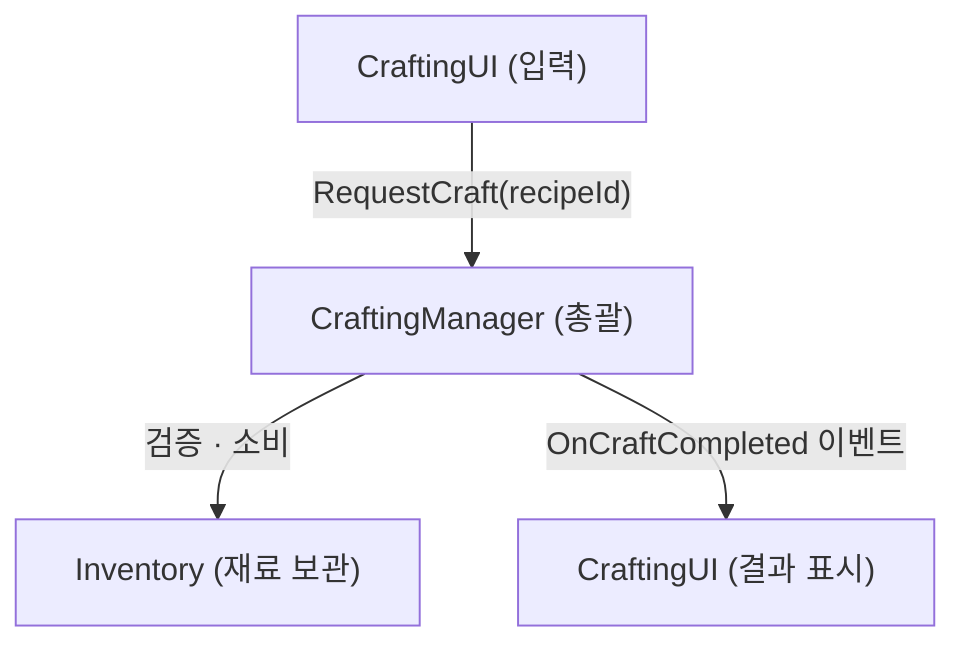
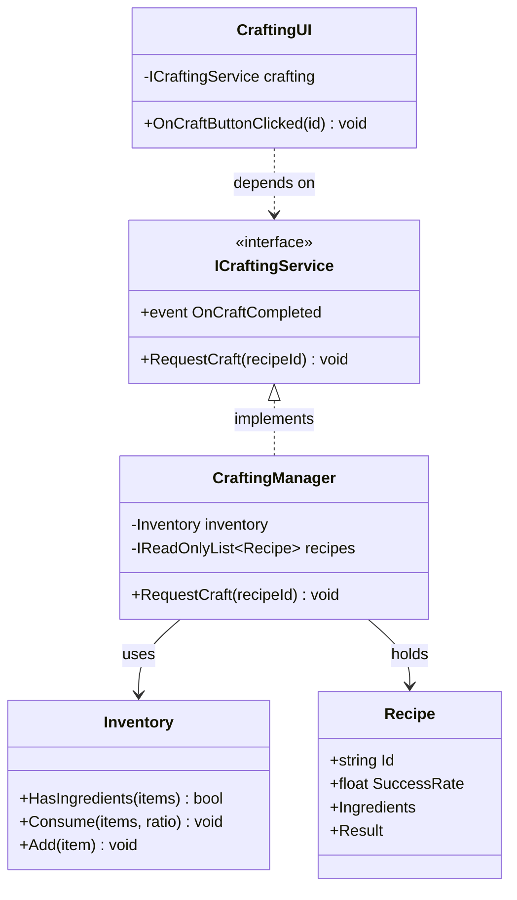
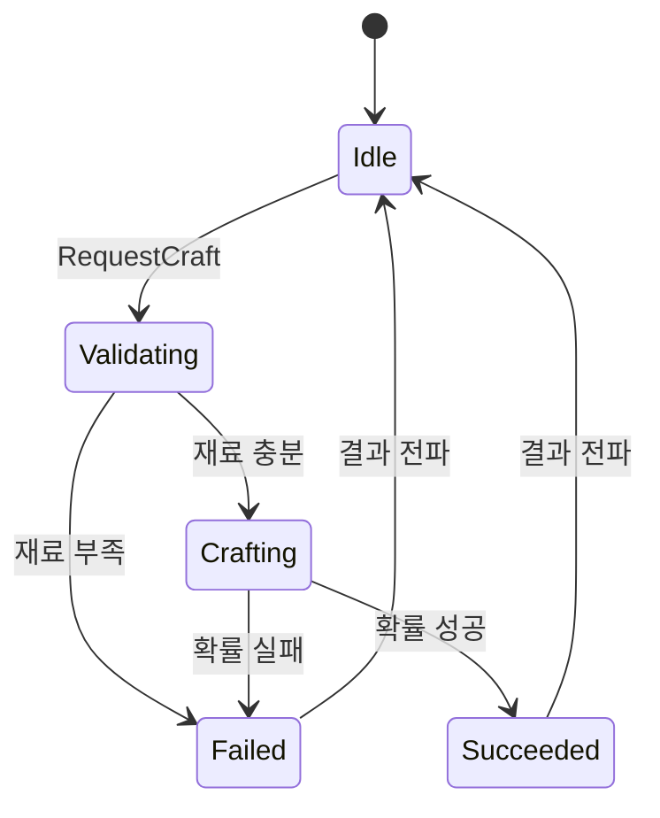

# 크래프팅 시스템 (CraftingSystem) 기술 문서

> **재료를 소비해 아이템을 확률적으로 제작하는, UI와 분리된 이벤트 기반 크래프팅 시스템**

> ⚠ **예시 프로젝트입니다.** 「유니티 개발자 취업·기술 문서 작성 가이드 v2」의 관통 예제로,
> 템플릿이 어떻게 동작하는지 보여주기 위해 들어 있습니다. 내 프로젝트를 추가했다면 이 폴더(`src/00-example-crafting/`)는 지우세요.

| 항목 | 내용 |
|---|---|
| 장르 | 생존 게임의 제작(크래프팅) 시스템 |
| 개발 기간 | 2025.06 ~ 2025.07 (개인 프로젝트) |
| 개발 인원 | 1인 |
| 개발 환경 | Unity 2022.3 LTS (C# 10), Rider |
| 주요 기술 | 이벤트 기반 아키텍처 · 인터페이스 의존(DIP) · LINQ · 확률 판정 주입 |
| 링크 | [GitHub](#) · [시연 영상](#) |

---

## 1. 개요

### 1.1 무엇을 만들었나 (What)

이 문서는 유니티(C#) 생존 게임의 **아이템 크래프팅 시스템**을 설계·구현한 과정을 설명합니다.
플레이어가 인벤토리의 재료를 소비해, 레시피에 정의된 결과물을 **확률적으로** 제작합니다.

- 예시 레시피: **나무 x3 + 돌 x2 → 돌도끼 x1** (성공 확률 80%)
- 제작에 실패하면 재료를 **50%만** 소비합니다.

### 1.2 왜 만들었나 (Why)

초기에는 제작 로직이 UI 코드 안에 뒤섞여 있어, **새 레시피를 추가할 때마다 UI를 수정**해야 했고
확률·실패 처리를 **테스트하기 어려웠습니다.** (문제)

이를 해결하기 위해 **제작 로직을 UI와 분리**하고, **이벤트로 결과를 전파**하는 구조를 도입했습니다. (목적)

> 이 문서는 **시스템 구조**, **제작 요청(RequestCraft) 기능**, **결과 전파 방식의 선택**을 중심으로 설명합니다.

---

## 2. 시스템 구조

### 2.1 아키텍처 흐름



UI는 **요청만** 보내고, 결과는 **이벤트로** 돌려받습니다. 화살표가 UI → Manager 한 방향뿐이라는 점이 핵심입니다.

### 2.2 클래스 관계



### 2.3 핵심 클래스 역할 분담

| 클래스 / 인터페이스 | 역할 |
|---|---|
| `ICraftingService` | 제작 서비스의 계약(인터페이스). UI는 구현체가 아닌 **이 계약에 의존** |
| `CraftingManager` | 제작 총괄. 검증 → 확률 판정 → 소비 → 결과 이벤트 발행 |
| `Inventory` | 재료 보관·검증·소비·추가 (LINQ로 재료 조회) |
| `Recipe` | 레시피 데이터 (필요 재료, 결과물, 성공 확률) |
| `CraftingUI` | 사용자 입력 → 제작 요청, 이벤트 구독 → 결과 표시 |

`CraftingUI`가 `CraftingManager`를 직접 참조하지 않고 `ICraftingService`에 의존하게 한 이유는,
UI를 건드리지 않고도 제작 로직 구현을 **교체·테스트**할 수 있게 하기 위해서입니다(DIP).
자세한 근거는 **4. 고민과 선택**에서 다룹니다.

---

## 3. 핵심 기능: 제작 요청

### 3.1 사용법 (API)

외부(예: `CraftingUI`)에서는 인터페이스의 `RequestCraft` 하나만 호출하면 됩니다. 결과는 이벤트를 구독해 받습니다.

```csharp
// CraftingUI.cs — 제작 서비스에 '요청'만 하고, 결과는 이벤트로 받는다
public sealed class CraftingUI : MonoBehaviour
{
    private ICraftingService crafting; // (Why) 구현체가 아닌 인터페이스에 의존 (DIP)

    private void OnEnable() =>
        crafting.OnCraftCompleted += HandleResult;

    private void OnDisable() =>
        crafting.OnCraftCompleted -= HandleResult;

    // 버튼 클릭 시 호출
    public void OnCraftButtonClicked(string recipeId) =>
        crafting.RequestCraft(recipeId);

    private void HandleResult(CraftingResult result) =>
        toast.Show(result.IsSuccess ? $"{result.Item.Name} 제작 성공!" : result.Reason);
}
```

### 3.2 핵심 동작

`RequestCraft`는 이 시스템의 심장부입니다.

1. 레시피를 조회한다 (LINQ)
2. **소비 전에** 재료를 검증한다 (방어적 처리)
3. 확률을 판정한다 (주입된 `roll`로 테스트 가능)
4. 성공/실패에 따라 소비율을 달리하고, 결과를 이벤트로 발행한다



```csharp
public void RequestCraft(string recipeId)
{
    var recipe = FindRecipe(recipeId);            // LINQ: FirstOrDefault
    if (recipe == null)
    {
        Publish(CraftingResult.Fail(recipeId, "레시피를 찾을 수 없습니다."));
        return;
    }

    // (Why) 소비 전에 먼저 검증 → 재료 유실 없이 안전하게 중단
    if (!inventory.HasIngredients(recipe.Ingredients))
    {
        Publish(CraftingResult.Fail(recipeId, "재료가 부족합니다."));
        return;
    }

    // (Why) 확률 판정을 주입된 roll로 분리 → 테스트 시 결정론적 검증 가능
    var success = roll() < recipe.SuccessRate;

    // (Why) 성공 100% / 실패 50% 소비로 '실패 페널티' 규칙을 표현
    inventory.Consume(recipe.Ingredients, success ? 1.0f : 0.5f);
    if (success)
        inventory.Add(recipe.Result);

    Publish(success
        ? CraftingResult.Success(recipeId, recipe.Result)
        : CraftingResult.Fail(recipeId, "제작에 실패했습니다."));
}
```

---

## 4. 고민과 선택: 제작 결과를 어떻게 전파할 것인가

| | 대안 A. Manager가 UI를 직접 갱신 | 대안 B. `OnCraftCompleted` 이벤트 발행 |
|---|---|---|
| 장점 | 구현이 직관적이고 빠름. 흐름 추적이 쉬움 | Manager는 "결과가 나왔다"만 알림 → **느슨한 결합**. 구독자만 추가하면 됨 |
| 단점 | Manager가 UI를 알게 되어 **강하게 결합**. 결과를 쓰는 곳이 늘 때마다 Manager 수정 | 이벤트 흐름이 코드에 직접 안 보여 추적이 조금 어려움. 구독 해제 누락 시 누수 위험 |

**대안 B(이벤트)를 선택했습니다.** 제작 결과를 소비할 대상이 UI 하나로 끝나지 않고
(연출·사운드·업적 등) 늘어날 것으로 판단했기 때문입니다.
'이벤트 흐름 추적의 어려움'이라는 대가는, `OnEnable/OnDisable`에서 구독·해제를 **짝지어 관리하는 규칙**으로 상쇄했습니다.

---

## 5. 결과 및 배운 점

### 5.1 결과

- 개요의 문제였던 '제작 로직과 UI의 결합'을 해소. 새 레시피 추가 시 UI 코드 **수정 0줄**로
  데이터(`Recipe`)만 추가하면 되도록 개선.
- `roll`을 주입 가능하게 설계해, 확률 성공/실패 경로를 **단위 테스트로 검증** 가능.

### 5.2 트러블슈팅: 실패해도 재료가 100% 사라지는 문제

| 항목 | 내용 |
|---|---|
| 문제 | 제작 실패 시에도 재료가 100% 사라짐 |
| 원인 | 확률 판정 결과와 무관하게 소비율을 `1.0f` 고정으로 넘기고 있었음 |
| 해결 | `success ? 1.0f : 0.5f`로 소비율을 분기하고, 이 규칙을 테스트로 고정 |
| 결과 | 실패 페널티(50% 소비) 규칙이 의도대로 동작, 회귀 방지 |

### 5.3 아쉬운 점과 개선 계획

- **(아쉬운 점)** `Recipe`가 코드에 하드코딩되어 있어, 기획자가 직접 수정할 수 없음.
- **(개선 계획)** `ScriptableObject` 기반 데이터로 전환해, 코드 없이 레시피를 편집·밸런싱할 수 있게 개선 예정.
