# Switch Strike 기술 문서

> **교대 한 번으로 위기를 반격 기회로 바꾸는 2D 사이드뷰 액션 플랫포머**

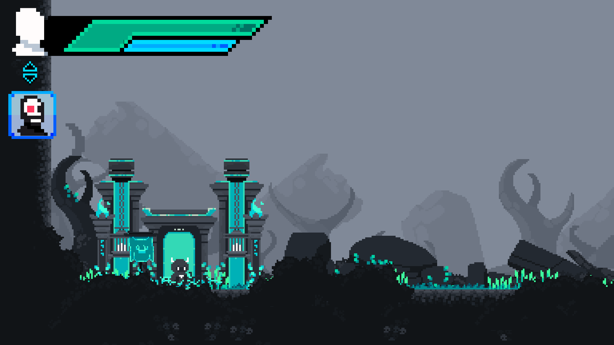

| 항목 | 내용 |
|---|---|
| 장르 | 2D 사이드뷰 액션 플랫포머 |
| 개발 기간 | 2주 (2026.06.24 ~ 2026.07.07) |
| 개발 인원 | 1인 개발 (개인 평가 프로젝트) |
| 개발 환경 | Unity 6.3 (6000.3.15f1), C#, Rider |
| 주요 기술 | Kinematic 이동 컨트롤러 · Animator 기반 FSM · 캐릭터 교대 & QTE · 중재자 기반 전투 처리 |
| 링크 | [GitHub](https://github.com/chesherneko/2D-Action-Platformer) · [시연 영상](https://www.youtube.com/watch?v=qtJYxDbJ-fQ) |

---

## 목차

1. [프로젝트 개요](#1-프로젝트-개요)
2. [전체 시스템 구조](#2-전체-시스템-구조)
3. [이동 컨트롤러](#3-이동-컨트롤러)
4. [캐릭터 교대 & QTE](#4-캐릭터-교대--qte)
5. [전투 처리 흐름](#5-전투-처리-흐름)
6. [적 AI와 보스 패턴](#6-적-ai와-보스-패턴)
7. [트러블슈팅](#7-트러블슈팅)
8. [결과 및 회고](#8-결과-및-회고)

---

## 1. 프로젝트 개요

### 1.1 무엇을, 왜 만들었나

**What.** 본 프로젝트는 플레이어가 두 명의 근접 캐릭터를 **교대**하며 싸우는 2D 사이드뷰 액션 플랫포머입니다. 걷기·점프·대시·벽 점프로 횡스크롤 스테이지를 돌파하고, 전투 중 쌓은 게이지로 캐릭터를 교대하면 새로 등장한 캐릭터가 강력한 **QTE 등장 공격**을 펼칩니다.

**Why.** 개발 기간은 2주로 짧았습니다. 그래서 콘텐츠의 양을 늘리기보다, 액션 플랫포머라는 장르가 반드시 갖춰야 할 **핵심 조작감을 직접 구현하고 검증하는 것**에 집중했습니다.

- **조작감**: Unity 물리(Rigidbody의 velocity)에 맡기지 않고 이동을 직접 계산하는 Kinematic 방식을 택했습니다. 정점 체공, 고정 거리 대시, 벽 매달리기처럼 실제 물리 법칙과는 다르지만 손에 착 붙는 움직임을 수치 단위로 설계하기 위해서입니다.
- **판단의 재미**: "상황에 맞는 캐릭터를 언제 꺼낼 것인가"라는 순간의 판단이 전투 흐름을 바꾸도록 교대 시스템을 설계했습니다. 교대 중에는 짧은 무적이 있어 교대 자체가 회피 수단이 되고, 게이지가 가득 찬 상태로 교대하면 반격이 됩니다.

> 이 문서는 **이동 컨트롤러**, **캐릭터 교대 & QTE**, **전투 처리 흐름** 세 시스템을 중심으로 설계 의도와 핵심 구현, 개발 중 내린 선택의 근거, 그리고 겪은 문제와 해결 과정을 설명합니다.

### 1.2 핵심 플레이 루프

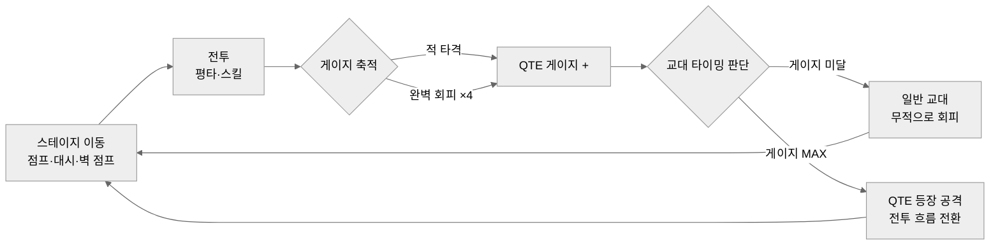

플레이어는 적을 공격하거나 적의 공격을 **완벽 회피**(대시 직후의 무적 구간에 공격을 흘리는 것)하며 게이지를 모읍니다. 완벽 회피는 일반 타격보다 게이지가 4배 많이 차도록 설계해, 위험을 감수한 플레이일수록 반격 기회가 빨리 오도록 했습니다.

### 1.3 콘텐츠 구성

| 구분 | 구성 | 특징 |
|---|---|---|
| 플레이어블 캐릭터 (2종) | **Mooni** (대검) | 스킬: 최대 HP의 30%를 회복하는 생존형 |
| | **Reaper** (낫) | 스킬: 공중에 떠올라 무적 상태로 체공하다가, 스킬 키를 다시 누르거나 2초가 지나면 하강 공격 |
| 일반 몬스터 (4종) | 전사 | 기본형. 30% 확률로 연속 공격 |
| | 궁수 | 투사체 공격. 조준을 먼저 확정한 뒤 발사 직전에 높이만 보정 |
| | 창병 | 힘을 모으는 동작 후, 다음 공격의 피해가 2배 |
| | 자폭병 | HP 30% 이하에서 자폭 공격 후 사망 |
| 보스 (1종) | 패턴 5종 | 일반 패턴 3종 + 특수 패턴 2종. 특수 패턴을 공략하면 보스가 역으로 큰 피해를 입음 |
| 진행 구조 | 단일 스테이지 | 긴 맵 하나를 돌파 → 보스 처치 → 결과 화면 후 종료. 세이브 포인트 기반 리스폰 |

### 1.4 기술 핵심 요약

| 핵심 요소 | 한 줄 요약 | 상세 |
|---|---|---|
| **Kinematic 이동 컨트롤러** | Rigidbody 속도 대신 이동량을 직접 계산하고, 축별 BoxCast로 충돌을 해결. 조작 수치를 ScriptableObject로 분리 | [3장](#3-이동-컨트롤러) |
| **캐릭터 교대 & QTE** | 두 캐릭터의 퇴장·등장을 동시에 연출하고, HP·속도·방향을 이어받아 끊김 없는 교대 구현 | [4장](#4-캐릭터-교대--qte) |
| **중재자 기반 전투 처리** | 모든 피격을 CombatManager가 중재. 완벽 회피, 히트스탑, 피격 연출이 한 흐름으로 연결 | [5장](#5-전투-처리-흐름) |
| **대상별 FSM 선택** | 플레이어·몬스터는 Animator 기반 FSM, 보스는 패턴 오브젝트 단위의 MonoBehaviour FSM | [2장](#2-전체-시스템-구조) |

### 1.5 구현 범위

| 기획 항목 | 구현 | 비고 |
|---|---|---|
| 이동 (걷기·점프·대시·벽 점프) | ✅ | 코요테 타임, 점프 버퍼, 정점 체공 등 보정 기법 포함 |
| 전투 (평타 콤보·스킬) | ✅ | 캐릭터별 스킬 1종, 쿨타임은 두 캐릭터가 공유 |
| 캐릭터 교대 & QTE | ✅ | 교대 무적, 게이지가 가득 차면 교대 쿨타임 즉시 해제 |
| 완벽 회피 | ✅ | 대시 시작 0.05초 무적 구간 |
| 패링 | ➖ 제외 | 구상한 패링은 "제자리에서 공격을 무효화하는 것"이었는데, 이 역할을 이미 완벽 회피가 하고 있어 범위에서 제외 ([4장](#4-캐릭터-교대--qte) 참고) |
| 플레이어블 캐릭터 2종 (필수) | ✅ | 기획상 최대 4종 확장을 고려해 구조 설계 |
| 일반 몬스터 (근접 2~3 + 원거리 1) | ✅ | 근접 3종 + 원거리 1종 |
| 최종 보스 | ✅ | 패턴 5종, 보스방 진입 연출 |
| UI | ✅ | HP, 스킬·교대 쿨타임, 게이지 Glow, 캐릭터 초상화 교체 연출, 보스 HP, 결과 화면 |

---

## 2. 전체 시스템 구조

### 2.1 아키텍처 개관

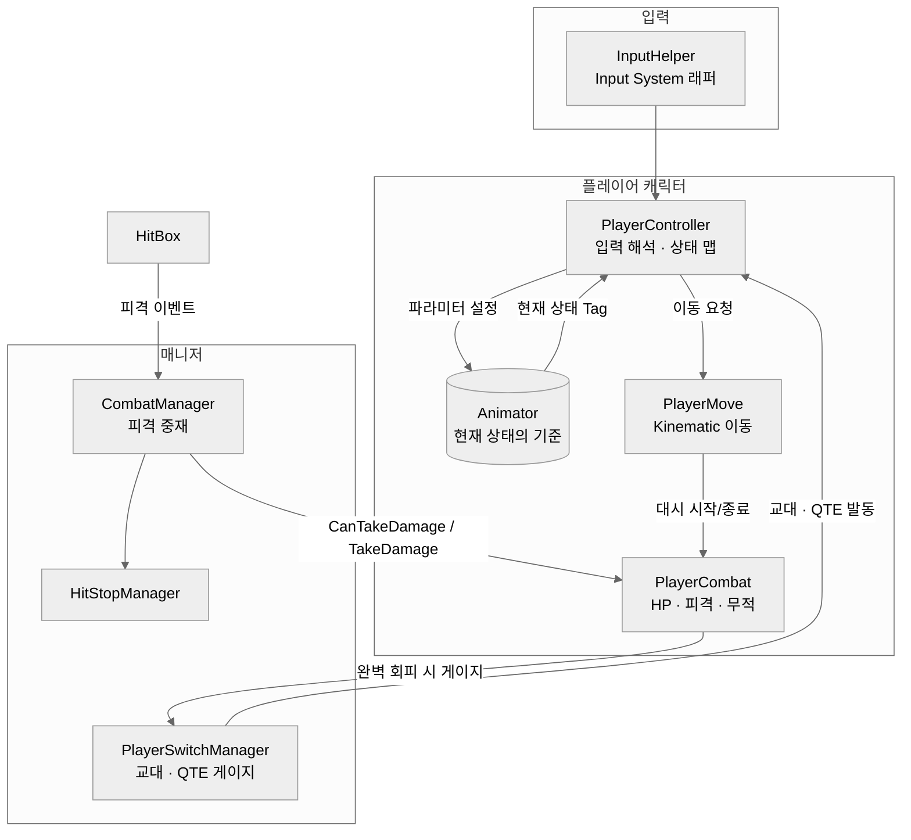

입력은 `PlayerController`로만 들어오고, 실제 이동은 `PlayerMove`, 피격은 `PlayerCombat`이 처리합니다. 캐릭터 바깥에서는 `PlayerSwitchManager`가 교대를, `CombatManager`가 모든 피격을 중재합니다. 이 구조의 핵심은 **"지금 어떤 상태인가"를 Animator가 결정하고, 코드는 "그 상태에서 무엇을 할 것인가"만 담당한다**는 점입니다(2.4 참고).

### 2.2 플레이어 클래스 역할 분담

| 클래스 | 하는 일 | 하지 않는 일 |
|---|---|---|
| `Player` | 구성 컴포넌트를 묶는 루트. 현재 조작 중인 캐릭터(`Player.Local`)와 조작 잠금 관리 (Soft: 이동·점프·대시·스킬 입력 차단 / Hard: 공격 입력까지 차단) | 입력 처리, 이동 계산 |
| `PlayerController` | 입력을 해석해 Animator 파라미터를 설정. Animator 상태 ↔ 코드 State 매핑. 스킬 쿨타임 관리 | 이동량 계산 (요청만 전달) |
| `PlayerMove` | 이동·점프·대시·벽 매달리기 계산과 충돌 해결 | Animator 조작 (Animator를 알지 못함) |
| `PlayerCombat` | HP, 피해·회복 적용, 피격 무적, 완벽 회피 판정 | 피격 연출 외의 상태 결정 |
| 각 State 클래스 | 해당 상태에서 **허용할 입력**과 진입/종료 처리 | 다른 상태로의 직접 전이 (전이는 Animator가 담당) |

State마다 처리하는 입력이 다르기 때문에, 행동 간 충돌이 **구조적으로** 막힙니다. 예를 들어 벽 매달리기 상태는 이동·점프 입력만 받고, 공격 상태는 공중 이동·대시·스킬·콤보 입력만 받습니다. "공격 중에는 점프 불가" 같은 규칙을 조건문으로 따로 쓰지 않아도 됩니다.

### 2.3 대상별 제어 방식 선택

이 프로젝트에는 성격이 다른 세 종류의 캐릭터가 있습니다. 하나의 FSM으로 통일하기보다, **각 대상의 요구사항에 맞는 제어 방식**을 골랐습니다.

| 대상 | 요구사항 | 선택한 방식 |
|---|---|---|
| **플레이어** | 모션이 곧 상태(스프라이트 시트 애니메이션). 이동·공격·스킬·QTE 등 상태가 많고 상태마다 허용 입력이 다름 | **Animator 기반 FSM** |
| **일반 몬스터** | 대기·순찰·추적·공격·피격·사망·부활의 패턴 반복 | **Animator 기반 FSM** (플레이어용 베이스 재사용) |
| **보스** | 패턴마다 칼날·장판·눈·미니언 등 **하위 오브젝트를 대량으로 다룸**. 패턴 단독 테스트가 자주 필요 | **MonoBehaviour(GameObject) 기반 FSM** |

### 2.4 Animator 기반 FSM의 동작

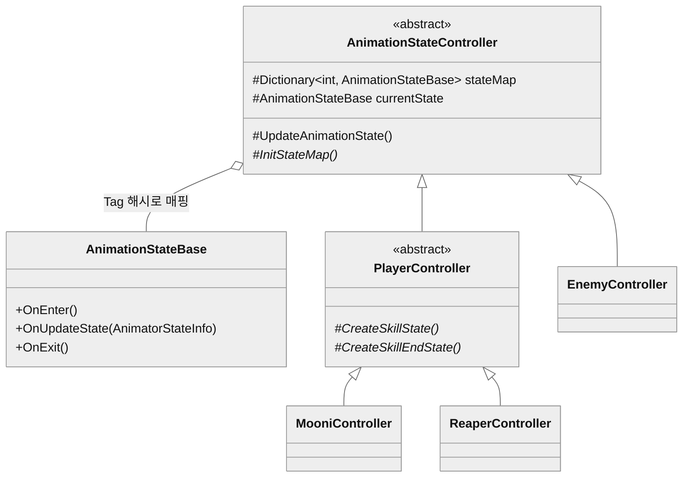

공통 부모 `AnimationStateController`는 매 프레임 **Animator의 현재 상태 Tag**를 읽고, Dictionary에 매핑된 코드 State를 찾아 실행합니다.

```csharp
// AnimationStateController.cs — 플레이어와 몬스터가 공유하는 FSM 베이스
protected virtual void UpdateAnimationState()
{
    AnimatorStateInfo stateInfo = Animator.GetCurrentAnimatorStateInfo(0);

    // (Why) 상태를 코드가 아닌 Animator의 Tag로 판별 → 애니메이션과 상태가 항상 1:1로 일치
    if (stateMap.TryGetValue(stateInfo.tagHash, out AnimState nextState) == false)
        nextState = defaultState;

    // 상태가 바뀐 프레임에만 Exit → Enter 호출
    if (currentState != nextState)
    {
        currentState?.OnExit();

        currentState = nextState;
        nextState.OnEnter();
    }

    // (Why) normalizedTime을 넘겨 '애니메이션 진행도' 기준의 로직(콤보 입력 창 등)을 작성 가능
    currentState.OnUpdateState(stateInfo);
}
```

- **상태 식별**: Animator 각 상태에 Tag를 지정하고 `AnimationTag` 상수로 관리합니다. 파라미터는 `AnimationParam`에 `Animator.StringToHash()` 결과를 `static readonly`로 캐싱해, 문자열 전달 시 생기는 가비지와 오타 실수를 막았습니다.
- **진행도 기반 로직**: State가 `normalizedTime`을 받기 때문에 "애니메이션 30% 이전의 공격 입력은 초기화, 90% 이후 입력은 무시" 같은 규칙을 쓸 수 있습니다. 1타만 치려다 실수로 연타해 2타까지 나가는 오입력을 이 방식으로 막았습니다.

```csharp
// PlayerAttackState.cs — 콤보 입력 창
public override void OnUpdateState(AnimatorStateInfo stateInfo)
{
    Owner.HandleAirMoveInput();
    Owner.HandleDashInput();
    Owner.HandleSkillInput();

    // (Why) 직전 타격의 입력이 다음 콤보로 넘어가지 않도록, 초반 30% 구간의 입력은 지움
    if (stateInfo.normalizedTime < INPUT_RESET_TIME)
    {
        Animator.SetBool(AnimationParam.IS_ATTACK, false);
        return;
    }

    // (Why) 모션이 거의 끝난 뒤의 입력은 다음 콤보로 인정하지 않음
    if (stateInfo.normalizedTime >= COMBO_INPUT_END_TIME)
        return;

    Owner.HandleComboAttackInput();
}
```

### 2.5 고민과 선택 ① 코드 주도 FSM vs Animator 주도 FSM

> **결정 대상**: 캐릭터의 "현재 상태"를 누가 결정할 것인가?

| | [A] 코드 주도 FSM | [B] Animator 주도 FSM ✓ |
|---|---|---|
| 방식 | 코드가 `ChangeState()`로 상태를 바꾸고, Animator에는 트리거로 알림 | Animator 전이가 상태를 바꾸고, 코드는 현재 Tag를 읽어 따라감 |
| 장점 | 상태 전이 흐름이 코드에 모두 드러나 추적이 쉬움 | 모션과 상태가 항상 1:1로 일치. 전이 조건을 Animator에 맡겨 코드가 단순해짐. Animator 창만 봐도 어느 상태에서 문제가 생겼는지 바로 보임 |
| 단점 | 코드 상태와 애니메이션 상태라는 두 상태 머신을 따로 맞춰야 함 | 상태가 늘수록 Animator 그래프가 복잡해짐. Tag를 빠뜨리면 에러 없이 기본 상태로 처리됨 |

**[최종 결정] B를 선택했습니다.** 캐릭터 애니메이션이 Spine 같은 본 애니메이션이 아니라 스프라이트 시트였기 때문에, 이 프로젝트에서는 사실상 **캐릭터의 모션 = 상태**였습니다. 같은 정보를 코드와 Animator 양쪽에 두고 맞추기보다, Animator 하나를 기준으로 삼는 편이 낫다고 판단했습니다. 상태를 코드에서 일일이 지정하지 않아도 Animator 전이만으로 상태가 자동으로 돌아간다는 점도 컸습니다.

**[감수한 대가]** Animator 그래프가 복잡해지는 문제는 실제로 겪었습니다. Tag 누락으로 기본 상태에 빠지거나, Any State에서 자기 자신으로 다시 진입하거나, 트랜지션 누락으로 상태에 갇히는 문제가 있었습니다. 또 Animator도 자체 규칙(트리거 소비 시점 등)을 가진 독립된 상태 머신이라는 점을 개발 중에 체감했고, 이와 관련된 문제와 해결은 [7장 트러블슈팅](#7-트러블슈팅)에 정리했습니다.

### 2.6 고민과 선택 ② 보스만 GameObject 기반 FSM을 쓴 이유

> **결정 대상**: 패턴이 5종이고 패턴마다 하위 오브젝트를 다루는 보스를 어떤 FSM으로 제어할 것인가?

| | [A] 기존 Animator 기반 FSM 재사용 | [B] GameObject 기반 FSM ✓ |
|---|---|---|
| 방식 | 패턴을 코드 State 클래스로 만들고 Animator 전이로 관리 | 패턴 하나 = 자식 GameObject 하나. 상태 전이 = 오브젝트 활성/비활성 |
| 장점 | 이미 만든 베이스 재사용 | 패턴이 쓰는 하위 오브젝트(칼날, 장판, 눈 등)를 패턴 오브젝트 아래에 두고 인스펙터로 바로 연결. **오브젝트를 켜는 것만으로 패턴 단독 실행** |
| 단점 | 코드 State는 MonoBehaviour가 아니라 하위 오브젝트 참조·코루틴 사용이 번거로움. 특정 패턴 하나를 확인하려면 별도의 테스트 코드 필요 | FSM 구현이 두 종류로 나뉨 |

```csharp
// BossController.cs — 상태 전이 = 현재 패턴 오브젝트 끄기 + 다음 패턴 오브젝트 켜기
public void ChangeState(Type stateType)
{
    if (stateMap.TryGetValue(stateType, out BossStateBase nextState) == false)
    {
        Debug.LogError($"'{stateType.FullName}'은 등록되지 않은 상태입니다.");
        return;
    }

    if (currentState != null)
        currentState.gameObject.SetActive(false);

    currentState = nextState;
    currentState.gameObject.SetActive(true); // (Why) OnEnable에서 패턴 코루틴이 시작됨
}
```

**[최종 결정] B를 선택했습니다.** 보스 패턴은 하위 오브젝트를 많이 다루기 때문에, 코드 기반이나 애니메이션 기반 FSM에서는 복잡도가 크게 늘어난다고 판단했습니다. GameObject 기반으로 만들면 메인 컨트롤러는 `SetActive`만 호출하면 되고, 무엇보다 **새 패턴을 만들 때 해당 오브젝트를 켜고 끄는 것만으로 바로 테스트**할 수 있어 2주라는 일정 안에서 패턴 5종을 만드는 데 유리했습니다. FSM이 두 종류로 나뉘는 비용은, 보스가 단 하나뿐인 이번 프로젝트에서는 감수할 만하다고 봤습니다. 패턴의 상세 구조는 [6장](#6-적-ai와-보스-패턴)에서 다룹니다.

### 2.7 캐릭터 확장 구조

기획 단계에서 플레이어블 캐릭터를 최대 4종까지 늘릴 계획이 있었기 때문에, 공통 로직은 부모에 두고 **캐릭터마다 다른 스킬 상태만 자식이 주입**하도록 설계했습니다.

```csharp
// PlayerController.cs (추상) — 공통 상태 맵에 '스킬 상태'만 비워 둠
protected abstract PlayerAnimationStateBase CreateSkillState();
protected abstract PlayerAnimationStateBase CreateSkillEndState();

protected override void InitStateMap()
{
    stateMap = new()
    {
        { Animator.StringToHash(AnimationTag.ANIM_TAG_MOVEMENT), new PlayerMovementState(this) },
        // ... 이동·점프·대시·벽·공격·QTE·사망 등 공통 상태 ...
        { Animator.StringToHash(AnimationTag.ANIM_TAG_SKILL),     CreateSkillState() },    // 캐릭터별
        { Animator.StringToHash(AnimationTag.ANIM_TAG_SKILL_END), CreateSkillEndState() }, // 캐릭터별
    };
}

// ReaperController.cs — 체공(Skill) → 하강 공격(SkillEnd) 두 단계
protected override PlayerAnimationStateBase CreateSkillState()    => new ReaperSkillState(this);
protected override PlayerAnimationStateBase CreateSkillEndState() => new ReaperSkillEndState(this);
```

새 캐릭터를 추가할 때는 `PlayerController`를 상속해 스킬 State를 1~2개 구현하면 됩니다(Mooni는 체공 단계가 없어 SkillEnd 하나만 사용). 이동·전투·교대 코드는 그대로 공유합니다.

---

## 3. 이동 컨트롤러

### 3.1 개요: 왜 이동을 직접 만들었나

액션 플랫포머에서 조작감은 "물리적으로 정확한 움직임"이 아니라 **"플레이어가 의도한 대로 움직이는 느낌"**에서 나옵니다. 점프 정점에서 잠깐 머무르는 체공, 항상 같은 거리를 이동하는 대시, 벽에 붙어 멈추는 매달리기는 모두 실제 물리 법칙과는 다른 움직임입니다.

Unity 물리(Rigidbody의 velocity)에 이동을 맡기면 이런 움직임, 특히 **점프를 세밀하게 제어하기 어렵다고 판단했습니다**. 그래서 처음부터 이동량을 매 프레임 직접 계산하고 충돌도 직접 해결하는 **Kinematic 이동 컨트롤러**를 구현했습니다.

### 3.2 구조

| 구성 요소 | 역할 |
|---|---|
| `PlayerMove` | 이동량(`MoveX`, `MoveY`) 계산, 충돌 해결, 점프·벽·대시 상태 관리 |
| `PlayerMoveSettings` (ScriptableObject) | 이동·중력·점프·벽·대시·충돌 관련 조작 수치를 분리. 코드 수정 없이 인스펙터에서 조작감 튜닝 |

입력 타이머와 물리 처리는 실행 주기를 나눴습니다. 코요테 타임·점프 버퍼·대시 쿨타임 같은 **시간 누적은 `Update`**에서, **이동 계산과 충돌 해결은 `FixedUpdate`**에서 처리합니다.

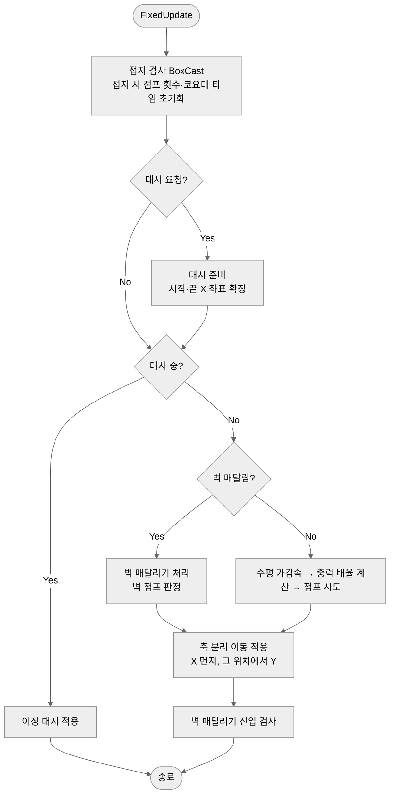

### 3.3 사용법 (API)

`PlayerController`(입력 담당)는 `PlayerMove`의 내부 계산을 몰라도 됩니다. 아래 요청 함수만 호출합니다.

```csharp
Movement.SetMoveInput(input);   // 방향 입력 전달 (-1 ~ 1)
Movement.RequestJump();         // 점프 요청 (버퍼에 저장되어 0.15초간 유효)
Movement.ReleaseJump();         // 점프 키를 뗌 → 가변 점프 높이 결정
bool canDash = Movement.RequestDash(); // 대시 요청 (쿨타임이면 false → 애니메이션도 재생하지 않음)
```

"요청"과 "적용"을 분리했기 때문에, 입력이 들어온 프레임과 물리가 처리되는 프레임이 달라도 입력이 유실되지 않습니다.

### 3.4 핵심 동작: 축 분리 충돌 해결

Rigidbody가 충돌을 대신 처리해 주지 않으므로, 이동하기 전에 **"이만큼 움직여도 되는가?"**를 직접 검사합니다. 캐릭터 콜라이더 크기의 박스를 이동 방향으로 쏘아(BoxCast) 막히면 막힌 지점 직전까지만 이동합니다.

```csharp
// PlayerMove.cs
private (float desiredMoveX, bool canMoveXAsDesired) ApplyActualMove()
{
    Vector2 desireMove = new Vector2(MoveX, MoveY) * Time.fixedDeltaTime;
    Bounds box = GetCastBox(); // 콜라이더보다 SkinWidth만큼 작은 검사용 박스

    // 1) X축을 먼저 검사하고
    float moveX = ResolveAxisMovement(desireMove.x, Vector2.right, box, out bool canMoveXAsDesired);

    // 2) (Why) 실제로 이동할 X 위치로 박스를 옮긴 뒤 Y축을 검사 → 모서리 끼임 방지 (3.8 참고)
    box.center += Vector3.right * moveX;
    float moveY = ResolveAxisMovement(desireMove.y, Vector2.up, box, out bool canMoveYAsDesired);

    if (canMoveYAsDesired == false) MoveY = 0f; // 천장·바닥에 닿으면 Y 속도 제거

    body.MovePosition(body.position + new Vector2(moveX, moveY));

    // (Why) X가 막혔는지를 반환 → 공중에서 벽에 막히면 '벽 매달리기' 진입 판단에 사용
    return (desireMove.x, canMoveXAsDesired);
}

private float ResolveAxisMovement(float move, Vector2 axis, Bounds box, out bool canMoveAsDesired)
{
    canMoveAsDesired = true;
    if (move == 0f) return 0f;

    Vector3 dir = move > 0f ? axis : -axis;
    RaycastHit2D hit = Physics2D.BoxCast(box.center, box.size, 0f, dir, Mathf.Abs(move), settings.GroundLayerMask);

    if (hit.collider == null) return move; // 막힘 없음 → 원하는 만큼 이동

    canMoveAsDesired = false;
    float resolvedMove = Mathf.Max(0f, hit.distance - settings.SkinWidth); // 충돌 지점 직전까지만
    return Mathf.Sign(move) * resolvedMove;
}
```

이 함수 하나가 **지형 충돌, 천장 충돌, 벽 매달리기 진입 판정**의 기반이 됩니다. 대시 역시 같은 `ResolveAxisMovement`를 사용해, 대시 도중 벽에 막히면 그 자리에서 즉시 종료됩니다.

### 3.5 조작감 보정 기법

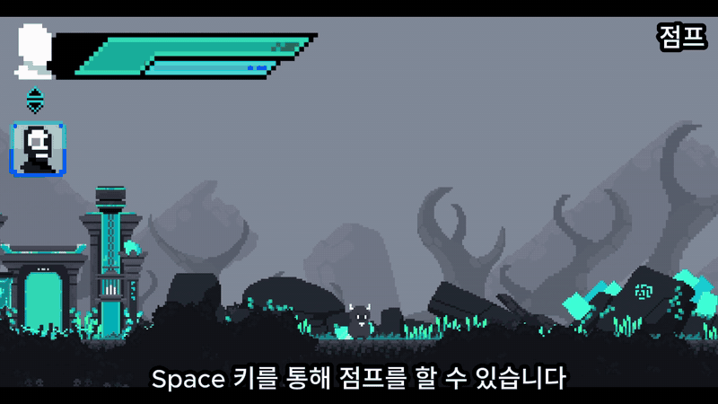

| 기법 | 설정값 | 동작 | 효과 |
|---|---|---|---|
| **코요테 타임** | 0.15초 | 발판에서 떨어진 직후에도 점프 허용 | 발판 끝에서 한 박자 늦은 점프 입력도 인정 |
| **점프 버퍼** | 0.15초 | 착지 직전의 점프 입력을 저장했다가 착지 순간 실행 | 착지 직전의 이른 입력도 점프로 처리 |
| **가변 점프** | 홀드 최대 0.15초 | 일찍 떼면 상승 중 중력 배율이 높아져 낮게 뜀 | 키를 누르는 길이로 점프 높이 조절 |
| **낙하 가속** | 중력 ×4.25 | 하강 시 중력 배율 증가 | 떨어질 때의 무게감 |
| **정점 체공 (Apex Hang)** | \|Y속도\| < 0.5 구간 | 정점 부근에서 중력 ×0.5, 수평 속도 ×1.25 | 아래 설명 참고 |

**정점 체공을 넣은 이유.** 정점 체공이 없을 때는 점프 정점에 닿자마자 바로 떨어져, 공중에서 방향을 바꾸거나 다음 행동을 고를 시간이 부족했습니다. 모든 판단을 점프 전에 끝내야 하는 하드코어한 조작은 이 게임이 지향하는 방향이 아니었기 때문에, 정점 부근에서만 중력을 줄이고 수평 이동을 조금 더 허용했습니다.

이 보정들은 모두 **중력 배율** 하나로 합쳐집니다.

```csharp
// PlayerMove.cs — 현재 상황에 맞는 중력 배율 계산
private float GetGravityMultiplier()
{
    if (isJumping == false)
        return MoveY > 0f ? 1f : settings.FallGravityMult; // 점프가 아닌 낙하 → 낙하 가속

    float mult;

    if (isJumpHold) mult = 1f; // 키를 누르고 있는 동안은 기본 중력
    else
    {
        if (MoveY > 0f)
        {
            // (Why) 키를 일찍 뗄수록 상승 중력이 커짐 → 짧게 누르면 낮은 점프
            float t = Mathf.InverseLerp(0f, settings.MaxJumpHoldTime, jumpHoldTime);
            mult = settings.LastAscentGravityMult * Mathf.Lerp(settings.MinJumpHoldGravityMult, 1f, t);
        }
        else mult = settings.FallGravityMult;
    }

    if (IsBonusPeakSection) // (Why) 정점 부근이면 중력을 줄여 체공 시간 확보
        mult *= settings.JumpHangGravityMult;

    return mult;
}
```

### 3.6 벽 매달리기 · 대시

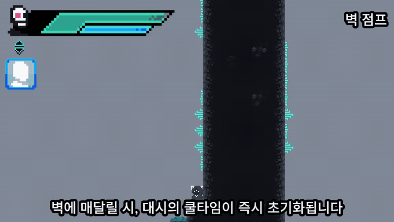

| 기능 | 동작 규칙 |
|---|---|
| **벽 매달리기** | 공중에서 X 이동이 막히면 Raycast로 매달릴 수 있는 벽인지 확인 후 매달림. 방향키를 누르고 있으면 중력을 무시하고, 반대 방향키를 0.5초 유지하면 떨어짐 |
| **벽 점프** | 벽 반대 방향으로 튕겨 나감. 매달리면 점프 횟수와 대시 쿨타임이 초기화 |
| **대시** | EaseInOutQuart 이징으로 **고정 거리 4.5**(속도 30 × 0.15초) 이동. 대시 중 Y 이동 제거, 벽에 막히면 즉시 종료 |
| **대시 쿨타임** | 0.5초. **지상에서만 회복**되며, 점프 시작이나 벽 매달리기 시 즉시 회복 |
| **대시 무적** | 대시 시작 0.05초 동안 피격 무시 → **완벽 회피** 판정 ([4장](#4-캐릭터-교대--qte)의 QTE 게이지와 연결) |

### 3.7 고민과 선택 ③ Rigidbody 물리 이동 vs Kinematic 직접 구현

> **결정 대상**: 플레이어 이동을 Unity 물리 엔진에 맡길 것인가, 직접 계산할 것인가?

| | [A] Rigidbody 물리 이동 (velocity / AddForce) | [B] Kinematic 직접 구현 ✓ |
|---|---|---|
| 장점 | 충돌 처리를 엔진이 해 줌. 구현이 빠름 | 정점 체공, 고정 거리 대시, 벽 매달리기처럼 물리 법칙을 벗어난 움직임을 원하는 대로 설계 가능. 모든 수치를 직접 통제 |
| 단점 | 마찰·관성 등 물리 연산이 끼어들어, 점프 곡선 같은 세밀한 움직임을 원하는 대로 만들기 어려움 | **충돌 해결을 직접 책임져야 함** (구현량 증가, 충돌 버그 위험) |

**[최종 결정] B를 선택했습니다.** 이 프로젝트의 목표가 "콘텐츠 볼륨보다 조작감"이었기 때문에, 조작감의 핵심인 점프를 세밀하게 제어하기 어려운 A는 맞지 않는다고 판단했습니다.

**[얻은 것]** 이동에 관여하는 모든 수치를 직접 통제할 수 있게 되었습니다. 이 수치들을 `PlayerMoveSettings`로 분리해 두어, 구현 이후의 조작감 조정은 코드 수정 없이 인스펙터에서 반복할 수 있었습니다.

**[감수한 대가]** 엔진이 해 주던 충돌 처리를 직접 맡아야 했고, 실제로 충돌 버그를 겪었습니다. 그 사례와 해결 과정은 바로 아래 3.8에서 다룹니다.

### 3.8 트러블슈팅: 점프 이동 중 타일 모서리에 끼는 문제

**증상.** 점프하며 대각선으로 이동하다가 타일 모서리 부근에 착지하면, 캐릭터가 모서리에 끼어 움직이지 않는 문제가 발생했습니다. 주로 점프 이동 중에 재현됐습니다.

**원인.** X축과 Y축의 이동 가능 여부를 **둘 다 이동 전의 같은 위치에서** 검사했기 때문입니다.

```
[수정 전] 두 축을 같은 시작 위치에서 검사

   ┌──┐ → X 검사: 오른쪽 비어 있음 → 이동 OK
   │P │ ↓ Y 검사: 아래 비어 있음  → 이동 OK
   └──┘
         ┌──────── 타일
         │
   → 실제로는 '오른쪽으로 이동한 위치'의 아래에 타일이 있음
   → 두 검사 모두 통과해 대각선으로 이동 → 박스가 타일 안으로 파고들어 끼임

[수정 후] X 이동을 먼저 반영한 위치에서 Y 검사

   ┌──┐ → X 검사 후 박스를 이동할 X 위치로 옮김
   │P │
   └──┘     ┌──┐ ↓ 옮긴 위치에서 Y 검사: 타일 감지
         ┌──│P'│── → 타일 위까지만 이동
```

X 이동만 보면 문제가 없고 Y 이동만 봐도 문제가 없지만, **두 이동을 합친 대각선 경로**에는 타일이 있는 경우를 걸러내지 못했던 것입니다.

**해결.** X축을 먼저 검사해 실제로 이동할 양을 확정하고, **검사용 박스를 그 위치로 옮긴 다음** Y축을 검사하도록 바꿨습니다(3.4 코드의 `box.center += Vector3.right * moveX`).

**배운 점.** 충돌 검사는 "각 축이 따로 가능한가"가 아니라 **"실제로 이동할 경로가 가능한가"**를 확인해야 합니다. 축을 나눠 처리할 때는 앞 축의 결과가 다음 축 검사의 시작점이 되어야 합니다. 엔진이 해 주던 일을 직접 구현할 때는 이런 숨은 전제를 하나하나 다시 세워야 한다는 것을 체감했습니다.

---

## 4. 캐릭터 교대 & QTE

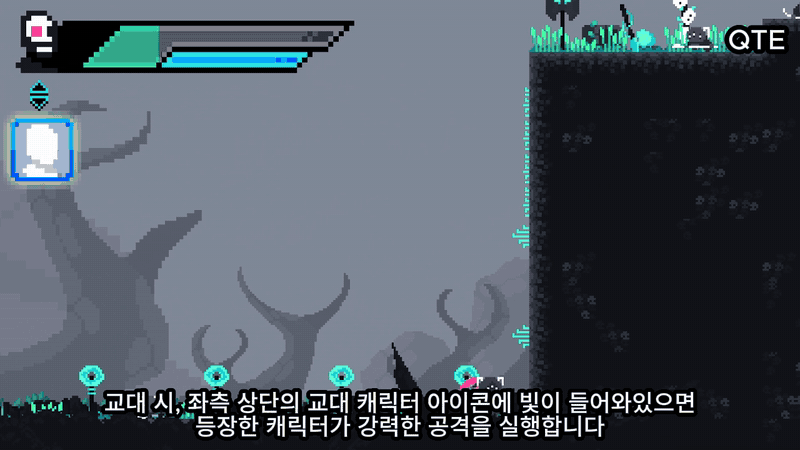

### 4.1 개요: 교대가 곧 전투 수단이 되도록

이 게임의 차별점은 **캐릭터 교대**입니다. 플레이어는 두 캐릭터를 동시에 조작하는 것이 아니라, 한 명씩 번갈아 꺼내 씁니다. 두 캐릭터는 공격 템포와 스킬이 다르기 때문에 상황에 맞춰 바꿔 쓰는 판단이 중요합니다.

교대를 단순한 캐릭터 변경이 아니라 **전투 수단**으로 만들기 위해 두 가지 장치를 넣었습니다.

| 장치 | 동작 | 플레이 의미 |
|---|---|---|
| **교대 무적** | 교대 연출 동안 나가는 캐릭터와 들어오는 캐릭터 모두 피격 판정(HurtBox) 비활성화 | 위험한 공격을 교대로 피하는 **방어 수단** |
| **QTE 등장 공격** | 게이지가 가득 찬 상태로 교대하면, 들어온 캐릭터가 등장과 동시에 강력한 공격 | 위기를 반격으로 바꾸는 **공격 수단** |

### 4.2 교대 흐름

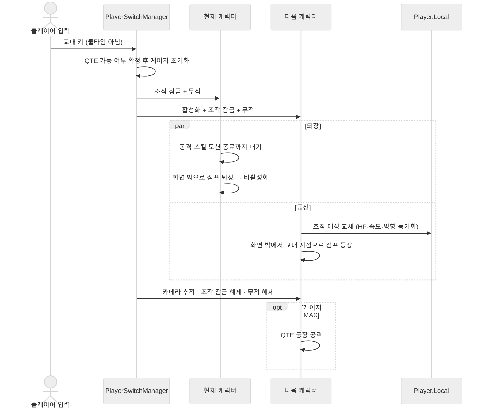

### 4.3 핵심 동작

**① 퇴장과 등장을 동시에 진행합니다.** 퇴장 코루틴과 등장 코루틴을 동시에 시작하고, 둘 다 끝날 때까지 기다립니다.

```csharp
// PlayerSwitchManager.cs — 교대 코루틴 (요약)
private IEnumerator SwitchCoroutine(int nextIdx)
{
    // 교대 시작 시점의 게이지로 QTE 발동 여부를 정하고 게이지 초기화 (4.4 참고)
    bool canUseQTE = qteGauge >= qteGaugeMax;
    qteGauge = 0f;

    IsSwitching = true;
    isSwitchOnCooldown = true;

    Player curr = currentPlayer;
    Player next = sparePlayers[nextIdx];
    // ... 교대 지점(switchPoint)과 화면 밖 지점(goalPoint) 계산 ...

    curr.LockControl();
    curr.EnableInvincibility();   // 나가는 캐릭터 무적
    next.gameObject.SetActive(true);
    next.LockControl();
    next.EnableInvincibility();   // 들어오는 캐릭터도 무적

    bool switchOutDone = false;
    bool switchInDone = false;

    // 퇴장·등장을 병렬 실행
    StartCoroutine(SwitchOutCoroutine(curr, switchPoint, goalPoint, () => switchOutDone = true));
    StartCoroutine(SwitchInCoroutine(curr, next, goalPoint, switchPoint, () => switchInDone = true, canUseQTE));

    yield return new WaitUntil(() => switchOutDone && switchInDone);

    currentPlayer = next;
    sparePlayers[nextIdx] = curr;
    IsSwitching = false;
}
```

**② 공격 도중에 교대해도 모션을 자르지 않습니다.** 나가는 캐릭터는 공격·스킬 모션이 끝날 때까지 기다렸다가 퇴장합니다.

**③ 상태를 이어받습니다.** 교대 시 HP, 수평 이동 속도, 바라보는 방향을 전용 구조체로 넘겨, 달리던 중에 교대하면 새 캐릭터도 그 속도와 방향 그대로 이어서 움직입니다.

```csharp
// Player.cs — 교대 시 상태 동기화
private static void SyncMovementState(Player curr, Player next)
{
    PlayerMoveSyncData syncData = new()
    {
        MoveX = curr.Movement.MoveX,                       // 수평 속도
        LastMoveDirection = curr.Movement.LastMoveDirection // 바라보는 방향
    };
    next.Movement.SyncPrevPlayerState(syncData); // 다음 캐릭터에 속도·방향 전달
}
```

### 4.4 QTE 게이지와 완벽 회피

| 항목 | 값 | 설명 |
|---|---|---|
| 게이지 최대치 | 100 | 가득 차면 UI에 Glow 표시 |
| 적 타격 | +5 (×1) | 플레이어 HitBox가 적을 맞힐 때마다 |
| **완벽 회피** | **+20 (×4)** | 대시 시작 0.05초 안에 공격을 받으면 피해 무시 + 게이지 획득 |
| 교대 쿨타임 | 10초 | **게이지가 가득 차면 쿨타임 즉시 해제** → 모은 게이지를 바로 쓸 수 있음 |
| 교대 시 게이지 | 0으로 초기화 | QTE 발동 여부와 관계없이 교대할 때마다 초기화 |

게이지가 가득 차면 교대 쿨타임이 풀리는 규칙에 맞춰, 교대 시에는 게이지를 초기화하도록 설계했습니다. 다만 게이지가 덜 찬 상태의 일반 교대에서도 그동안 모은 게이지가 사라지는데, 이 부분은 [8장 회고](#8-결과-및-회고)에서 개선 방향과 함께 다룹니다.

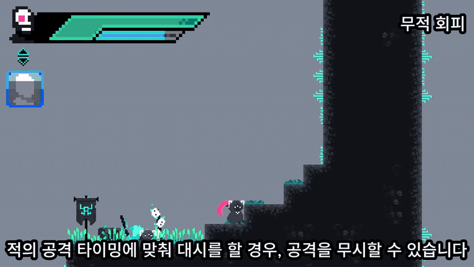

완벽 회피는 별도의 판정 시스템 없이, 전투 흐름(5장)의 **피해 수용 여부 확인 단계**(`CanTakeDamage`)에 끼워 넣어 구현했습니다.

```csharp
// PlayerCombat.cs — 피해를 받기 직전에 호출됨
public override bool CanTakeDamage(CombatEntity sender, CombatEvent @event)
{
    if (isDashInvincible) // 대시 시작 후 0.05초 이내
    {
        // (Why) 피해를 무시하는 동시에 보상(게이지 ×4)을 줌 → 위험을 감수한 회피를 반격 기회로 연결
        PlayerSwitchManager.Instance.GainQTEGauge(qteGaugeGainMult);
        return false; // 피해 · 히트스탑 모두 발생하지 않음
    }
    return true;
}
```

### 4.5 고민과 선택 ④ `Player.Local` 단일 참조 vs 대상 주입 구조

> **결정 대상**: 몬스터 AI·보스 패턴·UI는 "현재 플레이어"를 어떻게 알아낼 것인가?

| | [A] 대상 주입 구조 | [B] `Player.Local` 정적 참조 ✓ |
|---|---|---|
| 방식 | 각 시스템이 추적 대상을 주입받고, 교대 시 이벤트로 대상 변경을 알림 | 현재 조작 캐릭터를 `Player.Local` 하나에 두고 모든 시스템이 이를 참조 |
| 장점 | 결합도가 낮고, 대상이 여러 명이어도 대응 가능 | 교대 시 `Local`만 바꾸면 몬스터·보스·UI가 자동으로 새 캐릭터를 바라봄. 구현이 단순 |
| 단점 | 교대마다 구독자에게 변경을 전파하는 코드 필요 | 전역 상태에 의존. 조작 대상이 여러 명인 구조(멀티플레이 등)로는 확장 불가 |

**[최종 결정] B를 선택했습니다.** 이 게임은 교대를 하더라도 **조작 중인 캐릭터는 항상 한 명**이고, HP도 두 캐릭터가 공유합니다. 즉 "현재 플레이어"라는 개념이 게임 전체에서 하나뿐이므로, 2주라는 기간과 프로젝트 규모를 고려하면 전파 구조를 따로 만드는 것은 과한 설계라고 판단했습니다.

**[한계와 전환 방향]** 플레이어가 여러 명이 되거나 몬스터마다 다른 대상을 노려야 한다면 이 구조는 맞지 않습니다. 그때는 몬스터가 추적 대상을 직접 보관하고, 교대 이벤트를 구독해 갱신하는 방식으로 바꿔야 합니다.

### 4.6 고민과 선택 ⑤ 캐릭터별 스킬 쿨타임 vs 공유 쿨타임

> **결정 대상**: 두 캐릭터의 스킬 쿨타임을 따로 둘 것인가, 공유할 것인가?

| | [A] 캐릭터별 쿨타임 | [B] 공유 쿨타임 ✓ |
|---|---|---|
| 장점 | 교대하면 다른 캐릭터의 스킬을 바로 쓸 수 있어 스킬 사용 빈도가 높음 | 스킬 사용 횟수가 교대 여부와 관계없이 일정하게 유지되어 밸런스를 잡기 쉬움 |
| 단점 | "Mooni로 회복 → 교대 → Reaper로 즉시 무적 체공"처럼 회복과 무적을 연달아 쓰는 루트가 생겨 밸런스가 무너짐 | 교대해도 스킬은 쓸 수 없으므로, 교대만으로 얻는 이득이 그만큼 줄어듦 |

**[최종 결정] B를 선택했습니다.** 회복 → 교대 → 무적처럼 스킬을 이어 쓰는 루트는 너무 강하다고 판단했습니다. 쿨타임을 공유하면 스킬 사용 횟수가 일정하게 유지되고, 그 결과 플레이어는 지금 회복이 필요한지, 회피·공격이 필요한지 따져 보고 **스킬 하나를 골라 쓰게** 됩니다. 교대 연출 중에는 쿨타임이 흐르지 않습니다.

### 4.7 고민과 선택 ⑥ 패링을 구현하지 않은 이유

기획서에는 **패링**이 있었습니다. 구상한 패링은 "제자리에서 상대의 공격을 무효화하는 것"이었는데, 구현 단계에서 보니 이 역할은 **대시 무적으로 공격을 흘리는 완벽 회피**와 사실상 차이가 없었습니다. 사실상 같은 역할을 하는 시스템을 하나 더 만들 필요는 없다고 판단해 범위에서 제외했습니다.

### 4.8 플레이테스트 기반 튜닝

| 조정 항목 | 변경 전 | 변경 후 | 근거 |
|---|---|---|---|
| **완벽 회피 판정 시간** | 약 0.1초 | **0.05초** | "너무 쉽다"는 플레이테스트 피드백 |
| **몬스터 히트박스 타이밍** | 공격 이펙트가 뜨는 프레임에 활성화 | **이펙트보다 1프레임 먼저 활성화** | 아래 설명 참고 |

**히트박스를 1프레임 먼저 켠 이유.** 처음에는 공격 이펙트가 뜨는 프레임에 정확히 히트박스를 켰더니, 완벽 회피를 하려면 지나치게 정확한 타이밍이 필요했습니다. 그렇다고 무적 시간을 늘리면 회피가 너무 쉬워져 밸런스가 무너지는 딜레마가 있었습니다. 그래서 무적 시간은 그대로 두고 **판정 쪽을 조정**했습니다. 애니메이션이 12fps이므로 1프레임은 약 83ms이고, 이는 대시 무적(50ms)보다 긴 여유입니다. 플레이어 입장에서 "너무 일찍 맞는다"는 느낌 없이 회피 난이도만 완화할 수 있었습니다.

**공중 교대의 활용.** 공중에서 교대하면 들어온 캐릭터가 2단 점프를 다시 쓸 수 있습니다. 이 특성을 활용해 테스트 구간에 "2단 점프 → 교대 → 2단 점프 → 벽 점프"로 지나가는 지형을 배치했습니다. 다만 필수 루트로 강제하지 않고, 2단 점프 → 대시로도 아슬아슬하게 통과할 수 있게 열어 두었습니다.

---

## 5. 전투 처리 흐름

### 5.1 개요

플레이어, 일반 몬스터, 보스, 투사체는 모두 **같은 전투 흐름**을 사용합니다. 공격 판정(HitBox)과 피격 판정(HurtBox)을 분리하고, 그 사이를 `CombatManager`가 중재합니다.

| 구성 요소 | 역할 |
|---|---|
| `HitBox` | 공격 판정. **애니메이션 클립에 연동**되어 공격 모션의 특정 프레임에만 켜짐 |
| `HurtBox` | 피격 판정. 자신이 속한 `CombatEntity`(피해를 받는 주체)를 알고 있음 |
| `CombatManager` | 모든 피격 이벤트의 중재자. 피해 수용 여부 확인 → 히트스탑 → 피해 적용 |
| `CombatEntity` | HP와 공격력을 가진 전투 주체(플레이어 / 몬스터 / 보스). 스탯은 `EntityStat`(ScriptableObject)으로 관리 |
| `CombatEvent` | 피해량, 이벤트 종류(피해/회복), 히트스탑 시간을 담은 구조체 |

HitBox를 애니메이션 클립의 키로 켜고 끄기 때문에, **공격 판정이 들어가는 시점을 Animation 창의 타임라인에서 눈으로 보며 조정**할 수 있습니다. 4.8의 "히트박스 1프레임 선행" 튜닝도 Animation 창에서 판정 시점을 확인하며 조정했습니다.

### 5.2 흐름

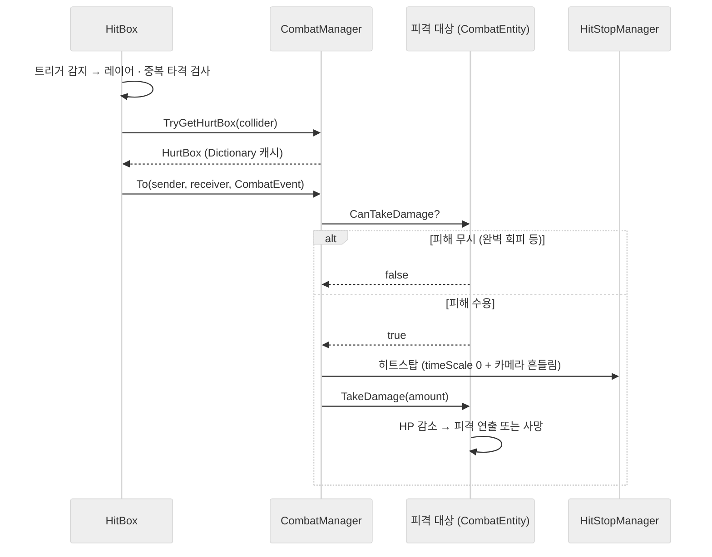

### 5.3 핵심 동작

```csharp
// HitBox.cs — 공격 판정
protected virtual bool TryHit(Collider2D collision)
{
    if (hitLayerMask.Contains(collision) == false) return false;

    // (Why) 히트박스가 켜져 있는 동안 같은 대상은 한 번만 타격 → 한 번의 공격이 여러 번 들어가는 문제 방지
    if (checkList.Contains(collision)) return false;

    // (Why) Collider → HurtBox를 Dictionary로 캐싱 → 피격마다 GetComponent를 호출하지 않음
    if (CombatManager.Instance.TryGetHurtBox(collision, out HurtBox hurtBox) == false) return false;

    checkList.Add(collision);

    CombatEvent @event;
    @event.EventType = CombatEventType.Damage;
    @event.Amount = Mathf.FloorToInt(owner.ATK * damageMult); // 공격자 스탯 × 공격별 배율
    @event.Position = Vector2.zero;
    @event.HitStopDuration = hurtBox.HitStopDuration;         // 히트스탑 길이는 맞는 쪽이 결정

    CombatManager.Instance.To(owner, hurtBox.Owner, @event);
    return true;
}

private void OnTriggerEnter2D(Collider2D collision) => TryHit(collision);

// 히트박스가 꺼지면(다음 공격) 타격 기록 초기화
protected virtual void OnDisable() => checkList.Clear();
```

같은 흐름을 상속으로 확장해 재사용합니다.

| 확장 클래스 | 추가 동작 |
|---|---|
| `PlayerHitBox` | 타격에 성공하면 QTE 게이지 획득 (`base.TryHit()`이 true일 때만) |
| `Projectile` (궁수 화살) | 트리거 대신 매 물리 프레임 CircleCast로 대상을 찾은 뒤, 같은 `TryHit()`으로 처리 |

```csharp
// CombatManager.cs — 피해 적용 직전의 관문
private void ApplyDamage(CombatEntity sender, CombatEntity receiver, CombatEvent @event)
{
    // (Why) 피해를 받을지는 '받는 쪽'이 결정 → 완벽 회피 같은 예외 규칙을 각 주체가 스스로 정의
    if (receiver.CanTakeDamage(sender, @event) == false)
        return;

    HitStopManager.Instance.Play(@event.HitStopDuration);
    receiver.TakeDamage(@event.Amount);
}
```

### 5.4 피격 피드백

타격감은 세 겹의 피드백으로 구성했습니다.

| 피드백 | 구현 |
|---|---|
| **화이트 플래시** | 셰이더의 `_HitEffectBlend` 값을 `MaterialPropertyBlock`으로 조정. 1프레임(0.083초) 간격으로 2번 깜빡임 |
| **경직** | 플래시가 진행되는 동안 Animator 속도를 0.5배로 낮춤 |
| **히트스탑** | `timeScale`을 0으로 만들고 실제 시간 기준으로 대기한 뒤 복구. 동시에 Cinemachine 노이즈로 카메라 흔들림 |

몬스터는 종류마다 피격 반응을 인스펙터에서 고를 수 있습니다(애니메이션 Hit 모션 / 셰이더 플래시 / 둘 다). 코드 수정 없이 몬스터 특성에 맞게 반응을 다르게 줄 수 있습니다.

```csharp
// HitEffect.cs — 화이트 플래시
private void SetHitEffectBlend(bool isOn)
{
    // (Why) material 프로퍼티를 직접 수정하면 몬스터마다 머티리얼 인스턴스가 새로 생성됨
    //       → 바꿀 값은 _HitEffectBlend 하나뿐이므로 PropertyBlock으로 개체별 값만 덮어씀
    renderer.GetPropertyBlock(propertyBlock);
    propertyBlock.SetFloat(HIT_EFFECT_BLEND, isOn ? 1f : 0f);
    renderer.SetPropertyBlock(propertyBlock);
}
```

### 5.5 고민과 선택 ⑦ 직접 판정 vs 중재자(CombatManager)

> **결정 대상**: HitBox가 피격 대상에게 직접 피해를 줄 것인가, 중간에 중재자를 둘 것인가?

| | [A] HitBox가 직접 판정 | [B] CombatManager 중재 ✓ |
|---|---|---|
| 방식 | 충돌한 오브젝트에서 컴포넌트를 찾아 바로 `TakeDamage()` 호출 | HitBox는 이벤트만 만들어 전달. 수용 여부 확인·히트스탑·피해 적용은 중재자가 처리 |
| 장점 | 구조가 단순하고 호출 경로가 짧음 | 피격 처리 순서가 한 곳에 모임. 문제가 생기면 중재자만 확인하면 됨. HurtBox 캐싱을 한 곳에서 관리 |
| 단점 | 히트스탑·무적 판정 같은 공통 규칙이 공격 종류마다 흩어짐. 피격마다 `GetComponent` 호출 | 클래스가 하나 늘고 호출 단계가 깊어짐 |

**[최종 결정] B를 선택했습니다.** 직접 판정해도 기능상 문제는 없지만, 플레이어·몬스터·보스·투사체가 모두 서로를 때리는 구조에서 피격 규칙이 여기저기 흩어지는 것은 설계상 문제라고 판단했습니다. 중재자를 두면 **문제가 생겼을 때 볼 곳이 하나**라는 명확한 이점이 있습니다. 실제로 완벽 회피(4.4)는 이 관문(`CanTakeDamage`)에 조건 하나를 넣는 것만으로 구현할 수 있었습니다.

---

## 6. 적 AI와 보스 패턴

### 6.1 일반 몬스터의 행동

일반 몬스터는 플레이어와 같은 **Animator 기반 FSM 베이스**(2.4)를 상속해 만들었습니다. 몬스터도 대기·순찰·추적·공격 패턴을 반복하기 때문에, 이미 만들어 둔 베이스를 재사용하는 편이 효율적이라고 판단했습니다.

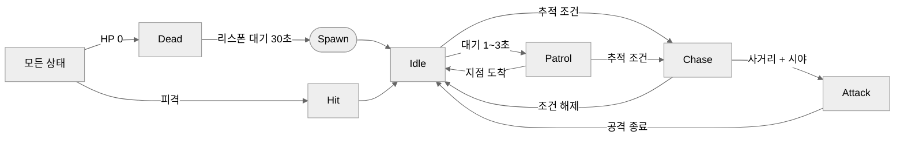

> Idle·Patrol 상태에서도 플레이어가 사거리와 시야 안에 들어오면 바로 공격으로 넘어갑니다.

| 단계 | 규칙 |
|---|---|
| **순찰** | 시작 위치와 지정한 순찰 지점 사이(순찰 범위)에서 랜덤 지점을 골라 이동 |
| **추적 조건** | ① 플레이어가 순찰 범위 안에 있고 ② 일정 거리 이내이며 ③ 사이에 장애물이 없을 때(Linecast 시야 판정) |
| **추적 범위 제한** | 추적 목표 지점을 순찰 범위 안으로 제한 → 순찰 범위 밖까지는 따라오지 않음 |
| **리스폰** | 사망 후 일정 시간(기본 30초)이 지나면 처음 위치와 방향으로 부활. 몬스터마다 리스폰 여부 설정 가능 |

### 6.2 몬스터 4종의 차별화

여러 종류의 몬스터로 다양한 전투 상황을 만들기 위해, 공통 컨트롤러(`EnemyController`)의 `Attack()`만 오버라이드해 타입별 공격 규칙을 표현했습니다.

| 전사 | 궁수 |
|---|---|
| 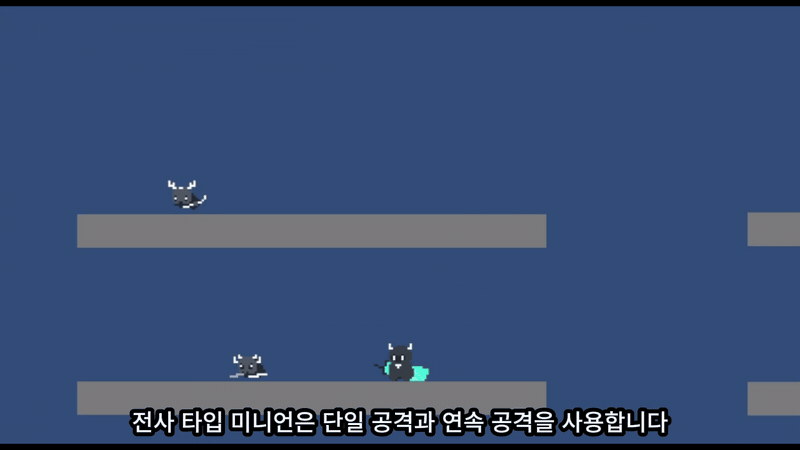 | 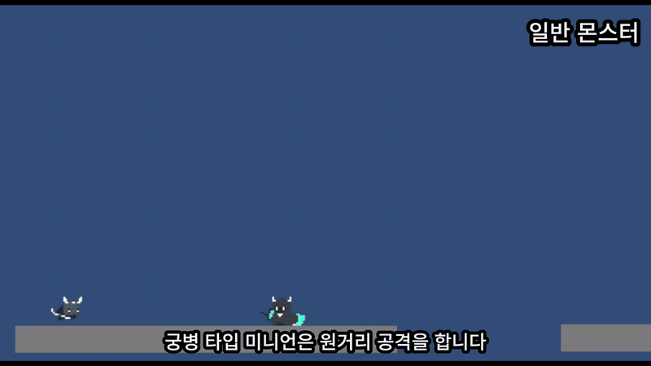 |
| **창병** | **자폭병** |
| 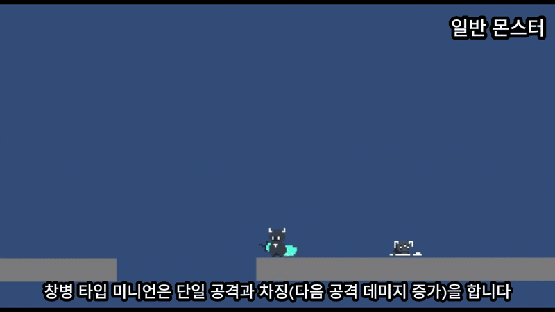 | 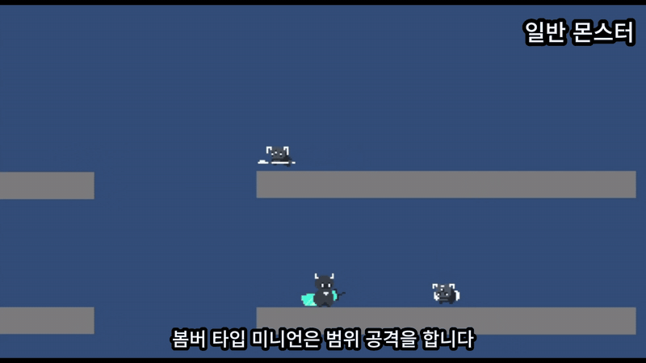 |

| 몬스터 | 공격 규칙 | 전투에서의 역할 |
|---|---|---|
| **전사** | 기본형. 30% 확률로 연속 공격 | 가장 기본적인 근접 적 |
| **궁수** | 공격 준비 시점에 조준 위치를 확정하고, 발사 직전에는 높이만 보정. 플레이어가 반대편으로 넘어갔으면 보정하지 않음 | 원거리 견제. 조준이 확정된 뒤에는 방향이 바뀌지 않아 피할 수 있는 공격이 되도록 함 |
| **창병** | 30% 확률로 **힘을 모으는 동작**을 취하고, 바로 다음 공격의 피해가 2배 | 힘을 모으는 모습이 곧 **예고 신호** → 다음 공격을 반드시 피해야 하는 위협이자, 완벽 회피로 게이지를 노릴 기회 |
| **자폭병** | HP 30% 이하가 되면 자폭 공격 후 사망 | 체력이 낮을수록 오히려 위험해지는 몬스터 |

```csharp
// BomberController.cs — 공통 컨트롤러의 Attack()만 교체
protected override int Attack()
{
    int id;

    // HP 30% 이하에서는 무조건 자폭 공격
    if (combat.HPRatio <= suicideHPRatioThreshold)
    {
        id = AnimationParam.ATTACK_2;
        isSuicide = true; // 공격이 끝나면 스스로 사망 처리
    }
    else id = AnimationParam.ATTACK_1;

    Animator.SetTrigger(id);
    return id;
}
```

### 6.3 보스 구조

보스는 2.6에서 설명한 **GameObject 기반 FSM**으로 제어합니다. 모든 패턴은 공통 부모 `BossPatternStateBase`를 상속하며, 오브젝트가 켜지면 아래 흐름으로 실행됩니다.

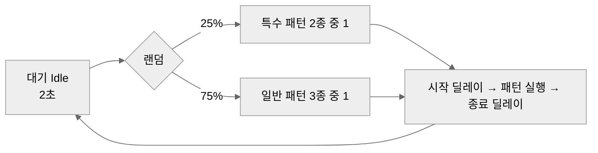

```csharp
// BossPatternStateBase.cs — 모든 패턴의 공통 흐름
protected override void OnEnable()
{
    // (Why) 오브젝트가 켜지는 것 자체가 '패턴 시작' → 컨트롤러는 SetActive만 하면 됨
    StartCoroutine(PatternCoroutine());
}

protected virtual IEnumerator PatternCoroutine()
{
    Animator.SetTrigger(PatternStartTrigger); // 패턴별 시작 모션
    yield return waitForStartLag;             // 패턴별 시작 딜레이 (인스펙터에서 조정)
    // → 자식 클래스가 이어서 패턴 본체를 실행하고, 끝나면 Idle로 복귀
}
```

시작·종료 딜레이 값은 패턴마다 인스펙터에서 조정할 수 있게 해, 패턴 난이도를 코드 수정 없이 맞출 수 있습니다. HP 기반 페이즈 구분은 일정상 넣지 못했습니다([8장](#8-결과-및-회고)).

### 6.4 패턴 5종

| 구분 | 패턴 | 동작 |
|---|---|---|
| 일반 1 | **추적 칼날** | 칼날이 일정 시간 플레이어를 따라다니다가 멈춘 뒤 공격 |
| 일반 2 | **장판 폭발** | 바닥의 일정 간격 지점 중 랜덤 10곳에 장판 생성 → 동시 폭발 |
| 일반 3 | **순차 스파크** | 스파크를 랜덤 순서로 하나씩 터뜨림 |
| 특수 1 | **눈과 빔** | 공중 랜덤 위치에 눈이 하나씩 생성되고, 눈동자가 플레이어를 따라감. 눈동자가 **멈추는 순간이 회피 신호**이며 0.25초 뒤 그 방향으로 빔 발사. 빔을 보스의 특정 부위로 유도해 맞히면 보스가 큰 피해를 입음 |
| 특수 2 | **미니언 스포너** | 아래 흐름 참고 |

| 일반 1 · 추적 칼날 | 일반 2 · 장판 폭발 |
|---|---|
| 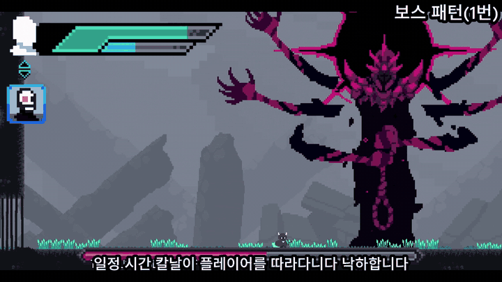 | 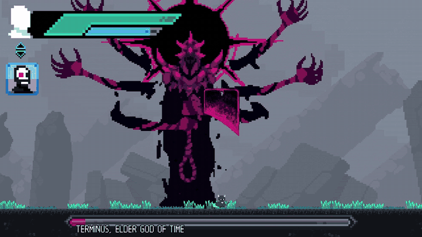 |
| **일반 3 · 순차 스파크** | **특수 1 · 눈과 빔** |
| 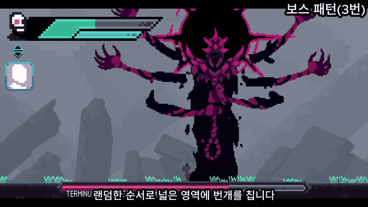 | 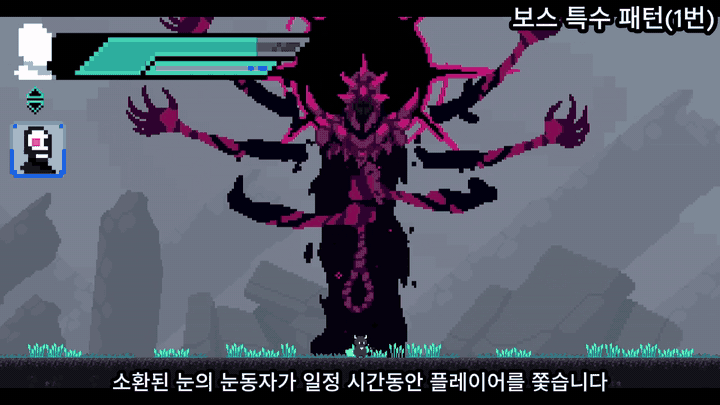 |

**특수 패턴 1의 빔 길이.** 빔이 지형을 뚫고 나가지 않도록, 눈동자 방향으로 Raycast를 쏴 지형까지의 거리를 잽니다. 다만 **잰 거리만큼만 빔을 늘리면 어색해집니다.** 빔은 폭이 있는 사각형이고 Raycast는 빔의 중심선 하나만 재기 때문에, 빔이 비스듬히 떨어지면 끝단의 한쪽 모서리가 지면에 닿지 못하고 떠 보입니다. 그래서 잰 거리에 **여유 길이(`lengthOffset`)를 더해** 빔 끝이 지형 아래로 파묻히게 만들었고, 빔이 지면에 꽂히는 것처럼 보이도록 했습니다.

| 잰 거리만큼만 늘린 경우 | 여유 길이를 더한 경우 ✓ |
|---|---|
| 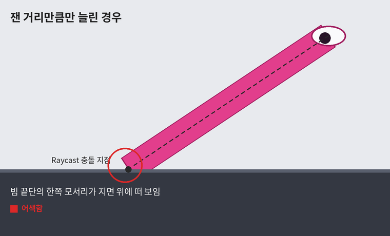 | 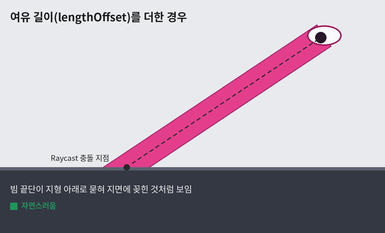 |
| 끝단 모서리가 지면 위에 떠 보임 | 끝단이 지형 아래로 묻혀 지면에 꽂힌 것처럼 보임 |

**특수 패턴 2**는 플레이어의 대응에 따라 결과가 갈리는 패턴입니다.

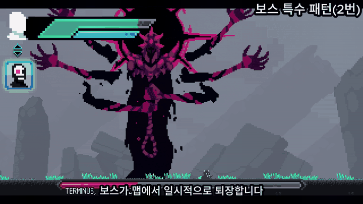

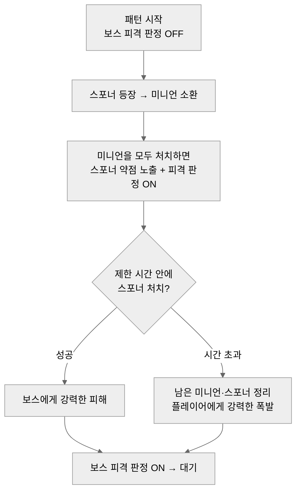

특수 패턴 두 종은 모두 **잘 대응하면 오히려 보스에게 큰 피해를 줄 수 있는 기회**가 되도록 설계했습니다. 기획서의 핵심 가치인 "위기를 반격 기회로 바꾸는 경험"을 보스전에서도 이어 가기 위해서입니다.

패턴에 쓰이는 오브젝트(칼날, 장판, 스파크, 눈)는 처음에 필요한 개수만큼 미리 만들어 두고, 패턴마다 `SetActive`로 재사용합니다.

### 6.5 보스방 진입 연출

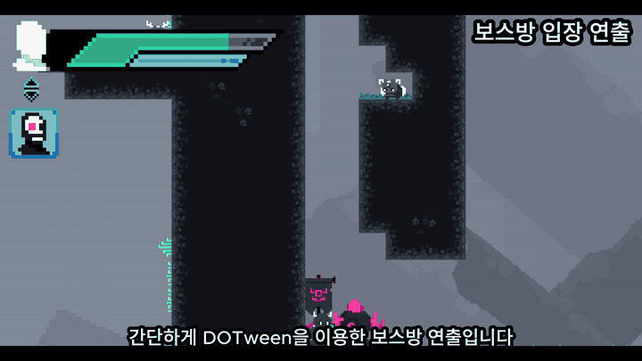

보스방에 들어서면 짧은 컷신이 재생됩니다. 연출 동안 플레이어는 **강한 조작 잠금**(공격 입력까지 차단) 상태입니다.

| 순서 | 연출 |
|---|---|
| 1 | 입구 봉쇄 + 카메라 흔들림 + 캐릭터 감정 표현(한숨) |
| 2 | 플레이어를 방 중앙으로 이동 |
| 3 | 두리번거림 + 감정 표현(속삭임, 물음표) |
| 4 | 보스 등장 + 카메라 흔들림 |
| 5 | 카메라 경계·오프셋·줌 변경 (보스 전체가 화면에 들어오도록) |
| 6 | 보스 시작 애니메이션 → 피격 판정·보스 UI 활성화 → 전투 시작 |

각 단계를 코루틴으로 나누고 `yield return`으로 이어 붙인 구조입니다. 5단계의 카메라 줌에서 겪은 문제는 [7장](#7-트러블슈팅)에서 다룹니다.

---

## 7. 트러블슈팅

> 이동 충돌 문제(타일 모서리 끼임)는 [3.8](#38-트러블슈팅-점프-이동-중-타일-모서리에-끼는-문제)에서 다뤘습니다. 이 장에서는 애니메이션·연출 쪽 문제를 모았습니다.

### 7.1 공중 공격·스킬 모션이 Jump/Fall 모션에 덮이는 문제

**증상.** 공중에서 공격이나 스킬을 쓰면, 모션 도중에 Jump/Fall 모션으로 넘어가 공격 모션이 덮어씌워졌습니다.

**원인.** 공중 상태(점프 중/낙하 중)는 Animator 안에서 판단하지 않고, `PlayerController`가 매 프레임 접지 여부와 Y 속도를 보고 **공중 상태가 바뀔 때 바깥에서 트리거를 쏘는 구조**입니다. 파라미터가 늘어날수록 Animator 관리가 급격히 어려워진다고 판단해 택한 구조였는데, 공격 도중에도 Y 속도가 바뀌면 Jump/Fall 트리거가 그대로 들어가 공격 모션을 끊었습니다.

**시도.** Animator 쪽에서 트랜지션 조건과 Has Exit Time을 조정해 봤지만 해결되지 않았습니다.

**해결.** 트리거를 쏘는 쪽에서 막았습니다. `CAN_JUMP_OR_FALL`이라는 가드 Bool을 두고, 공격·스킬·QTE·사망 상태에 **들어갈 때 끄고 나올 때 켜도록** 했습니다. 컨트롤러는 이 값이 꺼져 있으면 Jump/Fall 트리거를 쏘지 않습니다.

```csharp
// PlayerAttackState.cs — 공격 중에는 Jump/Fall 전이를 막음
public override void OnEnter() => Animator.SetBool(AnimationParam.CAN_JUMP_OR_FALL, false);
public override void OnExit()  => Animator.SetBool(AnimationParam.CAN_JUMP_OR_FALL, true);

// PlayerController.cs — 공중 상태 갱신
if (Animator.GetBool(AnimationParam.CAN_JUMP_OR_FALL) == false) return; // 가드: 트리거를 쏘지 않음
```

**회고.** Animator 트랜지션의 **Interruption Source** 설정은 검토해 보지 않았습니다. 트랜지션 도중 어떤 전이가 끼어들 수 있는지를 Animator 쪽에서 제어하는 방법이 있었는데, 가드 파라미터를 추가하기 전에 이 설정부터 확인해 봤어야 했다고 생각합니다.

### 7.2 소비되지 않은 Trigger가 남아 생긴 문제 2건

두 문제는 증상은 달랐지만 원인이 같았습니다.

**(a) 땅에 서 있는데 Fall 모션이 나오는 문제**

| | 내용 |
|---|---|
| **증상** | 낙하 중에 QTE 교대를 하면, QTE 공격이 끝난 뒤 땅에 서 있는데도 Fall 모션이 재생됨 |
| **원인** | 낙하 중 들어온 FALL 트리거가 QTE 모션에 밀려 **소비되지 않은 채 남아 있었음**. QTE 동안 중력을 받아 착지한 뒤 QTE가 끝나자, 남아 있던 FALL 트리거가 그제야 소비됨 |
| **해결** | QTE 상태를 나갈 때 접지 상태라면 FALL 트리거를 `ResetTrigger`로 정리 |

```csharp
// PlayerQTEState.cs
public override void OnExit()
{
    Animator.SetBool(AnimationParam.CAN_JUMP_OR_FALL, true);

    // (Why) QTE 중 착지했다면, 낙하 중 남은 FALL 트리거가 뒤늦게 소비되지 않도록 정리
    if (Animator.GetBool(AnimationParam.IS_GROUNDED))
        Animator.ResetTrigger(AnimationParam.FALL);
}
```

**(b) 몬스터가 부활하자마자 허공에 공격하는 문제**

| | 내용 |
|---|---|
| **증상** | 몬스터 리스폰을 확인하던 중, 부활 직후 플레이어가 사거리에 없는데도 허공에 공격하는 현상 발견 |
| **재현** | 여러 번 실험한 끝에 "공격 모션에 진입한 뒤 실제 타격이 들어가기 전에 죽이면" 재현됨을 확인 |
| **원인** | 공격 트리거와 공격 요청 플래그가 **남은 채로 사망** → 부활 후 남아 있던 트리거가 소비되며 공격 모션 재생 |
| **해결** | 사망 상태에 들어갈 때 공격 요청 플래그와 공격 트리거를 초기화 |

```csharp
// EnemyDeadState.cs
public override void OnEnter()
{
    // (Why) 공격 도중 사망하면 공격 트리거가 남아, 부활 직후 공격 모션이 재생됨 → 사망 시점에 정리
    Owner.ResetAttackState(); // IsAttackRequested = false + ATTACK_1/2 ResetTrigger
}
```

**배운 점.** Animator의 Trigger는 쏘는 순간 끝나는 신호가 아니라, **소비될 때까지 남아 있는 "예약"**입니다. 평소에는 바로 소비되기 때문에 문제가 드러나지 않지만, QTE나 사망처럼 **상태가 강제로 끊기는 지점**에서는 예약이 남아 엉뚱한 시점에 실행됩니다. 이 두 문제를 겪으면서 FSM이 Animator를 제어한다고 해서 Animator가 단순한 재생기가 되는 것이 아니라는 점, Animator도 **자체 규칙을 가진 독립된 상태 머신**이라는 점을 체감했습니다. 상태가 강제로 끊기는 지점에서는 남아 있을 수 있는 Trigger를 반드시 정리해야 한다는 것을 배웠습니다.

### 7.3 보스방 카메라 줌이 뚝뚝 끊기는 문제

| | 내용 |
|---|---|
| **증상** | 보스방 진입 연출에서 카메라를 줌 아웃하면, 부드럽게 줌되지 않고 단계별로 뚝뚝 끊김 |
| **원인** | Pixel Perfect 카메라는 픽셀 아트의 픽셀 정합을 유지하기 위해 렌더링 과정에서 픽셀 단위로 보정함. 이 보정 때문에 줌 배율이 연속적으로 바뀌지 못하고 단계적으로 바뀜. Pixel Perfect 자체의 동작 방식이라 줌을 유지한 채로는 해결 불가 |
| **해결** | 줌 연출이 진행되는 동안만 Pixel Perfect를 끄고, 연출이 끝나면 다시 켬 |

```csharp
// BossroomCutscene.cs — 카메라 조정 연출
cameraPixelPerfect.enabled = false; // (Why) 픽셀 보정이 줌을 단계적으로 끊으므로 연출 동안만 해제
// ... 오프셋 · 줌 · 보스 크기 Tween ...
cameraPixelPerfect.enabled = true;  // 연출 후 픽셀 정합 복구
```

### 7.4 대시 잔상 간격이 들쭉날쭉한 문제

| | 내용 |
|---|---|
| **증상** | 대시 잔상이 초반에는 촘촘하고, 빨라지는 구간에서는 듬성듬성하게 남음. 친구의 플레이테스트에서 "느낌이 안 산다"는 피드백과 함께, 잔상이 일정한 간격으로 쭉 이어지는 연출(산데비스탄 스타일) 요청 |
| **원인** | 잔상을 **매 프레임** 하나씩 만들었는데, 대시가 EaseInOutQuart 이징이라 프레임마다 이동 거리가 다름 → 느린 구간엔 촘촘하고 빠른 구간엔 벌어짐 |
| **해결** | 생성 기준을 '프레임'에서 **'이동 거리'**로 변경. 대시 거리를 잔상 개수로 나눈 간격마다 생성하고, 한 프레임에 간격 이상 이동했다면 그 프레임에 여러 개를 한꺼번에 생성 |

```csharp
// Afterimage.cs — 이동 거리 기준 생성 (코루틴 내부, 요약)
float moveDist = Mathf.Abs(currentPos - prevSpawnPos);

// (Why) 한 프레임에 간격 이상 움직였다면, 지나온 자리에 간격마다 잔상을 채워 넣음
while (moveDist >= spawnInterval)
{
    float direction = Mathf.Sign(currentPos - prevSpawnPos);
    prevSpawnPos += direction * spawnInterval;

    Vector3 spawnPos = transform.position;
    spawnPos.x = prevSpawnPos;
    GetItem().Execute(spawnPos, renderer.sprite, isFlip);

    moveDist = Mathf.Abs(currentPos - prevSpawnPos);
}
```

잔상 오브젝트는 Queue 기반 풀에서 꺼내 쓰고, 페이드가 끝나면 다시 풀로 돌려보내 대시마다 생성·파괴가 반복되지 않도록 했습니다.

---

## 8. 결과 및 회고

### 8.1 결과

**목표 달성 여부.** 개요에서 세운 목표는 "콘텐츠 볼륨보다 액션 플랫포머의 핵심 조작감을 직접 구현하고 검증하는 것"이었습니다. 기획서의 필수 구현 범위를 모두 구현했고(패링은 판단에 따라 제외, [1.5](#15-구현-범위)), 기획서가 정의한 네 가지 목표 경험을 아래와 같이 시스템으로 옮겼습니다.

| 목표 경험 (기획서) | 구현한 시스템 |
|---|---|
| **조작의 손맛** | Kinematic 이동 + 코요테 타임·점프 버퍼·가변 점프·정점 체공·고정 거리 대시 ([3장](#3-이동-컨트롤러)) |
| **전투의 리듬감** | 진행도 기반 콤보 입력 창, 화이트 플래시·경직·히트스탑 피드백, 성격이 다른 몬스터 4종 ([2.4](#24-animator-기반-fsm의-동작), [5장](#5-전투-처리-흐름), [6장](#6-적-ai와-보스-패턴)) |
| **반격의 쾌감** | 교대 무적, 완벽 회피(게이지 ×4), QTE 등장 공격, 대응에 성공하면 보스에게 큰 피해를 주는 특수 패턴 ([4장](#4-캐릭터-교대--qte), [6.4](#64-패턴-5종)) |
| **판단의 재미** | 공유 스킬 쿨타임, 게이지가 가득 차면 풀리는 교대 쿨타임 ([4.4](#44-qte-게이지와-완벽-회피), 4.6) |

**검증과 조정.** 성능 수치를 측정하는 프로젝트는 아니었기 때문에, 조작감은 수치를 분리해 반복 조정하고 플레이테스트 피드백으로 검증했습니다.

- 이동 관련 조작 수치를 ScriptableObject로 분리해, 코드 수정 없이 인스펙터에서 반복 튜닝
- 플레이테스트 피드백을 반영한 조정: 완벽 회피 판정 0.1초 → 0.05초, 몬스터 히트박스 1프레임 선행, 대시 잔상 생성 기준 변경

### 8.2 아쉬운 점과 개선 계획

| # | 아쉬운 점 | 원인 / 당시 판단 | 개선 계획 |
|---|---|---|---|
| 1 | **투사체가 대시 중인 플레이어를 통과함** (무적 타이밍이 아닌데도) | 트리거 판정을 매 물리 프레임 CircleCast 검사로 바꿨지만 해결되지 않음. 원인을 완전히 규명하지 못함 | 투사체와 플레이어 모두 빠르게 움직이는 상황이므로, 프레임 사이의 이동 경로 전체를 검사하도록 개선해 원인을 좁혀 볼 계획 |
| 2 | **히트스탑이 게임 전체를 멈춤** | `timeScale`을 0으로 만드는 방식이라 게임 전체의 시간이 함께 멈춤. 원래는 물리 시간만 제어하는 방식을 시도하려 했으나, 마감 하루 전이라 전체 검토 시간을 확보하기 위해 빠르게 구현할 수 있는 방식을 택함 | 공격자와 피격 대상의 애니메이션·이동만 멈추는 **대상 단위 히트스탑**으로 전환 |
| 3 | **Animator 그래프가 복잡해지고, 실수가 조용히 묻힘** | 상태가 늘수록 그래프 복잡도가 급격히 증가. Tag를 빠뜨리면 에러 없이 기본 상태로 처리되어 발견이 늦어짐 (2.5) | ① 매핑되지 않은 Tag로 기본 상태에 빠지면 경고 로그 출력 ② 파라미터 기준 정립: 한 번 발생하는 **이벤트성 전이**(공격, 피격)는 Trigger, 계속 유지되는 **지속 상태**(이동, 벽 매달리기)는 Bool ([7.2](#72-소비되지-않은-trigger가-남아-생긴-문제-2건)의 교훈) |
| 4 | **교대 중 콤보가 3타까지 이어짐** | 1~2타 중 공격키를 연타하며 교대하면 3타까지 마무리한 뒤 교대함. 교대 시에는 약한 조작 잠금(Soft Lock)만 걸리는데, 콤보 입력은 강한 잠금(Hard Lock)만 검사하기 때문. 합동 공격처럼 보여 허용함 | 의도하지 않은 동작을 그대로 두기보다, 교대 시 남은 콤보를 허용할지를 **명시적인 규칙**으로 정의 |
| 5 | **교대할 때마다 QTE 게이지가 초기화됨** | 게이지가 가득 차면 교대 쿨타임이 풀리는 규칙에 맞춰 교대 시 게이지를 초기화함. 그 결과 게이지가 덜 찬 상태의 일반 교대에서도 모은 게이지가 사라짐 | 게이지를 유지해, 남은 게이지를 활용하는 **교대 템포 기술**로 발전 |
| 6 | **보스에 HP 기반 페이즈가 없음** | 일정상 구현하지 못함. 현재는 대기 후 확률로 패턴을 선택 | 패턴 선택 단계에 HP 비율 조건을 추가해 페이즈별 패턴 목록을 사용. GameObject 기반 FSM이라 페이즈 전환 연출도 상태 오브젝트로 추가 가능 |

### 8.3 배운 점

1. **조작감은 수치로 설계하는 것이다.** "손맛"은 감각적인 표현이지만, 실제로는 0.15초의 코요테 타임, 0.5배의 정점 중력, 1프레임의 판정 선행 같은 구체적인 숫자의 조합이었습니다. 수치를 코드에서 분리해 둔 것이 반복 조정을 가능하게 했습니다.
2. **엔진이 대신 해 주던 일을 직접 맡으면, 숨은 전제를 다시 세워야 한다.** 물리 엔진 대신 직접 만든 이동에서는 "축을 나눌 때 앞 축의 결과가 다음 축의 시작점"이라는 전제를 놓쳐 모서리 끼임이 생겼습니다. Animator 역시 단순한 재생기가 아니라 자체 규칙을 가진 상태 머신이었습니다.
3. **범위와 구조를 정하는 것도 설계다.** 패링 제외, `Player.Local` 단일 참조, 공유 쿨타임, 보스 전용 FSM처럼, 2주라는 기간 안에서 무엇을 만들고 무엇을 단순화할지 고르는 판단이 결과물의 완성도를 결정했습니다.
