# 이그드라실 — 온라인 보드게임 기술 문서

> 팀 프로젝트 · 보드 시스템 & 서버 담당

---

## 0. 한 장 요약

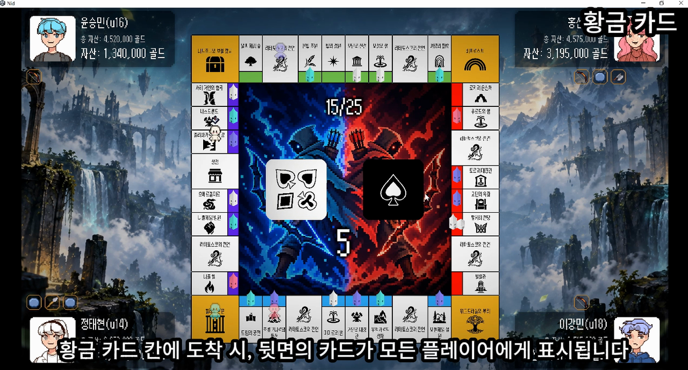

**이그드라실**은 부루마블식 자산 경쟁과 1:1 실시간 대전 '야차'를 결합한 2~4인 온라인 보드게임입니다. 저는 3인 팀에서 **보드 게임 규칙 전체와 서버**를 맡았습니다.

| 항목 | 내용 |
|---|---|
| 기간 · 인원 | 2026.08.20 ~ 2026.09.11 (약 3주) · 3인 (시작 4인, 1인 중도 이탈) |
| 내 역할 | 보드 규칙 전체(턴·이동·칸 효과·경제·영토·황금카드), 서버 게임 로직 전체, 전투의 온라인 연동 |
| 환경 | Unity 6 (C#), ASP.NET Core WebSocket 서버 (.NET 10), UniTask, DOTween |
| 결과 | 반 내 투표 **완성도 부문 1위**, 빌드 시연 완료 |

**핵심 기술 3가지**

| # | 기술 | 한 줄 설명 | 문서 위치 |
|---|---|---|---|
| 1 | **전원 보고 기반 턴 동기화** | 모든 클라이언트가 완료를 보고해야 다음 단계로 넘어가, 모든 화면이 같은 진행을 봅니다 | 3.1 |
| 2 | **클라이언트 처리 · 서버 중계 구조** | 규칙 계산은 클라이언트가, 순서·난수·진행 결정과 중계는 서버가 맡아 3주 안에 규칙 전체를 구현했습니다 | 2.5 |
| 3 | **데이터로 확장하는 칸·카드** | 칸 효과와 황금카드를 조합형 구조로 만들어, 카드 9장을 **TSV 파일 하나만 고쳐** 추가했습니다 | 3.3, 3.4 |

---

## 1. 프로젝트 개요

### 1.1 무엇을 만들었나 (What)

이그드라실은 북유럽 신화를 배경으로 한 **2~4인 온라인 보드게임**입니다. 플레이어는 주사위를 굴려 보드를 돌며 영토를 사고 건물을 올립니다. 상대 영토에 도착하면 통행료를 낸 뒤, 1:1 횡스크롤 대전 **'야차'**를 걸어 그 영토를 빼앗을 수 있습니다.

이 문서는 게임 전체 중 **제가 맡은 보드 시스템과 서버**를 다룹니다. 야차 전투 자체는 팀원이 만들었으므로, 이 문서에서는 제가 맡은 **온라인 연동 부분만** 다룹니다.

### 1.2 왜 이렇게 만들었나 (Why)

제가 이 프로젝트에서 집중한 것은 두 가지입니다.

**① 모든 화면이 같은 진행을 보는 보드 규칙:** 온라인 보드게임은 한 사람이 행동하는 동안 나머지가 그 과정을 지켜봅니다. 그런데 개발 중 **한 플레이어가 아직 상점 창을 열고 있는데, 다른 클라이언트에서는 턴이 먼저 넘어가는 문제**가 생겼습니다. 화면마다 진행이 어긋나면 게임이 성립하지 않으므로, 턴과 연출의 진행 기준을 서버에서 하나로 맞추는 구조가 필요했습니다.

**② 기획이 바뀌어도 코드를 고치지 않는 구조:** 개발을 시작할 때는 보드 칸 배치가 정해져 있지 않았고, 이후에도 칸 수(40칸 → 36칸), 황금카드 종류(11장 → 20장)와 수치, 장비 가격이 계속 바뀌었습니다. 칸·카드·밸런스 값을 코드에 넣으면 바뀔 때마다 코드를 고쳐야 하므로, **값과 조합은 데이터(TSV·JSON)에 두고 코드는 규칙만 갖도록** 설계했습니다.

이 문서는 서버와 클라이언트의 책임 분리(2장), 턴 동기화·이동·칸 효과·황금카드·경제·결투 연동(3장), 팀 협업 과정(4장), 트러블슈팅(5장), 결과와 회고(6장)를 차례로 설명합니다.

### 1.3 개발 환경 · 기간 · 링크

| 항목 | 내용 |
|---|---|
| 클라이언트 | Unity 6000.3 (URP), C# |
| 서버 | ASP.NET Core (.NET 10), 순수 WebSocket, JSON 메시지 |
| 주요 라이브러리 | UniTask(비동기), DOTween(연출), Newtonsoft.Json, Odin Inspector |
| 배포 | 강사 제공 클라우드 서버 (`git push` → 배포 스크립트) |
| 기간 | 2026.08.20 ~ 2026.09.11 (약 3주, 마지막 날 시연) |
| 링크 | GitHub: [클라이언트](https://github.com/chesherneko/Yggdrasil) · [서버](https://github.com/chesherneko/Yggdrasil-Server)<br>영상: [기능 소개 (약 4분)](https://youtu.be/vVEbGkKm4BM) · [풀 플레이 (약 30분)](https://youtu.be/yN_i65ytxaU) |

### 1.4 팀 구성과 내 역할

| 담당 | 역할 |
|---|---|
| **나** | 보드 규칙 전체, 서버 게임 로직 전체(접속·방 관리 기반은 강사 제공), 클라이언트 네트워크, 데이터 구조, 전투의 온라인 연동 |
| 팀원 A (팀장) | 야차 전투 (캐릭터 조작, 공격 판정, 투사체) |
| 팀원 B | UI · 연출 (상점·구매 팝업·보물 UI), 장비 인벤토리 |

**내가 작성한 범위**

| 영역 | 주요 클래스 |
|---|---|
| 서버 | `Room`(로비·게임·결투), `GameSession`(턴 상태), 메시지 프로토콜 전체 |
| 클라이언트 네트워크 | `RoomClient`, `RoomConnection`, 방 입장·로비 UI |
| 보드 · 진행 | `GameManager`, `TurnManager`, `PlayerManager`, `Board`, `BoardBuilder`, `Tile` |
| 칸 효과 | `TileEffect`(7종), `TileEffectSyncManager`, 경제·영토·황금카드·비프로스트·주사위·프로필 매니저 |
| 전투 연동 | 서버 결투 흐름, `CombatSystem`의 네트워크 처리, 결투 신청·수락 UI |

### 1.5 게임 소개

**핵심 루프**

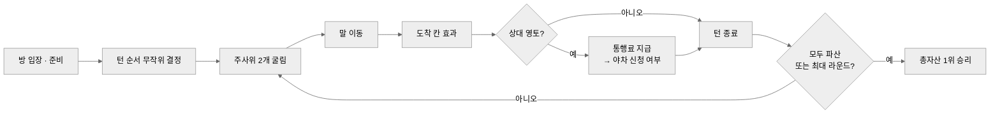

**보드 구성 (36칸)**

| 칸 | 개수 | 효과 |
|---|---|---|
| 영토 | 24 | 구매 · 건물 · 랜드마크 건설, 상대 영토면 통행료와 야차 |
| 황금카드 | 7 | 골드 획득·손실, 장비 획득·손실, 강제 이동 중 무작위 1장 |
| 출발지 | 1 | 지나가거나 도착하면 월급 |
| 감옥 | 1 | 2턴 동안 행동 불가 |
| 보물창고 | 1 | 무작위 장비 1개 획득 |
| 비프로스트 | 1 | 원하는 칸으로 이동 |
| 상점 | 1 | 일반 장비 구매. 도착하지 않고 지나가기만 해도 상점 창이 열림 |

**승리 조건**: 다른 플레이어가 모두 파산하거나, 최대 라운드가 끝났을 때 총자산(현금 + 영토 가치)이 가장 높은 플레이어가 승리합니다.

---

## 2. 전체 구조

### 2.1 서버와 클라이언트의 책임 분리

이 게임은 **게임 규칙은 클라이언트가 계산하고, 서버는 진행 순서·난수를 정하고 결과를 모두에게 전달**하는 구조입니다. 다만 아무 클라이언트나 계산하지 않고, **현재 턴인 플레이어의 클라이언트 한 곳만** 칸 효과를 계산해 서버에 요청합니다. 서버는 요청을 반영한 결과를 전원에게 보내고, 모든 클라이언트는 그 결과로 화면을 갱신합니다.

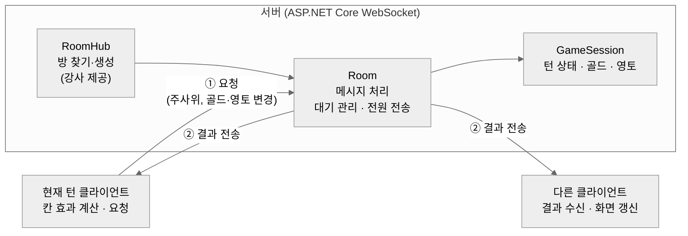

| 누가 정하는가 | 항목 |
|---|---|
| **서버가 결정** | 턴 순서(무작위), 주사위 눈, 황금카드 선택, 턴·라운드 진행, 결투 거절 성공 여부, 결투 시간 초과 판정, 접속 종료 처리 |
| **현재 턴 클라이언트가 계산 → 서버가 반영·전송** | 골드 증감(통행료·월급·구매·카드), 영토 소유·건물, 파산 선언 |
| **각 클라이언트가 처리** | 말 이동·주사위·카드 연출, UI 표시 |

이 구조를 고른 이유는 2.5에서 설명합니다.

### 2.2 서버 구조

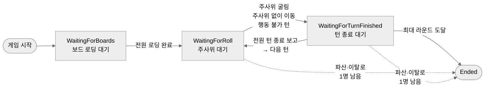

| 클래스 | 하는 일 | 하지 않는 일 |
|---|---|---|
| `RoomHub` (강사 제공) | 방 코드로 방을 찾거나 만들고, 빈 방을 지움 | 게임 로직 |
| `Room` | 메시지 종류별 처리 함수 호출, 전원 보고 대기 관리, 결과 전송. `Lobby`·`Game`·`Combat` 세 파일로 나눔 | 턴·골드 계산 |
| `GameSession` | 위 단계(페이즈) 관리, 주사위·카드 난수, 골드·영토·장비 상태 보관, 이탈 처리 결과 계산 | 네트워크 전송 |

- **늦게 도착한 메시지 차단:** 주사위·이동·칸 효과·황금카드처럼 턴 진행에 관련된 메시지에는 `TurnId`가 있습니다. 서버는 현재 턴 번호, 현재 플레이어, 현재 단계와 맞지 않는 요청을 버립니다. (골드·영토 변경 요청에는 이 확인이 빠져 있으며, 2.5에서 다룹니다.)
- **동시 요청 처리:** 한 방의 모든 게임 메시지는 방마다 하나 있는 잠금(`SemaphoreSlim`)을 거쳐 한 번에 하나씩 처리됩니다.

### 2.3 클라이언트 구조

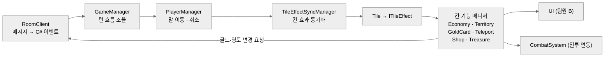

| 클래스 | 하는 일 | 하지 않는 일 |
|---|---|---|
| `RoomClient` | 서버 연결, 메시지 송수신, 받은 메시지를 이벤트 20여 개로 알림 | 게임 규칙 판단 |
| `GameManager` | 턴 시작·주사위 결과·게임 종료·이탈 이벤트를 받아 진행 순서 조율 | 칸 효과 내용 |
| `PlayerManager` | 말 이동(주사위 이동 / 지정 이동), 이동 취소 | 칸 효과 판단 |
| `TileEffectSyncManager` | 칸 효과를 모든 클라이언트에서 같은 시점에 시작·종료 | 효과 실행 |
| `Tile` | 칸 데이터와 효과 객체 보유 | 효과 종류 분기 (팩토리가 담당) |
| 칸 기능 매니저 | 영토 구매·통행료, 골드 지불, 카드 효과 등 실제 규칙 처리 | 화면 구성 (UI 담당) |

클라이언트끼리는 서로를 직접 부르지 않습니다. 서버 메시지는 `RoomClient`의 이벤트로만 들어오고, 각 매니저가 필요한 이벤트만 구독합니다.

### 2.4 데이터 구조

칸·카드·장비·드롭 확률은 **TSV 표 5개**로, 밸런스 값은 **`config.json`**으로, 보드 배치는 **`Board.json`**으로 관리합니다.

| 파일 | 내용 |
|---|---|
| `spaces.tsv` | 칸 30종: 이름, 가격, 아이콘, 색, 효과 종류, 통과 시 발동 여부 |
| `tiles.tsv` | 타일 모양 8종 (영토·특수·코너 × 방향) |
| `gold_cards.tsv` | 황금카드 20장: 설명, 패턴, 대상 범위, 골드 양, 이동할 칸 |
| `equipments.tsv`, `drop.tsv` | 장비 10종, 획득처별 등급 확률 (팀원 B 작성) |
| `config.json` | 월급, 감옥 턴 수, 건물·랜드마크 가격 배수, 통행료율 |
| `Board.json` | 36칸의 순서와 각 칸의 종류 |

표마다 **DTO**(TSV 한 줄을 그대로 담는 클래스)와 **Def**(게임에서 쓰는 형태로 바꾼 클래스)를 나누고, 읽어 오는 과정은 제네릭 기반 클래스 하나로 묶었습니다.

```csharp
// DataTable.cs — 모든 데이터 표의 공통 부모
public abstract class DataTable<DTO, Def>
{
    protected abstract string TablePath { get; }        // 예: "gold_cards"
    protected readonly Dictionary<int, Def> defs = new();

    public Def Get(int id) => defs[id];
    public IReadOnlyCollection<int> GetIds() => defs.Keys;
    public IReadOnlyCollection<Def> GetDefs() => defs.Values;

    public abstract UniTask LoadAsync();                 // DTO → Def 변환은 표마다 구현

    protected async UniTask<List<DTO>> GetRows()
        => await TSVReader.ReadTableAsync<DTO>(TablePath, true);
}

// GoldCardTable.cs — 문자열 열을 enum으로 바꿔 Def 생성
public override async UniTask LoadAsync()
{
    defs.Clear();
    foreach (GoldCardDTO dto in await GetRows())
    {
        var pattern = Enum.Parse<GoldCardPatternType>(dto.Pattern); // "GainGold" → enum
        var scope   = Enum.Parse<GoldCardScopeType>(dto.Scope);     // "ExceptSelf" → enum
        defs[dto.Id] = new GoldCardDef(dto.Id, dto.Description,
            Resources.Load<Sprite>(dto.IconKey), pattern, scope,
            dto.GoldAmount, dto.DropTableId, dto.TileId);
    }
}
```

새 표가 필요하면 DTO·Def·Table 세 클래스를 만들고 `DataManager`의 불러오기 목록에 한 줄 추가하면 됩니다. 이 구조 덕분에 6.1에서 다루는 것처럼 **카드 추가와 밸런스 조정을 코드 수정 없이** 할 수 있었습니다.

### 2.5 고민과 선택: 서버를 얼마나 '권위적'으로 만들 것인가

> **결정 대상:** 골드·영토 같은 게임 상태를 누가 계산하고, 누가 검증할 것인가?

| | [A] 서버가 모든 규칙을 계산·검증 | [B] 클라이언트가 계산, 서버는 진행 결정·중계 |
|---|---|---|
| 방식 | 통행료·까방권(3.5)·급매·카드 효과까지 서버가 계산하고 클라이언트는 결과만 표시 | 현재 턴 클라이언트가 계산해 요청하고, 서버는 반영해 전원에게 전달 |
| 장점 | 클라이언트 조작에 강함. 상태의 기준이 서버 하나 | 규칙 코드가 클라이언트 한 곳에만 있음. 서버 코드가 단순 |
| 단점 | 모든 규칙을 서버에도 다시 구현해야 함. 규칙이 바뀌면 양쪽 수정 | 클라이언트 조작에 취약 |

**[최종 결정]** [B]를 선택했습니다. 처음에는 "실제 온라인 서비스처럼 서버가 모든 값을 검증해야 한다"고 생각했는데, 그 생각 때문에 서버 설계에 오히려 접근하기 어려웠습니다. 그래서 이 프로젝트의 조건을 다시 따져 봤습니다.

- **만들어야 할 양:** 강사 제공 서버에는 접속·방 관리와 메시지 송수신만 있어서 게임 로직은 처음부터 직접 작성해야 했습니다. [A]를 택하면 통행료·까방권·급매·카드 효과 같은 규칙을 서버에 전부 새로 만들고, 연출을 위해 클라이언트에도 비슷한 흐름을 다시 만들어야 합니다.
- **기간과 경험:** 개발 기간은 3주였고, 저는 서버를 처음 다뤘습니다.
- **사용 환경:** 공개 서비스가 아니라 반 안에서 시연하는 게임이었습니다. 참가자가 클라이언트를 조작할 이유가 거의 없어서, 조작 방어에 드는 비용에 비해 얻는 것이 적었습니다.

이 조건에서는 규칙을 클라이언트 한 곳에만 두는 쪽이 맞다고 판단했습니다. 대신 **결과가 갈리면 안 되는 것(주사위, 카드 선택, 턴 순서, 턴 진행)만 서버가 결정**하게 했습니다.

**[얻은 것]** 단순한 구조로 정리하자 서버 작업이 생각보다 쉽게 풀렸고, 3주 안에 영토·경제·황금카드·결투 연동까지 보드 규칙 전체를 구현했습니다. 규칙이 바뀌어도 클라이언트 코드만 고치면 됐습니다.

**[감수한 대가]** 서버는 골드·영토 변경 요청을 계산 없이 그대로 반영하므로, 클라이언트를 조작하면 값을 바꿀 수 있습니다. 시연 환경에서는 받아들일 수 있는 위험이었지만, 공개 서비스로 운영한다면 [A]처럼 서버가 규칙을 계산하도록 바꿔야 합니다.

**[아쉬운 점]** 다만 계산을 맡기는 것과 요청을 아무 검증 없이 받는 것은 다른 문제였습니다. 주사위·이동 요청은 서버가 턴 번호와 현재 플레이어를 확인해 늦게 온 요청을 버리는데, **골드·영토 변경 요청에는 이 확인을 넣지 못했습니다.** 조작이 없어도, 지난 턴에서 늦게 도착한 요청이 반영될 수 있는 구조입니다. 이 확인은 [B] 구조를 유지하면서도 넣을 수 있었고 비용도 작았으므로, 6.3에서 개선 계획과 함께 다룹니다.

---

## 3. 핵심 시스템

### 3.1 턴 진행과 '전원 보고' 동기화

#### 개요

온라인 보드게임에서는 한 플레이어가 행동하는 동안 나머지 플레이어가 그 과정을 같은 화면으로 지켜봐야 합니다. 이 게임은 **서버가 진행 단계마다 모든 클라이언트의 완료 보고를 모은 뒤에 다음 단계를 알리는 방식**으로, 모든 화면의 진행을 맞춥니다.

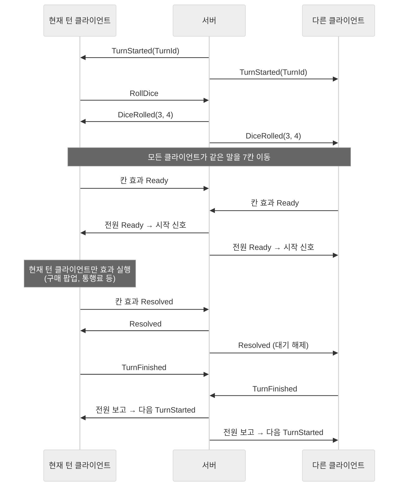

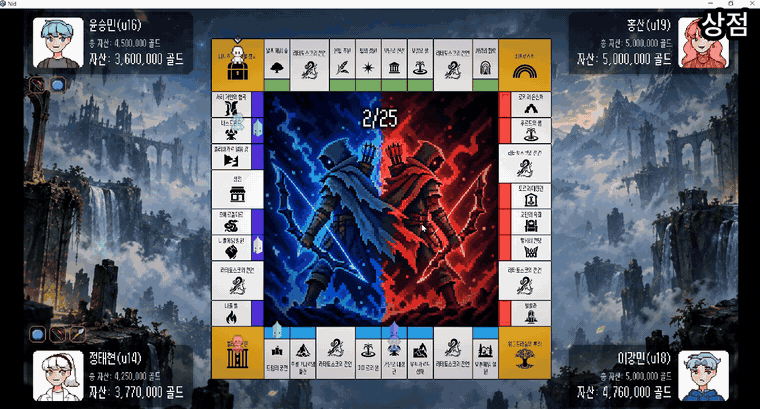

*현재 턴 플레이어가 상점을 보는 동안, 다른 플레이어 화면에는 "상점 둘러보는중..." 말풍선이 뜨고 진행은 멈춰 있습니다.*

#### 전원 보고를 쓰는 지점

| 지점 | 모두가 보고하는 것 | 서버가 모두 모은 뒤 보내는 것 |
|---|---|---|
| 게임 시작 | 보드 로딩 완료 | 첫 턴 시작 |
| 턴 종료 | 이번 턴의 연출·행동 완료 | 다음 턴 시작 |
| 칸 효과 시작 | 말이 그 칸에 도착함 | 효과 시작 신호 |
| 황금카드 | 카드 뒤집기 연출 완료 | 효과 적용 신호 |
| 지정 이동 (3.2) | 말 이동 완료 | 이동 완료 신호 |

#### 핵심 기능 ① 서버: 대기 목록이 비면 전송

서버는 단계마다 **아직 보고하지 않은 플레이어 목록**을 들고 있다가, 보고가 올 때마다 지우고, 목록이 비면 전원에게 신호를 보냅니다. 아래는 칸 효과 시작 신호를 처리하는 부분입니다.

```csharp
// Room.Game.cs — 칸 효과 Ready 보고 처리
private async Task HandleTileEffectReadyAsync(Member member, TileEffectSyncMessage msg)
{
    // (Why) 같은 턴 안에서도 이동(MoveId)과 칸(StepIndex)마다 따로 기다려야 하므로 셋을 묶어 키로 사용
    string key = $"{msg.TurnId}:{msg.MoveId}:{msg.StepIndex}";

    if (pendingTileEffects.TryGetValue(key, out PendingTileEffect pending) == false)
    {
        // 처음 보고가 들어온 시점에 방 안의 전원을 대기 목록으로 만든다
        pending = new PendingTileEffect { Message = msg, WaitingMemberIds = members.Keys.ToHashSet() };
        pendingTileEffects.Add(key, pending);
    }

    if (pending.WaitingMemberIds.Remove(member.User.Id) == false) return; // 중복 보고 무시
    if (pending.WaitingMemberIds.Count > 0) return;                       // 아직 남은 사람이 있음

    pendingTileEffects.Remove(key);
    await BroadcastAsync(msg);                                            // 전원 도착 → 시작 신호
}
```

턴 종료도 같은 방식입니다. `GameSession.ReportTurnFinished`는 보고한 플레이어 수가 전체 인원과 같아질 때만 다음 턴으로 넘어갑니다.

#### 핵심 기능 ② 클라이언트: 칸 효과 2단계 동기화

칸 효과는 **Ready(모두 도착)**와 **Resolved(효과 끝)** 두 단계로 맞춥니다. 효과는 현재 턴 클라이언트만 실행하고, 나머지는 Resolved 신호가 올 때까지 기다립니다.

```csharp
// TileEffectSyncManager.cs — 모든 클라이언트가 칸에 도착할 때마다 호출 (취소 확인 코드는 생략)
public async UniTask ExecuteAsync(string playerId, Tile tile, int turnId,
    long moveId, int stepIndex, bool isOwner, CancellationToken token)
{
    var ready = new TileEffectSyncMessage
        { TurnId = turnId, MoveId = moveId, StepIndex = stepIndex, Phase = TileEffectSyncPhase.Ready };

    await AnnounceAndWaitAsync(ready, token);       // ① 전원 도착까지 대기

    var resolved = new TileEffectSyncMessage
        { TurnId = turnId, MoveId = moveId, StepIndex = stepIndex, Phase = TileEffectSyncPhase.Resolved };

    if (isOwner)                                     // ② 현재 턴 클라이언트만 실제 효과 실행
    {
        await tile.ExecuteEffect(playerId);          //    (구매 팝업, 통행료, 카드 등)
        await AnnounceAndWaitAsync(resolved, token);
    }
    else await WaitAsync(resolved, token);           // ③ 나머지는 효과가 끝날 때까지 대기
}

private async UniTask AnnounceAndWaitAsync(TileEffectSyncMessage msg, CancellationToken token)
{
    // (Why) 서버 응답이 대기 등록보다 먼저 와도 놓치지 않도록, 대기를 먼저 등록한 뒤 보낸다
    UniTask waitTask = WaitAsync(msg, token);
    await Client.AnnounceTileEffectSync(msg);
    await waitTask;
}
```

같은 이유로 `WaitAsync`는 대기를 시작하기 전에 이미 도착한 신호를 따로 보관해 두었다가 바로 통과시킵니다.

#### 예외 처리

| 상황 | 처리 |
|---|---|
| 지난 턴의 메시지가 늦게 도착 | 서버·클라이언트 모두 `TurnId`가 현재와 다르면 무시 |
| 감옥으로 행동할 수 없는 턴 | 서버가 턴 시작 시 `CanAct = false`를 보내고 바로 턴 종료 대기 단계로 넘김. 클라이언트는 즉시 턴 종료 보고 |
| 대기 중에 플레이어가 나감 | 서버가 모든 대기 목록에서 그 플레이어를 지우고, 목록이 비면 그대로 다음 신호를 보냄. 나간 사람이 현재 턴이면 진행 중인 대기를 취소하고 다음 턴으로 |
| 새 턴 시작 · 게임 종료 | 클라이언트가 진행 중인 이동과 칸 효과 대기를 모두 취소 |

#### 고민과 선택: 다음 단계로 넘어가는 기준

> **결정 대상:** 턴과 연출을 언제 다음으로 넘길 것인가?

| | [A] 현재 턴 플레이어가 끝나면 진행 | [B] 모든 클라이언트가 보고하면 진행 |
|---|---|---|
| 방식 | 현재 턴 클라이언트의 종료 보고 하나로 다음 턴 시작 | 단계마다 전원의 완료 보고를 모은 뒤 진행 |
| 장점 | 구현이 단순하고 빠름. 대기가 없음 | 모든 화면이 같은 단계에 있음이 보장됨 |
| 단점 | 다른 화면의 연출·행동이 끝나지 않아도 진행됨 | 가장 느린 클라이언트에 맞춰 진행. 단계마다 대기 목록 관리 필요 |

**[최종 결정]** 처음에는 [A]에 가까웠지만, 한 플레이어가 아직 상점 창을 열고 있는데 턴이 넘어가는 문제를 겪고 [B]로 바꿨습니다(5.1). 턴 종료부터 전원 보고로 바꾼 뒤, 같은 문제가 생길 수 있는 칸 효과·황금카드·지정 이동에도 같은 방식을 적용했습니다.

**[얻은 것]** 보드 진행 중 모든 플레이어가 같은 장면을 보게 됐고, 새로운 연출 단계를 추가할 때도 "대기 목록을 만들고, 비면 보낸다"는 같은 틀을 그대로 썼습니다.

**[감수한 대가]** 한 클라이언트가 느리면 모두가 기다립니다. 다만 연결이 끊긴 플레이어는 대기 목록에서 바로 빠지므로, 나간 사람 때문에 진행이 멈추지는 않습니다.

### 3.2 이동: 주사위 이동과 지정 이동

#### 개요

말은 `DOTween`으로 한 칸씩 점프하며 이동합니다. 마지막 칸 다음은 출발지로 이어지고, 이동하면서 **도착한 칸**과 **지나가기만 해도 발동하는 칸**(출발지 월급, 상점)에서 3.1의 칸 효과 동기화를 실행합니다.

이동은 두 종류입니다.

| | 주사위 이동 (`MoveBy`) | 지정 이동 (`MoveTo`) |
|---|---|---|
| 언제 | 주사위를 굴렸을 때 | 비프로스트(원하는 칸 선택), 황금카드 강제 이동 |
| 무엇을 받는가 | 주사위 눈의 합 (몇 칸) | 목적지 칸 번호 |
| 누가 움직이는가 | 현재 턴 플레이어 | 현재 턴 플레이어 또는 **다른 플레이어**(황금카드 대상) |
| 한 턴에 몇 번 | 1번 | 여러 번, **동시에 여러 명**도 가능 |
| 이동 ID | 항상 0 | **서버가 발급** |

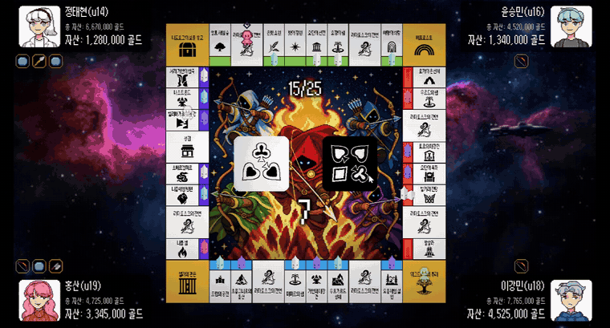

#### 핵심 기능: 지정 이동의 흐름

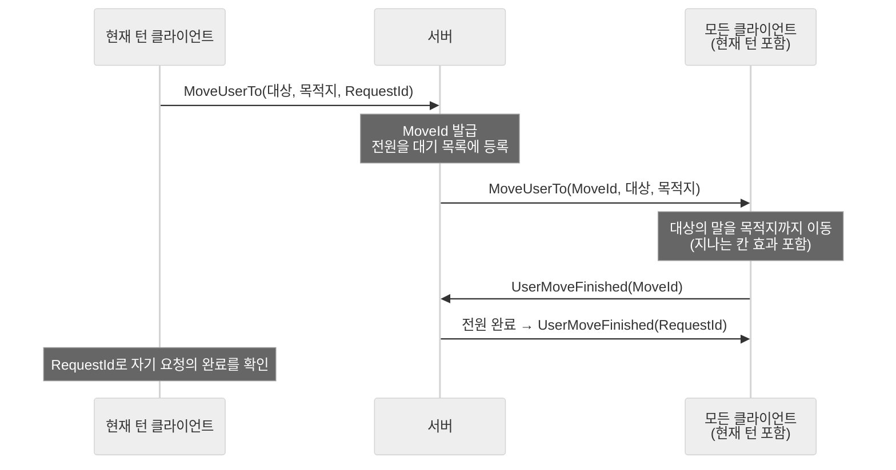

클라이언트는 서버가 보낸 `MoveId`마다 취소 토큰을 하나씩 만들어 이동을 관리합니다.

```csharp
// PlayerManager.cs — 지정 이동 (서버의 MoveUserTo를 받은 모든 클라이언트에서 실행, 취소 확인 코드는 생략)
public async UniTask<bool> MoveTo(string playerId, int tileIdx, int turnId, long moveId)
{
    if (TryGetPlayer(playerId, out Player player) == false) return false;

    // 이동마다 취소 토큰을 따로 둠 → 이탈·턴 종료 시 해당 이동만 취소 가능
    ActiveMove move = BeginMove(moveId, playerId);
    Board board = BlueMarbleWorld.Instance.Board;
    try
    {
        int stepIdx = 0;
        while (true)
        {
            Tile reached = await player.MoveNext(move.Cancellation.Token);   // 한 칸 이동

            bool isLanding = board.GetTileIndex(reached) == tileIdx;
            if (isLanding || reached.SpaceDef.IsActiveOnPass)                 // 도착 칸 또는 통과 발동 칸
            {
                await Sync.ExecuteAsync(playerId, reached, turnId,
                    moveId, stepIdx, isOwner: Client.Me.Id == playerId,
                    move.Cancellation.Token);                                 // 3.1의 동기화
            }

            if (isLanding) return true;
            stepIdx++;
        }
    }
    catch (OperationCanceledException) { return false; }                    // 취소되면 완료 보고를 하지 않음
    finally { EndMove(moveId, move); }
}
```

주사위 이동(`MoveBy`)도 같은 구조이고, 목적지 대신 칸 수만큼 반복하며 `moveId`로 0을 씁니다.

#### 예외 처리

| 상황 | 처리 |
|---|---|
| 이동 중인 플레이어나 요청한 플레이어가 나감 | 서버가 `UserMoveCancelled`를 보내고, 클라이언트는 그 `MoveId`의 이동만 취소 |
| 지정 이동이 끝나기 전에 턴 종료 보고가 옴 | 서버는 진행 중인 지정 이동이 있으면 턴 종료 보고를 받지 않음 |

#### 고민과 선택: 지정 이동을 누가 관리할 것인가

> **결정 대상:** "몇 칸"이 아니라 "어디로" 움직이는 이동을 어떻게 모든 클라이언트에 맞출 것인가?

| | [A] 주사위 이동처럼 각 클라이언트가 처리 | [B] 서버가 목적지와 이동 ID를 발급 |
|---|---|---|
| 방식 | 현재 턴 클라이언트가 이동을 시작하고, 칸 효과 동기화 키는 주사위 이동처럼 0을 사용 | 요청을 서버가 받아 `MoveId`를 붙여 전원에게 보내고, 이동별로 완료를 모음 |
| 장점 | 메시지 종류가 적고 단순 | 목적지가 전원에게 전달됨. 동시에 여러 이동이 있어도 ID로 구분. 이동 단위로 완료·취소 가능 |
| 단점 | 다른 클라이언트는 목적지를 알 수 없음. 한 턴에 이동이 여러 번이면 동기화 키가 겹침 | 메시지와 서버의 대기 관리가 늘어남 |

**[최종 결정]** [B]를 선택했습니다. 주사위 이동은 눈의 합만 알면 모두 같은 결과를 계산할 수 있지만, 지정 이동은 **목적지를 서버가 전달해야** 합니다. 또 "무작위 인원이 감옥으로 이동" 같은 황금카드는 **한 턴에 여러 명이 동시에 움직이므로**, 이동마다 구분할 ID가 필요했습니다. ID를 클라이언트가 만들면 서로 겹칠 수 있어 서버가 순서대로 발급하게 했습니다.

처음에는 서버가 지정 이동을 한 번에 하나만 받았고, 이동 중에 새 요청이 오면 거절했습니다. 황금카드의 다중 이동을 연결하면서 이를 **이동 ID별 대기 목록(`Dictionary<long, PendingUserMove>`)으로 바꾸고 거절 조건을 없앴습니다.**

**[얻은 것]** 비프로스트와 황금카드 이동이 같은 경로를 쓰게 됐고, 이동이 몇 개든 칸 효과 동기화 키(`TurnId:MoveId:StepIndex`)가 겹치지 않습니다. 한 플레이어가 나가도 그 플레이어와 관련된 이동만 골라 취소할 수 있습니다.

**[감수한 대가]** 지정 이동 한 번에 요청 → 전송 → 전원 완료 → 완료 전송으로 메시지가 오가고, 서버가 이동마다 대기 목록을 관리해야 합니다.

### 3.3 칸 효과 구조 (Strategy + Factory)

#### 개요

보드의 칸은 30종이고, 효과는 7종입니다. 칸마다 무슨 효과를 낼지는 `spaces.tsv`의 `Effect` 열이 정하고, 코드는 **효과 종류마다 클래스 하나**를 둡니다.

**`spaces.tsv` 일부**

| Id | Name | Price | Effect | IsActiveOnPass |
|---|---|---|---|---|
| 0 | 위그드라실의 뿌리 | 0 | Salary | TRUE |
| 1 | 요툰헤임 설원 | 50000 | Territory | FALSE |
| 7 | 헬라의 관문 | 0 | Prison | FALSE |
| 21 | 비프로스트 | 0 | Teleport | FALSE |
| 29 | 상점 | 0 | Shop | TRUE |

#### 구조

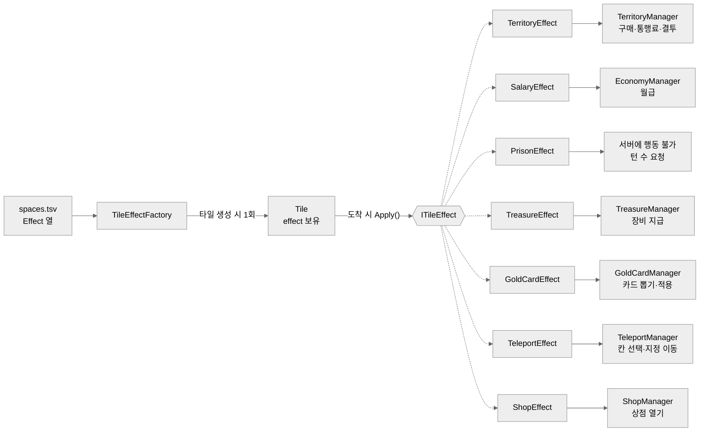

효과 클래스는 **어느 매니저에게 맡길지만 정하고**, 실제 규칙은 매니저가 처리합니다.

```csharp
// TileEffect.cs — 효과 클래스는 처리를 매니저에게 넘기기만 한다
public interface ITileEffect
{
    UniTask Apply(string playerId, Tile tile);
}

public class TerritoryEffect : ITileEffect
{
    public UniTask Apply(string playerId, Tile tile)
        => TerritoryManager.Instance.ResolveAsync(playerId, tile);   // 구매·통행료·결투는 매니저가 판단
}

public class SalaryEffect : ITileEffect
{
    public UniTask Apply(string playerId, Tile _)
        => EconomyManager.Instance.GainGoldTo(playerId, GameSettings.Instance.SalaryAmount); // 금액은 config.json
}

// TileEffectFactory.cs — TSV의 Effect 문자열(→ enum)을 효과 객체로
public static ITileEffect Create(TileEffectType type) => type switch
{
    TileEffectType.Territory => new TerritoryEffect(),
    TileEffectType.Salary    => new SalaryEffect(),
    TileEffectType.Prison    => new PrisonEffect(),
    TileEffectType.Treasure  => new TreasureEffect(),
    TileEffectType.GoldCard  => new GoldCardEffect(),
    TileEffectType.Teleport  => new TeleportEffect(),
    TileEffectType.Shop      => new ShopEffect(),
    _ => throw new NotImplementedException()
};
```

`Tile`은 생성될 때 한 번 팩토리로 효과 객체를 받아 두고, 칸에 도착하면 `effect.Apply()`만 부릅니다. `Tile`은 자기 효과가 무엇인지 모릅니다.

| 하고 싶은 일 | 필요한 작업 |
|---|---|
| 기존 효과를 가진 칸 추가 (예: 새 영토) | `spaces.tsv`에 한 줄 추가 + 보드 배치 |
| 칸 이름·가격·통과 발동 여부 변경 | `spaces.tsv` 수정 |
| 새로운 효과 종류 추가 | 효과 클래스 1개 + 팩토리 한 줄 + enum 값 |

#### 고민과 선택: 칸 효과 로직을 어디에 둘 것인가

> **결정 대상:** 칸에 도착했을 때의 처리(구매, 통행료, 카드…)를 누가 맡을 것인가?

| | [A] `Tile`이나 `Player`가 직접 처리 | [B] `Tile`은 효과 객체만, 처리는 매니저 |
|---|---|---|
| 방식 | `Tile` 안에서 효과 종류로 분기해 구매·통행료 등을 직접 실행 | `Tile`은 `ITileEffect`를 부르고, 효과 객체가 해당 매니저에 위임 |
| 장점 | 파일이 적고 흐름이 한 곳에 보임 | `Tile`은 칸 데이터만 다룸. 효과 종류가 늘어도 `Tile`은 그대로 |
| 단점 | 효과가 늘수록 `Tile`이 모든 규칙을 알게 됨. 영토·경제 같은 공용 상태를 칸마다 다루게 됨 | 클래스 수가 늘고, 흐름을 따라가려면 여러 파일을 봐야 함 |

**[최종 결정]** [B]를 선택했습니다. 말 이동을 처음 만들었을 때, 효과 로직을 각 `Tile`이나 `Player`가 가지면 구조적으로 좋지 않고 **중간에서 처리를 맡을 매니저가 필요하다**고 판단했습니다.

**[얻은 것]** 효과 구조를 만든 뒤(09-01) 영토·황금카드·비프로스트·보물 효과를 차례로 붙이는 동안, `Tile` 코드는 영토 건물 그림을 표시하는 기능 외에는 바뀌지 않았습니다(git 기록 기준). 규칙 수정은 각 매니저 안에서만 했습니다.

**[감수한 대가]** 칸 하나의 동작을 이해하려면 `Tile` → 효과 클래스 → 매니저 순으로 파일 세 곳을 봐야 합니다.

### 3.4 황금카드: 패턴 × 범위 조합

#### 개요

황금카드 칸에 도착하면 카드 20장 중 1장을 뽑아 효과를 적용합니다. 카드 한 장은 **무엇을 하는지(패턴 5종)**와 **누구에게 하는지(범위 4종)**의 조합이고, `gold_cards.tsv`의 한 줄로 정의합니다.

**현재 카드 20장의 분포** (✓: 해당 조합의 카드가 있음)

| 패턴 \ 범위 | 나 (Self) | 모두 (All) | 나 제외 (ExceptSelf) | 무작위 (Random) |
|---|---|---|---|---|
| 골드 획득 (GainGold) | ✓ | ✓ | ✓ | ✓ |
| 골드 손실 (LoseGold) | ✓ | ✓ | ✓ | ✓ |
| 장비 획득 (GainTreasure) | ✓ | ✓ | | ✓ |
| 장비 손실 (LoseTreasure) | ✓ | ✓ | ✓ | ✓ |
| 이동 (GoTo) | ✓ (감옥·발할라·비프로스트·보물창고) | | | ✓ (감옥) |

**`gold_cards.tsv` 일부**

| Id | Description | Pattern | Scope | GoldAmount | TileId |
|---|---|---|---|---|---|
| 2 | 나를 제외한 모두가 200,000 골드 획득 | GainGold | ExceptSelf | 200000 | -1 |
| 9 | 무작위 인원이 감옥으로 이동 | GoTo | Random | -1 | 9 |
| 17 | 나를 제외한 모두가 장비 1개 손실 | LoseTreasure | ExceptSelf | -1 | -1 |

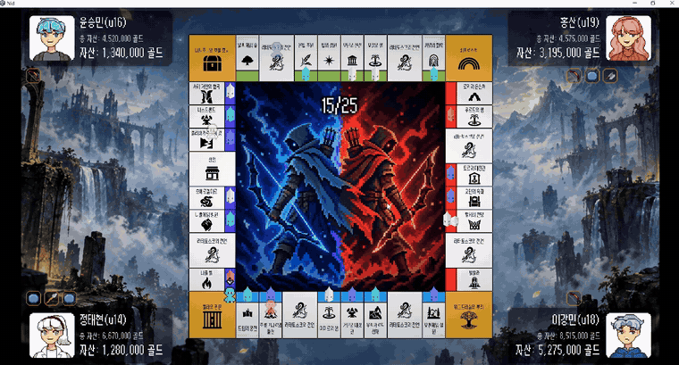

#### 핵심 기능 ① 패턴과 범위 조립

`GoldCardManager`는 시작할 때 enum의 모든 값에 대해 팩토리로 객체를 만들어 사전에 넣어 둡니다. 카드를 적용할 때는 **범위 객체로 대상 목록을 구하고, 패턴 객체에 그 목록을 넘기기만** 합니다.

```csharp
// GoldCardManager.cs
protected override void OnInitialize()
{
    PopulateByEnum(scopes, GoldCardScopeFactory.Create);     // Self, All, ExceptSelf, Random
    PopulateByEnum(patterns, GoldCardPatternFactory.Create); // GainGold, LoseGold, GainTreasure, LoseTreasure, GoTo
}

// enum의 모든 값을 순회하며 팩토리 결과를 사전에 등록
private static void PopulateByEnum<TEnum, TValue>(Dictionary<TEnum, TValue> dict, Func<TEnum, TValue> factory)
    where TEnum : struct, Enum
{
    foreach (TEnum value in (TEnum[])Enum.GetValues(typeof(TEnum)))
        dict[value] = factory(value);
}

private UniTask ApplyCardEffectAsync(string playerId, GoldCardDef card)
{
    string[] targetIds = scopes[card.ScopeType].GetTargetIds(playerId);   // 누구에게
    return patterns[card.PatternType].Apply(                              // 무엇을
        targetIds, card.GoldAmount, card.DropTableId, card.TileId);
}
```

```csharp
// GoldCardScope.cs — 무작위 범위: 1명 ~ (전체 - 1)명
public string[] GetTargetIds(string _)
{
    IReadOnlyList<string> playerIds = RoomClient.Instance.PlayerIds;
    int randCount = Random.Range(1, playerIds.Count);   // 상한 미포함 → 전원이 뽑히지 않음
    return playerIds.GetDistinctRandoms(randCount);
}
```

#### 핵심 기능 ② 뽑기와 연출 동기화

1. 현재 턴 클라이언트가 카드 ID 목록을 보내면, **서버가 무작위로 한 장을 골라** 전원에게 알립니다. 같은 턴에 다시 뽑기 요청이 오면 서버가 무시합니다.
2. 모든 화면에 뒷면 카드가 나타나고, **현재 턴 플레이어만** 카드를 클릭할 수 있습니다.
3. 클릭하면 서버가 전원에게 공개 신호를 보내고, 모든 화면에서 동시에 카드를 뒤집습니다.
4. 각 클라이언트가 연출 완료를 보고하고, **전원이 보고하면**(3.1) 현재 턴 클라이언트가 효과를 적용합니다.

#### 고민과 선택: 카드를 어떻게 정의할 것인가

> **결정 대상:** 카드 종류가 계속 늘어날 때, 새 카드를 어떻게 추가할 것인가?

| | [A] 카드 목록을 코드에 두고 효과 종류별로 처리 (초기 임시 구현) | [B] 패턴 × 범위 조합, 카드는 TSV 한 줄 |
|---|---|---|
| 방식 | 카드 목록이 코드 안 리스트로 있고, 효과 3종(골드 변화·장비 지급·강제 이동)을 분기로 처리. 대상은 항상 뽑은 사람 | 패턴 5종과 범위 4종을 각각 클래스로 만들고, 카드는 둘의 조합과 수치만 TSV에 적음 |
| 장점 | 카드가 적을 때 빠르게 만들 수 있음 | 카드 추가·수치 변경이 TSV 수정만으로 끝남. "모두", "나 제외", "무작위" 대상 표현 가능 |
| 단점 | 카드를 추가·수정할 때마다 코드 수정. 대상 범위를 바꾸려면 효과마다 코드를 고쳐야 함 | 조합으로 표현할 수 없는 카드(예: 조건이 붙은 효과)는 새 패턴 클래스가 필요. 패턴마다 쓰지 않는 열이 생김(`-1`) |

**[최종 결정]** [B]를 선택했습니다. 황금카드는 처음에 효과 3종(골드 변화·장비 지급·강제 이동)과 임시 카드 5장으로 시작했습니다. 카드 종류를 본격적으로 늘리는 단계에서 카드 정의를 TSV로 옮기고, "모두", "나 제외" 같은 대상도 표현할 수 있도록 패턴과 범위를 나눈 조합 구조로 다시 만들었습니다.

**[얻은 것]** 09-09에 카드를 **11장에서 20장으로 늘린 커밋은 `gold_cards.tsv` 한 파일만 수정**했습니다. 같은 날 카드의 골드 값을 초기 자금 규모에 맞게 바꾼 것도 TSV 수정이었습니다.

| 카드 | 변경 전 | 변경 후 |
|---|---|---|
| 0. 골드 획득 (나) | +500 | +300,000 |
| 4. 골드 손실 (나) | -300 | -150,000 |
| 7. 골드 손실 (무작위) | -400 | -100,000 |

**[감수한 대가]** 패턴마다 필요한 값이 달라서, TSV에는 쓰지 않는 열을 `-1`로 채운 칸이 많습니다. 조합으로 표현할 수 없는 새로운 효과가 필요하면 패턴 클래스와 enum을 추가해야 합니다.

**[튜닝]** 무작위 범위는 처음에 1명부터 전원까지 뽑혔는데(`Random.Range(1, Count + 1)`), 플레이테스트에서 "다 같이 걸리면 '모두' 카드와 뭐가 다르냐"는 의견이 나와 09-08에 **최대 (전체 - 1)명**(`Random.Range(1, Count)`)으로 바꿨습니다.

### 3.5 경제와 영토

#### 개요

영토 24칸은 구매 → 건물 → 랜드마크 순으로 키울 수 있고, 다른 플레이어가 도착하면 통행료를 받습니다. 가격 배수와 통행료율은 모두 `config.json`에 있습니다.

| 항목 | 공식 (`config.json` 값) |
|---|---|
| 건물 가격 | 땅값 × 2 |
| 랜드마크 가격 | 땅값 × 4 |
| 영토 총 가치 | 땅값 + 건물 가격 + 랜드마크 가격 (지은 것만) |
| 통행료 | 총 가치 × 0.5 (땅만) / 0.75 (건물) / 1.5 (랜드마크) |
| 급매가 | 총 가치 × 0.8 |

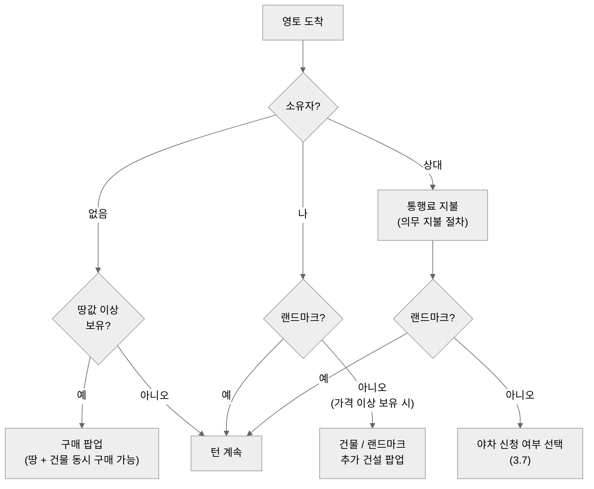

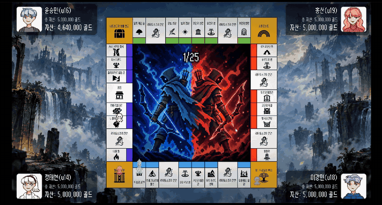

#### 핵심 기능 ① 골드 변경: 서버 반영을 확인한 뒤 진행

골드는 서버가 저장합니다. 클라이언트는 변경량을 요청한 뒤, **서버가 전원에게 보낸 골드 값이 예상한 값이 될 때까지 기다렸다가** 다음 단계로 넘어갑니다. 그래서 구매 가능 여부 같은 다음 판단은 항상 서버에 반영된 값으로 합니다.

```csharp
// EconomyManager.cs
private async UniTask UpdateGoldToAsync(string playerId, int amount)
{
    if (TryGetGold(playerId, out int currentGold) == false) return;

    int expectedGold = currentGold + amount;
    var completion = new UniTaskCompletionSource();

    OnUpdated += HandleUpdated;            // 서버의 골드 갱신 메시지를 구독
    try
    {
        UpdateGoldTo(playerId, amount);    // 서버에 변경량 요청
        await completion.Task;             // 반영될 때까지 대기
    }
    finally { OnUpdated -= HandleUpdated; }

    void HandleUpdated()
    {
        if (TryGetGold(playerId, out int updated) && updated == expectedGold)
            completion.TrySetResult();
    }
}
```

영토 소유·건물 변경도 같은 방식으로, 요청한 칸의 갱신 메시지가 돌아올 때까지 기다립니다.

#### 핵심 기능 ② 의무 지불: 까방권 → 급매 → 지불 → 파산

통행료처럼 피할 수 없는 지불은 한 함수에서 순서대로 처리합니다.

```csharp
// EconomyManager.cs — 통행료 등 반드시 내야 하는 금액 (연출과 일부 조건은 생략)
public async UniTask<bool> PayMandatoryAsync(string payerId, int amount, string recipientId = null)
{
    TryGetGold(payerId, out int currentGold);

    // ① 까방권: 현금은 부족하지만 총자산으로는 낼 수 있을 때, 게임당 1회
    bool canUseProtection = currentGold < amount
        && recipientId != null
        && paymentProtectionUsedPlayerIds.Contains(payerId) == false
        && GetTotalAssets(payerId, currentGold) >= amount;

    if (canUseProtection)
    {
        paymentProtectionUsedPlayerIds.Add(payerId);
        await GainGoldTo(recipientId, amount);          // 내 돈은 그대로, 상대만 받음
        return true;
    }

    // ② 급매: 현금이 부족하면 가치가 낮은 영토부터 자동 매각
    if (currentGold < amount)
    {
        await TerritoryManager.Instance.LiquidateForDebtAsync(payerId, amount);
        TryGetGold(payerId, out currentGold);
    }

    // ③ 낼 수 있는 만큼 지불
    int paid = Mathf.Min(currentGold, amount);
    if (paid > 0)
    {
        await LoseGoldTo(payerId, paid);
        if (recipientId != null) await GainGoldTo(recipientId, paid);
    }

    // ④ 다 못 냈으면 파산
    if (paid >= amount) return true;
    await Client.RequestDeclareBankruptcy(payerId);
    return false;
}
```

#### 고민과 선택: 큰 지출을 한 번 맞으면 게임이 끝나는 문제

> **결정 대상:** 현금이 부족할 때 영토를 어떻게 처분하고, 크게 잃은 플레이어가 다시 따라올 여지를 어떻게 줄 것인가?

| | [A] 기획서: 플레이어가 영토를 골라 급매, 투자금의 50% | [B] 가치가 낮은 영토부터 자동 매각, 80% |
|---|---|---|
| 방식 | 급매 대상 선택 UI에서 하나씩 골라 판매 | 필요한 금액이 될 때까지 싼 영토부터 자동으로 판매 |
| 장점 | 어떤 영토를 지킬지 플레이어가 전략적으로 선택 | 추가 UI가 필요 없음. 비싼 영토가 마지막까지 남음 |
| 단점 | 선택 UI를 새로 만들어야 함. 50%면 한 번 급매하면 회복하기 어려움 | 플레이어가 지킬 영토를 고를 수 없음 |

**[최종 결정]** [B]를 선택했습니다. 선택형 급매는 UI를 새로 만들어야 하는데, 남은 일정에 UI를 하나씩 늘릴 여유가 없었습니다. UI를 배치해도 동작 코드까지 연결하는 데 시간이 걸렸던 경험이 있어서, **새 UI 없이 끝나는 방식**을 골랐습니다(4.4). 매각가는 50%로 하면 급매 한 번에 너무 많이 잃어 회복하기 어렵다고 보고 80%로 정했습니다.

그래도 자동 매각만으로는 "한 번 크게 털리면 복구가 안 된다"는 강사 피드백을 받았습니다. 그래서 **모두의 마블의 대출 시스템을 차용**해 **'까방권'**을 만들었습니다. 현금은 부족하지만 총자산으로는 낼 수 있는 상황에서, 게임당 한 번 지불을 면제해 줍니다(상대는 그대로 통행료를 받습니다).

**[얻은 것]** 급매·까방권·파산이 새 UI 없이 한 함수 안의 순서로 정리됐습니다. 까방권이 발동하면 모든 플레이어의 화면에 "까방권 발동!" 말풍선이 떠, 무슨 일이 일어났는지 알 수 있습니다.

**[감수한 대가]** 플레이어가 급매할 영토를 직접 고를 수 없어, 기획서가 의도한 "어떤 땅을 지킬지" 고르는 재미는 빠졌습니다. 또 까방권으로 받는 통행료는 누구의 돈에서도 빠지지 않으므로, 게임 전체의 골드 총량이 늘어납니다.

### 3.6 보드 제작 도구

#### 개요

보드는 씬에 칸을 직접 배치하지 않고, **보드 빌더**라는 도구로 칸의 순서와 종류만 정해 `Board.json`에 저장합니다. 게임을 시작하면 이 파일을 읽어 같은 규칙으로 보드를 생성합니다.

| 기능 | 동작 |
|---|---|
| 칸 추가 | 칸 모양(영토·특수·코너)과 지역(`spaces.tsv`의 칸)을 골라 마지막 칸 다음에 붙임 |
| 마지막 칸 삭제 | 가장 최근 칸 하나를 지움. 코너를 지우면 진행 방향도 되돌림 |
| 저장 | 칸 목록을 `Board.json`과 프리팹으로 저장 |
| 불러오기 · 초기화 | 저장된 JSON으로 다시 만들거나, 출발지만 남기고 모두 지움 |

#### 핵심 기능: 방향을 따라 이어 붙이고, 코너에서 꺾기

칸은 출발지에서 시작해 **남 → 서 → 북 → 동** 방향으로 이어지고, 코너 칸을 놓을 때마다 다음 방향으로 꺾입니다. 새 칸의 위치는 직전 칸과 새 칸의 스프라이트 크기로 계산하므로, 칸마다 좌표를 적을 필요가 없습니다.

```csharp
// TileExtensions.cs — 직전 칸 옆에 새 칸을 붙일 위치 계산
public static Vector3 CalculateDistFrom(this Tile tile, Tile origin, TileDirection dir, Vector3 offset)
{
    Vector3 move = dir switch
    {
        TileDirection.South => Vector3.left,
        TileDirection.West  => Vector3.up,
        TileDirection.North => Vector3.right,
        TileDirection.East  => Vector3.down,
        _ => throw new ArgumentOutOfRangeException()
    };

    // 두 칸의 절반 크기를 더한 만큼 진행 방향으로 이동 (offset만큼 살짝 겹쳐 붙임)
    Vector3 dist = origin.MainRenderer.bounds.extents + tile.MainRenderer.bounds.extents - offset;
    return origin.transform.position + Vector3.Scale(move, dist);
}

// BoardSpawner.cs — 런타임에 Board.json으로 보드 생성 (빌더와 같은 규칙)
for (int i = 1; i < entries.Count; i++)
{
    Tile created = CreateTile(entries[i].TileId, entries[i].SpaceId, root);
    created.transform.position = created.CalculateDistFrom(lastCreated, dir, offset);

    lastCreated = created;
    if (created.Def.Type == TileType.Corner) dir++;   // 코너를 지나면 다음 방향으로
}
```

`Board.json`에는 칸 순서별로 **타일 모양 ID와 지역 ID만** 들어 있고, 좌표는 들어 있지 않습니다.

#### 고민과 선택: 보드를 어떻게 만들 것인가

> **결정 대상:** 보드의 칸 배치를 어디에, 어떤 형태로 둘 것인가?

| | [A] 씬에 칸 오브젝트를 직접 배치 | [B] 빌더로 순서·종류만 데이터로 저장하고 런타임에 생성 |
|---|---|---|
| 장점 | 도구를 만들 필요가 없음. 눈으로 보며 바로 배치 | 칸 하나를 바꾸거나 넣어도 나머지 위치가 자동으로 맞춰짐. 게임 코드는 칸 목록만 앎 |
| 단점 | 칸을 넣거나 빼면 뒤쪽 칸을 전부 다시 옮겨야 함. 수십 칸을 손으로 맞추는 반복 작업 | 빌더 자체를 만드는 시간. 위치가 스프라이트 크기에 의존해 크기가 다른 그림을 쓰면 보정값 조정 필요 |

**[최종 결정]** [B]를 선택했습니다. 개발 초기에는 **칸 배치를 구체적으로 정하지 않은 상태**였기 때문에, 배치를 바꿔 보며 보드를 설계할 수 있어야 했습니다. 수십 칸을 손으로 맞추는 것은 의미 없는 반복 작업이라고 판단했습니다.

**[얻은 것]** 보드의 칸 구성을 데이터 한 파일로 관리하게 됐고, 게임 코드는 `Board.json`을 읽어 생성하기만 합니다. 기획서의 40칸 보드도 빌더로 직접 배치해 보고, 화면에 다 담기지 않거나 칸이 너무 작아진다는 것을 확인한 뒤 **36칸으로 조정**했습니다.

**[감수한 대가]** 빌더에서 저장하면 기존 `Board.json`을 덮어씁니다. 백업 기능을 넣지 못해, 팀원들에게 "main 브랜치에서 빌더로 테스트 맵을 저장하지 말 것"을 커밋 메시지로 공지했습니다.

### 3.7 결투(야차) 서버 로직과 전투 연동

#### 개요

상대 영토에서 통행료를 낸 뒤 '야차'를 신청하면, 두 플레이어가 1:1 횡스크롤 전투를 하고 나머지는 관전합니다. 전투 자체(캐릭터 조작, 공격 판정, 투사체)는 전투 담당 팀원이 만들었고, **제가 맡은 부분은 결투의 서버 흐름과 이를 클라이언트 전투에 연결하는 작업**입니다. 연결 과정은 4.2에서 다룹니다.

| 결투 신청 → 방어자 응답 | 전투 → 결과 → 보드 복귀 (2배속) |
|---|---|
| 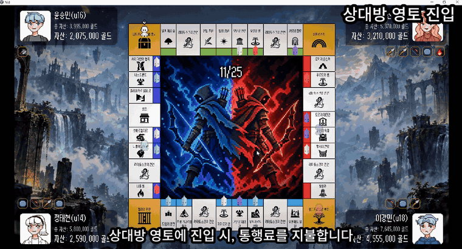 | 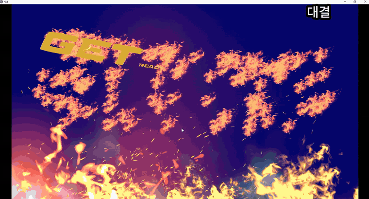 |

#### 핵심 기능: 결투의 서버 흐름

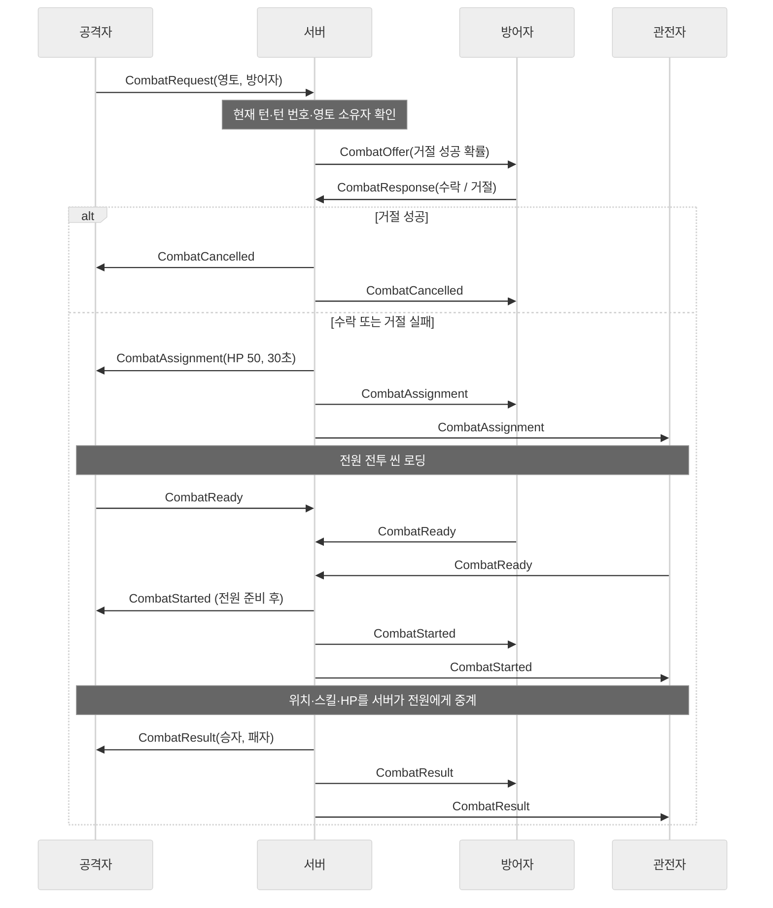

| 단계 | 서버 처리 |
|---|---|
| 신청 | 확인 조건: 진행 중인 결투 없음 · 신청자가 현재 턴 · 턴 번호 일치 · 대상이 영토 소유자. 하나라도 틀리면 신청자에게만 취소 전송 |
| 수락·거절 | 방어자에게만 제안. 거절이면 서버가 확률로 성공 여부 판정 |
| 시작 | 관전자 포함 **전원의 전투 씬 로딩 보고** 후 시작 (3.1과 같은 방식) |
| 진행 | 위치·스킬: 결투 당사자가 보낸 것만 전원에게 중계 / HP: 각자 자신의 남은 HP를 보고 |
| 종료 | HP 0 보고 · 서버 제한 시간 초과 · 당사자 접속 종료 중 먼저 일어난 것으로 판정 |

```csharp
// Room.Combat.cs — 거절 판정: 성공할 때마다 그 방어자의 다음 거절 확률이 절반
double rejectionChance = activeCombat.RejectionChance;          // 처음 0.5
bool rejectSucceeded = !message.Accepted && Random.Shared.NextDouble() < rejectionChance;

if (rejectSucceeded) combatRejectionChances[defenderId] = rejectionChance / 2;
else                 combatRejectionChances.Remove(defenderId); // 수락하거나 거절에 실패하면 초기화

// Room.Combat.cs — HP 보고: 늘어나는 값은 받지 않음
if (message.RemainingHp < 0 || message.RemainingHp > previousHp) return;
```

#### 결투 결과 규칙

| 상황 | 결과 |
|---|---|
| 공격자 승리 | 공격자가 영토(건물 포함)의 소유권을 넘겨받음 |
| 방어자 승리 | 공격자가 통행료를 한 번 더 냄 |
| 승리 보상 (공통) | 이긴 쪽이 누구든 **영토 가치만큼 골드**를 받음 |
| 시간 종료 | 남은 HP가 많은 쪽 승리. **같으면 공격자 패배** |
| 결투 중 접속 종료 | 나간 사람 패배 |
| 공통 | 두 플레이어 모두 보유 장비 내구도 1 감소 |

- **동점이면 공격자 패배:** 코인 토스 같은 별도 판정을 두기보다, "자신 있어서 결투를 걸었는데 이기지 못했다면 진 것"으로 보았습니다. 기획서의 "동률이면 점령자 승리"와도 같은 규칙입니다.
- **방어자 승리 시 통행료 재지급:** 공격자는 이기면 상대 영토를 빼앗는 큰 이득을 얻으므로, 졌을 때의 손해도 커야 한다고 판단했습니다.
- **승리 보상 골드:** 공격·방어와 관계없이 승리 자체에 주는 보상입니다. 기획서의 '승리자 드랍 보상'을 대신합니다.
- **서버 제한 시간 34초:** 클라이언트 전투 시간은 30초지만, 서버는 시작 신호 후 34초에 판정합니다. 전투 시작 연출이 나중에 추가되면서 생긴 문제를 시연 직전에 임시로 보정한 값입니다(5.4).

#### 고민과 선택: 방어자의 거절을 어떻게 다룰 것인가

> **결정 대상:** 결투 신청을 받은 방어자에게 어떤 선택권을 줄 것인가?

| | [A] 기획서: 기권하면 패배 | [B] 확률로 거절, 성공할수록 확률 감소 |
|---|---|---|
| 방식 | 방어자는 싸우거나, 기권해 영토를 넘김 | 거절을 고르면 50% 확률로 결투 취소. 성공할 때마다 그 방어자의 확률이 절반, 수락하거나 실패하면 다시 50% |
| 장점 | 규칙이 단순. 공격자가 원하면 반드시 승부가 남 | 방어자에게도 선택의 여지가 있음. 연속 거절은 점점 어려워짐 |
| 단점 | 방어자는 사실상 선택권이 없음 | 결과에 운이 개입. 거절에 성공하면 공격자는 통행료만 내고 끝남 |

**[최종 결정]** [B]를 선택했습니다. 팀 회의에서 기획서 방식은 **방어자의 의사가 묵살되는 느낌이라 너무 가혹하다**는 의견이 나와, 방어자에게 거절할 기회를 주기로 했습니다. 규칙은 두 단계를 거쳐 정해졌습니다.

1. **50:50 거절:** 처음에는 거절하면 코인 토스로 성공 여부를 정하려 했지만, 코인 연출까지 만들 여유가 없어 확률 판정만 남겼습니다(서버에서 `Random.Shared.Next(2)`).
2. **성공할수록 절반:** 테스트해 보니 **거절이 너무 쉬워** 결투가 잘 성립하지 않았습니다. 그래서 거절에 성공할 때마다 그 방어자의 확률을 절반으로 줄이고, 현재 확률을 결투 신청 화면에 표시했습니다(09-09).

**[얻은 것]** 방어자도 결투 신청을 받는 순간 "받을지, 운에 걸고 거절할지"를 고르게 됐습니다. 확률은 서버가 방어자별로 기억하므로, 클라이언트는 받은 확률을 화면에 보여 주기만 합니다.

**[감수한 대가]** 결투 성립 여부에 운이 끼어듭니다. 거절에 성공하면 공격자는 통행료만 낸 채 턴이 끝납니다.

---

## 4. 협업

### 4.1 파트 간 연결 지점

각 파트는 서로의 내부 구현을 몰라도 되도록, **이벤트 하나, 또는 결과를 돌려주는 비동기 함수 하나**로만 연결했습니다.

| 연결 | 보드 쪽 (나) | 상대 파트 | 방식 |
|---|---|---|---|
| 영토 구매 팝업 | `TerritoryManager.OnPurchaseRequested` 이벤트 발행 → `await` | UI가 팝업을 띄우고 `SubmitPurchase(땅, 건물, 랜드마크)` 호출 | 이벤트 + 결과 대기 |
| 상점 | `ShopManager.OpenAsync()` | `ShopUIController.OpenShopAsync()`가 창이 닫힐 때 끝남 | 비동기 함수 |
| 보물 획득 연출 | `TreasureManager.PresentAsync(장비)` | 보물 팝업이 씬 시작 시 `SetPresenter()`로 자신을 등록 | 등록된 표시 객체 호출 |
| 결투 | `CombatSystem.StartCombat()` → `CombatOutcome` 반환 | 전투 씬에서 승패 결정 | 비동기 함수 + 결과 값 |
| 장비 보유 정보 | 장비가 바뀌면 서버로 전송 → 모든 프로필에 아이콘 표시 | `InventoryManager`가 장비 추가·삭제 | 서버 동기화 |

예를 들어 영토 구매는 다음과 같이 이어집니다. 보드 쪽은 "구매 결정을 기다린다"는 것만 알고, 팝업이 어떻게 생겼는지는 모릅니다.

```csharp
// TerritoryManager.cs — 구매 결정을 UI에 맡기고 결과만 기다림
purchaseWaiter = new UniTaskCompletionSource<TerritoryBill>();
OnPurchaseRequested?.Invoke(tile, currentGold);     // UI가 구독해 팝업 표시
TerritoryBill bill = await purchaseWaiter.Task;     // UI가 SubmitPurchase()를 부르면 재개

public void SubmitPurchase(bool isBuyTile, bool isBuyBuilding, bool isBuyLandMark)
    => purchaseWaiter?.TrySetResult(new TerritoryBill(isBuyTile, isBuyBuilding, isBuyLandMark));
```

### 4.2 로컬 전투를 온라인으로 연결하기

전투는 로컬에서 먼저 완성하고, 네트워크 연결은 서버를 맡은 제가 이어받는 순서로 진행했습니다. 그래서 전투 코드는 한 화면에서 두 캐릭터가 싸우는 로컬 방식으로 만들어져 있었고, 저는 이 코드를 읽고 네트워크로 바꿔야 할 지점을 정리한 뒤 **두 플레이어가 각자의 화면에서 싸우는 온라인 전투**로 연결했습니다.

| 영역 | 로컬 전투 (연결 전) | 온라인 전투 (연결 후) |
|---|---|---|
| 결투 시작 | 바로 전투 시작 | 서버의 신청·수락·전원 로딩 확인 후 시작 (3.7) |
| 스킬 사용 | 바로 실행 | 서버로 보내고, 서버가 전원에게 보낸 것을 모두가 실행. 같은 스킬이 두 번 실행되지 않도록 `CastId`로 중복 확인 |
| 이동 | 두 캐릭터를 한 화면에서 처리 | 내 캐릭터만 조작하고 가로 위치만 서버로 보냄 |
| 피격 · HP | 맞은 판정과 결과를 한 화면에서 계산 | **각 클라이언트는 자기 캐릭터가 맞은 것만 판정**하고, 남은 HP를 서버에 보고 |
| 승패 | 클라이언트가 결정 | **서버가** HP 0 보고·시간 초과·접속 종료로 결정 |
| 씬 구성 | 전투 씬에 오브젝트를 직접 배치 | 보드 씬 위에 전투 씬을 추가로 불러오고, `CombatSceneSetup`이 캐릭터·UI를 구성. 전투 씬만 단독 실행하면 테스트 모드로 동작 |

#### 고민과 선택: 피격과 HP를 누가 계산할 것인가

> **결정 대상:** 맞았는지 판정하고 남은 HP를 계산하는 일을 어느 클라이언트가 맡을 것인가?

| | [A] 때린 쪽이 알리고, 모든 클라이언트가 계산 | [B] 맞은 쪽이 계산해 남은 HP를 서버에 보고 |
|---|---|---|
| 흐름 | 때린 쪽이 피격을 알림 → 서버가 피해량을 전원에게 전달 → 각 클라이언트가 HP 계산 → 캐릭터·UI에 반영 → 누군가 승패를 판정해 서버에 다시 보고 | 맞은 쪽이 HP를 계산해 서버에 보고 → 서버가 그 값으로 승패 판정 → 끝났으면 결과를, 아니면 HP 값만 전원에게 전달 → 받은 값을 그대로 표시 |
| 장점 | 때린 사람 화면 기준으로 판정이 바로 보임 | 단계가 짧음. HP의 기준값이 서버에 하나만 있음. 회피 무적처럼 **맞은 쪽만 정확히 아는 상태**로 판정 |
| 단점 | 모든 클라이언트가 같은 HP를 계산해야 하고, 승패를 정하는 주체가 따로 필요해 흐름이 김 | 맞은 쪽 클라이언트를 믿어야 함 (서버는 HP가 늘어나는 보고만 막음) |

**[최종 결정]** [B]를 선택했습니다. 상대 HP를 모든 화면에 표시해야 하므로 어차피 HP 값은 서버를 거쳐야 했습니다. [A]처럼 피해량을 받아 클라이언트마다 계산하면 계산 → 반영 → 승패 판정 → 재보고로 흐름이 길어지는데, 맞은 쪽이 HP를 바로 보고하면 **서버가 그 값으로 승패를 정하고 나머지에는 HP만 전달**하면 됩니다.

**[얻은 것]** 승패 판정이 서버 한 곳으로 모였고, 클라이언트는 받은 HP를 표시하기만 합니다. 결과적으로 회피 중 무적 상태도 위치 동기화 없이 맞은 쪽 화면에서 정확하게 판정됩니다(서버로는 가로 위치만 보내고, 무적 여부는 보내지 않습니다).

**[감수한 대가]** 맞은 쪽 클라이언트가 HP를 조작하면 막을 수 없습니다. 2.5와 같은 판단으로, 시연 환경에서는 받아들일 수 있는 위험으로 보았습니다. 또 네트워크 지연이 있으면 때린 쪽 화면에서는 맞은 것처럼 보여도 실제로는 빗나갈 수 있습니다.

### 4.3 고민과 선택: 장비 스킬을 무엇으로 정의할 것인가

> **결정 대상:** 개발 막바지에 남은 장비 스킬을, **남은 기간 안에 완성하고 바로 조정할 수 있는 방식**으로 어떻게 만들 것인가?

장비 스킬은 전투의 기본 동작이 갖춰진 뒤 개발 막바지에 작업하게 됐고, 처음 택한 방식은 직선·포물선·범위 궤적을 코드로 계산하는 것이었습니다. 이 방식은 궤적마다 계산과 판정 시점을 맞추고 디버깅해야 해서, 남은 기간 안에 여러 장비를 완성하기에는 작업량이 컸습니다. 그래서 저는 전투 담당에게 애니메이션 클립으로 궤적을 그리고 프레임에 맞춰 히트박스를 켜는 방식을 제안해 직접 시연해 보였고, 함께 검토한 끝에 이 방식으로 바꿔 구현했습니다.

| | [A] 코드 + 데이터로 궤적 계산 | [B] 애니메이션 클립으로 궤적을 만들고, 프레임에 맞춰 판정 |
|---|---|---|
| 방식 | TSV의 사거리·속도·범위 값으로 코드가 직선·포물선·범위 공격을 계산 | 투사체 프리팹의 애니메이션 클립이 이동 경로를 그리고, 특정 프레임에서 히트박스를 켜고 끔 |
| 장점 | 장비를 TSV 한 줄로 추가·조정 가능 | 눈으로 보며 궤적을 만들 수 있어 코드 부담이 적음. 남은 기간 안에 완성 가능 |
| 단점 | 궤적 계산 코드를 직접 작성·디버깅해야 함 | 장비마다 클립 제작 필요. TSV 값과 실제 동작이 분리됨 |

**[최종 결정]** [B]를 선택했습니다. 보드 쪽에서는 데이터로 확장하는 구조를 지켰지만, 이 부분은 **확장성보다 마감 안에 완성하는 것**을 우선했습니다. 애니메이션 방식은 궤적을 눈으로 보며 바로 고칠 수 있어, 남은 기간 안에 여러 장비를 만들고 조정하기에 유리했습니다. 저는 방식 제안과 시연을, 구현은 전투 담당이 맡았습니다.

**[얻은 것]** 장비 스킬이 시연 전에 들어갔고, 야차는 시연에서 좋은 반응을 얻었습니다.

**[감수한 대가]** 피해량과 프리팹 경로는 TSV에서 읽지만, **사거리·속도·범위는 애니메이션 클립이 정하고 TSV 값은 장비 설명 문구에만 쓰입니다.** 그래서 장비를 TSV만으로 늘릴 수 없었고, 설명에 적힌 수치와 실제 동작이 어긋날 수 있습니다. 플레이해 보니 야차가 예상보다 훨씬 재미있어서 시연 전에 장비 종류를 늘리고 싶었지만, 장비 하나를 추가하려면 TSV 한 줄이 아니라 **투사체 프리팹과 애니메이션 클립을 새로 만들어야** 해서 남은 기간에는 할 수 없었습니다. 이 점이 가장 아쉬웠습니다(6.3).

### 4.4 UI 범위 결정

UI를 화면 배치와 동작 코드로 나눠 작업했는데, **동작 코드를 누가 연결할지 미리 정하지 않아** 화면만 있고 동작하지 않는 상태가 생기곤 했습니다. 그때마다 기능 쪽에서 연결 코드를 작성해야 했기 때문에, 일정이 빠듯한 상황에서 UI 하나를 추가하는 비용이 생각보다 컸습니다.

그래서 후반에는 **새 UI가 필요한 기능을 늘리지 않는 쪽으로 규칙을 설계**했습니다. 기획서의 선택형 급매 대신 자동 매각을 택한 것(3.5)이 대표적입니다.

---

## 5. 트러블슈팅

5.1과 5.4는 원인이 같은 종류의 문제입니다. 둘 다 **"다음으로 넘어가도 되는가"를 판단하는 기준이 서버와 클라이언트에서 달랐기** 때문에 생겼습니다.

### 5.1 클라이언트마다 턴 진행이 어긋난 문제

| 단계 | 내용 |
|---|---|
| 증상 | 한 플레이어가 아직 상점 창을 열고 행동 중인데, 다른 클라이언트에서는 턴이 먼저 넘어감 |
| 원인 | 서버가 **현재 턴 클라이언트의 종료 보고 하나**만 받고 다음 턴을 시작함. 다른 클라이언트의 연출·행동이 끝났는지는 확인하지 않음 |
| 해결 | 턴 종료를 **전원 보고 방식**으로 변경 (모든 클라이언트가 보고해야 다음 턴). 이후 같은 문제가 생길 수 있는 칸 효과·황금카드 연출·지정 이동에도 같은 방식 적용 (3.1) |
| 배운 점 | 멀티플레이에서는 "내 화면에서 끝났다"와 "모두의 화면에서 끝났다"가 다릅니다. 진행을 넘기는 지점마다 **누구의 완료를 기준으로 삼을지** 먼저 정해야 합니다 |

### 5.2 로컬 플레이어와 원격 플레이어를 나눴다가 통합한 일

| 단계 | 내용 |
|---|---|
| 상황 | 서버를 처음 다루면서 플레이어를 **내가 조작하는 `LocalPlayer`**와 **다른 사람의 `RemotePlayer`** 두 클래스로 나눔. 그런데 두 클래스의 이동 코드(`MoveNext`, `MoveTo`)가 거의 같았음 |
| 원인 | 이 게임은 **자기 턴에만 행동**합니다. 입력은 내 클라이언트에서만 받고, 다른 플레이어의 말은 서버 메시지대로 움직이기만 하면 되므로 원격 플레이어라는 별도 개념이 필요 없었음. 서버 구조를 처음 접해 클라이언트를 어떻게 나눠야 할지 판단이 서지 않았던 것이 원인 |
| 해결 | 두 클래스를 `Player` 하나로 통합(09-04). 입력은 `TurnManager`가 내 턴일 때만 받고, 모든 말은 같은 `Player` 코드로 움직임. 중복 클래스 1개(약 70줄) 삭제 |
| 배운 점 | 네트워크 구조를 정할 때는 기술적 구분(로컬/원격)보다 **게임 규칙상 누가 언제 입력하는지**를 먼저 따져야 합니다 |

### 5.3 폴더 정리 후 병합이 꼬인 문제

| 단계 | 내용 |
|---|---|
| 증상 | 팀원 브랜치를 main에 병합할 때 충돌이 대량으로 발생 |
| 원인 | ① 스프라이트 같은 에셋이 `Assets` 바로 아래에 흩어져 있어, 제가 **팀에 알리지 않고** 폴더 구조를 정리함 ② 팀에 **main 병합 주기가 정해져 있지 않아**, 작업 브랜치와 main의 차이가 크게 쌓여 있었음. 두 가지가 겹쳐 파일 이동과 수정이 한꺼번에 충돌함 |
| 해결 | 강사 피드백에 따라 **각자 작업 브랜치에 main을 주기적으로 병합**해 최신 상태를 유지하는 방식으로 바꿈 |
| 배운 점 | 파일 위치를 바꾸는 작업은 혼자 정할 일이 아니라 팀에 먼저 알려야 했습니다. 또 폴더 구조 같은 공용 규칙은 **프로젝트를 시작할 때 팀이 함께 정해야** 합니다. main 주기 병합은 이후 작업에서도 계속 쓰는 습관이 됐습니다 |

### 5.4 결투가 화면 타이머보다 일찍 끝난 문제

| 단계 | 내용 |
|---|---|
| 증상 | 결투 화면의 남은 시간이 아직 남았는데, 결투가 시간 초과로 강제 종료됨. 시연 직전에 발견 |
| 원인 | 처음에는 시작 신호를 받으면 바로 전투가 시작됐는데, 시연 직전에 전투 시작 연출이 추가됨. 이때 **서버 타이머를 연출 시간에 맞게 바꾸지 못함.** 서버는 시작 신호를 보낸 순간부터 시간을 재고, 클라이언트는 연출이 끝난 뒤에 30초 타이머를 시작하므로, 서버가 연출 시간만큼 먼저 끝남 |
| 해결 | 코드를 고칠 시간이 없어, 연출 시간을 대략 계산해 서버 제한 시간을 **30초 → 34초**로 늘림 |
| 배운 점 | 서버와 클라이언트가 시간을 재기 시작하는 **기준 시점을 하나로** 맞춰야 합니다. 숫자로 보정했기 때문에 연출 길이가 바뀌면 다시 어긋나며, 이 부분은 기술 부채로 남았습니다(6.3) |

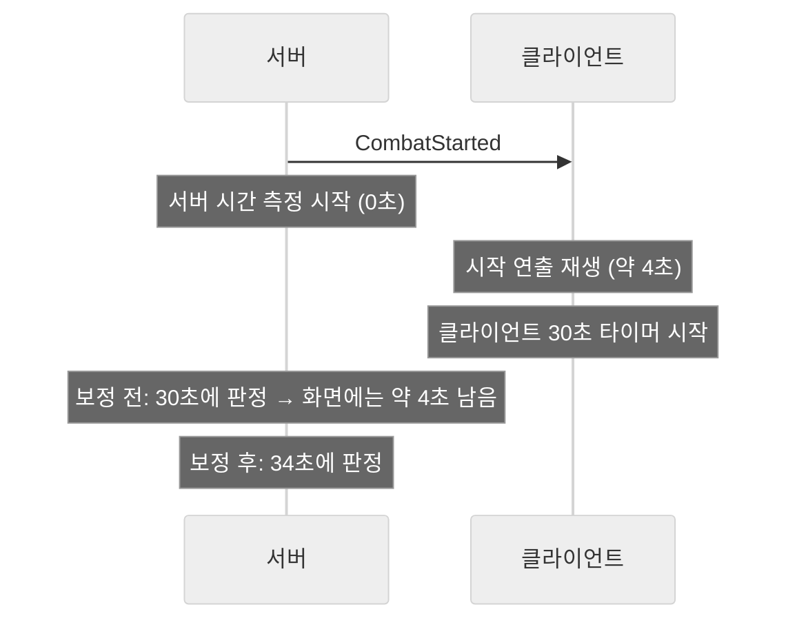

---

## 6. 결과와 회고

### 6.1 결과

| 목표 (1.2) | 결과 |
|---|---|
| 모든 화면이 같은 진행을 보는 보드 규칙 | 보드 로딩·턴 종료·칸 효과·황금카드·지정 이동 5곳에 전원 보고 방식을 적용해, 2~4인 온라인 플레이를 시연까지 진행 |
| 기획이 바뀌어도 코드를 고치지 않는 구조 | 황금카드 11장 → 20장 추가와 카드 골드 값·장비 가격·월급·감옥 턴 수 조정을 **코드 수정 없이 TSV·JSON만 고쳐** 처리. 카드 9장을 추가한 커밋은 `gold_cards.tsv` 한 파일만 변경 |

- **외부 평가:** 반 내 투표에서 **완성도 부문 1위**를 받았습니다. 시연에서는 야차가 특히 좋은 반응을 얻었습니다.
- **플레이 시간:** 33라운드 기준 약 50분 ~ 1시간. 시연에서는 시간에 맞춰 25라운드로 진행했습니다.

### 6.2 플레이테스트 기반 조정

| 항목 | 변경 전 → 후 | 이유 |
|---|---|---|
| 보드 칸 수 | 40칸(기획) → 36칸 | 40칸은 화면에 다 담기지 않거나 칸이 너무 작아짐. 빌더로 직접 배치해 확인 (3.6) |
| 감옥 | 1턴(기획) → 3턴 → 2턴 | 1턴은 패널티가 너무 약하고, 3턴은 너무 큼 |
| 황금카드 골드 | +500 → +300,000 등 | 초기 자금(5,000,000)에 맞춰 단위를 조정 (3.4) |
| 무작위 대상 카드 | 1명 ~ 전원 → 1명 ~ (전체 - 1)명 | "다 같이 걸리면 '모두' 카드와 뭐가 다르냐"는 의견 (3.4) |
| 급매가 | 50%(기획) → 80% | 50%는 급매 한 번에 너무 많이 잃어 회복하기 어려움 (3.5) |
| 결투 거절 | 기권 = 패배(기획) → 50:50 → 성공할 때마다 절반 | 기권하면 바로 지는 규칙은 방어자에게 너무 가혹하다는 회의 의견으로 50:50 거절을 도입. 테스트해 보니 거절이 너무 쉬워, 성공할 때마다 확률을 줄임 (3.7) |
| 최대 라운드 | 33 → 20 → 25 | 시연 시간이 팀당 1시간에서 30분으로 줄어 20으로 테스트했으나 너무 짧다는 팀 의견으로 25로 재조정 |

### 6.3 아쉬운 점과 개선 계획

| 문제 | 원인 · 당시 판단 | 개선 계획 |
|---|---|---|
| 골드·영토 변경 요청을 서버가 검증하지 않음 | 계산을 클라이언트에 맡기는 구조(2.5)를 택하면서, 주사위·이동에는 있는 턴 번호·요청자 확인을 이 요청들에는 넣지 못함 | 주사위·이동 요청처럼 `TurnId`와 현재 턴 플레이어를 확인하고, 맞지 않는 요청은 버림 |
| 결투 시간을 숫자로 보정 (34초) | 시연 직전에 발견해 코드로 고칠 시간이 없었음 (5.4) | 클라이언트가 시작 연출을 마친 뒤 준비 완료를 보고하고, 서버는 전원 보고 후부터 시간을 잼 (3.1과 같은 방식) |
| 장비를 데이터로 늘릴 수 없음 | 마감 안에 완성하기 위해 애니메이션 클립 방식을 선택 (4.3) | TSV의 사거리·속도·범위 값으로 궤적을 만드는 공용 투사체를 두고, 장비별로는 그림만 바꾸도록 전환 |
| 기획 기능 일부 미구현 (보드 턴 제한 시간, 재접속, 영토 전투 보너스, 총자산 동률 판정) | 핵심 규칙을 하나라도 더 완성하는 쪽을 우선함. 턴 제한은 상점·구매 팝업·연출처럼 **시간이 멈춰야 하는 구간**을 하나하나 설계해야 했고, 재접속은 일정상 제외 | 턴 제한은 이미 있는 플레이어 활동 상태(상점·구매·결투 중)를 기준으로 시간을 멈추는 방식부터 적용 |

### 6.4 배운 점

- **소통과 공용 규칙은 시작할 때 정해야 합니다.** 폴더 구조, UI 동작 코드를 누가 연결할지 같은 것을 미리 정하지 않아 병합이 꼬이고(5.3) 같은 일을 두 번 하는 경우가 생겼습니다. 팀에서 가장 부족했던 부분입니다.
- **설계는 정답이 아니라 프로젝트의 규모와 조건에 맞춰야 합니다.** 서버를 설계할 때 "실제 서비스처럼 서버가 모든 값을 검증해야 한다"는 생각에 막혀 있다가, 기간·경험·사용 환경을 따져 결과가 갈리면 안 되는 것만 서버가 정하도록 단순하게 바꾸자 3주 안에 보드 규칙 전체를 완성할 수 있었습니다(2.5). 장비 스킬을 데이터 대신 애니메이션으로 만든 것(4.3)도 같은 판단이었습니다.
- **멀티플레이에서는 "다음으로 넘어가는 기준"을 하나로 맞춰야 합니다.** 턴 진행(5.1)과 결투 시간(5.4) 문제는 모두 서버와 클라이언트가 서로 다른 기준으로 진행을 판단해서 생겼습니다.
